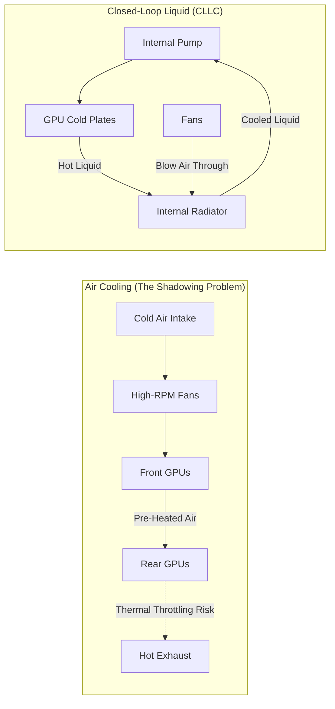

# Chapter 5 — Power, Cooling, and Rack Integration

| Chapter metadata | Value |
|---|---|
| Volume | 06 — HGX Platforms & OEM Integration |
| Difficulty | Expert |
| Estimated reading time | 35 minutes |
| Primary audience | DevOps, SRE, Platform, Cloud and Infrastructure Engineers |
| Core question | Why does an OEM HGX server require 6 massive power supplies, and how do they prevent the back row of GPUs from melting? |

## Introduction

In Volume 5, we discussed the facility-level power and cooling limits of the data center. In this chapter, we zoom in on how OEMs actually handle those limits inside the metal box of the server.

Building a chassis for an HGX baseboard is one of the hardest mechanical engineering challenges in the IT industry. You are placing several kilowatts of silicon (eight 700 W GPUs alone are 5.6 kW) inside a metal box of a few rack units. 

If an OEM gets the airflow wrong by a fraction of an inch, the rear GPUs will overheat and thermal-throttle. If they get the power delivery wrong, the load steps from 8 GPUs jumping from idle to full utilization can trip power supply protection and crash the server. 

## 1. Power Delivery: The 54-Volt Transition

Enterprise servers have traditionally distributed 12-Volt internal power. High-power GPU servers push toward higher-voltage DC distribution, because current is $I = P / V$: 10 kW at 12 Volts would be about 833 Amps, while the same power at 48-54 Volts is roughly 185-210 Amps. Resistive loss scales with the square of current, so the higher-voltage bus is much easier to engineer. The exact HGX baseboard input voltage is defined in NVIDIA's HGX design collateral for OEMs; treat the 54 V figures below as the general pattern, not a specification.

### The OEM 54V Power Architecture
To integrate an HGX tray, OEMs completely redesign the server's power distribution.
1.  **Massive PSUs:** HGX servers from the major OEMs typically contain several multi-kilowatt Power Supply Units (PSUs) in a redundant configuration (the count and rating vary by model; check the OEM spec sheet). 
2.  **54V Conversion:** These PSUs convert facility AC input to a high-voltage DC bus (commonly described as 48-54 V class). 
3.  **The Busbar:** At these currents, power is typically carried on thick copper busbars or heavy-gauge connectors rather than ordinary cables, to minimize resistance.
4.  **Point of Load (PoL):** Tiny voltage regulators sitting millimeters away from the GPU silicon step the bus voltage down to the roughly 1 V required by the chips. 

## 2. Air Cooling: The Shadowing Problem

If you open an air-cooled OEM HGX server, you will see a massive wall of extremely violent, dual-rotor fans. These fans are loud and can consume a meaningful share of server power.

They push cold air from the front of the server to the back. 

### Airflow Shadowing

*("Airflow shadowing" is an informal term used here, not an NVIDIA specification term.)*

The GPUs on an HGX tray are arranged in rows. The front row of GPUs receives perfectly cold air. However, as the air passes through the massive heatsinks of the front GPUs, it absorbs heat. 
By the time the air reaches the back row of GPUs, it is noticeably warmer than the inlet air. 

If the OEM does not design the internal air baffles perfectly to route fresh air over the rear GPUs, they will suffer from **Airflow Shadowing**. The rear GPUs will run hotter than the front GPUs. 

**The Infrastructure Impact:** In distributed training, the cluster is only as fast as its slowest GPU. If the rear GPUs thermal-throttle and drop their clock speeds, synchronous training steps are paced by the slowest GPU, so the whole job slows with them.

## 3. Direct Liquid Cooling (DLC) at the Edge

Because Airflow Shadowing is so difficult to solve, and because the Blackwell (B200) generation pushes power toward 1,000 W per GPU, OEMs are transitioning to liquid.

### Closed-Loop Liquid Cooling (CLLC)
Some enterprises do not have chilled water pipes in their data center to support full facility liquid cooling. 
Some designs use **closed-loop liquid cooling**. 
*   The OEM bolts cold plates to the GPUs.
*   They run liquid tubes to a massive radiator built inside the server chassis itself. 
*   The violent fans blow air through the internal radiator. 
*   It is completely self-contained. It requires no facility water, but it prevents the GPUs from thermal throttling. 

## Architectural Diagram: The OEM Cooling Challenge

## Customer Scenario (Senior Level)

**The Situation:**
A cloud provider buys 100 air-cooled OEM HGX H100 servers. They install them in their legacy data center. During a benchmark test, `nvidia-smi` reports that GPUs 4, 5, 6, and 7 on every single node are dropping their clock speeds well below the expected boost clock (illustrative scenario). The data center manager checks the room temperature and says, "The room is freezing cold (18°C / 64°F), so it's not a cooling issue. The NVIDIA drivers must be bugged."

**The Senior Architect Response:**
"The NVIDIA drivers are functioning perfectly; they are protecting the silicon from melting. You are experiencing classic **Airflow Shadowing**.

The room temperature is irrelevant if the cold air cannot physically reach the silicon. In this scenario, GPUs 4 through 7 happen to sit downstream of GPUs 0 through 3 in the airflow path (the layout varies by OEM chassis). Even though the air entering the front of the server is 18°C, it must pass through the massive 700-Watt heatsinks of GPUs 0 through 3. By the time that air reaches the rear GPUs, it has absorbed massive amounts of thermal energy. 

The rear GPUs are suffocating on pre-heated air, reaching their thermal limit, and automatically reducing clocks (thermal slowdown reported in `nvidia-smi -q -d PERFORMANCE`). 

To fix this, first confirm with `nvidia-smi -q -d TEMPERATURE,PERFORMANCE` and BMC fan and inlet sensors, then check rack airflow hygiene (blanking panels, recirculation, inlet temperature at the server) and the OEM's validated operating envelope. If the chassis cannot meet the envelope, move to a liquid-cooled variant."

## Interview Preparation

**Conceptual:** Why do modern HGX baseboards require 54-Volt power delivery instead of standard 12-Volt power? *(Hint: Delivering multiple kilowatts at 12V requires very high current (Amperage), which would melt standard copper wiring and create immense heat. a higher-voltage bus (48-54 V class) cuts the amperage roughly 4x for the same power).*

**Architecture:** What is "Airflow Shadowing" in a high-density GPU server? *(Hint: When the front row of GPUs pre-heats the air, causing the rear row of GPUs to suffocate on hot exhaust air, leading to thermal throttling on the rear components).*
