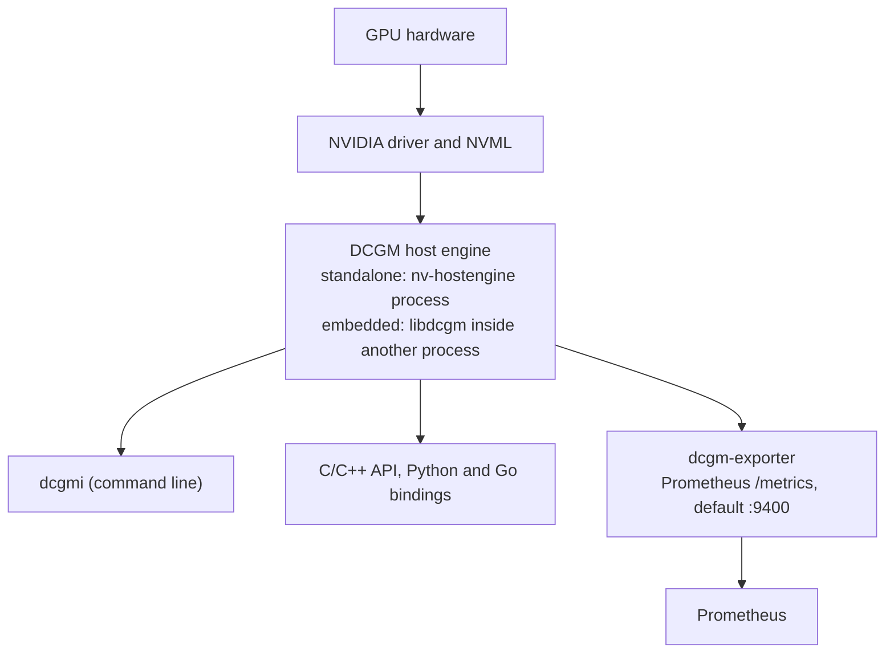
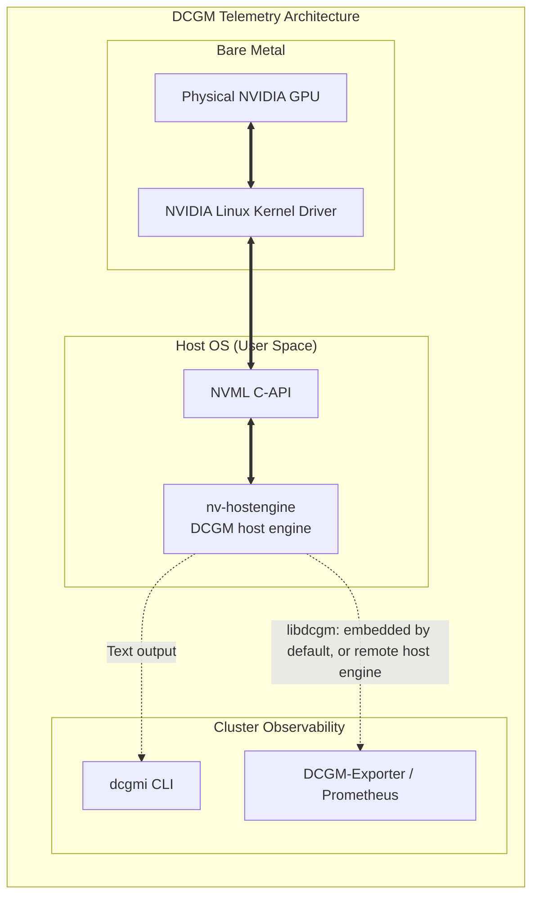

# Chapter 04 — DCGM: The GPU Metrics Foundation

DCGM (NVIDIA Data Center GPU Manager) is the single most important tool for GPU observability. It is the bridge between GPU hardware state and your monitoring stack. Understanding DCGM is understanding what metrics are available, what they mean, how to collect them reliably, and how to export them for dashboards and alerting.

| Chapter metadata | Value |
|---|---|
| Volume | 16 — GPU Observability and Operational Health |
| Difficulty | Intermediate–Advanced |
| Estimated reading time | 50 minutes |
| Primary audience | DevOps, SRE, Platform Engineers, infrastructure teams |
| Core question | How do you collect GPU metrics reliably at scale, and what can DCGM actually measure? |

## Learning Objectives

You will be able to:
- Install and configure DCGM on GPU nodes
- Run DCGM diagnostics to validate GPU health
- Extract metrics from DCGM programmatically (C/Python/Go bindings, dcgmi, Prometheus exporter)
- Understand which metrics are available for which GPU models
- Set up DCGM monitoring in production with persistence and reliability
- Diagnose DCGM failures and recover GPUs that DCGM can't see

## Beginner's Primer: What is DCGM?

In Chapter 1, we learned that standard Linux tools cannot see inside a GPU. If you log into a server, you can type `nvidia-smi` to see the GPU state. 

But what if you have a cluster of 1,000 servers? You cannot SSH into 1,000 servers every 10 seconds and type `nvidia-smi`. 

You need a programmatic tool that runs quietly in the background on every single server, continuously gathering data from the GPU hardware, and organizing it so it can be shipped off to a central dashboard.
**That tool is DCGM (Data Center GPU Manager).**

DCGM is the unsung hero of the NVIDIA software stack. It is a library and optional daemon that reads GPU state through the NVIDIA driver (NVML). It does three major things:
1. **Telemetry:** It constantly reads the temperature, power, clock speeds, and memory usage.
2. **Health Checks:** It constantly watches for hardware failures, ECC memory errors, and PCIe link issues.
3. **Diagnostics:** You can ask DCGM to run a "stress test" on the GPU to verify the silicon is healthy before handing it to a customer.

Every major enterprise monitoring tool (Prometheus, DataDog, New Relic) gets its GPU data by asking DCGM for it.

## What DCGM Does

DCGM is a library plus an optional daemon. It collects *fields* (temperature, power, ECC counters, link state, profiling metrics) for *entities* (GPUs, MIG instances, NVSwitches, NVLinks, and on current releases NVIDIA CPUs and ConnectX adapters). Clients read those fields, run health checks and diagnostics, and apply policies (DCGM documentation, About).



### Embedded versus standalone

**Embedded.** DCGM runs as a shared library inside another process. The documentation notes that `dcgm-exporter` does exactly this by default: it initializes an embedded host engine inside the exporter process through `libdcgm`.

**Standalone.** A separate host-engine process, `nv-hostengine`, serves command-line and remote clients. Packaged installs run it as the `nvidia-dcgm` systemd service. `dcgm-exporter` can connect to a standalone host engine instead of embedding one (option `--remote-hostengine-info`, whose displayed example value uses port 5555).

Pick one deliberately. Running a standalone host engine *and* an embedded one in the exporter doubles the collection work for the same fields. The exporter documentation says to follow the selected installation guide "instead of assuming that every exporter deployment requires a separately installed DCGM host engine."

### Fields and watches: why DCGM stays cheap

A *field* is a numeric ID with metadata (entity level, scope, value type, and whether it is a gauge, counter, event, or attribute). A *watch* asks the host engine to collect chosen fields for chosen entities at an interval, with retention limits. The host engine collects one stream per entity-field pair, no matter how many clients ask. If two clients want GPU 0 power every 5 s and every 1 s, DCGM collects at 1 s and both read from the shared stream (DCGM docs, Fields and Watches).

Two consequences for operations:

1. **Cadence is a cost knob.** More entity-field pairs, shorter intervals, and longer retention all raise host-engine load. The documentation says to choose a cadence by how quickly an operator can act on the value, not by the fastest number accepted.
2. **A sample has a timestamp.** The timestamp is when DCGM collected the value, not when you read it. A recent sample of a counter can describe a very long history, and a stale sample can stay readable until retention expires. Check the timestamp before trusting a dashboard panel.

The exporter's default collection interval is **30,000 ms (30 s)**, set with `-c`/`--collect-interval` or `DCGM_EXPORTER_INTERVAL` (DCGM docs, dcgm-exporter reference). Short events between scrapes can be missed with the default. The DCGM docs add that Xid and clock-event counts use configurable windows (`--xid-count-window-size`, default 300,000 ms) for that reason.

## Installing and Starting DCGM

### Step 1: Install the DCGM 4 packages

DCGM 4 ships CUDA-major-specific runtime packages. First find the CUDA major version your driver supports, then install the matching package from the NVIDIA repository (DCGM docs, Install DCGM):

```bash
$ nvidia-smi -q | grep -E 'Driver Version|CUDA Version'
$ CUDA_VERSION=12            # the major version shown above

# Ubuntu / Debian
$ sudo apt-get update
$ sudo apt-get install --yes --install-recommends datacenter-gpu-manager-4-cuda${CUDA_VERSION}

# RHEL / Rocky / Fedora
$ sudo dnf install --assumeyes datacenter-gpu-manager-4-cuda${CUDA_VERSION}
```

- The first command prints the CUDA user-mode version your installed driver supports; use that major number.
- The package name carries the CUDA major (`datacenter-gpu-manager-4-cuda12`). It requires `datacenter-gpu-manager-4-core`.
- Older tutorials install a package named `datacenter-gpu-manager` (DCGM 3.x). The install guide tells you to remove it, together with `datacenter-gpu-manager-config`, before installing DCGM 4.
- Requirements from the guide: at least 16 GB host RAM and at least as many CPU cores as GPUs. DCGM is tested with NVIDIA Datacenter Drivers. On NVSwitch systems, Fabric Manager must match the driver major version.

### Step 2: Start the host engine

```bash
$ sudo systemctl enable --now nvidia-dcgm
$ systemctl status nvidia-dcgm --no-pager
$ dcgmi discovery --list
```

- `enable --now` starts the service and makes it start at boot. The service name is `nvidia-dcgm`, not `nv-hostengine`.
- `systemctl status` shows whether the service is running. A process can be "running" before the listener and GPU access are usable, so do not stop there.
- `dcgmi discovery --list` is the real check: it asks the host engine for the GPUs, NVSwitches, ConnectX devices, and CPUs it knows. Inactive GPUs are omitted unless you add `--all`.

The packaged DCGM 4.6 unit runs `/usr/bin/nv-hostengine -n --service-account nvidia-dcgm` (the `-n` flag keeps it in the foreground so systemd tracks the real process).

### Step 3: Sample live fields and run a quick diagnostic

```bash
$ dcgmi dmon --list                         # field IDs, short column names, descriptions
$ dcgmi dmon --field-id 100,101 --count 10  # two fields, every GPU, ten samples
$ dcgmi diag --run 1                        # quick deployment checks (alias: -r short)
```

- `dmon --list` is a metadata catalogue for your `dcgmi` build, not a hardware probe. A listed field can still be unsupported on your GPU.
- `--count 10` stops after ten samples; the default delay is 1,000 ms (`--delay`). Without `--count`, `dmon` runs until interrupted.
- A value of `N/A` can mean not supported, not found, no permission, or not yet sampled. `dmon` does not distinguish them.
- `dcgmi diag --run` accepts levels `1` to `4`, with aliases `quick`/`short`, `medium`, `long`, and `xlong`. Level 1 takes seconds, level 2 about two minutes, level 3 about 15 minutes. Later levels include earlier checks and are more invasive, so schedule them with workload owners.

The diagnostic prints a table. The documentation gives this illustrative shape for a failed test:

```text
Successfully ran diagnostic for group.
+---------------------------+------------------------------------------------+
| Diagnostic                | Result                                         |
+===========================+================================================+
|-----  Metadata  ----------+------------------------------------------------|
| DCGM Version              | <installed-version>                            |
| Driver Version Detected   | <driver-version>                               |
| GPU Device IDs Detected   | <device-id>                                    |
+-----  Hardware  ----------+------------------------------------------------+
| memory                    | Fail                                           |
|                           | GPU0: Fail                                     |
| Warning: GPU0             | <condition-specific error message>             |
+---------------------------+------------------------------------------------+
```

(Source: DCGM documentation, "Results and Logging". Exact categories, tests, statuses, and messages vary by release, hardware, and request.) Use `--json` for automation, but note the documentation says the JSON schema is not stable across releases.

## Core DCGM Metrics

DCGM exposes hundreds of metrics (called "fields"). The most important ones for observability:

> **Field names are changing. Check before you alert.** Current DCGM documentation marks several widely used fields as deprecated in favor of fields with explicit units, for example `DCGM_FI_DEV_GPU_UTIL` (203) → `DCGM_FI_DEV_GPU_UTIL_RATIO`, `DCGM_FI_DEV_FB_USED` / `FB_FREE` / `FB_TOTAL` → `..._BYTES`, `DCGM_FI_DEV_SM_CLOCK` / `MEM_CLOCK` → `..._HERTZ`, `DCGM_FI_DEV_THERMAL_VIOLATION` → `DCGM_FI_DEV_GPU_THERMAL_THROTTLE_SECONDS_TOTAL`, and `DCGM_FI_DEV_POWER_VIOLATION` → `DCGM_FI_DEV_GPU_POWER_THROTTLE_SECONDS_TOTAL` (DCGM Field Identifiers). The exporter keeps "legacy exporter names" in its default collector file and maps them to canonical fields (DCGM Exporter Metrics, "Shipped Default Metrics"). The Prometheus names in this chapter therefore still work, but the *units and semantics* follow the canonical field behind them. Verify unit and range on your exporter version before you write a threshold (for example, whether a utilization series is 0 to 100 or 0 to 1), and prefer the canonical names in new collector files.

### Execution Metrics

| DCGM Field | Query | Typical Range | When to Alert |
|---|---|---|---|
| `DCGM_FI_DEV_GPU_UTIL` | Current GPU utilization | 0-100% | &lt; 10% for 10+ min (when work expected) |
| `DCGM_FI_PROF_SM_OCCUPANCY` | % of streaming multiprocessors with active warps | 0-100% | &lt; 20% (kernel not filled) |
| `DCGM_FI_DEV_CLOCK_THROTTLE_REASONS` | Why clocks are reduced | None / Thermal / Power | Any throttling (performance capped) |
| `DCGM_FI_DEV_POWER_USAGE` | Current instantaneous power | 0-TDP | > 90% of TDP (headroom shrinking) |
| `DCGM_FI_DEV_THERMAL_VIOLATION` | Count of thermal throttle events | 0-∞ | > 0 (GPU was throttled) |

### Memory Metrics

| DCGM Field | Query | Typical Range | When to Alert |
|---|---|---|---|
| `DCGM_FI_DEV_FB_FREE` | Free GPU memory | 0-total | &lt; 2GB (OOM risk) |
| `DCGM_FI_DEV_FB_USED` | Used GPU memory | 0-total | > 95% (pressure) |
| `DCGM_FI_PROF_DRAM_ACTIVE` | % of peak memory bandwidth (DRAM active cycles) | 0-100% | &lt; 20% (under-utilizing) or > 95% (saturated) |
| `DCGM_FI_DEV_POWER_VIOLATION` | Power-throttle-driven clock reduction events | 0-∞ | > 0 (memory/compute subsystem throttled) |

### Reliability Metrics

| DCGM Field | Query | Typical Range | When to Alert |
|---|---|---|---|
| `DCGM_FI_DEV_GPU_TEMP` | GPU die temperature | 30-90°C | > 82°C (near throttle threshold) |
| `DCGM_FI_DEV_ECC_SBE_VOL_TOTAL` | Count of corrected single-bit errors | 0-∞ | Any increase (hardware wearing out?) |
| `DCGM_FI_DEV_ECC_DBE_VOL_TOTAL` | Count of uncorrected double-bit errors | 0-∞ | > 0 (data corruption risk) |
| `DCGM_FI_DEV_XID_ERRORS` | GPU exceptions (Xid code) | 0 | > 0 (GPU fault) |

## Querying DCGM

### Method 1: `dcgmi`

```bash
$ dcgmi discovery --list                    # what DCGM sees
$ dcgmi discovery --info aptc --gpuid 0     # identity, power limits, thermal limits, clocks
$ dcgmi dmon --field-id 100,101 --count 5   # sample fields for all GPUs
$ dcgmi diag --run 2                        # medium validation
```

- `discovery --info` takes letters: `a` device identity and firmware, `p` power limits, `t` thermal limits, `c` supported clocks, `w` workload power profiles. Combine each at most once.
- `dmon` creates connection-scoped watches that end when it exits. Other clients can still keep the same fields watched, so stopping `dmon` does not prove collection stopped.

### Method 2: Language bindings

The C/C++ API, the installed Python bindings, and the separately distributed Go bindings expose the full feature surface and are the right choice for long-running integrations that need structured results and callbacks (DCGM docs, About). The earlier draft of this chapter described a REST API on port 5555. DCGM documentation describes no such API. Port 5555 appears only as the example value for connecting to a remote host engine.

### Method 3: The Prometheus exporter (production default)

`dcgm-exporter` selects DCGM fields from a collector CSV, watches them, adds entity and optional Kubernetes labels, and serves Prometheus text at `/metrics` on `:9400` by default.

For a package-managed host:

```bash
$ sudo apt-get install datacenter-gpu-manager-exporter       # or: sudo dnf install ...
$ sudo systemctl enable --now nvidia-dcgm nvidia-dcgm-exporter
$ curl -s http://localhost:9400/metrics | head -40
```

- The package installs `/usr/bin/dcgm-exporter`, the default collector file `/etc/dcgm-exporter/default-counters.csv`, and the unit `nvidia-dcgm-exporter.service`.
- `curl ... /metrics` is the end-to-end check. If the endpoint answers but has no `DCGM_FI_*` lines, the exporter is up and the field selection or GPU access is wrong.

To change which fields are exported, point the exporter at your own three-column collector CSV:

```bash
$ dcgm-exporter -f /etc/dcgm-exporter/my-counters.csv -c 10000
```

- `-f` (`--collectors`, env `DCGM_EXPORTER_COLLECTORS`) selects the CSV. A file-backed CSV is watched for changes, and `SIGHUP` reloads it.
- `-c 10000` sets the collection interval to 10 s (default 30 s). Shorter intervals raise host-engine load, as covered earlier.
- Other flags and environment variables take effect only after restart. Precedence is command-line flag, then environment variable, then config file, then default.

On Kubernetes, `-k` (`--kubernetes`) maps metrics to pods. In most clusters the GPU Operator deploys and manages the exporter for you ([Volume 10](../volume-10/index.md)).

Illustrative shape of the output (labels vary with version and options):

```text
# HELP DCGM_FI_DEV_GPU_TEMP GPU temperature (in C).
# TYPE DCGM_FI_DEV_GPU_TEMP gauge
DCGM_FI_DEV_GPU_TEMP{gpu="0",UUID="GPU-<uuid>",...} <value>
```

## DCGM in Production: Reliability and Recovery

### Monitor the monitor

If the host engine or exporter stops, you lose GPU visibility without any GPU symptom. Alert on the exporter target being down (the Prometheus `up` metric for the DCGM job) and on the freshness of DCGM samples, not only on GPU values.

```bash
$ systemctl status nvidia-dcgm nvidia-dcgm-exporter --no-pager
$ journalctl --unit=nvidia-dcgm.service --boot
$ sudo systemctl restart nvidia-dcgm
```

- Use the journal to read the packaged service's log. The DCGM documentation advises against starting a second server process just to see console output.
- A restart drops client watches. Clients that reconnect must re-create their watches.

### Logging for problem reports

The documented evidence set for any DCGM problem report is `nvidia-bug-report.log.gz` (from `nvidia-bug-report.sh`), the full output of `dcgmi -v`, and the relevant logs (DCGM docs, Debugging and Troubleshooting).

```bash
# Host-engine debug logging as a systemd drop-in (survives package upgrades)
$ sudo systemctl edit nvidia-dcgm.service
[Service]
Environment="__DCGM_DBG_LVL=DEBUG"
$ sudo systemctl restart nvidia-dcgm

# Diagnostic debug log for one run
$ dcgmi diag -r short --debugLogFile /tmp/nvvs.log -d DEBUG
```

- Edit the service through a drop-in, never the vendor unit. The documentation lists editing the vendor unit as never appropriate, because a package upgrade can overwrite it.
- `__DCGM_DBG_LVL` is the environment fallback for host-engine log level. A `--log-level` option on the command line takes precedence over it.
- `-d DEBUG` and `--debugLogFile` apply to the diagnostic run only.

### GPUs that detach or disappear

From DCGM 4.5 with driver 590, DCGM supports GPU binding and unbinding at runtime and starts even if no GPU is detected. When a GPU detaches, DCGM removes it from groups, drops its watches and cached values, and resets applied configuration, which is not reapplied automatically when it returns. Watches on the built-in all-GPUs group apply to newly attached GPUs automatically. Health checks do not report incidents on detached GPUs, so a missing GPU can look like a quiet one. Pair DCGM with a GPU-count check (for example `dcgmi discovery --list --all`) in your alerting.

## Worked Example: DCGM Does Not List a GPU That `nvidia-smi` Shows

**Scenario.** `nvidia-smi -L` lists four GPUs, but a monitoring job based on DCGM covers only three.

**Step 1: Compare the two views.**

```bash
$ nvidia-smi -L
$ dcgmi discovery --list --all
```

- `--all` includes inactive GPUs. For any included GPU whose status is not `OK`, the output adds a `Status: <state>` line and marks its name and PCI bus ID `(last known)`, meaning the values are cached.
- If the GPU appears here with a non-OK status, DCGM knows it but cannot use it right now. If it is missing entirely, restart the host engine and look again.

**Step 2: Check the service and its journal.**

```bash
$ systemctl status nvidia-dcgm --no-pager
$ journalctl --unit=nvidia-dcgm.service --boot | tail -50
```

**Step 3: Check the kernel side.** If the GPU is genuinely inaccessible, the kernel log carries the Xid evidence:

```bash
$ journalctl -k | grep "NVRM: Xid"
```

An Xid 79 ("GPU has fallen off the bus") means the driver found the GPU inaccessible over PCI Express and is often a PCIe link or hardware problem (NVIDIA Xid Errors catalog). Do not try to fix that from DCGM. Collect `nvidia-bug-report.sh` output and hand it to the hardware owner.

**Step 4: Check privileges.** The packaged service uses the `nvidia-dcgm` service account. If a command works as root but not under the service, the difference is process credentials, not DCGM itself. Compare `systemctl cat nvidia-dcgm.service` with the privileges of the failing process.

**Step 5: Re-verify with a client request.**

```bash
$ sudo systemctl restart nvidia-dcgm
$ dcgmi discovery --list
```

The final client request is the real test. The documentation warns that a process can be reported as running before the expected listener, libraries, or GPU access are usable.

## Architecture Summary

DCGM is the foundational telemetry layer for NVIDIA GPUs. It sits between the low-level hardware driver (NVML) and the high-level cluster monitoring tools (Prometheus). By abstracting the complex hardware interactions into standard metrics streams, it allows Platform Engineers to build reliable dashboards and alerts across thousands of nodes.



## Key Takeaways

1. **DCGM is the sensor layer** — it exposes GPU hardware state in a standardized way.
2. **Always use DCGM Prometheus exporter in production** — it scales and integrates with standard monitoring.
3. **DCGM metrics require interpretation** — high utilization ≠ healthy; must look at memory, clocks, and temperature together.
4. **Monitor DCGM itself** — if the daemon crashes, all GPU visibility is lost.
5. **Test DCGM startup** — verify it starts on boot and all GPUs are visible before shipping to production.

## Cross-References

- Chapter 02: Signals, metrics, logs, traces
- Chapter 03: Core GPU metrics and interpretation
- **Next:** Chapter 05 covers Prometheus and Grafana for storing and visualizing DCGM metrics
