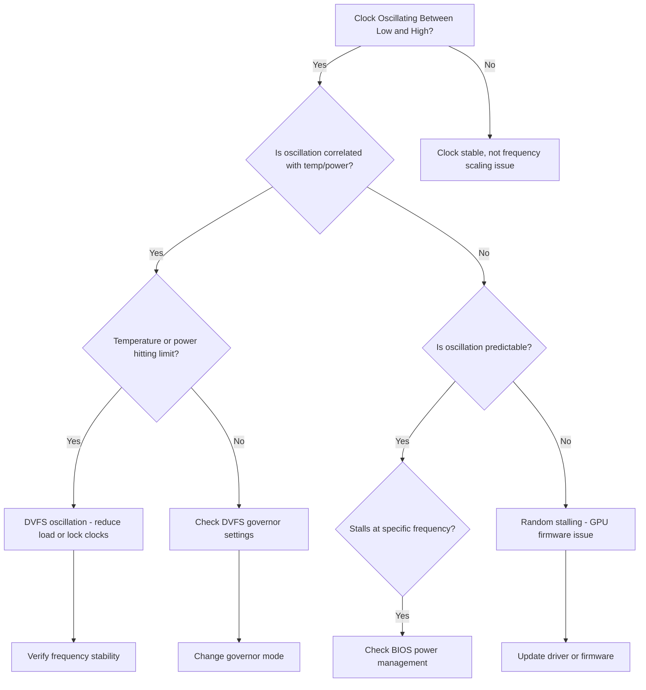
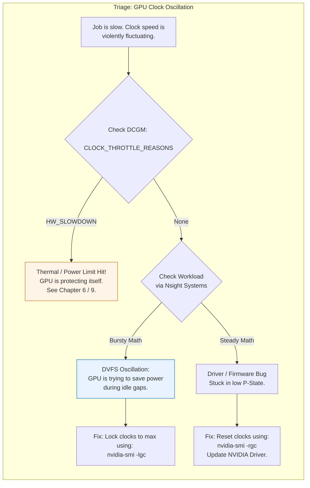

# Clock Instability and Frequency Scaling Problems

> **Note:** Terminal and log output blocks in this chapter are illustrative (not captured from a real system). Clock values and timestamps are examples; supported clocks and P-states differ by GPU model and driver. Data center GPUs manage their own clocks and power states in firmware; there is no BIOS setting that disables GPU DVFS. Operator controls are clock locks (`nvidia-smi -lgc`/`-lmc`, reset with `-rgc`/`-rmc`), power limits, and persistence mode.

## Beginner's Primer: The Confused Engine

In Chapter 6, we learned that a GPU slows down (throttles its clock speed) when it overheats. 
But what if the GPU is perfectly cold, drawing very little power, and it *still* randomly slows down?

This is called **Clock Instability (DVFS Oscillation)**. 
DVFS (Dynamic Voltage and Frequency Scaling) is a feature built into modern GPUs to save electricity. If the GPU thinks it isn't doing any hard work, it downshifts into a lower gear (a lower P-State) to save power. When hard work arrives, it upshifts back to maximum speed.

The problem? AI workloads are bursty. If a PyTorch dataloader is slightly unoptimized, it might feed the GPU a batch of images, pause for 5 milliseconds, and feed it another batch. 
Short idle gaps can let the GPU's power management lower clocks, and ramping back up takes time, which can make throughput uneven. Whether this happens depends on the GPU model, driver, and power policy. SREs must diagnose this using DCGM, and then use `nvidia-smi` to lock the graphics clock (`-lgc`) if a stable clock is required.

## Symptoms

- GPU clock speed fluctuates wildly (1980 MHz → 500 MHz → 1980 MHz) during steady workload
- Performance oscillates 30-40% without code changes
- Frequency stalls at low clock speeds despite low temperature and power headroom
- Specific GPU in cluster exhibits unstable clocks while others are stable

## Evidence

### Key Metrics to Collect

- GPU clock speed over time (Nsight Systems, DCGM)
- Power state from nvidia-smi (P0 vs P8)
- Temperature and power consumption (should be stable if workload is)
- Frequency scaling driver logs
- BIOS power management settings

## Diagnosis

### Diagnosis Flowchart



### First Diagnostic Step: Monitor Clock Frequency Over Time

```bash
$ nvidia-smi -i 0 -q | grep "Current Clocks"

        Current Clocks
            Graphics                       : 1200 MHz
            SM                             : 1200 MHz
            Memory                         : 405 MHz
```

This snapshot shows current clock, but oscillation happens over seconds. Use continuous monitoring:

```bash
$ watch -n 0.5 'nvidia-smi -i 0 --query-gpu=timestamp,clocks.current.graphics --format=csv,noheader'

# Example output showing oscillation:
# 2024-01-15 10:30:00.123, 1980
# 2024-01-15 10:30:00.623, 1980
# 2024-01-15 10:30:01.123, 1200
# 2024-01-15 10:30:01.623, 0800
# 2024-01-15 10:30:02.123, 1980
# 2024-01-15 10:30:02.623, 1980
```

**Pattern:** Frequency drops 1980 → 1200 → 800 MHz then recovers. This is DVFS at work.

### Check Power State (P-States)

```bash
$ nvidia-smi -i 0 -q | grep "Performance State"

Performance State                   : P2
```

Query available power states:

```bash
# P0 is the highest performance state and higher numbers are lower-power states.
# List the clocks your GPU supports:
$ nvidia-smi -q -d SUPPORTED_CLOCKS -i 0 | head -30
```

If P-state changes rapidly (P0 → P3 → P0), DVFS is aggressively rescaling.

### Collect Frequency History with DCGM

```bash
# Sample DCGM clock fields (SM clock and memory clock; look up IDs with `dcgmi dmon -l`)
$ dcgmi dmon -e <DCGM_FI_DEV_SM_CLOCK id>,<DCGM_FI_DEV_MEM_CLOCK id>
# GPU   SMCLK  MEMCLK
     0   1200    405

# Run continuous monitoring
$ for i in {1..60}; do
  freq=$(nvidia-smi -i 0 --query-gpu=clocks.current.graphics --format=csv,noheader)
  temp=$(nvidia-smi -i 0 --query-gpu=temperature.gpu --format=csv,noheader)
  power=$(nvidia-smi -i 0 --query-gpu=power.draw --format=csv,noheader)
  echo "Freq=$freq, Temp=$temp, Power=$power"
  sleep 0.5
done
```

**Output example:**
```
Freq=1980 MHz, Temp=65°C, Power=310W
Freq=1980 MHz, Temp=65°C, Power=310W
Freq=1200 MHz, Temp=65°C, Power=150W
Freq=1200 MHz, Temp=65°C, Power=150W
Freq=1980 MHz, Temp=65°C, Power=310W
```

**Observation:** Frequency drops but temperature and power both drop proportionally → DVFS responding to something, but temperature is NOT the trigger (temp stays 65°C throughout).

### Check DVFS Governor

```bash
# GPU clocks are managed by the driver/firmware; check for operator-set locks and policy
$ nvidia-smi -i 0 -q -d CLOCK,PERFORMANCE | grep -i "clocks\|locked\|reason"
# Host-side CPU frequency governor (affects launch latency, not GPU DVFS)
$ cat /sys/devices/system/cpu/cpu0/cpufreq/scaling_governor
```

Check driver DVFS settings:

```bash
$ nvidia-smi -i 0 --query-gpu=persistence_mode --format=csv,noheader
# With persistence mode off, the driver can unload when no client is attached, which adds
# initialization delay and resets some state; enable it with nvidia-smi -pm 1
```

### Verify Workload Stability

```bash
$ # Run benchmark with fixed load
$ python3 << 'EOF'
import torch
import subprocess
import time

x = torch.ones(4096, 4096, device='cuda')

for i in range(60):
    # Fixed workload - kernel should keep clocks stable
    for _ in range(100):
        y = torch.matmul(x, x)
    
    freq = subprocess.check_output(['nvidia-smi', '-i', '0', '--query-gpu=clocks.current.graphics', '--format=csv,noheader']).decode().strip()
    print(f'Iter {i}: Clock = {freq}')
    time.sleep(0.5)
EOF
```

**Expected:** Clock should stabilize at 1900-1980 MHz within first few iterations, then remain stable for all 60 iterations.

**If unstable:** Clock oscillates throughout 60 iterations despite fixed workload.

## Resolution

### Step 1: Determine If Oscillation Is Necessary

1. **Check temperature and power during oscillation:**
   ```bash
   # If temperature > 80°C during high-clock phase, oscillation is thermal protection
   # If power draw near limit during high-clock phase, oscillation is power protection
   # If both cool/power-plenty, oscillation is unnecessary DVFS
   ```

2. **If thermal throttling:**
   - Address cooling issues (see Chapter 06)
   - Once temperature controlled, frequency should stabilize

3. **If power throttling:**
   - Reduce power limit or upgrade PSU (see Chapter 09)

### Step 2: Remove host-side power saving and lock clocks (if safe)
If temperature and power are NOT triggering oscillation:
1. **Set host power management to performance:** set the CPU frequency governor to `performance` and, where appropriate, set the BIOS power profile to a performance profile (these are host CPU settings; the GPU's own DVFS is not exposed in BIOS).
2. **Lock the graphics clock if a stable clock is required** (see Step 4), and make sure no stale lock or low power limit is applied.
3. **Verify:**
   ```bash
   $ nvidia-smi -i 0 --query-gpu=clocks.current.graphics --format=csv,noheader
   
   # Expected: stable clock at or near the maximum for your GPU
   ```

### Step 3: If Oscillation Persists After Host Tuning and Clock Lock

Check for firmware issue:

1. **Update driver:**
   ```bash
   sudo apt update && sudo apt install --only-upgrade nvidia-driver-550
   sudo reboot
   ```

2. **Update GPU firmware/VBIOS:**
   ```bash
   # Check current VBIOS version
   nvidia-smi -i 0 -q | grep "VBIOS"
   
   # GPU firmware/VBIOS updates ship through the vendor's board
   # management tooling (OEM firmware bundle or fwupd on supported
   # platforms) — there is no generic nvidia-smi firmware-flash flag.
   ```

3. **If still oscillating, GPU likely has a hardware issue:**
   - Clock generator circuit failing
   - Power delivery oscillating at hardware level
   - Escalate to vendor

### Step 4: Enforce Fixed Clock Speed (temporary workaround)

If oscillation cannot be stopped:

```bash
# Set fixed clock (if supported)
$ sudo nvidia-smi -i 0 -lgc 1800  # Lock to 1800 MHz

# Verify
$ nvidia-smi -i 0 --query-gpu=clocks.current.graphics --format=csv,noheader
# Expected: 1800 (fixed, no variation)
```

**Trade-off:** Performance lower than max (1800 MHz vs 1980 MHz) but stable.

## Verification

### Verification Checklist

1. **Clock frequency stable for extended run:**
   ```bash
   # Monitor for 5 minutes
   freq_values=()
   for i in {1..600}; do
     freq=$(nvidia-smi -i 0 --query-gpu=clocks.current.graphics --format=csv,noheader)
     freq_values+=($freq)
     sleep 0.5
   done
   
   # Count unique frequencies
   printf '%s\n' "${freq_values[@]}" | sort -u | wc -l
   
   # Expected: 1 (all identical) or 2-3 (minor variation ±50 MHz acceptable)
   # If > 5: oscillation still present
   ```

2. **Performance consistent across iterations:**
   ```bash
   # Run benchmark 10 times, measure throughput
   for i in {1..10}; do
     python benchmark.py
   done | grep "throughput:"
   
   # Expected: Variation < 5%
   ```

3. **Thermal and power within range:**
   ```bash
   nvidia-smi -i 0 --query-gpu=temperature.gpu,power.draw --format=csv,noheader
   
   # Expected: Temp 70-80°C, Power 280-320W (stable values)
   ```

4. **Host power policy confirmed:**
   ```bash
   cat /sys/devices/system/cpu/cpu0/cpufreq/scaling_governor
   
   # Expected: performance
   ```

### Production Troubleshooting Table

| Symptom | Evidence | Root Cause | Fix | Verification |
|---------|----------|-----------|-----|--------------|
| Frequency oscillates 1980 → 1200 MHz every 2 sec, load fixed | Temperature constant 65°C, power oscillates 310W → 150W → 310W | DVFS over-aggressively scaling, no actual thermal/power need | Check throttle reasons first; set CPU governor to performance; lock clocks with `nvidia-smi -lgc` if a stable clock is required | Clock stable at 1980 MHz for 5+ minutes |
| Clock stalls at 1200 MHz despite cool temp (65°C) and low power (150W) | DVFS enabled, GPU stuck in P4/P5 state, not returning to P0 | DVFS governor stuck or firmware bug | Try `nvidia-smi -rgc` to clear any clock lock, or reboot; if persists, update driver firmware | Clock returns to 1980 MHz after fix |
| Specific GPU oscillates while identical GPUs stable | One GPU shows erratic clock, others steady | Hardware clock generator failing or power delivery oscillating on one GPU | Check power cable to that GPU; if cable OK, GPU hardware is failing | If cable reseating fixes it, done; otherwise plan GPU replacement |
| Clock oscillation synchronized across all GPUs in node | All GPUs drop clock in unison at same frequency/timing | System-level DVFS governor (BIOS power management) is aggressive | Check platform power capping and BMC/BIOS power profile; set CPU governor to performance | All GPUs maintain high clock stably |
| Clock stays low (1000 MHz) even though no thermal/power limit | Frequency locked via nvidia-smi command or driver default | User or automation locked GPU to low frequency | Check if `nvidia-smi -lgc` was called; unlock with `nvidia-smi -rgc` | Clock returns to 1980 MHz after unlock |

## Prevention

### Health Checks

1. **Monitor frequency stability:**
   ```bash
   #!/bin/bash
   # Weekly frequency stability test
   for gpu in {0..3}; do
     freqs=()
     for i in {1..120}; do
       freq=$(nvidia-smi -i $gpu --query-gpu=clocks.current.graphics --format=csv,noheader)
       freqs+=($freq)
       sleep 0.25
     done
     
     unique_freqs=$(printf '%s\n' "${freqs[@]}" | sort -u | wc -l)
     if [[ $unique_freqs -gt 5 ]]; then
       echo "WARNING: GPU $gpu frequency unstable ($unique_freqs unique values in 30 seconds)"
     fi
   done
   ```

2. **Host power policy validation:**
   ```bash
   # Periodically compare the CPU governor, BIOS power profile, and nvidia-smi
   # clock locks/power limits against the golden configuration for the node type
   ```

3. **Frequency stall alerts:**
   ```bash
   # Prometheus alert (placeholder metric): detect if clock locked below max
   alert: LowClockFrequency
   expr: nvidia_smi_clocks_current_graphics < 1900
   for: 5m
   annotations:
     summary: "GPU {{ $labels.gpu }} stuck at low clock frequency"
   ```

## Escalation

### When to Escalate

**Escalate to GPU vendor or platform team if:**
- Clock oscillation persists after ruling out throttle reasons and applying a clock lock
- Frequency stalls at low clock despite no thermal or power constraints
- Multiple GPUs show synchronized clock drops (system-wide issue)
- Clock frequency doesn't respond to power limit or thermal changes
- Driver update and firmware update don't resolve oscillation

**Escalation data to collect:**

```bash
# Clock instability diagnostics
echo "=== Clock Instability Escalation Data ===" > clock_escalation.log

# 2-minute continuous clock monitoring
for i in {1..240}; do
  nvidia-smi -i 0 --query-gpu=timestamp,clocks.current.graphics,clocks.max.graphics,temperature.gpu,power.draw --format=csv >> clock_escalation.log
  sleep 0.5
done

# Host CPU and platform info
dmidecode --type 4 >> clock_escalation.log 2>&1

# Driver info
nvidia-smi | head -10 >> clock_escalation.log

# Nsight Systems trace (if available)
# nsys profile -o clock_trace -d 60 -t cuda,nvtx python -c "while True: pass"
```

### Interview Preparation

**Q: "GPU clock keeps dropping from 1980 MHz to 1000 MHz and back during training, even though temperature is 65°C and power draw is stable. What's happening?"**

A: "That looks like clock scaling driven by something other than heat or power, so first I'd read the throttle reasons (`nvidia-smi -q -d PERFORMANCE`) to rule out power cap, power brake, and thermal slowdown. If none are active, I'd look at the workload (idle gaps from the data pipeline show up in an Nsight Systems trace) and the host power policy, and if a stable clock is required I'd lock the graphics clock with `nvidia-smi -lgc` and verify it holds. GPU DVFS itself is not something you disable in BIOS."

**Q: "One GPU's clock is stuck at 1200 MHz and won't go higher, but temperature is 60°C and power is well under limit."**

A: "That sounds like the GPU is stuck in a lower P-state and can't transition back up. Could be: (1) someone explicitly locked the clock via nvidia-smi; (2) driver bug; (3) GPU hardware issue. First, I'd check if a clock lock was set: `nvidia-smi -lgc` shows the current lock, and `nvidia-smi -rgc` resets it. If that doesn't work, I'd try rebooting. If the clock still won't go higher after reboot, I'd update the driver — could be a firmware bug fixed in newer version. If it still stalls at 1200 MHz, the GPU's power management circuit might be failing and I'd escalate to hardware."

**Q: "How would you prevent clock instability in a production cluster?"**

A: "First, I'd standardize host power settings (CPU governor, BIOS power profile) and any GPU clock locks or power limits across nodes through configuration management. Then I'd monitor: every 30 seconds, sample GPU clock from each GPU and alert if I see > 3 unique clock values in a 5-minute window. If a GPU starts oscillating, I'd drain it from the cluster and investigate. I'd also do monthly BIOS settings audits to make sure some system config change didn't accidentally re-enable DVFS. Finally, I'd stay current on driver updates because clock-related firmware bugs get fixed regularly. The key insight is that oscillation is always a sign of something wrong — either something's protecting the GPU (thermal, power), or something's misconfigured."

## Architecture Summary

Clock Instability occurs when the GPU's power-saving features (DVFS) conflict with the bursty nature of AI workloads. When the GPU rapidly oscillates between high and low clock speeds (P-States), overall throughput collapses. SREs must use DCGM to confirm the oscillation is *not* caused by Thermal/Power limits, and then use `nvidia-smi -lgc` to enforce a rigid hardware clock lock, disabling power-saving features in favor of absolute deterministic performance.

