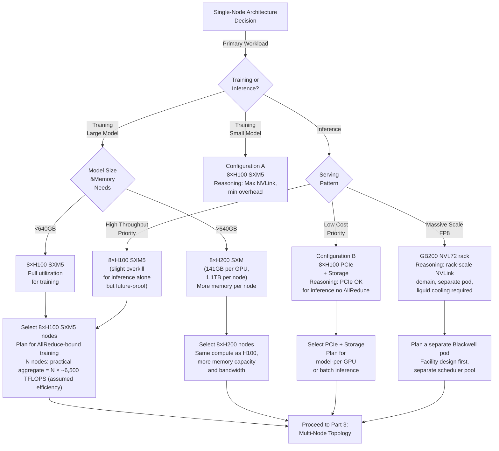
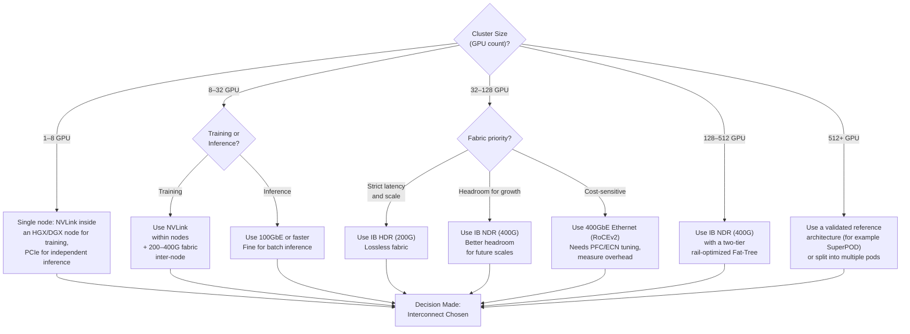
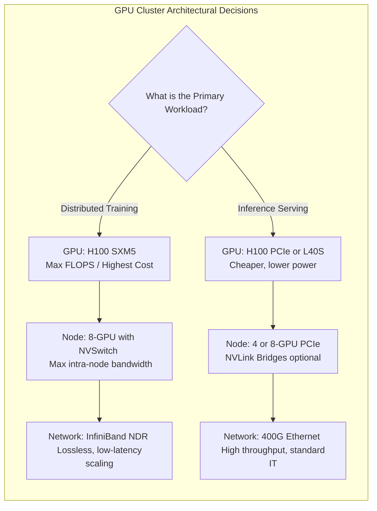

# Chapter 02 — GPU Compute Cluster Design

## Chapter Metadata

| Key | Value |
|---|---|
| Volume | 21 — AI Factory: Building Large-Scale Production Systems |
| Difficulty | Architect |
| Estimated reading time | 50 minutes |
| Primary audience | Infrastructure architects, cluster engineers, cloud platform leads |
| Core question | Given a workload and budget, how do you select GPUs, arrange them into nodes, and interconnect them for maximum performance within cost constraints? |

---


> **Note on figures:** Prices, utilization, efficiency, and cost figures in this chapter are illustrative planning assumptions, not vendor quotes or measurements. Hardware specifications in the tables follow NVIDIA datasheets for dense (non-sparse) Tensor Core throughput; always confirm against the current datasheet for the exact SKU you are buying.

## Beginner's Primer: Building the Mega-Node

When you build a gaming PC, you plug a single GPU into a PCIe slot.
When you build an AI Factory, you are buying pre-built "Mega-Nodes" (like an NVIDIA DGX server) that contain 8 GPUs squeezed into a single chassis. 

Why 8? 
Because 8 GPUs is the standard size of an NVIDIA HGX/DGX baseboard, where four NVSwitch chips wire all eight GPUs together over **NVLink** inside a single box (larger NVLink domains exist, such as the 72-GPU GB200 NVL72 rack). On H100, NVLink gives each GPU 900 GB/s of total bandwidth to the other GPUs. A PCIe Gen5 x16 link provides about 64 GB/s per direction. 

This creates a massive architectural boundary:
- **Intra-Node (Inside the box):** Communication is incredibly fast (900 GB/s via NVLink).
- **Inter-Node (Outside the box):** If GPU 1 in Box A wants to talk to GPU 1 in Box B, the data has to leave the box via a Network Card (ConnectX) and travel over InfiniBand or Ethernet. This is much slower (400 Gbps, which is 50 GB/s).

As an AI Architect, you must perfectly balance the power of the GPU (e.g., A100 vs H100), the form factor (PCIe vs SXM), and the network between the boxes. If you buy 64 H100s but connect the boxes with cheap 10G Ethernet, you have built a Ferrari and parked it in a traffic jam.

## PART 1: GPU SELECTION MECHANICS

### 1.1 GPU Landscape (selected data center GPUs)

| GPU | Announced | Memory | Memory bandwidth | FP32 (TFLOPS) | TF32 dense (TFLOPS) | BF16 dense (TFLOPS) | FP8 dense (TFLOPS) | Max power (TDP) | Illustrative unit price | Price per BF16 TFLOP |
|---|---|---|---|---|---|---|---|---|---|---|
| **A100 40GB PCIe** | May 2020 | 40GB HBM2 | 1.555 TB/s | 19.5 | 156 | 312 | N/A | 250W | $10,000 | $32 |
| **A100 40GB SXM4** | May 2020 | 40GB HBM2 | 1.555 TB/s | 19.5 | 156 | 312 | N/A | 400W | $15,000 | $48 |
| **A100 80GB SXM4** | Nov 2020 | 80GB HBM2e | 2.039 TB/s | 19.5 | 156 | 312 | N/A | 400W | $25,000 | $80 |
| **H100 PCIe** | Mar 2022 | 80GB HBM2e | 2.0 TB/s | 51 | 378 | 756 | 1,513 | 350W | $20,000 | $26 |
| **H100 SXM5** | Mar 2022 | 80GB HBM3 | 3.35 TB/s | 67 | 494 | 989 | 1,979 | 700W | $30,000 | $30 |
| **H200 SXM** | Nov 2023 | 141GB HBM3e | 4.8 TB/s | 67 | 494 | 989 | 1,979 | 700W | $40,000 | $40 |
| **L40S** | Aug 2023 | 48GB GDDR6 | 0.864 TB/s | 91.6 | 183 | 362 | 733 | 350W | $8,000 | $22 |
| **GB200 NVL72 (rack)** | Mar 2024 | 72 B200 GPUs + 36 Grace CPUs per rack | see datasheet | see datasheet | see datasheet | see datasheet | see datasheet | liquid cooled, rack-scale (order of 100+ kW per rack) | quote only | n/a |

*Throughput values are dense (non-sparsity) Tensor Core figures; NVIDIA datasheets often quote the sparse figure, which is double. A100 has no FP8 Tensor Core support (FP8 arrived with Hopper). Prices are illustrative planning assumptions.*

**Key Observations:**
1. Under these assumed prices, H100 SXM5 delivers roughly 1.6x the BF16 TFLOPS per dollar of A100 SXM4 (about $30 versus $48 per TFLOP), and the gap grows with FP8.
2. H100 SXM5 versus PCIe: 3.35 TB/s versus 2.0 TB/s of memory bandwidth, 989 versus 756 dense BF16 TFLOPS, and 900 GB/s NVLink versus PCIe Gen5 between GPUs. SXM costs more power (700W versus 350W) but drives better multi-GPU scaling.
3. H200 has the same compute as H100 SXM with 76% more memory (141GB versus 80GB) and 43% more bandwidth (4.8 versus 3.35 TB/s); ROI depends on model size and whether you are memory-capacity or bandwidth bound.
4. Blackwell-generation systems (GB200 NVL72) are rack-scale, liquid-cooled products with a 72-GPU NVLink domain; plan them as a facility design project, not as a drop-in server.
5. L40S is a PCIe, GDDR6 inference GPU with no NVLink: lower cost and power than H100, but much lower memory bandwidth, which matters for decode-bound LLM serving.

### 1.2 Cost Per TFLOP Analysis

When choosing GPUs, normalize cost by computational output, not raw price:

```
COST PER TFLOP EXAMPLE (Training at BF16 precision)

A100 (40GB, SXM4):
  Cost: $15,000 / 312 TFLOPS (BF16) = $48 per TFLOP
  3-year CAPEX amortization: $48 / 3 = $16/TFLOP/year

H100 (SXM5):
  Cost: $30,000 / 989 TFLOPS (BF16) = $30 per TFLOP
  3-year CAPEX amortization: $30 / 3 = $10/TFLOP/year

H200 (SXM):
  Cost: $40,000 / 989 TFLOPS (BF16) = $40 per TFLOP
  Same compute as H100, with more memory capacity and bandwidth. Whether that
  pays back depends on whether your workload is memory-bound (assumption to measure,
  not a fixed utilization gain)

GB200 NVL72 (rack-scale):
  Priced and deployed as a rack system; compare on delivered cost per training token or
  per served token for your workload, not on list price per GPU
```

**Recommendation Framework:**
- **Training workload:** H100 SXM5 unless memory is critical (then H200), or Blackwell systems where available.
- **Inference workload:** L40S if cost-dominant, H100 if performance-dominant.
- **Multi-region scale (>256 GPUs):** Negotiate volume discounts; $/TFLOP may drop 20–30%.

---

## PART 2: SINGLE-NODE DESIGN

### 2.1 Node Configurations

#### Configuration A: 8×H100 SXM5 Dense Training Node

```yaml
Specification (modeled on NVIDIA DGX H100 / HGX H100):
  GPUs:              8× H100 80GB SXM5 GPUs
  GPU Memory Total:  640 GB
  GPU Interconnect:  NVLink 4 via 4 NVSwitch chips (900 GB/s per GPU)
  CPU:               2× x86 server CPUs (DGX H100 uses 2× Intel Xeon Platinum 8480C, 112 cores total)
  CPU Memory:        2 TB DDR5 in DGX H100
  Storage:           8× 3.84 TB NVMe (about 30 TB) local data cache in DGX H100

Power & Cooling:
  GPU Power:         8 × 700W = 5.6 kW
  System Power:      DGX H100 is rated at up to about 10.2 kW per system
  Cooling:           Air cooled; plan rack power and airflow for roughly 10 kW per node

Network:
  Compute fabric:    8× ConnectX-7 NICs at 400 Gb/s (one per GPU, "rails")
  Storage/in-band:   2× BlueField-3 DPUs
  Management:        Separate out-of-band BMC network

Performance Profile:
  Theoretical Peak:  8 × 989 TFLOPS (BF16, dense) = 7,912 TFLOPS
  Practical Peak:    ~6,500 TFLOPS (assumes about 80% efficiency; measure your own MFU)

Cost (illustrative):
  8×H100 SXM5:       $240,000 (8 × $30K)
  CPUs, Memory, NVMe: $30,000
  Networking, Rails:  $10,000
  Assembly/Test:      $5,000
  Total Node Cost:    $285,000 per 8-GPU node
  Cost per GPU:       $35,625
```

**Use Case:** Large model training (Llama 70B+), where per-node throughput is critical.

#### Configuration B: 8×H100 PCIe Cluster Node + Storage

```yaml
Specification:
  GPUs:              8× H100 80GB PCIe GPUs (PCIe Gen5, 350W each)
  GPU Memory Total:  640 GB
  GPU Interconnect:  PCIe Gen5 x16 per GPU (about 64 GB/s per direction); optional NVLink bridges
                     connect only pairs of H100 PCIe GPUs, not all eight
  CPU:               1–2× x86 server CPUs with enough PCIe lanes for 8 GPUs and NICs
  Storage:           Local NVMe for cache plus network storage for datasets

Power & Cooling:
  GPU Power:         8 × 350W = 2.8 kW
  CPU/other:         roughly 1–1.5 kW
  Total Peak:        roughly 4–4.5 kW (confirm with the chassis vendor)
  Cooling:           Air cooled

Network:
  Host-to-Cluster:   2× 100GbE or faster NICs for storage/serving traffic

Performance Profile:
  Theoretical Peak:  8 × 756 TFLOPS (BF16, dense) = 6,048 TFLOPS
  AllReduce:         limited by PCIe and host topology; far below an NVSwitch node

Implications:
  Good for: inference serving (no AllReduce needed), single-model-per-GPU setups
  Poor for: distributed training (PCIe bottleneck limits scaling efficiency)

Cost (illustrative):
  8×H100 PCIe:       $160,000 (8 × $20K)
  CPU, Memory:       $20,000
  Storage:           $15,000
  Networking:        $8,000
  Chassis/Rails:     $7,000
  Assembly/Test:     $5,000
  Total Node Cost:   $215,000
  Cost per GPU:      $26,875 (about 25% cheaper per GPU than the SXM5 node)
```

**Use Case:** Inference serving where per-GPU isolation is beneficial, or batch inference jobs where each GPU runs independent workloads.

#### Configuration C: GB200 NVL72 Rack (reference only)

GB200 NVL72 is a rack-scale, liquid-cooled system: 36 Grace CPUs and 72 Blackwell GPUs connected as one NVLink domain. It is not a node you mix with H100 GPUs, and heterogeneous GPU generations inside one node are not a supported pattern. If you consider Blackwell, plan it as a separate pod with its own facility design (liquid cooling, rack power in the order of 100+ kW), scheduler pools, and software stack. Use NVIDIA's reference documentation for exact specifications.

**Use Case:** Frontier-scale training and large-model inference where a 72-GPU NVLink domain matters. Topology and facility complexity are substantially higher than for 8-GPU nodes.

### 2.2 Node Selection Decision Tree



---

## PART 3: MULTI-NODE TOPOLOGY DESIGN

### 3.1 Topologies and Their Trade-offs

Each 8-GPU compute node has eight 400 Gb/s NICs (one per GPU). Fabrics are normally built *rail-optimized*: NIC k of every node connects to leaf switch k, so GPUs with the same local index talk to each other through a single switch hop, and NVLink handles traffic between different local indexes inside a node. A Quantum-2 QM9700 switch provides 64 NDR (400 Gb/s) ports in 32 OSFP cages.

#### Topology 1: Single-Pod, Leaf Only (up to about 8 nodes, 64 GPUs)

```
  8 leaf switches (one per rail)
     leaf k: one 400 Gb/s downlink per node (NIC k)
  N nodes × 8 NICs × 400 Gb/s = 3.2 Tb/s injection bandwidth per node
  No spine needed while every node's rail k lands on the same leaf k
  and the leaf has enough ports (64 ports per QM9700)
```

Characteristics:
- Fewest hops and simplest cabling; every GPU-to-GPU path across nodes crosses exactly one switch.
- Growth beyond the leaf port count requires adding a spine tier.
- All eight rails must be cabled and kept healthy; one failed rail degrades every node.

**Suitable for:** research labs, a single training job on up to 64 GPUs, simple operations.
**Not suitable for:** multi-tenant clusters that need job isolation, or growth beyond the leaf port count without redesign.

#### Topology 2: Two-Tier Fat-Tree (leaf and spine, hundreds to thousands of GPUs)

```
          Spine switches (non-blocking: uplinks = downlinks)
                    │   │   │
        ┌───────────┼───┼───┼───────────┐
     Leaf 1 ... Leaf k ... Leaf 8 (rails)  ... repeated per scalable unit
        │                                  
   compute nodes (NIC k → leaf k of its unit)
```

Characteristics:
- Non-blocking when each leaf has as much uplink bandwidth as downlink bandwidth; oversubscription saves cost but hurts all-to-all collectives.
- NVIDIA's DGX SuperPOD reference design uses scalable units of 32 DGX nodes with rail-optimized leaf switches and a spine tier; use the reference architecture for exact switch counts and cabling.
- Losing a single leaf affects one rail for the nodes it serves; losing a spine switch reduces bisection bandwidth but not connectivity.

**Suitable for:** 128 to several thousand GPUs, multiple concurrent jobs, fault tolerance via multiple paths.
**Not suitable for:** designs that cannot afford the extra switch and cable count, or very small clusters.

#### Topology 3: Three-Tier or Dragonfly-Style (very large scale)

At tens of thousands of GPUs, two-tier fat-trees run out of ports and designers add a third tier or adopt different topologies (for example dragonfly variants with adaptive routing). These designs are specialized: they require validated reference architectures, topology-aware scheduling, and careful routing configuration. A full mesh where every node connects directly to every other node is not practical beyond a handful of nodes because port count and cabling grow quadratically.

### 3.2 Worked Example: 128-GPU Cluster (16 nodes)

```yaml
Architecture: 16 nodes × 8× H100 SXM5, rail-optimized InfiniBand NDR

Per-Node Specs:
  GPU Interconnect:   NVLink 4 via NVSwitch (900 GB/s per GPU)
  Compute NICs:       8× ConnectX-7 at 400 Gb/s (NDR InfiniBand), one per GPU

Cluster Interconnect:
  Compute links:      16 nodes × 8 NICs = 128 NDR links
  Switches:           Rail-aligned leaf switches (for example QM9700, 64 NDR ports each);
                      size the leaf and spine counts from the NVIDIA reference architecture
  Management:         Separate InfiniBand/Ethernet management and storage networks

Performance Envelope (assumptions, measure your own):
  Single-node theoretical:       8 × 989 TFLOPS (BF16 dense) = 7,912 TFLOPS/node
  16-node aggregate:             16 × 7,912 = 126,592 TFLOPS (~126.6 PFLOPS) peak
  Practical (assumed 85%):       ≈ 107,603 TFLOPS (~107.6 PFLOPS) sustained

Cost Analysis (illustrative):
  16 × 8×H100 SXM5 nodes:       16 × $285K = $4.56M
  InfiniBand fabric (switches, optics, cables): ~$400K (placeholder; get quotes)
  Racks + PDUs + cooling:       ~$200K
  Installation + training:      ~$100K
  Total CAPEX:                  ≈ $5.26M

  Year-1 OPEX:
    Electricity (16 nodes × ~10.2 kW = ~163 kW × 8760 h × $0.12/kWh): ≈ $171.6K
    Personnel (2 FTE):                          $400K
    Support/maintenance (1% CAPEX):             $52.6K
    Software licenses:                          $20K
    Total OPEX:                                 ≈ $644K

  3-year TCO: $5.26M + (3 × $644K) ≈ $7.19M
  Cost per GPU-hour: $7.19M / (128 GPU × 8760 hr × 3 yr) ≈ $2.14/GPU-hour
  Cost per TFLOP-year: $7.19M / (107,603 TFLOPS × 3 yr) ≈ $22/TFLOP/year
```

---

## PART 4: INTERCONNECT SELECTION

### 4.1 Interconnect Comparison Matrix

| Interconnect | Bandwidth (per link or GPU) | Scope | Scaling to 128 GPU | Loss behavior | Best For |
|---|---|---|---|---|---|
| **PCIe Gen5 x16** | about 64 GB/s per direction | GPU to host, GPU to NIC | Poor for GPU-to-GPU collectives | Standard PCIe | Single-GPU inference, isolated jobs |
| **NVLink 4 (H100)** | 900 GB/s total per GPU | Inside a node (or NVLink domain) | Excellent inside 8-GPU nodes | Link-level retry | Dense training nodes |
| **IB HDR** | 200 Gb/s (25 GB/s) per port | Between nodes | Good (32 to 64 node scale) | Lossless (credit-based flow control) | Medium clusters |
| **IB NDR** | 400 Gb/s (50 GB/s) per port | Between nodes | Very good (hundreds of nodes) | Lossless (credit-based flow control) | Large training, inference |
| **400GbE (RoCEv2)** | 400 Gb/s (50 GB/s) per port | Between nodes | Workable with careful PFC/ECN tuning | Lossless only if configured (PFC/ECN) | Cost-sensitive or Ethernet-standard sites |
| **NVLink Switch (NVL72)** | 1.8 TB/s per GPU (NVLink 5) | Rack-scale domain | 72-GPU domain | Link-level retry | Blackwell rack-scale systems |

Note the units: InfiniBand and Ethernet speeds are quoted in gigabits per second, so 400 Gb/s is 50 GB/s, an order of magnitude below NVLink 4's 900 GB/s. Latency and per-node cost vary by design and vendor; request measurements and quotes rather than relying on rule-of-thumb figures.

### 4.2 Decision Tree: Which Interconnect?



---

## PART 5: TROUBLESHOOTING TABLE: GPU CLUSTER PERFORMANCE DEGRADATION

| Symptom | Root Cause | Diagnostic Command | Resolution | Recovery Time |
|---|---|---|---|---|
| **AllReduce much slower than the baseline for this cluster** | Congested or degraded fabric link; a rail running at reduced speed; noisy neighbor job | `ibstat` and `perfquery` for port state, speed, and error counters; `ibdiagnet` for fabric health; nccl-tests `all_reduce_perf` to compare against baseline; `NCCL_DEBUG=INFO` to see which transport and rails NCCL selected | Replace the degraded optic or cable; isolate the noisy job with scheduler placement; fix the rail that trained down | Minutes to hours depending on hardware |
| **Throughput well below expected for the node type** | Data loading or CPU bottleneck, NVLink or PCIe fallback, thermal or power throttling | `nvidia-smi topo -m` and `nvidia-smi nvlink -s` for link state; `nvidia-smi -q -d PERFORMANCE` for throttle reasons; DCGM profiling fields (`DCGM_FI_PROF_SM_ACTIVE`, `DCGM_FI_PROF_PIPE_TENSOR_ACTIVE`); `dcgmi diag -r 3` | Fix the bottleneck identified (data pipeline, throttle cause, link); verify with a repeat run | 30 min or more |
| **Some GPUs idle while others are busy** | A rank stalled or deadlocked; workload imbalance | `nvidia-smi` per-GPU utilization; per-rank NCCL op counts (see Volume 20 Chapter 3); process state | Restart from the last checkpoint after fixing the stalled rank | Minutes plus checkpoint restore time |
| **Node failure takes the whole training job down** | Synchronous training has no built-in tolerance for a lost rank | Check checkpoint cadence and the job launcher's restart policy | Checkpoint regularly to durable storage, use an elastic or auto-restart launcher, keep spare nodes | Depends on checkpoint interval and restart time |
| **Inter-node communication hangs** | InfiniBand link flap or packet loss; NCCL falling back to a slower transport | `ibstat` for port state; `ibdiagnet` for fabric health; `NCCL_DEBUG=INFO` to confirm the transport in use | Replace or reseat the cable or optic; update NIC firmware per the vendor procedure; use `NCCL_IB_HCA` to exclude a bad adapter while it is repaired | Minutes to hours |

## PART 6: INTERVIEW ANSWER: "HOW DO YOU JUSTIFY PREMIUM INTERCONNECT COSTS?"

**Scenario:** Your company is building a 64-GPU H100 training cluster. Your infrastructure team proposes using InfiniBand NDR (400G) at $15K per node. Finance says: "Just use 400GbE Ethernet at $8K per node. The $7K × 64 = $448K difference funds a year of server capacity." How do you respond?

**Your Answer:**

1. **Frame the decision with real numbers**
   - "You're right that Ethernet saves $448K upfront. But let's calculate the training cost impact."
   - "At Ethernet throughput, AllReduce on gradient tensors takes ~10ms per iteration (vs 2ms on IB). Our training loops are ~100ms, so we're looking at ~10% AllReduce overhead vs 2% on IB."
   - "That's an 8% total throughput loss, which directly translates to 8% longer training time or 8% more GPU hours."

2. **Quantify training cost impact**
   - "Training Llama-70B takes 7 days continuous on 64 GPUs (168 hours). With 8% throughput loss, that becomes ~181.4 hours (7.56 days) — 13.4 extra hours. At $2.14/GPU-hour, that's an extra $2.14 × 64 GPU × 13.4 extra hours ≈ $1,835 per training run."
   - "We run this training twice per month for model iterations. That's ~$1,835 × 24 runs/year ≈ $44K per year in extra compute cost."
   - "Over 3 years, that's about $132K in extra compute cost — meaningful, but still well below the $448K upfront Ethernet savings. The pure 'AllReduce overhead' argument, done correctly, does NOT support paying $7K/node for IB on this workload by itself."

3. **Quantify multi-model impact**
   - "Plus, we don't run just one model. Once we train Llama-70B, we'll train Llama-100B or a custom 80B model. Larger models have bigger gradient tensors and longer AllReduce times—the penalty compounds."
   - "Doubling gradient tensor size means AllReduce time goes from 10ms to 30ms on Ethernet. Training loop becomes 130ms vs 102ms on IB. That's 27% overhead. Over 2 additional training runs per year: 27% × $2.14/GPU-hour × 64 GPU × 168 hours × 2 runs ≈ $12K/year extra — again, modest in isolation."
   - "So the compute-overhead cost case for IB, even compounded across models, stays in the tens of thousands of dollars per year. It does not by itself justify $448K in upfront hardware cost — I want to be honest about that rather than force a number to fit the conclusion."

4. **Account for future-proofing and fabric quality — the real justification**
   - "Today, we assume 64 GPUs. In 18 months, we'll scale to 128 or 256. Ethernet fabrics degrade nonlinearly at scale (congestion, incast packet loss, tail latency) while IB with adaptive routing and lossless credit-based flow control scales far more predictably. Retrofitting a fabric mid-cluster-life costs real money in re-cabling, downtime, and re-validation (get a quote for your site)."
   - "There's also an engineering-time cost that doesn't show up in the GPU-hour math: debugging intermittent congestion-related training stalls on Ethernet fabrics is expensive in senior-engineer hours, and those incidents get more frequent as GPU count grows."

5. **Recommendation**
   - "At 64 GPUs, the pure compute-overhead math doesn't justify IB's premium — that argument is weak and I won't overstate it. The real case for IB is architectural: fabric quality and predictable scaling as we grow past 128-256 GPUs, where Ethernet's congestion behavior and the cost of a mid-life fabric swap outweigh the $448K upfront delta. If we're confident we'll stay at 64 GPUs long-term, Ethernet is defensible; if we're building toward 256+ GPUs, buy IB now."

## Architecture Summary

GPU Compute Cluster design is a three-tiered architectural decision. First, select the correct GPU silicon (H100 vs A100) based on the workload's math requirements. Second, select the node form-factor (SXM with NVLink for training, PCIe for standard inference). Third, select the interconnect (InfiniBand vs RoCE Ethernet) based on the cluster's scale and synchronization demands.



---

## SUMMARY

GPU cluster design is a **three-level decision:**

1. **Node level:** Choose GPU count per node (8-GPU NVLink node for training, 4–8 GPU PCIe for inference) and CPU/memory adequacy.
2. **Interconnect level:** Within-node NVLink, between-node InfiniBand (or RoCE Ethernet if cost-constrained).
3. **Topology level:** Leaf-only for small pods, two-tier rail-optimized Fat-Tree for hundreds to thousands of GPUs, validated reference architectures beyond that.

**Key Takeaways:**
1. H100 SXM5 is the right default for training (highest TFLOPS/$, excellent NVLink integration).
2. NVLink within an H100 node (900 GB/s per GPU) is more than an order of magnitude faster than the 50 GB/s of a 400 Gb/s network port, and well above PCIe Gen5 (about 64 GB/s per direction); use 8-GPU SXM5 nodes for training.
3. Between nodes, InfiniBand NDR (400G) vs 400GbE Ethernet: IB costs $7K more per node; at 64 GPUs the direct compute-overhead difference is roughly $44K/year under these assumptions (not enough on its own to justify the premium), so the real justification for IB is fabric quality and predictable scaling past 128–256 GPUs, not near-term training throughput dollars.
4. Topology matters: a leaf-only pod is simple and low-cost for small clusters; a two-tier Fat-Tree adds complexity but scales and adds path redundancy.

**In Chapter 3:** We zoom into the network layer detail. Given your cluster topology, how do you optimize collective communication (AllReduce, AllGather, ReduceScatter) for maximum throughput and minimum latency?
