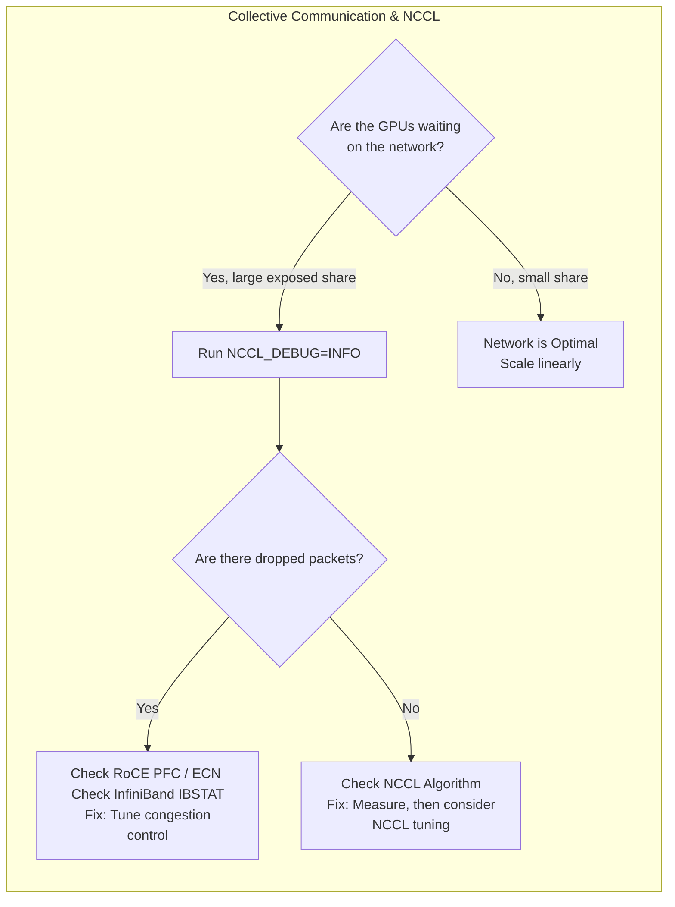

# Chapter 03 — High-Speed Networking Architecture

## Chapter Metadata

| Key | Value |
|---|---|
| Volume | 21 — AI Factory: Building Large-Scale Production Systems |
| Difficulty | Architect |
| Estimated reading time | 55 minutes |
| Primary audience | Infrastructure architects, networking engineers, distributed systems engineers |
| Core question | How do you optimize collective communication (AllReduce, AllGather, ReduceScatter) to achieve near-linear scaling in multi-GPU training? |

---


> **Note on figures:** Timings, bandwidth results, and tool output in this chapter are illustrative assumptions used to explain the mechanics, not measurements. Measure your own cluster with nccl-tests (Part 6). Link rates are quoted in Gb/s (a 400 Gb/s NDR port is 50 GB/s).

## Beginner's Primer: The Communication Tax

In Chapter 2, we built the Mega-Nodes. Now we have to connect them.

If you have 1,000 GPUs training a massive AI model, they don't work independently. They all have to mathematically agree on what they just learned before they can move to the next step. 

Imagine 1,000 people in a room trying to average their test scores. 
- **The Bad Way:** Everyone yells their score at the teacher. The teacher writes down 1,000 numbers, calculates the average, and yells the answer back. The teacher is a massive bottleneck. 
- **The AI Way (Ring All-Reduce):** Person 1 hands their score to Person 2. Person 2 adds their score and hands it to Person 3. This circle continues until the final sum makes it all the way around the ring. 

This synchronization is called a **Collective Operation** (like `AllReduce`). 
NVIDIA's software library that handles this is called **NCCL** (NVIDIA Collective Communication Library).

**The Problem:** Every time the GPUs do an `AllReduce`, they stop doing math and wait for the network. This wait time is called the **Communication Tax**. If your network is slow, or your switches are dropping packets, your Communication Tax goes from 1% to 50%. You are paying $10 Million for GPUs, and they are spending half their time waiting for the network. This chapter teaches you how to design non-blocking networks that keep the tax as small as the workload allows.

## PART 1: COLLECTIVE COMMUNICATION FUNDAMENTALS

### 1.1 Why Collectives Matter at Scale

In distributed training, the training loop consists of three phases:

```
DISTRIBUTED TRAINING ITERATION TIMELINE

┌─────────────────────────────────────────────┐
│ 1. FORWARD PASS (compute-bound)             │
│    ~500 ms per iteration (load independent) │
└─────────────────────────────────────────────┘
                    │
┌─────────────────────────────────────────────┐
│ 2. BACKWARD PASS (compute-bound)            │
│    ~1000 ms per iteration                   │
└─────────────────────────────────────────────┘
                    │
┌─────────────────────────────────────────────┐
│ 3. ALLREDUCE (communication-bound)          │
│    Synchronize gradients across N GPUs      │
│    Time depends on topology, not compute    │
└─────────────────────────────────────────────┘

Example (assumed values): 64-GPU training on Llama-70B
  Forward: 500 ms
  Backward: 1000 ms
  AllReduce: depends on collective algorithm, message size, and fabric

  Total iteration time: 1500 ms + exposed AllReduce time

  Impact on scaling (assumed exposed AllReduce times):
    If exposed AllReduce = 200 ms: total = 1700 ms, overhead = 13% (poor scaling)
    If exposed AllReduce = 5 ms:   total = 1505 ms, overhead = 0.3% (near-linear scaling)
```

The difference between well-tuned and poorly-tuned collective communication, including how much of it overlaps with compute, can be the difference between near-linear scaling and poor scaling at 64+ GPUs.

### 1.2 Key Collective Operations

```
COMMON COLLECTIVES IN DISTRIBUTED TRAINING

1. ALLREDUCE(gradient_tensor) — sum gradients across all GPUs, return result to all
   Used in: Every training step (most critical)
   Data volume: Sum of all per-GPU gradients (typically 200 MB–2 GB per GPU)
   
   Algorithm trade-offs:
     - Tree (NCCL uses pipelined double binary trees): O(log N) latency, good for latency-bound and large-scale cases
     - Ring AllReduce: O(N) latency but bandwidth-optimal (each GPU sends and receives 2(N-1)/N of the data), best for large messages
     - Recursive doubling: O(log N) rounds but sends the full buffer each round, suited to small messages

2. ALLGATHER(tensor) — collect tensor from each GPU, scatter to all
   Used in: Model parallel training, inference serving
   Example: Collect model shards after distributed training checkpoint

3. REDUCESCATTER(tensor) — inverse of AllGather; sum at each rank, scatter result
   Used in: Model parallel gradient aggregation
   
4. BROADCAST(tensor, root) — send tensor from one GPU to all others
   Used in: Parameter server updates, model weight distribution

5. BARRIER() — synchronize all GPUs (wait for slowest)
   Used in: Between training iterations, checkpoint boundaries
   Impact: Stalls fast GPUs waiting for slow ones; exposes load imbalance
```

---

## PART 2: COLLECTIVE ALGORITHMS

### 2.1 Ring AllReduce (Linear Scaling at Scale)

**Algorithm:** Each GPU i sends gradient to GPU (i+1) mod N, receives from GPU (i-1) mod N. Perform 2(N-1) steps, each moving one "chunk" of the full gradient.

```
RING ALLREDUCE EXAMPLE: 4 GPUs, gradient [A, B, C, D]

Initial state:
  GPU 0: [A0, B0, C0, D0]  (local data)
  GPU 1: [A1, B1, C1, D1]
  GPU 2: [A2, B2, C2, D2]
  GPU 3: [A3, B3, C3, D3]

Step 1: Send to neighbor, reduce locally
  GPU 0 sends D0 → GPU 1 (wrap-around), receives C3
  GPU 1 sends A1 → GPU 2, receives D0
  GPU 2 sends B2 → GPU 3, receives A1
  GPU 3 sends C3 → GPU 0, receives B2
  
  After local reduce:
  GPU 0: [A0, B0, C0, D0+D3]
  GPU 1: [A1+D0, B1, C1, D1]
  GPU 2: [A2, B2+A1, C2, D2]
  GPU 3: [A3, B3, C3+B2, D3]

Step 2–3: Continue ring rotation (total 6 steps for 4 GPUs)

Final result (after 2N-2 = 6 steps):
  GPU 0: [A0+A1+A2+A3, B0+B1+B2+B3, C0+C1+C2+C3, D0+D1+D2+D3]
  GPU 1: [A0+A1+A2+A3, B0+B1+B2+B3, C0+C1+C2+C3, D0+D1+D2+D3]
  GPU 2: [A0+A1+A2+A3, B0+B1+B2+B3, C0+C1+C2+C3, D0+D1+D2+D3]
  GPU 3: [A0+A1+A2+A3, B0+B1+B2+B3, C0+C1+C2+C3, D0+D1+D2+D3]

Performance Analysis:
  Network latency per step: ~2 μs (within-rack IB)
  Time per step (send 1/4 of gradient, reduce locally):
    Send: (Total_Gradient / N) / Bandwidth
    Example: 800 MB total gradient / 4 GPU = 200 MB per step
             200 MB / 50 GB/s (IB NDR per direction) = 4 ms per step
  Total time: 6 steps × (4 ms + 2 μs overlap) ≈ 24 ms
  
  Comparison to a naive star/tree with a single root:
    The root's links carry traffic from all N-1 peers, so the root becomes the bottleneck as N grows.
    Ring keeps per-link traffic constant, which is why it is bandwidth-optimal for large messages.
    (NCCL's tree algorithm pipelines a double binary tree and avoids the single-root problem.)
```

**When to use:** Large messages, where bandwidth dominates. NCCL chooses between ring, tree, and other algorithms automatically from message size and topology.

### 2.2 Recursive Doubling (Low-Latency Variant)

**Algorithm:** Instead of a ring, use a tree where communication happens in parallel at log(N) depth.

```
RECURSIVE DOUBLING: 8 GPUs, minimize latency

Round 0 (distance = 1):
  GPU 0 ↔ GPU 1  (exchange, reduce locally)
  GPU 2 ↔ GPU 3
  GPU 4 ↔ GPU 5
  GPU 6 ↔ GPU 7

Round 1 (distance = 2):
  GPU 0/1 ↔ GPU 2/3
  GPU 4/5 ↔ GPU 6/7

Round 2 (distance = 4):
  GPU 0/1/2/3 ↔ GPU 4/5/6/7

Total rounds: log₂(8) = 3 rounds

Comparison:
  Ring needs 2(N-1) = 14 steps, each moving 1/N of the buffer (latency-heavy, bandwidth-optimal).
  Recursive doubling needs 3 rounds, but each round exchanges the full buffer, so it wins
  for small messages (latency-bound) and loses for large messages (bandwidth-bound).

Trade-off: Requires a power-of-two-friendly layout; not efficient for large messages
```

**When to use:** Small, latency-sensitive messages. Large messages favor ring or tree.

### 2.3 Tree AllReduce (Moderate Latency)

```
BALANCED TREE ALLREDUCE (8 GPUs, depth 2)

           GPU 0 (root)
              ╱  ╲
          GPU 1   GPU 2
          ╱  ╲    ╱  ╲
      GPU 3  GPU 4  GPU 5  GPU 6
                              │
                            GPU 7

Reduce phase (bottom-up):
  GPU 3,4,5,6,7 send to parents (4 sends in parallel)
  GPU 1,2 reduce results + send to root
  GPU 0 receives final result

Broadcast phase (top-down):
  GPU 0 sends to GPU 1, GPU 2
  GPU 1, GPU 2 send to children (4 sends in parallel)

Total latency: 2 × (send + reduce) × depth ≈ 2 × 4 ms × 2 = 16 ms
Bandwidth utilization: Low (not all links used simultaneously)
```

**When to use:** Latency-bound collectives at larger rank counts. NCCL's tree algorithm is built on pipelined double binary trees and is selected automatically when it is faster.

---

## PART 3: COLLECTIVE LIBRARY IMPLEMENTATIONS

### 3.1 NVIDIA NCCL (The Standard)

```yaml
What is NCCL:
  NVIDIA Collective Communications Library
  Handles AllReduce, AllGather, ReduceScatter, Broadcast at GPU scale
  Open source, distributed separately from the CUDA Toolkit (packages, containers, or source)
  
Default behavior:
  NCCL auto-selects algorithm based on:
    - Cluster size (N GPUs)
    - Available bandwidth (IB, Ethernet, NVLink)
    - Latency profile
    - User hints via NCCL_ALGO env variable
  
Performance: measure with nccl-tests (Part 6); results depend on topology, message size,
  NCCL version, and fabric tuning. Do not rely on rule-of-thumb figures.

NCCL algorithm selection:
  Environment variables:
    NCCL_ALGO=Ring        (restrict to ring)
    NCCL_ALGO=Tree        (restrict to tree)
    NCCL_ALGO=CollnetDirect / CollnetChain   (in-network aggregation, NCCL 2.14+, needs the CollNet plugin and
                                              NCCL_COLLNET_ENABLE=1; the name 'Collnet' applies only to 2.5-2.13)
    (Forcing an algorithm is a last resort; NCCL selects by topology. Since 2.24, invalid tokens fail.)
    
  Debugging:
    NCCL_DEBUG=INFO       (shows the transports, rails, and algorithms NCCL selected)
    NCCL_DEBUG=TRACE      (very verbose call tracing; use briefly)
```

### 3.2 Reducing Launch Overhead with CUDA Graphs

For repeated collectives (the same AllReduce every training iteration), launch and CPU overhead can be reduced by capturing the work in a CUDA Graph. NCCL supports being captured in CUDA graphs; there is no separate "NCCL Graph" API. Frameworks expose this (for example PyTorch CUDA graph capture, and `torch.compile` modes that use CUDA graphs). Measure with Nsight Systems to see whether CPU launch gaps are actually a bottleneck before adopting it.

---

## PART 4: TOPOLOGY-SPECIFIC OPTIMIZATIONS

### 4.1 Single-Pod NVLink Topology Optimization

```yaml
Topology:
  16 H100 SXM5 nodes, 8 GPU per node, NVLink within-node, IB NDR rail-optimized between nodes

Within-node (8 GPU via NVLink/NVSwitch):
  Bandwidth: 900 GB/s per GPU (NVLink 4)
  Handled by NCCL over NVLink; cost is small relative to inter-node traffic

Inter-node (across 16 nodes):
  Bandwidth: one 400 Gb/s (50 GB/s) NIC per GPU, i.e. 8 rails per node
  NCCL builds hierarchical rings/trees automatically: reduce within the node over NVLink
  first, then communicate across nodes on the rail that matches each GPU's local index

Optimization strategy:
  1. Verify rail alignment: NIC k of every node on leaf switch k, and GPU-NIC pairing correct
     (check `nvidia-smi topo -m` and NCCL_DEBUG=INFO output for the selected NICs)
  2. Leave NCCL_ALGO unset unless measurements show a better choice
  3. Overlap communication with backward compute (Part 5.2) so AllReduce time is hidden
  4. Where the fabric supports it, evaluate in-network reduction (SHARP) and NVLink SHARP (NVLS)
  5. Validate with nccl-tests across all nodes and compare against the per-node baseline

Result: measure bus bandwidth with nccl-tests at the message sizes your model produces, and
express the communication overhead as exposed (non-overlapped) AllReduce time divided by
iteration time.
```

### 4.2 Multi-Rack Fat-Tree Optimization

```yaml
Topology (assumed example):
  32 nodes × 8 GPU = 256 GPUs, 4 racks of 8 nodes
  Rail-optimized leaf switches per rack, uplinked to a spine tier
  If the spine uplinks are oversubscribed (for example 2:1), cross-rack bandwidth is
  half of the aggregate leaf downlink bandwidth

Optimization challenge:
  Cross-rack collectives share the oversubscribed uplinks. Heavy all-to-all or
  data-parallel traffic from many jobs can saturate them, causing queueing, ECN/PFC
  activity on RoCE, and AllReduce stalls.

Resolution:
  1. Prefer a non-blocking (1:1) fabric for training pods, or place jobs so most traffic
     stays within a leaf/rack domain (topology-aware scheduling)
  2. Let NCCL use hierarchical algorithms (intra-node, then inter-node); verify the
     chosen paths with NCCL_DEBUG=INFO
  3. Reduce communication volume: gradient accumulation (fewer AllReduce calls per sample),
     overlap with compute, and sharding strategies that reduce cross-rack traffic
  4. Monitor link utilization and congestion counters on uplinks
```

### 4.3 InfiniBand Specific: Lossless Credit-Based Flow Control vs RoCE PFC

```
InfiniBand uses link-level, credit-based flow control: a sender transmits only when
the receiver has advertised buffer credits, so InfiniBand fabrics are lossless by design.
Congestion can still build up (head-of-line blocking, congestion spreading), which shows up
as higher latency and lower throughput rather than loss.

RoCEv2 (RDMA over Ethernet) is different: it needs Priority Flow Control (PFC) and ECN
configured correctly to be lossless, and misconfigured PFC can cause pause storms.

Monitoring:
  InfiniBand: ibqueryerrors, perfquery (PortXmitWait, symbol/link errors), ibdiagnet
  RoCE/Ethernet: ethtool -S (pause and ECN counters), switch PFC/ECN counters
Mitigation:
  1. Check cabling, optics, and error counters before tuning software
  2. Use adaptive routing and congestion control features supported by your fabric
  3. Keep the framework collective timeout bounded; raise it only after the fabric is healthy
```

---

## PART 5: BANDWIDTH OPTIMIZATION TECHNIQUES

### 5.1 Gradient Compression

```text
Assume sharded gradients (ZeRO/FSDP), so each of 64 GPUs reduces a 1/64 slice:
  Llama-70B gradients in BF16 = 70B params × 2 bytes = 140 GB total
  Per GPU slice: 140 GB / 64 ≈ 2.19 GB
  At 50 GB/s per NIC (400 Gb/s): 2.19 GB / 50 GB/s ≈ 44 ms (single transfer, ignoring protocol overhead)
```

Compression trades communication time for accuracy risk and compute:
- **Lower-precision gradients** (for example BF16 to FP8) halve the data again but can hurt convergence; validate on your model.
- **Low-rank or sparsification schemes** (such as PowerSGD or top-K) cut communication more but add compute and convergence risk, and often need error feedback.
- NCCL does not provide built-in compression. In PyTorch DDP use a communication hook (`register_comm_hook`) with a supported scheme rather than quantizing gradient tensors by hand (NCCL cannot sum arbitrary quantized tensor types, and 8-bit sums overflow).

In many cases the better first step is overlap (Part 5.2), which hides communication behind backward compute without changing the math.

### 5.2 Communication-Overlap: Computation-Communication Pipelining

```text
Sequential:  [Forward 500 ms][Backward 1000 ms][AllReduce 10 ms] = 1510 ms (assumed values)

Overlapped:  AllReduce of earlier layers' gradients runs while later layers' backward
             compute is still running, so only the tail of the AllReduce is exposed.
```

PyTorch DistributedDataParallel does this by default: gradients are grouped into buckets (`bucket_cap_mb`, default 25 MB), and each bucket's AllReduce launches as soon as its gradients are ready during `loss.backward()`. You do not call `all_reduce` per layer by hand. FSDP has analogous prefetching and overlap settings. Use Nsight Systems to confirm that NCCL kernels overlap with backward compute and tune bucket sizes if they do not.

---

## PART 6: MEASUREMENT & TUNING

### 6.1 Measuring Collective Performance

```bash
# 1. NVIDIA NCCL Tests (benchmark collectives)
cd /path/to/nccl-tests
make MPI=1 MPI_HOME=/path/to/mpi CUDA_HOME=/usr/local/cuda NCCL_HOME=/path/to/nccl
# 2 nodes x 8 GPUs, one MPI process per GPU, sweep 8 MB to 8 GB (adapt to your launcher)
mpirun -np 16 --map-by ppr:8:node ./build/all_reduce_perf -b 8M -e 8G -f 2 -g 1
# Output columns: size, count, type, redop, root, time (us), algbw (GB/s), busbw (GB/s), #wrong
# Compare busbw against your cluster baseline; busbw is the figure comparable to link bandwidth

# 2. NCCL in debug mode (see transport and algorithm selection)
NCCL_DEBUG=INFO mpirun ... ./build/all_reduce_perf ...

# 3. Profiling with Nsight Systems
nsys profile -o profile --trace=cuda,nvtx python train.py

# The report shows NCCL kernels on the GPU timeline so you can see overlap with compute
```

### 6.2 Tuning NCCL for Your Cluster

| Issue | Symptom | NCCL Environment Variable | Guidance (NCCL User Guide, Environment Variables) |
|---|---|---|---|
| **Collective slower than baseline at scale** | Congestion, or an unsuitable algorithm | `NCCL_ALGO` | Leave unset unless you have measured a better choice: NCCL selects by topology. Valid names include `Ring`, `Tree`, `CollnetChain` and `CollnetDirect` (2.14 and later), and `NVLS`/`NVLSTree` (NVLink SHARP). Since 2.24, unexpected tokens fail, and if `ring` is not listed there is no fallback to it |
| **High variance in AllReduce latency** | Packet loss, link flapping, one slow rail | `NCCL_IB_HCA` | Select adapters explicitly, for example `=mlx5_0:1,mlx5_1:1` (`=` means exact names), after confirming port state with `ibstat` |
| **Memory pressure from NCCL buffers** | Out-of-memory near collectives | `NCCL_BUFFSIZE` | Default is 4194304 bytes (4 MiB); values are integers in bytes, powers of 2 recommended. Reduce only if memory-constrained, and re-benchmark |
| **Intra-node traffic not using NVLink** | Single-node all-reduce slower than expected | `NCCL_P2P_LEVEL`, `NCCL_P2P_DISABLE` | NCCL chooses automatically. `NVL` limits P2P to NVLink-connected GPUs, and `NCCL_P2P_DISABLE=1` disables P2P (a diagnostic, not a tuning step). Confirm the transport actually used with `NCCL_DEBUG=INFO` |
| **IB performance in virtualized environments** | Lower than bare-metal baseline | `NCCL_IB_PCI_RELAXED_ORDERING` | Default `2` (use Relaxed Ordering if available); `1` forces it and fails if unavailable; `0` disables it |


---

## PART 7: TROUBLESHOOTING TABLE

| Symptom | Diagnostic | Root Cause | Resolution | Recovery Time |
|---|---|---|---|---|
| **AllReduce timeout (>30s, kills job)** | Job exits with "NCCL operation timed out" | Network flap, all-to-all congestion, or failed GPU | Check IB port state and error counters (`ibstat`, `perfquery`), GPU health (`nvidia-smi`, kernel `NVRM: Xid` messages); raise the framework's process-group timeout only after the link and GPUs are shown healthy | 5–10 min |
| **AllReduce stalls (10–100x slower than baseline)** | `nccl-tests` bandwidth well below the cluster baseline; PFC pause counters rising | PFC pause storm, IB buffer exhaustion | Inspect PFC/ECN configuration and counters on NICs and switches (`ethtool -S`, `nv show qos roce` on Cumulus). Reducing batch size does not fix congestion, and async error handling changes how errors surface, not speed | 30 sec (rerun iteration) |
| **Irregular AllReduce latency (some iterations 5ms, others 50ms)** | Training throughput variance | Noisy neighbor job contending for uplinks | Use resource isolation (cgroups, bandwidth reservation) | 2–5 min (kill noisy job) |
| **AllReduce works at 8 GPU, fails at 64 GPU** | Job hangs on first AllReduce after 64-GPU launch | IB switch port MTU mismatch or NCCL rank mismatch | Verify IB MTU=4096 across all switches, verify torch.distributed.launch rank assignment | 10 min (reconfigure MTU, relaunch) |

## Architecture Summary

An AI Factory's network is the ultimate bottleneck. It is not enough to just buy 400G switches; the architecture must support the specific Collective Communication algorithms (e.g., Ring All-Reduce) that NCCL uses to synchronize gradients across thousands of GPUs. The network must be Rail-Optimized, Non-Blocking, and utilize advanced congestion control to ensure that the Communication Tax never exceeds 1% of the total training time.



---

## SUMMARY

Collective communication is the **performance ceiling** for distributed training. Optimizations:

1. **Algorithm selection:** Let NCCL choose between ring (bandwidth-optimal, large messages) and tree (latency-optimal at scale); force an algorithm only with measurements.
2. **Hardware:** InfiniBand NDR (400G) and properly tuned RoCE 400GbE can both work; measure collective bandwidth on your fabric rather than assuming a fixed ratio.
3. **Topology:** Keep traffic local where possible. Multi-rack fabrics need non-blocking (or well-understood oversubscribed) uplinks and hierarchical collectives to avoid congestion.
4. **Optimization:** Communication-overlap (bucketed backward pass) first, then compression or topology-specific tuning where measurements justify it.
5. **Measurement:** Use nccl-tests, NCCL debug output, and GPU profiling to validate bus bandwidth against your own baseline.

**Key Takeaway:** Track exposed (non-overlapped) communication time as a share of iteration time. If it is large, first check overlap, link health, and rail alignment before upgrading the network.

**In Chapter 4:** We move to storage and I/O. Given your training workload, how do you design data pipelines to feed GPUs with data at the required throughput (hundreds of GB/sec)?
