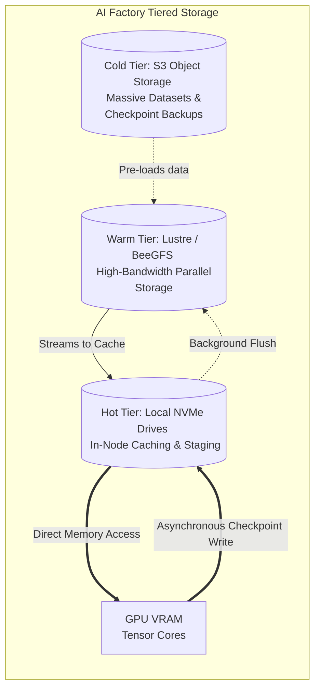

# Chapter 04 — Storage Infrastructure for AI Pipelines

## Chapter Metadata

| Key | Value |
|---|---|
| Volume | 21 — AI Factory: Building Large-Scale Production Systems |
| Difficulty | Architect |
| Estimated reading time | 40 minutes |
| Primary audience | Infrastructure architects, data platform engineers, storage admins |
| Core question | How do you design storage to keep 64–512 GPUs continuously fed with training data without becoming the bottleneck? |

---


> **Note on figures:** Throughputs, capacities, and costs in this chapter are illustrative planning assumptions, not measurements or vendor quotes. Size your own pipeline from your measured tokens (or samples) per second and bytes per sample.

## Beginner's Primer: Feeding the Beast

If the GPUs are the engine of your AI Factory, the Data is the fuel.

The fastest engine in the world is useless if the fuel pump is broken. In AI, the data rate per GPU depends entirely on the modality: text tokens are tiny, while images and video can demand hundreds of megabytes per second per GPU. If you have 512 GPUs, your storage system must instantly deliver massive streams of data, perfectly synchronized, 24 hours a day.

There are three major fuel pumps you have to manage:
1. **The Dataloader (Reading):** Pumping millions of images or text documents into the GPUs for training. If you store these as millions of tiny files, the storage system will spend all its time reading the "table of contents" (metadata) instead of sending the data. You must package data into large shards.
2. **The Checkpoint (Writing):** Every few hours, all 512 GPUs will pause (or stream in the background) and write the model and optimizer state, often around a terabyte for a 70B model, to storage. This is an explosive burst of write traffic that will crash standard enterprise NAS devices.
3. **The Caching Tier:** To protect your network, you don't stream data from AWS S3 directly into the GPUs. You stream it into local NVMe drives on the server (the staging area), and the GPU reads it from there.

This chapter synthesizes the storage patterns from Volume 15 into high-level architectural requirements for building the AI Factory.

## PART 1: STORAGE BOTTLENECK ANALYSIS

### 1.1 Data Throughput Demands

```
TRAINING DATA PIPELINE MATH

Required read bandwidth = samples per second × bytes per sample

Text LLM pretraining (tokenized, pre-packed):
  tokens/s per GPU ≈ MFU × peak FLOPs / (6 × parameters)
  Llama-3-70B on H100 at an assumed 40% MFU: 0.40 × 989e12 / (6 × 70e9) ≈ 940 tokens/s per GPU
  64 GPUs ≈ 60,000 tokens/s
  At 2–4 bytes per token ID: ≈ 120–240 KB/s for the whole cluster

  Text pretraining therefore needs very little read bandwidth. The storage problems for
  text LLMs are metadata (millions of small files), random access patterns, and above all
  checkpoint writes (Part 3), not steady-state read throughput.

Image / video / multimodal training (example to size, verify with your data):
  ResNet-50-class vision training on an A100 is often in the low thousands of images/s;
  at roughly 100–150 KB per JPEG that is several hundred MB/s per GPU, and
  64 GPUs can need tens of GB/s of aggregate read bandwidth plus heavy CPU/GPU decode.

Dataset size and epoch time:
  A dataset of D bytes read at aggregate bandwidth B takes D / B per pass.
  Example: 6 TB tokenized text at 1 GB/s aggregate = 6,000 s (about 1.7 hours) per pass, which
  is far faster than the training run needs; storage is not the constraint in that case.

Rule of thumb: measure your real samples/s and bytes/sample before buying storage.
```

### 1.2 Storage Tier Strategy

```yaml
STORAGE TIER ARCHITECTURE

Tier 1: GPU Cache (NVMe on compute node)
  Capacity:      tens of TB per node (for example 8 × 3.84 TB NVMe in DGX H100, about 30 TB)
  Throughput:    on the order of 7 GB/s per PCIe Gen4 NVMe drive; aggregate depends on RAID/striping
  Latency:       sub-millisecond random read
  Use case:      Hot dataset (current training epoch) and local checkpoint staging
  Maintenance:   Treat as ephemeral cache; durability comes from the tiers below

Tier 2: Cluster Storage (parallel file system or NAS, for example Lustre, GPFS, WEKA, VAST, NetApp)
  Capacity:      hundreds of TB to PB per cluster
  Throughput:    from a few GB/s (small NAS) to hundreds of GB/s (parallel file system), shared by all nodes
  Latency:       milliseconds over the network
  Use case:      Working dataset and shared checkpoints
  Maintenance:   Managed system with HA controllers

Tier 3: Long-term Archive (S3, GCS, or other object storage)
  Capacity:      Effectively unlimited
  Throughput:    scales with parallel connections; per-connection throughput is modest
  Latency:       tens to hundreds of milliseconds per request
  Use case:      Raw dataset versioning, checkpoint backup, long-term retention
  Maintenance:   Managed by the provider; versioning and lifecycle rules built in
```

---

## PART 2: DATA PIPELINE DESIGN

### 2.1 Reference Architecture: 64-GPU Training Cluster

```
STORAGE ARCHITECTURE DIAGRAM

GPU Cluster (64×H100)
├── Node 1–8: Local NVMe (8×7.68TB per node = 61TB per 8-node group)
│   └── Training data for current epoch (200GB per GPU × 8 = 1.6 TB)
│
├── Cluster storage (example: an all-flash NAS or parallel file system)
│   ├── Capacity: 500 TB
│   ├── Throughput: 10 GB/sec (assumed aggregate)
│   ├── Contains: Full training dataset (50–100 TB), intermediate checkpoints
│   └── Connected via: 2× 400GbE NICs to cluster switch
│
└── Cloud Archive (AWS S3)
    ├── Capacity: Unlimited
    ├── Initial dataset upload: ~100 TB (one-time; physical transfer devices or a dedicated link may beat the public network)
    ├── Checkpoint backup: Every 8 hours, ~1 TB per checkpoint
    └── Cost: S3 Standard is roughly $0.023 per GB-month (check current pricing), so 100 TB is about $2,300/month
```

### 2.2 Data Loading Pipeline (PyTorch Example)

```python
# Optimal data pipeline for distributed training

import os
import torch
from torch.utils.data import DataLoader, IterableDataset

class TrainingDataset(IterableDataset):
    def __init__(self, s3_path, local_cache_dir, batch_size, rank, world_size):
        self.s3_path = s3_path
        self.local_cache = local_cache_dir  # /nvme/training_cache
        self.batch_size = batch_size
        self.rank = rank
        self.world_size = world_size
        
        # Pre-fetch first 100 batches into local NVMe
        self._prefetch_to_local()
    
    def _prefetch_to_local(self):
        """Parallel prefetch from NAS/S3 to local NVMe"""
        import s3fs
        import concurrent.futures
        
        fs = s3fs.S3FileSystem()
        all_files = fs.glob(f"{self.s3_path}/*.bin")
        
        # Partition files across ranks (each rank prefetches its own data)
        my_files = all_files[self.rank::self.world_size]
        
        with concurrent.futures.ThreadPoolExecutor(max_workers=4) as executor:
            futures = []
            for f in my_files[:100]:  # Prefetch first 100 files
                if not os.path.exists(f"{self.local_cache}/{os.path.basename(f)}"):
                    futures.append(executor.submit(self._fetch_file, f))
            
            concurrent.futures.wait(futures)
    
    def _fetch_file(self, s3_path):
        """Fetch from S3 to local NVMe in 64MB chunks"""
        local_path = f"{self.local_cache}/{os.path.basename(s3_path)}"
        
        # First try local NVMe (hot cache)
        if os.path.exists(local_path):
            return local_path
        
        # Fall back to NAS (NetApp) or S3
        import s3fs
        fs = s3fs.S3FileSystem()
        
        with open(local_path, 'wb') as f_out:
            with fs.open(s3_path, 'rb') as f_in:
                while True:
                    chunk = f_in.read(64 * 1024 * 1024)  # 64MB chunk
                    if not chunk:
                        break
                    f_out.write(chunk)
        
        return local_path
    
    def __iter__(self):
        while True:
            # Load from local NVMe (hot path, <1ms latency)
            for local_file in os.listdir(self.local_cache):
                with open(f"{self.local_cache}/{local_file}", 'rb') as f:
                    while True:
                        tokens = f.read(4 * self.batch_size)  # int32 token IDs: 4 bytes per token
                        if not tokens:
                            break
                        
                        # Yield tokenized batch
                        yield torch.frombuffer(tokens, dtype=torch.int32).reshape(self.batch_size, -1)

# Usage
dataset = TrainingDataset(
    s3_path="s3://llm-data/pile-dedupe/train",
    local_cache_dir="/nvme/training_cache",
    batch_size=128,
    rank=torch.distributed.get_rank(),
    world_size=torch.distributed.get_world_size()
)

dataloader = DataLoader(
    dataset,
    batch_size=None,  # Dataset already returns batches
    num_workers=4,    # Parallel I/O workers
)

# In training loop
for batch in dataloader:
    # Forward/backward as normal
    output = model(batch)
    loss = criterion(output)
    loss.backward()
    optimizer.step()

# Relative expectations (measure your own):
#   Local NVMe hit: lowest latency, negligible overhead
#   Shared file system fallback: higher latency, usually acceptable if prefetching hides it
#   Object-store fallback at training time: can stall the GPUs, avoid it on the hot path
```

---

## PART 3: CHECKPOINT MANAGEMENT

### 3.1 Checkpoint Strategy

```yaml
CHECKPOINT DESIGN FOR LLAMA-70B TRAINING

Training state with mixed-precision AdamW (bytes per parameter):
  BF16 weights:            2
  FP32 master weights:     4
  Adam first moment (m):   4
  Adam second moment (v):  4
  Checkpoint total:        14 bytes/param × 70B ≈ 980 GB (about 1 TB)
  (BF16 gradients, 2 bytes/param, are recomputed and not normally checkpointed.
   Training memory is higher than the checkpoint: about 16 bytes/param ≈ 1.1 TB total.)

With ZeRO-3 / FSDP sharding across 64 GPUs:
  Per GPU shard:      ~980 GB / 64 ≈ 15 GB
  Per node (8 GPUs):  ~122 GB

Checkpoint frequency:
  Option A: Every 8 hours
    - Risk: up to 8 hours of compute lost on failure
    - Storage: ~1 TB per checkpoint × 3 per day × 7 days = ~21 TB (before retention policy)
    - Write time to a shared file system at an assumed 10 GB/s aggregate: ~100 seconds
  Option B: Every 24 hours
    - Risk: up to 24 hours lost on failure
    - Storage: ~7 TB per week

Checkpoint file format:
  Use the framework's sharded format (PyTorch Distributed Checkpoint, DeepSpeed, Megatron),
  where each rank writes its own shard in parallel, rather than gathering everything on rank 0.

Checkpoint write path:
  GPU HBM → host memory over PCIe (Gen5 x16 about 64 GB/s per direction) → local NVMe or network file system

  Optimization:
    Write shards to local NVMe first (122 GB per node at an assumed ~10–20 GB/s aggregate is
    on the order of 10 seconds), then upload asynchronously to the shared tier in the
    background. Training resumes after the fast local write, not after the slow upload.
```

### 3.2 Checkpoint Resume & Validation

```python
# Sharded checkpoint save/load with PyTorch Distributed Checkpoint (every rank writes its own shard)
import torch.distributed.checkpoint as dcp

def save_checkpoint(model, optimizer, step, path):
    state_dict = {"model": model.state_dict(), "optim": optimizer.state_dict(), "step": step}
    dcp.save(state_dict, storage_writer=dcp.FileSystemWriter(f"{path}/step-{step}"))
    # Newer PyTorch releases also provide dcp.async_save to overlap the write with training

def load_checkpoint(model, optimizer, path, step):
    state_dict = {"model": model.state_dict(), "optim": optimizer.state_dict(), "step": step}
    dcp.load(state_dict, storage_reader=dcp.FileSystemReader(f"{path}/step-{step}"))
    model.load_state_dict(state_dict["model"])
    optimizer.load_state_dict(state_dict["optim"])
    return state_dict["step"]
```

For FSDP models, use the FSDP-aware state-dict helpers (`torch.distributed.checkpoint.state_dict`) so sharded state is saved and restored correctly; check the PyTorch documentation for your release because these APIs have evolved.

**Validation practices that matter regardless of framework:**
- Write to a temporary name and rename on completion, so a crash never leaves a half-written checkpoint that looks valid.
- Record per-shard checksums (for example SHA-256) in a manifest and verify them after upload and before resume.
- Test restore regularly on a different node count, not just the happy path.
- Keep at least the last two good checkpoints until the newest has been verified by a successful resume.
- Back up asynchronously to object storage and verify the upload before deleting local copies.

---

## PART 4: STORAGE FAILURE HANDLING

| Issue | Symptom | Root Cause | Resolution |
|---|---|---|---|
| **NAS unavailable (network partition)** | NFS mount errors or hung I/O (exact messages vary by client and server) | Cluster lost connectivity to NAS; network flap or NAS reboot | Failover to local NVMe cache, retry mount with exponential backoff, alert ops |
| **Checkpoint corruption (size mismatch)** | Loader errors such as short reads or checksum mismatches | Incomplete write during network fault or power loss | Use checksums (MD5), validate before load, restore from S3 backup |
| **Slow S3 uploads (>10 min to back up ~1TB)** | Upload errors or timeouts | S3 API rate limiting or network saturation | Use multipart upload (1GB chunks in parallel), exponential backoff on 5xx errors |
| **Data cache miss (NVMe evicted, revert to S3)** | Training stalls for 100–500ms per batch | Local NVMe capacity exceeded, working dataset larger than cache | Increase prefetch window, implement LRU eviction policy, or expand NVMe to 8 TB per node |

## Architecture Summary

An AI Factory's storage architecture must be tiered to protect the expensive GPU compute cycles from slow I/O. Cloud Object Storage (S3) acts as the durable cold tier, Parallel File Systems (Lustre/BeeGFS) act as the warm active tier, and Local NVMe drives act as the ultra-hot staging cache.



---

## SUMMARY

Storage infrastructure must support:

1. **Data feeding:** sized from measured samples/sec × bytes/sample: negligible for tokenized text, potentially tens of GB/sec cluster-wide for image and video workloads.
2. **Checkpoint management:** about 1 TB (70B model with optimizer state) every few hours, written as sharded checkpoints, validated with checksums, backed up to S3.
3. **Tiered storage:** NVMe cache (hot), NAS (warm), S3 (cold, long-term).
4. **Resilience:** Local NVMe cache survives NAS outages; S3 backup survives cluster failure.

**In Chapter 5:** We move to power delivery and thermal management. How do you power and cool 64 H100 GPUs (44.8 kW of GPU power alone, more than 80 kW for the nodes) without thermal throttling?
