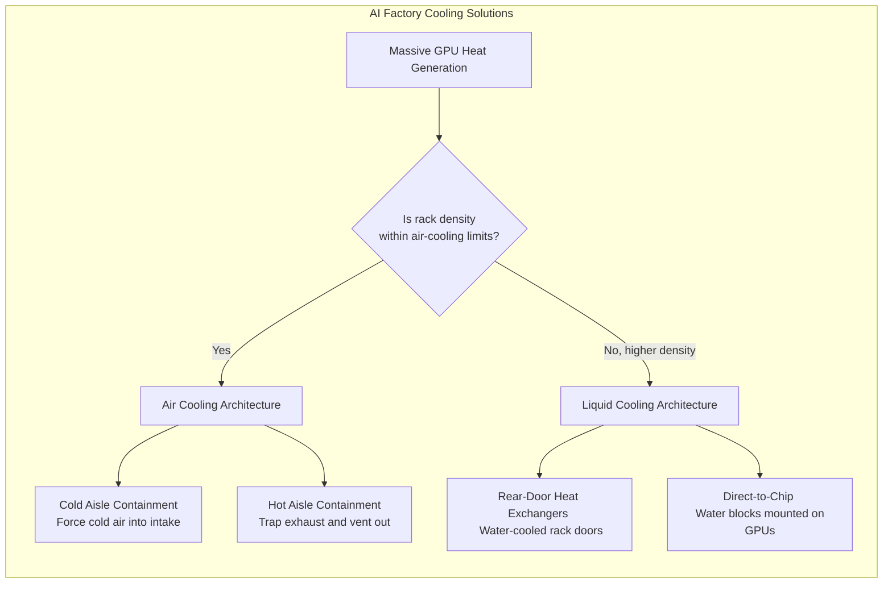

# Chapter 05 — Power Delivery and Thermal Management

## Chapter Metadata

| Key | Value |
|---|---|
| Volume | 21 — AI Factory: Building Large-Scale Production Systems |
| Difficulty | Architect |
| Estimated reading time | 35 minutes |
| Primary audience | Infrastructure architects, facility engineers, cost optimization leads |
| Core question | How do you deliver power to and cool dense GPU clusters without exceeding data center capacity or facility budgets? |

---


> **Note on figures:** Power, cooling efficiency, and cost figures in this chapter are planning assumptions for illustration. Use the vendor's rated power for the exact system (for example the DGX H100 user guide lists about 10.2 kW maximum per system) and your facility's measured PUE.

## Beginner's Primer: The Physics of AI

In traditional IT, a server rack holds 40 web servers and pulls about 5 to 10 kilowatts (kW) of power. You plug it into the wall, and the room's air conditioner keeps it cool.

AI completely breaks the physics of traditional data centers.
A single rack of modern NVIDIA DGX (H100) servers can pull **on the order of 40 kilowatts (kW) or more** (each system is rated at about 10.2 kW maximum, and four per rack is common for air cooling). 

To put that in perspective, 40 kW is several times the power of a whole traditional rack. You are putting the electrical and heat output of an entire neighborhood into a single 2-foot by 4-foot metal box.

If you put an AI rack into a traditional data center, two things happen instantly:
1. **The Brownout:** The server tries to pull more electricity than the copper wires in the wall can physically provide. The voltage sags, and the server crashes.
2. **The Meltdown:** The servers generate so much heat that the traditional air conditioning cannot physically blow cold air fast enough to stop the GPUs from hitting 90°C and thermal throttling.

To build an AI Factory, architects must move beyond software and understand Datacenter Facilities. This means high-density PDUs (Power Distribution Units), Hot/Cold Aisle Containment, and increasingly, Liquid Cooling (where water is piped directly over the hot silicon chips because air is no longer sufficient to carry the heat away).

## PART 1: POWER CONSUMPTION ANALYSIS

### 1.1 Component Power Budgets

```yaml
H100-BASED COMPUTE NODE POWER BREAKDOWN (DGX H100 class)

GPU power (per H100 SXM5):
  Idle: tens of watts
  Training: typically a large fraction of the 700W maximum TDP, depending on utilization
  Maximum TDP: 700W (configurable power limit; check nvidia-smi -q -d POWER)

Node-level (DGX H100 specification):
  8 GPUs:           8 × 700W = 5.6 kW at maximum TDP
  CPUs, memory, NVMe, 8 compute NICs, 2 DPUs, fans, and conversion losses:
                    the remainder of the system's maximum rating
  System maximum:   about 10.2 kW per node (use for provisioning)

Planning rule:
  Provision circuits, PDUs, and cooling for the system's rated maximum (10.2 kW), then
  use measured power (DCGM, PDU metering) to refine utilization-based cost estimates.
```

### 1.2 Cluster-Level Power Budget

```
64-GPU TRAINING CLUSTER (8 nodes × 8 GPU each)

Per-node provisioning power:      10.2 kW
Cluster IT load (provisioned):    8 nodes × 10.2 kW = 81.6 kW

Facility overhead (PUE, assumed): 1.35 (cooling, power distribution, lighting)
Total facility power at full load: 81.6 kW × 1.35 ≈ 110 kW

Assumed utilization schedule:
  Training (16 hours/day):    ~110 kW
  Idle (4 hours/day):         ~20 kW (cooling, power management, idle nodes)
  Maintenance (4 hours/day):  ~40 kW

Monthly energy (30 days):
  Training:     16 h × 30 × 110 kW = 52,800 kWh
  Idle:          4 h × 30 × 20 kW  =  2,400 kWh
  Maintenance:   4 h × 30 × 40 kW  =  4,800 kWh
  Total:                              60,000 kWh/month

At $0.12/kWh (US industrial average):
  Monthly cost: 60,000 × $0.12 = $7,200/month = $86,400/year for the 64-GPU cluster
  (facility overhead is already included through the PUE factor)
```

---

## PART 2: COOLING DESIGN

### 2.1 Cooling Technologies Comparison

| Cooling Type | Typical Role | Relative Capital Cost | Relative Operating Cost | Maintenance | Best For |
|---|---|---|---|---|---|
| **Air cooling (standard)** | Room-level CRAC/CRAH with hot/cold aisle | Lowest | Highest | Filter changes, fan maintenance | Lower-density racks, research labs |
| **Air with containment** | Hot or cold aisle containment, higher supply temperature | Low to moderate | Moderate | Containment integrity, filters | Production air-cooled racks (roughly up to 40 kW per rack) |
| **Direct-to-chip liquid (cold plate)** | Coolant loops to CPUs/GPUs with CDUs | Higher | Lower | Coolant quality, pumps, leak detection | High-density production clusters (Blackwell-class racks) |
| **Immersion** | Servers in dielectric fluid | Higher | Lower | Fluid handling, specialized service | Highest density and specialized facilities |

Efficiency differences are best compared through measured PUE for your site; request vendor data rather than using generic COP figures.

### 2.2 Reference Cooling Design: 64-GPU Air-Cooled Deployment

```
THERMAL DESIGN

Layout:
  64 GPUs = 8 nodes; with air cooling at about 4 nodes (≈ 40 kW) per rack this is 2 racks
  Front of rack: cold-aisle intake. Rear: hot-aisle exhaust.

Airflow estimate (sensible heat):
  Required airflow (CFM) ≈ 3.16 × Watts / ΔT(°F)
  For 81,600 W of IT load and a 20°C (36°F) air temperature rise:
    CFM ≈ 3.16 × 81,600 / 36 ≈ 7,160 CFM across the deployment
  Check the node's rated airflow and inlet temperature limits in the vendor's site requirements.

HVAC:
  Size cooling capacity for the total heat load (≈ 81.6 kW of IT heat plus margin) with N+1
  redundancy, and keep supply air within the vendor's inlet temperature specification.

Temperature monitoring:
  Inlet (cold-aisle) temperature: within the vendor's specified range
  GPU temperatures: watch trends against the GPU's slowdown and shutdown thresholds
  Alerts: rising GPU temperature at constant load, rising exhaust temperature, or containment breach
```

### 2.3 Thermal Shutdown & Throttling

```python
# Monitoring GPU thermal state

import subprocess

def monitor_gpu_thermal(warn_c=80):
    """Print GPUs above a site-chosen warning threshold."""
    out = subprocess.run(
        ['nvidia-smi', '--query-gpu=index,temperature.gpu', '--format=csv,noheader,nounits'],
        capture_output=True, text=True).stdout
    for line in out.strip().splitlines():
        gpu_id, temp_c = [x.strip() for x in line.split(',')]
        if int(temp_c) >= warn_c:
            print(f"WARNING: GPU {gpu_id} at {temp_c} C; check throttle reasons")

# Thresholds are model-specific. Query the slowdown and shutdown temperatures with:
#   nvidia-smi -q -d TEMPERATURE
# and confirm whether the GPU is actually throttling with:
#   nvidia-smi -q -d PERFORMANCE   (look for HW/SW Thermal Slowdown)
```

---

---

## PART 3: POWER DELIVERY ARCHITECTURE

### 3.1 Power Distribution Tiers

```
Power distribution (conceptual)

Tier 1: Utility / UPS feed to the row
  Provision per-rack circuits for the rack's rated load plus derating (continuous loads are typically
  limited to 80% of the breaker rating by electrical code). Example: 3-phase 208V at 60A is about
  21.6 kW rated and about 17.3 kW continuous, so a 40 kW rack needs multiple feeds.

Tier 2: Rack PDU (switched/monitored)
  Metered inlets and outlets, remote outlet control, SNMP/Redfish telemetry into Prometheus.
  Size and balance phases for the actual node PSU inputs.

Tier 3: Node power supplies
  DGX H100 uses multiple redundant power supplies; see the DGX H100 user guide for the supply
  count, redundancy scheme, and input voltage range. Feed supplies from independent PDUs/feeds
  (A/B) so one feed failure does not drop the node.

Planning: 8 nodes × 10.2 kW = 81.6 kW needs roughly 4-5 racks of capacity at 20 kW per rack, or
2 racks at ~40 kW per rack with the higher-density feeds.
```

### 3.2 Power Consumption Forecasting

```yaml
CLUSTER UTILIZATION & POWER PLANNING (illustrative)

Using ~110 kW facility power per 64-GPU job (Part 1.2) at 16 hours/day of training:

Month 1: 1 training job (8 nodes, 64 GPU)
  Facility power at load: ~110 kW → $13.20/hour
  Monthly: $13.20 × 16 × 30 ≈ $6,340

Month 2: 2 concurrent jobs (16 nodes, 128 GPU)
  Facility power at load: ~220 kW → $26.40/hour
  Monthly: $26.40 × 16 × 30 ≈ $12,670
  This exceeds a 144 kW budget, so power capacity must be added before the second job is deployed.

Planning rule: electricity scales roughly linearly with active nodes (about $86K/year per
64-GPU cluster under the schedule in Part 1.2). The binding constraint is usually committed
facility power and cooling capacity, not the electricity bill, so plan capacity upgrades
12 months ahead of cluster growth.
```

---

---

## PART 4: TROUBLESHOOTING TABLE

| Symptom | Diagnostic | Root Cause | Resolution | Prevention |
|---|---|---|---|---|
| **GPUs throttling (clock reduction)** | `nvidia-smi` shows clocks well below the GPU's max and a thermal slowdown reason active | Thermal throttle due to high temperature | Check cooling intake temp and airflow, verify chassis fan operation via the BMC | Monitor GPU temp trends against the GPU's slowdown threshold |
| **Power loss (GPUs offline)** | Node powers off completely; BIOS not accessible | PSU overload or circuit breaker trip | Check PDU power draw; reduce node load (2 instead of 4 training jobs concurrently) | Monitor PDU inlet amps; alert at >80A |
| **Intermittent node reboots** | Node restarts unprompted every 1–2 hours | Unstable power supply or thermal shutdown | Swap PSU with known-good unit; check inlet air temperature | Trend PSU output voltage; replace if unstable |
| **Hot-aisle temperature > 45°C (setpoint 30°C)** | CRAC intake 25°C but exhaust 50°C | Hot-aisle/cold-aisle mixture (containment breach) | Seal gaps in raised floor, verify CRAC intake is pulling cold air | Implement blanking panels, monitor containment quarterly |
| **Cooling COP degradation (1 year ago: COP 3.5, now: COP 2.8)** | Power draw same, but more CRAC activity | Evaporator coil fouled with dust; reduced cooling efficiency | Replace CRAC filters, clean fins | Change filters every 3 months, trend CRAC power/cooling curve |

## Architecture Summary

AI Infrastructure relies on extreme power density. An 8-GPU node draws up to about 10 kW, and training power swings with the workload, which traditional datacenter PDUs and HVAC systems may not support. Architects must design containment cooling (preventing hot exhaust from mixing with cold intake) or migrate entirely to Direct-to-Chip Liquid Cooling for next-generation silicon (e.g., Blackwell).



---

## SUMMARY

Power and thermal design determines cluster reliability and operating cost:

1. **Power budget:** about 82 kW of IT load per 64-GPU H100 cluster (8 nodes at ~10.2 kW), roughly 110 kW at the facility with a PUE of 1.35.
2. **Cooling:** Air cooling works up to roughly 40 kW per rack with containment; beyond that, direct-to-chip liquid cooling is the usual path. Compare options with measured PUE and vendor quotes.
3. **Monitoring:** Track GPU temp, PDU watts, inlet air temp; alert when any exceed thresholds.
4. **Forecasting:** Plan facility power upgrades 12 months ahead; each additional 64-GPU job adds roughly another 110 kW of facility power.

**In Chapter 6:** Software stack integration. How do you orchestrate CUDA, PyTorch, JAX, and distributed training frameworks to actually use all 64 GPUs efficiently?
