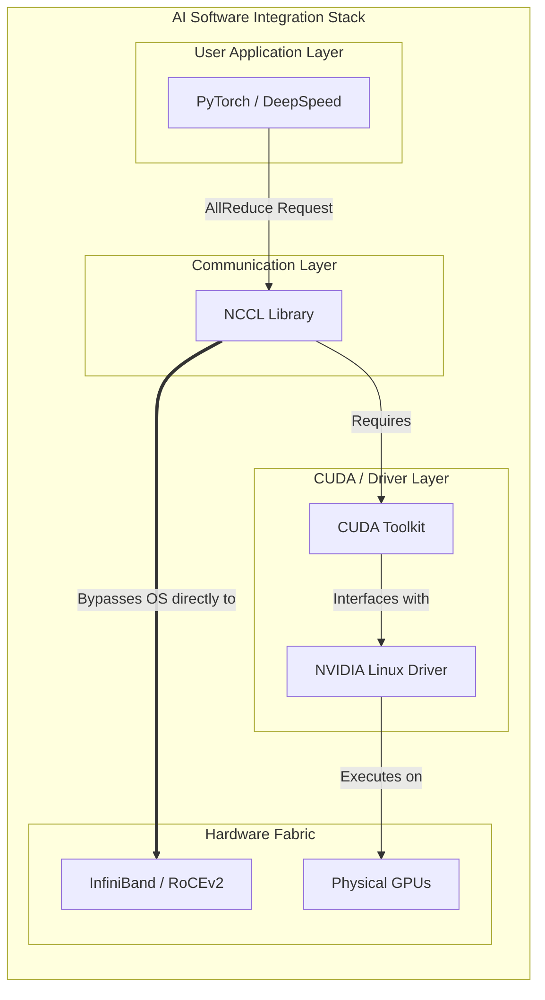

# Chapter 06 — Software Stack Integration

## Chapter Metadata

| Key | Value |
|---|---|
| Volume | 21 — AI Factory: Building Large-Scale Production Systems |
| Difficulty | Architect |
| Estimated reading time | 35 minutes |
| Primary audience | Software engineers, platform leads, DevOps engineers |
| Core question | How do you configure CUDA, frameworks, and distributed training libraries so they actually use 64+ GPUs efficiently without configuration errors? |

---


> **Note on figures:** Version numbers, configuration values, and performance expectations in this chapter are examples. Check NVIDIA's CUDA compatibility documentation, the NGC container release notes, and the framework documentation for the versions you deploy.

## Beginner's Primer: The Software Glue

If you build a massive AI Factory with H100 GPUs, InfiniBand networks, and Liquid Cooling, you have only built the *hardware*. 

The GPUs don't magically know how to talk to each other. If a Data Scientist runs standard Python code, it will run on exactly 1 CPU core and ignore all $50 Million of hardware. 

You need **Software Glue** to stitch the hardware together:
1. **CUDA & Drivers:** This tells Linux how to talk to the physical silicon.
2. **NCCL (NVIDIA Collective Communication Library):** This tells the GPUs how to send data over the InfiniBand network.
3. **PyTorch / DeepSpeed:** This takes the AI Model, shatters it into 64 pieces, and assigns one piece to each GPU. 
4. **Orchestration (torchrun / MPI):** This is the master coordinator. It starts the Python script on all 64 GPUs simultaneously and assigns them their "Rank" (e.g., "You are GPU #42"). 

If any of these layers are misconfigured, the training job will instantly crash with cryptic errors like `NCCL operation timed out`. This chapter teaches you how to configure the stack so that PyTorch perfectly aligns with the physical hardware topology.

## PART 1: CUDA RUNTIME CONFIGURATION

### 1.1 CUDA Version & Driver Alignment

```yaml
COMPATIBILITY PRINCIPLES (versions change; verify against NVIDIA documentation)

Layers, bottom to top:
  GPU hardware and firmware
  NVIDIA kernel driver (installed on the host; sets the maximum CUDA version supported)
  CUDA runtime/toolkit (often bundled inside the framework container or wheel)
  cuDNN, NCCL, cuBLAS (bundled or installed alongside the toolkit)
  Framework (PyTorch, JAX) built against specific CUDA/cuDNN/NCCL versions

Rules that hold across releases:
  - The host driver must be at least as new as the minimum required by the CUDA version in the container.
  - Within one CUDA major version, CUDA minor-version compatibility lets newer toolkits run on
    older drivers (with some feature limits); across major versions you need a new driver.
  - Prefer NVIDIA NGC framework containers: each release pins a tested combination of CUDA,
    cuDNN, NCCL, and framework, and its release notes state the minimum driver.
  - Use the same container image on every node of a job, and the same driver branch on every host.
  - Pin and record the versions (driver, CUDA, NCCL, framework) with every training run.

Check what is installed:
  nvidia-smi                      (driver version and the highest CUDA version it supports)
  python -c "import torch; print(torch.version.cuda, torch.cuda.nccl.version())"
```

### 1.2 CUDA Memory Management

```python
# Useful CUDA/PyTorch settings for multi-GPU training

import os
import torch

# 1. Consistent device ordering across tools (nvidia-smi, CUDA) on every node
os.environ.setdefault("CUDA_DEVICE_ORDER", "PCI_BUS_ID")

# 2. Allocator configuration to reduce fragmentation. Set before the first CUDA allocation.
#    (expandable_segments is available in recent PyTorch releases; see the PyTorch CUDA docs)
os.environ.setdefault("PYTORCH_CUDA_ALLOC_CONF", "expandable_segments:True")

# 3. Peer-to-peer access: CUDA enables NVLink/PCIe peer access automatically when NCCL or
#    PyTorch copies between GPUs. You can check capability, but you do not enable it by hand:
n = torch.cuda.device_count()
for i in range(n):
    for j in range(n):
        if i != j:
            print(i, j, torch.cuda.can_device_access_peer(i, j))

# 4. Inspect memory (reserved memory includes the caching allocator's cached blocks)
def check_gpu_memory():
    for i in range(torch.cuda.device_count()):
        total = torch.cuda.get_device_properties(i).total_memory / 1e9
        allocated = torch.cuda.memory_allocated(i) / 1e9
        reserved = torch.cuda.memory_reserved(i) / 1e9
        print(f"GPU {i}: total {total:.1f} GB, allocated {allocated:.1f} GB, reserved {reserved:.1f} GB")

check_gpu_memory()
```

CUDA Graphs (to reduce kernel-launch overhead) are enabled through the framework (for example PyTorch CUDA graph capture or `torch.compile` modes), not through `CUDA_LAUNCH_BLOCKING`, which only forces synchronous kernel launches for debugging and should stay at `0` in production.

---

## PART 2: PYTORCH DISTRIBUTED TRAINING SETUP

### 2.1 DDP (Distributed Data Parallel) Configuration

```python
import datetime
import torch
import torch.distributed as dist
from torch.nn.parallel import DistributedDataParallel as DDP
import torch.multiprocessing as mp

def setup_distributed():
    """Initialize distributed training with NCCL backend"""
    
    # 1. Initialize process group
    # Each process gets RANK (0–63), LOCAL_RANK (0–7 per node), WORLD_SIZE (64)
    # Set by torch.distributed.launch or torchrun
    
    import os
    rank = int(os.environ.get("RANK", 0))
    world_size = int(os.environ.get("WORLD_SIZE", 1))
    local_rank = int(os.environ.get("LOCAL_RANK", 0))
    
    # Set device (each process runs on one GPU)
    torch.cuda.set_device(local_rank)
    device = torch.device("cuda", local_rank)
    
    # Initialize backend (NCCL is default for GPU training)
    dist.init_process_group(
        backend="nccl",  # GPU-optimized collective backend
        rank=rank,
        world_size=world_size,
        timeout=datetime.timedelta(minutes=30),  # Timeout for hung processes
    )
    
    return device, rank, world_size

def train_distributed():
    device, rank, world_size = setup_distributed()
    
    # Load model
    model = MyTransformer(...)
    model = model.to(device)
    
    # Wrap with DDP (handles AllReduce for gradients automatically)
    local_rank = int(os.environ["LOCAL_RANK"])
    model = DDP(model, device_ids=[local_rank], output_device=local_rank)
    
    # Optimizer
    optimizer = torch.optim.AdamW(model.parameters(), lr=1e-4)
    
    # Training loop
    for epoch in range(num_epochs):
        for batch_idx, (x, y) in enumerate(dataloader):
            x, y = x.to(device), y.to(device)
            
            # Forward pass
            logits = model(x)
            loss = criterion(logits, y)
            
            # Backward (automatically calls AllReduce for gradients)
            optimizer.zero_grad()
            loss.backward()
            
            # AllReduce happens inside loss.backward() (DDP hooks)
            # No explicit dist.all_reduce() needed!
            
            optimizer.step()
            
            if rank == 0 and batch_idx % 100 == 0:
                print(f"Epoch {epoch}, Batch {batch_idx}, Loss {loss:.4f}")
    
    # Cleanup
    dist.destroy_process_group()

# Launch with torchrun (recommended):
# torchrun --nproc_per_node=8 --nnodes=8 --node_rank=0 --rdzv_backend=c10d --rdzv_endpoint=node0:29500 train_script.py
# (use --rdzv_id and the same command on every node; node_rank may be omitted with an elastic rendezvous)

# (torch.distributed.launch is deprecated in favor of torchrun)
```

### 2.2 DeepSpeed Integration (Production-Grade Training)

```python
# DeepSpeed: Production distributed training with ZeRO optimization

import deepspeed
import torch

def train_with_deepspeed():
    model = MyTransformer(...)
    
    # DeepSpeed config (ds_config.json)
    ds_config = {
        "train_micro_batch_size_per_gpu": 4,   # per-GPU micro-batch (example value)
        "gradient_accumulation_steps": 8,      # global batch = micro_batch × accumulation × world_size
        "bf16": {"enabled": True},
        "optimizer": {
            "type": "AdamW",
            "params": {"lr": 1e-4, "betas": [0.9, 0.999], "eps": 1e-8, "weight_decay": 0.01}
        },
        "zero_optimization": {
            "stage": 3,  # Shards parameters, gradients, and optimizer state across data-parallel ranks
            # CPU offload trades GPU memory for PCIe traffic and is usually unnecessary on 80GB GPUs:
            # "offload_optimizer": {"device": "cpu", "pin_memory": True},
            # "offload_param": {"device": "cpu", "pin_memory": True},
            "reduce_scatter": True,
            "contiguous_gradients": True,
        },
        "gradient_clipping": 1.0,
    }
    # Data-parallel size comes from the launcher's world size (64 here), not from this config.
    
    # Initialize DeepSpeed engine
    model_engine, optimizer, _, _ = deepspeed.initialize(
        model=model,
        model_parameters=model.parameters(),
        config_dict=ds_config,
        dist_init_required=True,
    )
    
    # Training loop (simpler than manual DDP)
    for epoch in range(num_epochs):
        for batch in dataloader:
            x, y = batch
            
            logits = model_engine(x)
            loss = criterion(logits, y)
            
            model_engine.backward(loss)  # DeepSpeed handles AllReduce + ZeRO updates
            model_engine.step()
            
            if model_engine.global_rank == 0:
                print(f"Loss: {loss:.4f}, LR: {model_engine.get_lr()[0]:.2e}")
    
    # Save checkpoint (DeepSpeed format includes all ZeRO state)
    model_engine.save_checkpoint("./checkpoints", tag="final")

# Benefits over vanilla DDP:
#   ZeRO Stage 3 shards parameters, gradients, and optimizer state across ranks, so per-GPU
#   model-state memory drops roughly in proportion to the number of ranks
#   Optional CPU/NVMe offload for models that still do not fit
#   Activation checkpointing is configured separately (it is not automatic)
#   Built-in gradient accumulation
```

---

## PART 3: MULTI-FRAMEWORK ORCHESTRATION

### 3.1 PyTorch + JAX Interop

Mixing PyTorch data loading with JAX compute is uncommon, but it works when needed. Move tensors between frameworks without a host copy using DLPack (`torch.utils.dlpack.to_dlpack` and `jax.dlpack.from_dlpack`, or the `__dlpack__` protocol in recent releases), keep both frameworks on the same CUDA version, and avoid `numpy()` round trips on GPU tensors because they force a device-to-host copy. For multi-node JAX, initialize with `jax.distributed.initialize` and use the same NCCL-based collectives stack.

### 3.2 Kubernetes Orchestration for Distributed Training

For production, prefer a purpose-built operator (Kubeflow Training Operator `PyTorchJob`, or a batch scheduler such as Kueue/Volcano) that gang-schedules all pods together. A plain Kubernetes Job can work using Indexed completion mode and a headless Service, as sketched below (adapt names and sizes to your cluster).

```yaml
apiVersion: v1
kind: Service
metadata:
  name: llama-train            # headless service for pod DNS
spec:
  clusterIP: None
  selector:
    job-name: llama-70b-training
---
apiVersion: batch/v1
kind: Job
metadata:
  name: llama-70b-training
spec:
  completionMode: Indexed      # each pod gets JOB_COMPLETION_INDEX 0..7
  parallelism: 8               # 8 nodes × 8 GPU = 64 GPUs (all must run together)
  completions: 8
  backoffLimit: 3
  template:
    spec:
      restartPolicy: Never
      subdomain: llama-train   # pods resolve as llama-70b-training-<index>.llama-train
      containers:
      - name: training
        image: nvcr.io/nvidia/pytorch:24.06-py3   # example NGC tag; pin a tested release
        resources:
          limits:
            nvidia.com/gpu: 8
          requests:
            nvidia.com/gpu: 8
        command: ["/bin/bash", "-c"]
        args:
          - >
            torchrun --nproc_per_node=8 --nnodes=8
            --node_rank=$JOB_COMPLETION_INDEX
            --master_addr=llama-70b-training-0.llama-train --master_port=29500
            /workspace/train.py
        volumeMounts:
        - name: checkpoints
          mountPath: /workspace/checkpoints
      volumes:
      - name: checkpoints
        persistentVolumeClaim:
          claimName: training-checkpoints-pvc
      affinity:
        podAntiAffinity:       # one pod per node (each pod uses all 8 GPUs of its node)
          requiredDuringSchedulingIgnoredDuringExecution:
          - labelSelector:
              matchExpressions:
              - key: job-name
                operator: In
                values: ["llama-70b-training"]
            topologyKey: kubernetes.io/hostname
```

A plain Job does not gang-schedule: if only some pods can be placed, the ones that start will wait for the missing ranks until the rendezvous times out. That is the main reason to use Kueue, Volcano, or the Training Operator. Also set InfiniBand/RDMA device access (for example via the NVIDIA Network Operator) so the pods can use the high-speed fabric.

---

## PART 4: TROUBLESHOOTING TABLE

| Issue | Symptom | Root Cause | Resolution |
|---|---|---|---|
| **NCCL initialization timeout** | `RuntimeError: NCCL operation timed out` at startup | Master address unreachable or rank mismatch | Check MASTER_ADDR DNS resolution from every pod, verify node ranks match pod indexes, confirm all pods are scheduled (gang scheduling), and only then consider a longer timeout |
| **GPU peer access failure** | `RuntimeError: invalid device ordinal` or P2P disabled | GPU drivers not matching or insufficient permissions | Verify nvidia-smi output consistent on all nodes, check /proc/driver/nvidia/gpus permissions |
| **Out-of-memory during training** | `torch.cuda.OutOfMemoryError: CUDA out of memory` | Model too large or batch size too high | Reduce batch size, enable gradient checkpointing, use ZeRO Stage 3 offloading |
| **Slow gradient transfer (AllReduce)** | AllReduce far slower than the nccl-tests baseline for this cluster | IB disabled, using TCP fallback, or network congestion | Set `NCCL_DEBUG=INFO`, verify IB link status, reduce concurrent jobs |

## Architecture Summary

Integrating the software stack for an AI Factory requires perfectly aligning the Host OS driver versions with the Containerized PyTorch libraries. Distributed training frameworks (like DeepSpeed or Megatron) must be initialized with exact knowledge of their environment (WORLD_SIZE, RANK, MASTER_ADDR) to ensure that NCCL can successfully establish high-speed RDMA connections across the InfiniBand fabric.



---

## SUMMARY

Software stack integration requires:

1. **CUDA/Driver alignment:** Match versions; use latest stable driver + CUDA Toolkit.
2. **DDP or DeepSpeed:** For 64+ GPU training, use DeepSpeed ZeRO for memory efficiency.
3. **Distributed initialization:** Use torchrun or torch.distributed.launch; verify RANK/WORLD_SIZE.
4. **Monitoring:** Log GPU memory, AllReduce latency, throughput every iteration.

**In Chapter 7:** Multi-node distributed training deep dive.
