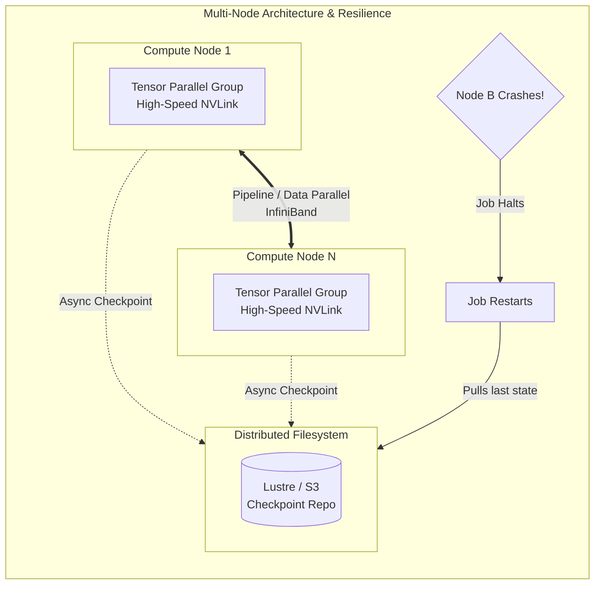

# Chapter 07 — Multi-Node Distributed Training

## Beginner's Primer: Beyond a Single Server

In Volume 13, we covered the deep mathematical mechanics of Distributed Training (FSDP, ZeRO, Megatron). In this chapter, we apply those concepts to the physical architecture of the AI Factory.


> **Note on figures:** Throughputs, step times, and recovery times in this chapter are illustrative assumptions. Measure tokens per second and recovery time on your own cluster.

When you train a massive AI model (like a 70B LLM), it is impossible to fit it on one physical server. You must distribute the job across multiple physical servers (Multi-Node).

This introduces massive physical risks:
1. **The Network Bottleneck:** Inside a single server, GPUs talk over NVLink at 900 GB/s. Between servers, they talk over InfiniBand at 50 GB/s. If you split your math wrong (e.g., trying to do Tensor Parallelism across two separate servers), the training job will crawl to a halt.
2. **The Hardware Failure Guarantee:** If you run 512 GPUs for 3 months, it is a statistical certainty that a GPU will melt, a network cable will fail, or a power supply will surge. If you do not have an automated Checkpointing and Fault Tolerance strategy, a single hardware failure will destroy 3 months of progress and millions of dollars.

Platform Architects must build training clusters assuming that hardware will constantly fail, and networks will constantly congest.

## PART 1: SCALING STRATEGIES

### 1.1 Data Parallelism (Batch Size Scaling)

```python
# Standard approach: Increase batch size with GPU count
# Gradient = sum of per-GPU losses, then AllReduce

batch_size_per_gpu = 128
num_gpus = 64
global_batch_size = batch_size_per_gpu * num_gpus  # 8192 sequences

# Training convergence:
#   Larger batch = noisier gradient estimate = need higher learning rate
#   Heuristic: LR scales with sqrt(batch_size)
#   base_lr = 1e-4 (for 32-token batch)
#   scaled_lr = base_lr * sqrt(8192 / 32) = base_lr * 16 = 1.6e-3

# Learning-rate scaling is a heuristic (linear and square-root rules both exist); tune it and use warmup.
# Scaling efficiency = (cluster throughput) / (N × single-GPU throughput); measure it, and
# expect it to fall as AllReduce time becomes exposed.
```

### 1.2 Pipeline Parallelism (Stage Splitting)

Pipeline parallelism assigns consecutive groups of layers to different GPUs (stages), so no single GPU must hold the whole model. To keep stages busy, each batch is split into micro-batches that flow through the stages in a pipeline.

```text
4 stages, 4 micro-batches (forward only, schematic):
  time →
  stage 0: m0 m1 m2 m3
  stage 1:    m0 m1 m2 m3
  stage 2:       m0 m1 m2 m3
  stage 3:          m0 m1 m2 m3
The idle slots at the start and end are the "pipeline bubble". With p stages and m micro-batches
the bubble fraction is roughly (p - 1) / (m + p - 1), so more micro-batches shrink it.
Schedules such as 1F1B interleave forward and backward passes to limit activation memory.
```

Cost: point-to-point activation transfers between stages (cheap compared with AllReduce when stages sit on different nodes), bubble overhead, and more complex code. In PyTorch, see `torch.distributed.pipelining` (schedules such as GPipe and 1F1B); production LLM stacks usually use Megatron-LM or NeMo, which combine pipeline, tensor, and data parallelism.

### 1.3 Tensor Parallelism (Intra-Layer Sharding)

Tensor parallelism splits the weight matrices inside a layer across GPUs. In a Transformer MLP block, the first matrix is split by columns and the second by rows (Megatron-style), so each block needs one AllReduce in the forward pass and one in the backward pass; attention is split by heads in the same spirit.

```python
# Megatron-Core configuration sketch (other required TransformerConfig fields omitted)
from megatron.core.transformer.transformer_config import TransformerConfig

config = TransformerConfig(
    num_layers=80, hidden_size=8192, num_attention_heads=64,   # example Llama-70B-like shape
    tensor_model_parallel_size=8,     # shard each layer across the 8 GPUs of one node (NVLink)
    pipeline_model_parallel_size=2,   # 2 pipeline stages across nodes
)
# Tensor parallel communication happens on every layer, so keep it inside one NVLink domain
```

---

## PART 2: FAULT TOLERANCE & CHECKPOINTING

### 2.1 Checkpoint Resume Strategy

Resilience starts with checkpoints that every rank can write and every restart can read. Use sharded, per-rank checkpoints (see Chapter 04, Part 3: PyTorch Distributed Checkpoint, DeepSpeed, or Megatron checkpoints) rather than gathering the whole model on rank 0, which does not scale to large models and fails under ZeRO-3/FSDP sharding.

Policy checklist:
- Checkpoint on a step interval derived from the cost of lost work versus the cost of writing (for example every 500 steps or every few hours), written first to fast node-local or shared storage and copied asynchronously to object storage.
- Keep several recent checkpoints (not just one) and verify the newest by resuming from it before pruning older ones.
- Record the step, data-loader position, RNG state, and learning-rate schedule so a resume continues the same trajectory.
- Restart automatically from the latest complete checkpoint when a failure occurs (next section).

```text
Example: cluster fails at step 5243 with a checkpoint every 500 steps
  - Restart the job; the launcher loads step-5000
  - Training resumes from step 5001
  - At most 500 steps of work are ever lost; here 243
```

### 2.2 Detecting & Recovering from Failures

When a rank or node dies, the NCCL communicators across the job are broken, and collectives either error out or hang until the timeout. In-process `try/except` retry loops generally cannot repair that state; the reliable pattern is to let the process group fail, kill the job, and restart from the last checkpoint:

- **torchrun elastic restarts:** `torchrun --max-restarts=3 ...` restarts all workers after a failure (with a rendezvous backend such as c10d), and the training script resumes from the latest checkpoint at start-up.
- **Scheduler-level restarts:** Slurm requeue (`--requeue`) or Kubernetes Job/Training Operator restart policies relaunch the job on healthy nodes; combine with node health checks (DCGM diag) so a bad node is excluded.
- **Detect hangs, not just crashes:** set a bounded collective timeout and a watchdog (PyTorch's NCCL watchdog and flight recorder help diagnose which rank stalled), then restart.
- **Spare capacity:** keep spare nodes so a restart does not wait for hardware repair.

Recovery time is dominated by detection time (the timeout), scheduling, process start-up, and checkpoint load; measure it in a game-day exercise.

---

---

## PART 3: TROUBLESHOOTING PERFORMANCE DEGRADATION

| Issue | Symptom | Diagnostic | Resolution |
|---|---|---|---|
| **Training slow (8hrs instead of 6hrs for 1 epoch)** | Throughput 30% below expected (20M tokens/sec vs 32M) | Check GPU utilization (nvidia-smi), AllReduce time (nccl-tests, profiler, NCCL_DEBUG=INFO), I/O latency | Increase batch size, reduce checkpointing frequency, verify no noisy neighbors |
| **Stragglers (1 GPU much slower than others)** | One rank consistently slow in AllReduce, training hangs | Per-rank timing or profiler traces show one rank arriving late to the collective | Replace slow GPU, check thermal throttling (nvidia-smi dmon), verify network link |
| **Deadlock in AllReduce (hangs indefinitely)** | Training freezes during backward pass, no output for 30+ seconds | NCCL op counts stop advancing for a full iteration or longer, IB port errors | Identify the lagging rank (Volume 20 Chapter 3), check IB link status (`ibstat`, `perfquery`), and restart from the last checkpoint; raise the timeout only if the fabric and ranks are healthy |
| **Model divergence (loss NaN)** | Loss becomes NaN after 1000 steps (was stable initially) | Check gradient magnitudes (print param.grad.abs().max()), learning rate | Reduce LR by 2x, enable gradient clipping (clip_grad_norm=1.0), check data pipeline |

## Architecture Summary

Designing a multi-node training cluster requires strict adherence to physical boundaries. Tensor Parallelism must be restricted to the boundaries of a single node (NVLink), while Data and Pipeline Parallelism can span across nodes (InfiniBand). Furthermore, because multi-node training is highly susceptible to hardware failures, operators must implement rapid, asynchronous checkpointing to distributed parallel file systems to minimize the blast radius of a node crash.



---

## SUMMARY

Distributed training at 64+ GPUs requires:

1. **Scaling strategy:** Data parallelism (batch size) scales to 128+ GPU; pipeline/tensor parallelism needed for larger models.
2. **AllReduce optimization:** Overlap communication with backward compute and keep tensor-parallel traffic on NVLink; measure the exposed communication share.
3. **Fault tolerance:** Sharded checkpoints at a measured interval; automatic restart from the last verified checkpoint on failure.
4. **Monitoring:** Track throughput, AllReduce latency, gradient norm, loss trends.

**In Chapter 8:** Inference serving (different from training; optimizes latency instead of throughput).
