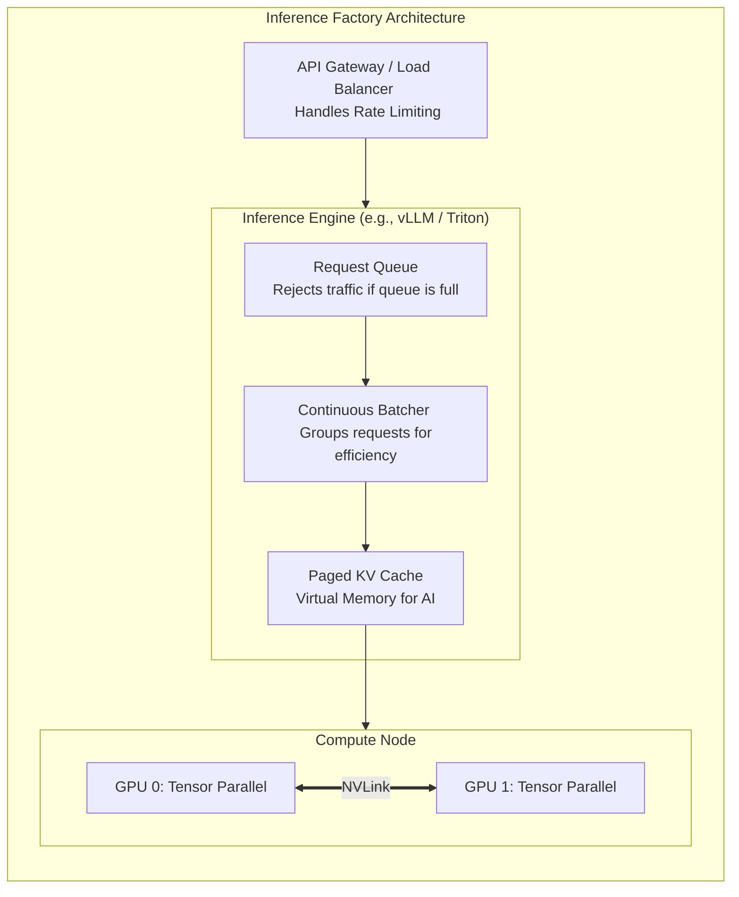

# Chapter 08 — Inference Serving at Scale

## Beginner's Primer: The Inference Economics

In Volume 12, we covered the deep technical execution of AI Inference (Prefill vs. Decode, KV Cache, PagedAttention). In this chapter, we apply those concepts to the design of the AI Factory.


> **Note on figures:** Decode rates, batch sizes, QPS, and cost figures in this chapter are planning assumptions derived from the first-principles model shown, not benchmark results. Benchmark your model, precision, and serving engine before sizing.

Building an Inference cluster is an exercise in **Economics**. 
In Training, you just want to finish the job as fast as possible. 
In Inference, your goal is to process the maximum number of user requests per dollar of hardware (Throughput) *without* breaching the user's patience threshold (Latency SLA).

If you misconfigure your AI Factory's inference layer, you might achieve an incredible 10,000 requests per second, but every user has to wait 5 seconds for a response. The business will fail. 

Architects use Continuous Batching engines (like vLLM or Triton) to perfectly balance this. They dynamically pack user requests together to maximize GPU utilization, while ejecting finished requests instantly to minimize latency. This chapter teaches you how to scale these engines across massive hardware clusters to support thousands of Queries Per Second (QPS).

## PART 1: INFERENCE ARCHITECTURE FUNDAMENTALS

### 1.1 Throughput vs. Latency Trade-off

LLM decode is memory-bandwidth bound: every decode step reads all model weights (plus the KV cache) from HBM, and that cost is shared by every sequence in the batch. This is why batching raises throughput almost for free until compute or KV-cache memory becomes the limit.

```python
# First-principles decode model for Llama-3-70B in BF16 on 2x H100 (tensor parallel = 2)

weights_gb = 140                       # 70B params x 2 bytes
weights_per_gpu_gb = weights_gb / 2    # 70 GB read per decode step per GPU
hbm_tb_s = 3.35                        # H100 SXM HBM3 bandwidth

min_step_ms = weights_per_gpu_gb / (hbm_tb_s * 1000) * 1000   # = 20.9 ms lower bound
step_ms = 30                           # assumed real step time (KV reads, kernels, TP communication)

per_sequence_tokens_s = 1000 / step_ms          # ~33 tokens/s per sequence
batch = 64                                      # concurrent sequences (continuous batching)
replica_tokens_s = batch * per_sequence_tokens_s  # ~2,100 tokens/s per 2-GPU replica (~1,070 per GPU)

# KV cache check: ~320 KB per token (Llama-3-70B, BF16); 64 sequences x ~660 tokens = ~14 GB,
# which fits in the ~20 GB left after weights on two 80 GB GPUs.
```

Strategy comparison (same hardware, assumed numbers):

```text
Static large batches (B=256, wait for the batch to fill):
  Throughput: high; latency: poor (requests wait for the batch and for the slowest sequence)
  Best for: offline / batch inference

Static small batches (B=4):
  Latency: good; throughput: poor (GPU memory bandwidth is mostly wasted)
  Cost per token: high

Continuous batching (recommended for online serving):
  New requests join the running batch at every decode step; finished sequences leave immediately.
  Throughput approaches the large-batch case while TTFT stays near prefill time plus queueing.
  Limits: KV-cache memory, compute at large batch, and the TTFT/ITL SLO.
```

### 1.2 vLLM Serving Architecture

vLLM implements continuous batching and PagedAttention. For production, run its OpenAI-compatible server (or Triton with the vLLM/TensorRT-LLM backend) rather than calling the offline `LLM` class from a request handler.

```bash
# Example: Llama-3-70B-Instruct on 2 GPUs (tensor parallel), BF16
vllm serve meta-llama/Llama-3.1-70B-Instruct \
  --tensor-parallel-size 2 \
  --dtype bfloat16 \
  --max-num-seqs 64 \
  --gpu-memory-utilization 0.90
# Flag names and defaults change between vLLM releases; check `vllm serve --help` for your version.
```

Planning expectations for this configuration (assumptions from Part 1.1, to be benchmarked):
- Per-sequence decode rate: roughly 30 tokens/s.
- Concurrency: up to `max-num-seqs` sequences, limited by KV-cache memory.
- TTFT: prefill time plus queueing; keep the queue short with admission control.

---

## PART 2: MULTI-GPU INFERENCE SCALING

### 2.1 Tensor Parallelism for Inference

```yaml
SCALING LLAMA-70B INFERENCE

Single H100 (80GB VRAM):
  BF16 weights: 140 GB → does not fit.
  FP8/INT8 weights: ~70 GB → fits, but leaves roughly 10 GB for KV cache and activations,
  so concurrency is small; quantization quality must be validated for your task.

Option 1: Quantization (FP8 or INT8) on 1 GPU
  Lower cost per replica; limited KV-cache headroom; validate accuracy on your evals.

Option 2: 2-GPU Tensor Parallelism (BF16)
  70 GB of weights per GPU, leaving about 10 GB per GPU for KV cache and activations.
  Communication: AllReduce on NVLink within the node each layer (small relative to the weight reads).
  Quality: no quantization loss.

Option 3: 4-GPU or 8-GPU Tensor Parallelism
  More KV-cache room and lower per-token latency (less weight to read per GPU), at the price of
  more communication and fewer replicas per node. Worth it for latency-critical or much larger models.

Recommendation: start with 2-GPU TP in BF16 (or FP8 on 2 GPUs for more KV room), measure
latency and throughput, then adjust.
```

### 2.2 Multi-GPU Serving Cluster

```yaml
PRODUCTION INFERENCE CLUSTER: 2000 QPS PEAK

Requirement: Serve Llama-70B with p99 TTFT <500ms, 99.9% availability

Scaling calculation (assumptions from Part 1.1):
  Per-sequence decode rate: ~36 tokens/s (28 ms per step, assumed)
  Avg response: 150 tokens → ~4.2 s per sequence
  Concurrent sequences per 2-GPU replica: 64
  Replica throughput: 64 / 4.2 s ≈ 15.2 QPS per replica (2 GPUs)

  Design target — N+1 regional failover: with 3 active-active regions, any ONE region can
  fail and the remaining TWO must absorb the full 2000 QPS, so each region must support
  ~1000 QPS on its own:
    Replicas per region: 1000 / 15.2 ≈ 66; GPUs per region: 66 × 2 ≈ 132
    Total across 3 regions: ≈ 396 GPUs; with 8 GPUs per node ≈ 17 nodes per region

Deployment:
  Region 1 (us-west): 17 nodes (136 GPUs), 68 replicas ≈ 1,034 QPS capacity
  Region 2 (us-east): 17 nodes, same setup
  Region 3 (eu-west): 17 nodes, same setup
  Total: 51 nodes, 408 GPUs; ~667 QPS per region in normal operation, ~1,034 QPS of
  headroom per region during a single-region failover

Infrastructure cost (illustrative):
  Hardware: 408 GPUs × $30K = $12.24M
  Network: multi-region bandwidth, $2M/year (assumed)
  Power: 408 × 700W = 285.6 kW at maximum TDP; assume ~60% average draw and a 1.35 PUE:
         285.6 × 0.6 × 1.35 ≈ 231 kW → 231 × 8760 h × $0.12/kWh ≈ $243K/year
  Personnel: 10 SRE/Eng × $150K = $1.5M/year
  Total 3-year cost: $12.24M + ($2M + $0.243M + $1.5M) × 3 ≈ $23.5M
  Annual tokens served at constant peak load: 2000 QPS × 86,400 × 365 × 150 ≈ 9.46 trillion tokens/year
  Cost per 1M tokens: ($23.5M / 3) / 9.46M ≈ $0.83 per 1M tokens (real cost is higher at lower average load)
```

---

---

## PART 3: SERVING CHALLENGES & SOLUTIONS

| Challenge | Impact | Solution |
|---|---|---|
| **High tail latency (p99 > 1 sec) while p50 &lt; 100ms** | User experience poor during traffic spikes | Implement queue backpressure; reject requests at 99.95% full capacity instead of queueing indefinitely |
| **Model inference timeout (>30 sec, triggers client disconnect)** | Requests dropped, user sees error | Implement per-request timeout budget; reject new requests if response cannot complete within SLA |
| **KV cache fragmentation (memory wasted by incomplete sequences)** | Max concurrent sequences drops over time | Use a paged KV cache (PagedAttention, as in vLLM), which allocates fixed-size blocks and largely avoids fragmentation; enable prefix caching for shared prompts |
| **Unbalanced multi-GPU load (one GPU at 100%, others at 40%)** | Worst GPU is bottleneck; others idle | Use load-aware request routing; distribute based on estimated tokens per response |
| **Quantization quality degradation** | User-facing output quality worse | Evaluate quantized models on your own task benchmarks, try a less aggressive format (FP8 instead of INT4), or keep sensitive layers in higher precision |

## Architecture Summary

Designing an Inference AI Factory is fundamentally different from a Training Factory. The primary constraint is no longer compute (FLOPS), but Memory Bandwidth (reading weights) and VRAM capacity (holding KV Cache). Engineers must utilize specialized serving engines (like vLLM) that implement Continuous Batching and PagedAttention to maximize throughput without breaching strict Time-To-First-Token (TTFT) latency SLAs.



---

## SUMMARY

Inference serving differs fundamentally from training:

1. **Latency SLA:** Target p99 TTFT &lt;500ms, not max throughput.
2. **Continuous batching:** A dynamic batch (up to the KV-cache and SLO limits) achieves most of the throughput of large static batches with much lower latency.
3. **Scaling:** Decode is memory-bandwidth bound per step; batching amortizes the weight reads, so add replicas for concurrency and tensor-parallel GPUs for latency and KV-cache room.
4. **Multi-region:** Replicate clusters across regions for the availability SLA; size each region for the failover case.

**In Chapter 9:** Multi-region deployment and failover mechanisms.
