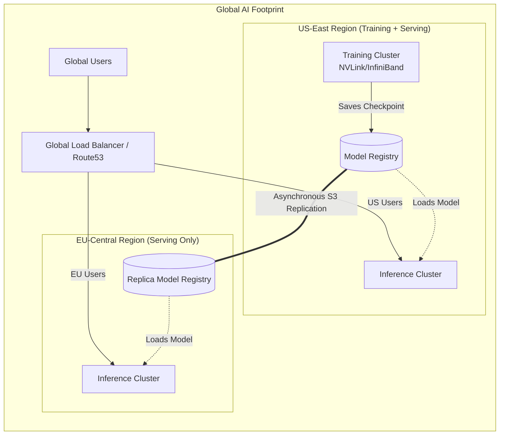

# Chapter 09 — Multi-Region Deployment

## Beginner's Primer: The Speed of Light

If you build the fastest AI Factory in the world in Virginia, and a user in Tokyo asks it a question, the response will be slow. 
You cannot optimize away the speed of light. It takes roughly 150 milliseconds for data to cross the Pacific Ocean.

> **Note on figures:** Capacities, latencies, costs, and failover times in this chapter are planning assumptions that continue the sizing from Chapter 08; they are not measurements.


Furthermore, if a hurricane takes offline the Virginia datacenter, your global business is instantly dead.

To achieve ultra-low latency and 99.99% reliability, enterprises use **Multi-Region Deployments**.
They build identical AI Factories in Virginia, Frankfurt, and Tokyo. A Global Load Balancer routes users to their nearest factory.

However, Multi-Region creates massive challenges:
1. **Model Synchronization:** If you fine-tune the model in Virginia, how do you securely copy the 140GB weights to Frankfurt and Tokyo without causing downtime?
2. **Data Gravity:** If a user in Tokyo uploads a 50GB dataset, but your training cluster is in Virginia, you have to drag that data across the ocean.

This chapter explains how to architect global AI footprints, including Active-Active Inference and Cross-Region Checkpoint replication.

## PART 1: MULTI-REGION ARCHITECTURE

### 1.1 Active-Active Inference Serving

```yaml
GEOGRAPHY-AWARE LOAD BALANCING (2000 QPS, 3 regions, sized as in Chapter 08)

Each region: 17 nodes × 8 GPU = 136 GPUs ≈ 68 two-GPU replicas ≈ 1,034 QPS capacity
Normal load: ~667 QPS per region; failover headroom: one region can fail and the other two
carry ~1,000 QPS each.

Region 1 (us-west-2):  latency to nearby users ~20 ms,  3 AZs, load balancer health checks
Region 2 (us-east-1):  latency to nearby users ~50 ms,  3 AZs
Region 3 (eu-west-1):  latency to nearby users ~30 ms,  3 AZs

Global Load Balancer (GeoDNS + application-level routing):
  1. DNS lookup returns the nearest healthy region (GeoDNS; failover speed is bounded by DNS TTLs)
  2. Client connects to the region-specific load balancer
  3. Load balancer routes to a healthy inference pod
  4. If a region is down, health checks remove it and clients retry against the next region
     (detection plus DNS propagation is typically tens of seconds; client-side retry can be faster)

Cost breakdown (annual, illustrative):
  Hardware: 51 nodes × $285K = $14.5M (one-time)
  Amortized 3-year CAPEX: $14.5M / 3 ≈ $4.84M/year
  Electricity: ≈ $243K/year (408 GPUs at 700W max, ~60% average draw, PUE 1.35; see Chapter 08)
  Personnel: 15 engineers × $150K = $2.25M/year
  Network (inter-region replication, WAN): $1M/year

  Total: ≈ $8.3M/year (for serving 2000 QPS across 3 regions with single-region failover tolerance)
```

### 1.2 Disaster Recovery & Failover

```python
# Health checks + automatic failover

import asyncio
from typing import List

class RegionalInferenceCluster:
    def __init__(self, region: str, endpoint: str, capacity_qps: int):
        self.region = region
        self.endpoint = endpoint
        self.capacity_qps = capacity_qps
        self.healthy = True
        self.latency_ms = 0
        self.error_rate = 0.0
    
    async def health_check(self):
        """Poll regional cluster every 10 seconds"""
        while True:
            try:
                start = time.time()
                # Test inference (dummy request)
                response = await asyncio.wait_for(
                    self.test_inference(), timeout=5.0
                )
                self.latency_ms = (time.time() - start) * 1000
                self.healthy = True
                self.error_rate = 0.0
            except Exception as e:
                self.healthy = False
                self.error_rate = 1.0
                logging.error(f"Health check failed for {self.region}: {e}")
            
            await asyncio.sleep(10)  # Check every 10 sec
    
    async def test_inference(self):
        """Lightweight inference test"""
        async with aiohttp.ClientSession() as session:
            async with session.post(
                f"http://{self.endpoint}/v1/completions",
                json={"prompt": "test", "max_tokens": 1},
                timeout=5.0
            ) as resp:
                return await resp.json()

class GlobalLoadBalancer:
    def __init__(self, clusters: List[RegionalInferenceCluster]):
        self.clusters = clusters
    
    async def route_request(self, request):
        """Route to best healthy cluster"""
        # 1. Filter healthy clusters
        healthy = [c for c in self.clusters if c.healthy]
        
        if not healthy:
            raise RuntimeError("All regions down")
        
        # 2. Select by latency (prefer lower latency, then lower load)
        best_cluster = min(
            healthy,
            key=lambda c: (c.latency_ms, c.error_rate)
        )
        
        # 3. Route request
        try:
            response = await asyncio.wait_for(
                best_cluster.serve_request(request),
                timeout=30.0
            )
            return response
        except asyncio.TimeoutError:
            # Failover to next best cluster
            healthy.remove(best_cluster)
            if healthy:
                return await self.route_request(request)  # Retry with next cluster
            else:
                raise RuntimeError("Request timeout, all regions exhausted")

# Failover time: health checks detect an outage in about 10 s (plus the request timeout for
# requests already in flight); clients that retry immediately fail over faster.
# Capacity must exist in the surviving regions (N+1 sizing) or failover only moves the overload.
```

---

## PART 2: CROSS-REGION TRAINING COORDINATION

### 2.1 Asynchronous Model Synchronization

```text
TRAINING ACROSS REGIONS

Synchronous data/tensor/pipeline parallelism needs per-step communication in milliseconds, but
cross-region latency is on the order of tens to hundreds of milliseconds and WAN bandwidth is far
below an InfiniBand fabric. Do not run one synchronous training job across regions.

Practical patterns:
  1. Train each job inside one region; replicate finished checkpoints to other regions for serving
     (asynchronous object-storage replication).
  2. Place training where the data lives (data gravity); move model artifacts, not raw datasets.
  3. Research approaches such as local-SGD / low-communication optimizers (for example DiLoCo-style
     methods) reduce synchronization frequency, but they are not drop-in: averaging weights from
     independently trained replicas is not guaranteed to preserve quality, so validate carefully.
```

## Architecture Summary

To achieve global low latency and high availability, an AI Factory must expand into a multi-region footprint. While Inference can easily run Active-Active across regions (using Global Load Balancing), Training is physically bound by the speed of light. Synchronous distributed training (TP/PP/DP) cannot cross an ocean due to latency; instead, organizations must train regionally and asynchronously replicate the model weight checkpoints to global serving clusters.



---

## SUMMARY

Multi-region deployment trades off:
- **Latency:** Each user sees &lt;50ms to nearest region (good UX)
- **Cost:** roughly 1.5x the single-region capacity for N+1 failover across three regions (each region sized for half of peak), plus duplicated operations
- **Complexity:** Failover, model synchronization, data consistency (operational burden)

**Key metrics:**
- Regional failover time: seconds to tens of seconds, depending on health-check interval, DNS TTL, and client retry behavior
- Inference availability: set by the SLA you size for (one region down, traffic reroutes to regions with headroom)
- Model sync: checkpoint replication is asynchronous; measure replication lag against your release process

**In Chapter 10:** Observability and operational monitoring.
