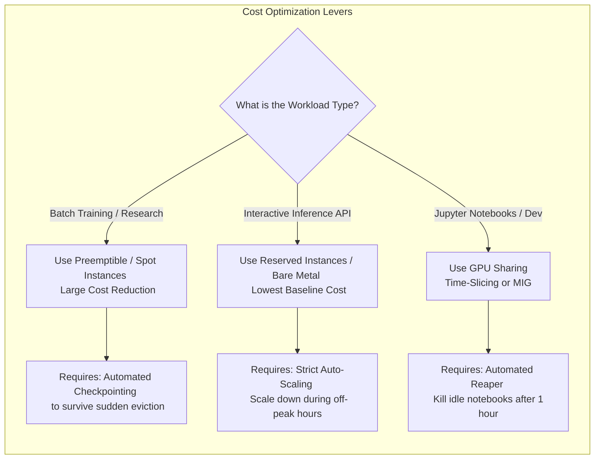

# Chapter 12 — Cost Optimization and Resource Efficiency

## Beginner's Primer: The Price of Idle Silicon

If you rent a moving truck for $100 a day, you don't park it in your driveway empty. You pack it as full as possible, drive it back and forth constantly, and return it exactly when you are done. 


> **Note on figures:** Prices, discounts, interruption rates, and cost totals in this chapter are illustrative planning assumptions. Check current cloud pricing and your own contracts.

An NVIDIA H100 GPU costs on the order of $30,000 to buy, or several dollars per hour to rent in the cloud (prices vary widely by provider and commitment). An 8-GPU node costs $250,000+. 

If a data scientist requests an 8-GPU node, runs a Jupyter notebook for 30 minutes, and goes home for the weekend leaving the server running, they have just burned thousands of dollars of cloud spend (a 64-hour weekend at an assumed $50 to $100 per node-hour) for absolutely zero business value. 

In AI, **Cost Optimization (FinOps)** is not an accounting exercise; it is an engineering discipline. It requires Platform SREs to build automated systems that ruthlessly maximize the return on investment (ROI). 
- If an Inference API is receiving low traffic at night, the platform must autoscale the GPUs down. 
- If a Training job doesn't need to finish immediately, the platform should use "Spot Instances" (discounted, interruptible cloud GPUs) to save 70% on the bill.

This chapter details the engineering strategies to squeeze every penny of value out of your AI Factory.

## PART 1: UTILIZATION OPTIMIZATION

### 1.1 GPU Utilization Strategies

```yaml
MAXIMIZING GPU UTILIZATION (Target: 80%+ measured SM activity, not allocation)

Current State:
  Training cluster: 64 GPUs = 8 nodes, 8 concurrent jobs of 8 GPUs each
  Allocation: 100% (every GPU is assigned to a job)
  Measured utilization: lower (for example ~64% average) because of job start-up, checkpoint
  pauses, data-loading stalls, and idle gaps between jobs

Optimization 1: Backfill and fractional sharing
  Use a scheduler with gang scheduling and backfill (Slurm, Kueue, Volcano, Run:ai)
  so short jobs fill gaps without delaying large jobs. For small development jobs, share GPUs with
  MIG or time-slicing (trusted users only) instead of giving each a full GPU.

Optimization 2: Job packing (bin-packing)
  Jobs requesting [8, 4, 4, 8, 4] GPUs = 28 GPUs total on 8-GPU nodes:
    Node A: job 1 (8)     Node B: jobs 2+3 (4+4)    Node C: job 4 (8)    Node D: job 5 (4)
  4 nodes (32 GPUs) with 28 in use = 87.5% allocation, versus spreading jobs one per node,
  which would use 5 nodes. Pack small jobs together and keep whole nodes free for large jobs.

Optimization 3: Preemption (kill low-priority jobs for high-priority)
  Priority tiers:
    - P0 (production inference): Never killed
    - P1 (critical training): Can preempt P2
    - P2 (research): Can be preempted, restart from checkpoint

  Strategy: Run P2 jobs on otherwise idle capacity (no completion guarantee)
  Savings: P2 jobs can be charged at a discount and soak up idle GPUs
  Trade-off: P2 jobs are interrupted when higher-priority work arrives (acceptable for research)
```

### 1.2 Cost per Output Metric

```python
# Define cost per output (not per GPU). Sizing continues Chapter 08: 408 GPUs serving 2000 QPS.

inference_qps = 2000
avg_tokens_per_response = 150
responses_per_day = inference_qps * 86_400           # 172.8M responses
tokens_per_day = responses_per_day * avg_tokens_per_response   # 25.9B tokens

# Costs (per day)
hardware_cost_per_day = (408 * 30_000) / 1095        # 3-year amortization ≈ $11.2K
electricity_cost_per_day = 231 * 24 * 0.12           # ≈ 231 kW facility draw ≈ $665
operational_cost_per_day = (15 * 150_000) / 365      # ≈ $6.2K

total_cost_per_day = hardware_cost_per_day + electricity_cost_per_day + operational_cost_per_day
# ≈ $18.1K per day

cost_per_million_tokens = total_cost_per_day / (tokens_per_day / 1_000_000)
# ≈ $18.1K / 25,900 million tokens ≈ $0.70 per million tokens (at constant 2000 QPS)

# Compare to your price per million tokens and your real average load. If traffic averages
# 40% of peak, the hardware and operations share per token is about 2.5x higher.
#
# Levers: quantization (more concurrency per GPU), better batching, higher utilization, cheaper
# capacity for non-latency-critical work (spot), and shared infrastructure across models.
```

---

## PART 2: SPOT INSTANCES & CLOUD STRATEGY

### 2.1 Spot Instance Pricing

```yaml
CLOUD GPU PRICING (illustrative; AWS p5.48xlarge = 8×H100 per instance, check current pricing)

On-demand (assumed): $60/hour per instance
  = $60 / 8 GPU = $7.50/GPU/hour
  = $180/GPU/day
  = $54K/GPU/year (assumes ~300 operating days/year; at 365 days it would be $65.7K)

Spot price (assumed ~65% discount): $21/hour per instance
  = $2.63/GPU/hour
  = $63/GPU/day
  = $18.9K/GPU/year (same 300-day assumption)

  Savings vs on-demand: about $35K/GPU/year (65%)
  Trade-off: Job can be interrupted at any time; interruption frequency varies by instance type, region, and time

Strategy: Hybrid (on-demand + spot)
  Production inference: mostly reserved/on-demand for the SLA baseline, spot only for burst
  that can tolerate interruption
  Research training: spot with frequent checkpoints (accept interruptions, resume from checkpoint)
```

### 2.2 Implementing Spot Instance Resilience

```python
# Handle spot interruption gracefully

import threading
import time

class SpotInstanceManager:
    def __init__(self):
        self.interruption_signal = False
        self.monitor_thread = threading.Thread(target=self._monitor_spot_termination)
        self.monitor_thread.daemon = True
        self.monitor_thread.start()
    
    def _monitor_spot_termination(self):
        """Poll AWS instance metadata for a spot interruption notice (about 2 minutes of warning)"""
        import requests
        
        while True:
            try:
                # IMDSv2 requires a session token first (PUT /latest/api/token); omitted for brevity
                response = requests.get(
                    "http://169.254.169.254/latest/meta-data/spot/instance-action",
                    timeout=5
                )
                
                if response.status_code == 200:
                    # Spot instance terminating in 2 minutes
                    print("ALERT: Spot instance terminating!")
                    self.interruption_signal = True
                    # Trigger graceful shutdown
                    break
            
            except:
                pass
            
            time.sleep(5)  # Check every 5 sec
    
    def should_gracefully_shutdown(self):
        """Check if training should save checkpoint and exit"""
        return self.interruption_signal

# In training loop
spot_manager = SpotInstanceManager()

for step in range(num_steps):
    # Training
    loss.backward()
    optimizer.step()
    
    if step % 100 == 0:
        trainer.save_checkpoint(model, optimizer, step)
    
    # Check for spot interruption
    if spot_manager.should_gracefully_shutdown():
        print(f"Graceful shutdown at step {step}")
        trainer.save_checkpoint(model, optimizer, step)
        break

# Result: When spot instance receives termination notice, save checkpoint and exit
# Next spot instance resumes from saved checkpoint
# Cost: substantially lower than on-demand; lost work is bounded by the checkpoint interval
```

---

## PART 3: COST BREAKDOWN ANALYSIS

```yaml
TOTAL COST BREAKDOWN (3-YEAR DEPLOYMENT, 1200 GPUs, illustrative)

CAPEX (Hardware + Installation):
  GPU: 1200 × $30K = $36M
  Networking (IB, Ethernet): $1.5M
  Storage (NVMe, NAS, SAN): $2M
  Cooling/Power infrastructure: $1.5M
  Servers/Chassis/Rails: $2M
  Installation labor: $1M
  Subtotal CAPEX: $44M

OPEX (Operations, annual):
  Electricity: 1200 × 700W × 60% average draw × 1.35 PUE ≈ 680 kW → ≈ $0.72M/year × 3 = $2.15M
  Personnel (30 FTE × $150K): $4.5M/year × 3 = $13.5M
  Maintenance/SLA: $2M/year × 3 = $6M
  Network (WAN, DDoS, CDN): $1M/year × 3 = $3M
  Software licenses: $0.5M/year × 3 = $1.5M
  Subtotal OPEX: ≈ $26.2M

TOTAL 3-YEAR TCO: ≈ $70.2M

Cost Metrics:
  Per-GPU-year: $70.2M / (1200 × 3) ≈ $19.5K/GPU/year
  GPU hardware per GPU-year: $36M / (1200 × 3) = $10K
  Operations (OPEX) per GPU-year: $26.2M / (1200 × 3) ≈ $7.3K

  Cost per inference throughput:
    1200 GPUs ≈ 9,100 QPS capacity (at ~7.6 QPS per GPU, Chapter 08)
    Annual cost: $70.2M / 3 ≈ $23.4M per year
    Cost per 1K QPS of capacity: ≈ $2.6M/year

  Cost per training throughput:
    1200 GPU × 989 TFLOPS (BF16 dense, H100 SXM5, Chapter 2) ≈ 1,186.8 PFLOPS peak
    Cost per PETAFLOP-year: $23.4M / 1,186.8 PFLOPS ≈ $19.7K
```

## Architecture Summary

AI Cost Optimization requires aggressive workload Bin-Packing, leveraging Spot Instances for resilient training jobs, and constantly calculating "Cost per Token" or "Cost per Petaflop" rather than just looking at the monthly cloud bill. Operations teams must utilize advanced schedulers to pre-empt idle or low-priority workloads, ensuring the expensive silicon is constantly crunching high-value math.



---

## SUMMARY

Cost optimization strategies:
1. **Utilization:** Target 80%+ measured utilization through backfill, bin-packing, sharing, and preemption.
2. **Spot instances:** large discounts for interruption-tolerant work (research training with frequent checkpoints).
3. **Cost per output:** Focus on throughput, not GPU count (inference: cost per token, training: cost per step).
4. **TCO analysis:** 3-year deployment reveals amortized costs; personnel is often larger than hardware CAPEX.

**Key insight:** At scale, operational cost (personnel, power, network) often exceeds hardware cost. Automation, monitoring, and efficient job scheduling have high ROI.

**In Chapter 13:** Reference architecture for production 100-GPU training cluster.
