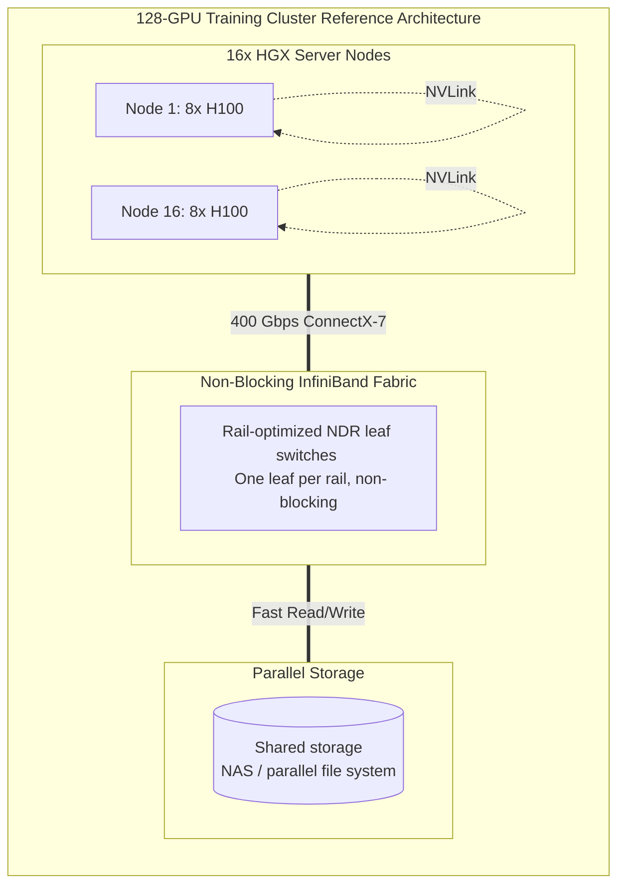

# Chapter 13 — Reference Architecture: 100-GPU Training Cluster

## Beginner's Primer: Putting It All Together

Throughout Volume 21, we have discussed the individual pieces of an AI Factory: Compute, Storage, Network, Power, and Operations. 


> **Note on figures:** Prices, schedules, and targets in this chapter are illustrative planning assumptions that build on Chapter 02 (a 16-node, 128-GPU pod). Use NVIDIA's DGX H100 / SuperPOD reference architecture documentation for validated bills of materials, cabling, and software versions.

This chapter is the **Blueprints**. 
If your CEO hands you $8 Million and says, *"Build me a data center to train our own proprietary LLaMA model from scratch,"* this is exactly what you buy, how you plug it in, and how you test it.

We are designing a **128-GPU Training Cluster**. 
Why 128? Because 16 eight-GPU nodes is a practical building block: with a rail-optimized InfiniBand fabric (NIC k of every node on leaf switch k) every GPU reaches its same-rail peers through a single switch hop, and NVLink handles traffic between rails inside each node. It is small enough to build as one pod and large enough for serious training.

## COMPLETE DESIGN: 70B-CLASS LLM TRAINING

### Cluster Specification

```yaml
CONFIGURATION:

Compute:
  16 nodes × 8 GPU H100 SXM5 = 128 GPUs (more than a 70B model strictly needs, which allows
  elasticity: multiple jobs, spare nodes, or faster training)

  Per-node (DGX H100 class):
    CPU: 2× Intel Xeon Platinum 8480C (112 cores total)
    Memory: 2 TB DDR5
    GPU: 8× H100 80GB SXM5 (NVLink 4 via NVSwitch, 900 GB/s per GPU)
    Storage: 8× 3.84 TB NVMe (about 30 TB local cache)
    Compute NICs: 8× ConnectX-7 400 Gb/s (one per GPU, NDR InfiniBand)
    Storage/in-band: 2× BlueField-3 DPUs

Interconnect (compute fabric):
  Rail-optimized InfiniBand NDR: 8 leaf switches (one per rail), each with 16 node downlinks;
  add a spine tier if the pod will grow beyond one leaf-only layer
  Separate storage and management networks (do not share the compute rails)
  Cabling: DAC for short runs, AOC/optics otherwise; follow the vendor cable-length rules

Storage:
  Cluster storage: shared all-flash NAS or parallel file system (500 TB, ~10 GB/s assumed)
  Archive: AWS S3 (training dataset versioning, checkpoints)

Cooling:
  Air-cooled DGX H100 with hot/cold aisle containment
  Capacity: plan ~163 kW of IT heat load (16 nodes × ~10.2 kW) plus margin, about 4 nodes
  (≈ 41 kW) per rack across 4 racks

Power:
  Provision about 163 kW of IT load, fed from independent A/B feeds with rack PDUs sized for
  ≈ 41 kW per rack (see Chapter 05 for derating)
  UPS: cover network, storage, and management at minimum; size compute coverage deliberately
  (training can ride through brief outages by checkpointing)

Networking:
  Public: 1× 100GbE connection to the production network
  Out-of-band management: dedicated BMC network

Observability:
  GPU monitoring: DCGM + dcgm-exporter into Prometheus
  Network: UFM or ibdiagnet/perfquery counters, switch telemetry
  Host: node_exporter
  Visualization: Grafana dashboards (GPU, network, power)

TOPOLOGY (rail-optimized)

  Node 1 ... Node 16: each node has 8 NICs (rail 0 ... rail 7)
  Leaf switch k connects NIC k of every node (16 downlinks each)
  Inside each node, NVLink/NVSwitch moves data between GPUs on different rails
  Storage and management networks are separate from the compute rails
```

### Hardware Cost Breakdown

```yaml
CAPEX ANALYSIS (illustrative, consistent with Chapter 02):

GPU nodes: 16 × $285K (8× H100 SXM5 + CPUs, memory, NVMe, NICs) = $4.56M
InfiniBand fabric (switches, optics, cables): ~$400K (get quotes)
Shared storage (allocated share): $200K
Racks, PDUs, cooling: $200K
Installation & testing: $100K
Subtotal hardware and install: ≈ $5.46M

Software & licensing:
  NCCL, DCGM, Prometheus, Grafana: no license fee (open source / free to use)
  OS subscription and optional NVIDIA AI Enterprise licenses: priced per GPU or per node (obtain quotes)

TOTAL CAPEX: ≈ $5.5M

Cost per GPU: $5.5M / 128 ≈ $43K per GPU
Cost per BF16 TFLOP: $5.5M / (128 × 989 TFLOPS) ≈ $43 per TFLOP (consistent with Chapter 2)
```

### Deployment Procedure

```yaml
DEPLOYMENT CHECKLIST (8 weeks):

Weeks 1-2: Site Preparation
  - Install power distribution (PDUs, cables, circuit breakers)
  - Install cooling infrastructure (chiller, coolant lines)
  - Set up racks and cable trays
  - Verify utility power (feed voltage, phase, and amperage per the rack PDU design)
  - Test UPS failover

Weeks 3-4: Hardware Installation
  - Unpack, inventory, and burn-in test all GPUs (8 tests × 1 hour = full day per node)
  - Install nodes in rack (8 hours for 16 nodes)
  - Install network switch, connect nodes
  - Verify IB link status (ibstat on each node, all ports UP)

Weeks 5-6: Software & Configuration
  - Install the vendor-validated OS image (for example DGX OS) or your standard Ubuntu/RHEL image
  - Install the NVIDIA driver, CUDA, cuDNN, and NCCL versions from the validated stack for your
    system (NVIDIA's DGX and NGC release notes list tested combinations); record all versions
  - Configure the distributed training environment (torchrun, DeepSpeed, or Megatron-LM)
  - Run nccl-tests across all node pairs and at full scale (verify bus bandwidth against baseline)

Week 7: Baseline Performance Testing
  - Train a representative model (for example a small GPT-style model) for 100+ steps
  - Measure throughput and model FLOPs utilization (MFU); compare against the reference numbers
    for your model and software stack rather than a fixed percentage
  - Verify exposed communication time is small relative to iteration time
  - Measure power draw: 16 nodes can draw up to about 163 kW (16 × 10.2 kW rated); compare
    measured draw under load to the rated maximum

Week 8: Production Readiness
  - Deploy Prometheus + Grafana for monitoring
  - Configure alerts (thermal slowdown reason, exposed communication time above baseline, power approaching feed limits)
  - Set up checkpoint infrastructure (NAS NFS, S3 sync)
  - Configure the job scheduler (Slurm or Kubernetes with a gang-scheduling layer)
  - Run 1-week stability test (burn-in training, detect intermittent failures)

LAUNCH CHECKLIST:
  ✓ All 128 GPUs healthy (nvidia-smi output on each node)
  ✓ nccl-tests bus bandwidth meets the baseline on every node pair and at full scale
  ✓ Checkpoint save/load working (test on small model)
  ✓ Monitoring alerts configured and tested
  ✓ Runbook for common failures written
  ✓ On-call rotation established
```

### AI Factory Commissioning and Acceptance

The Week 8 "Production Readiness" checklist above answers *"is the software stack
configured?"* Commissioning and acceptance testing answers a harder question: *"does this
physical cluster actually perform to spec, and can we prove it before signing off and handing
it to researchers?"* This is the step most postmortems trace back to — a cluster that passed
`nvidia-smi` and NCCL smoke tests but had a marginal cable, a firmware mismatch, or an
underprovisioned cooling loop that only showed up under sustained load three weeks into a
customer's training run. Formal acceptance testing catches that class of failure *before*
handoff, not after.

Acceptance runs in six stages, each producing sign-off evidence — not just "it looks fine."

```yaml
STAGE 1: PHYSICAL ACCEPTANCE

Why: Everything downstream (firmware, network, training) is built on physical assumptions
     (power is stable, cooling keeps up, cables are seated). Skipping this stage means later
     failures get misdiagnosed as software bugs when the root cause is a loose transceiver.

Checks:
  - Rack/power: PDU load balanced across phases, breaker headroom >20% of rated capacity
  - Cooling: Rack inlet temp <27°C under simulated load, no hot spots (thermal camera walk)
  - Cabling: All IB/Ethernet runs labeled, no exceeded bend-radius, DAC/AOC within spec length
  - Optics/transceivers: `ethtool` / switch CLI shows no RX/TX power out of range on any port
  - BMC/OOB: Every node's BMC reachable, IPMI/Redfish power-cycle test succeeds per node

Evidence of pass: Signed physical inspection checklist + thermal scan photos + BMC reachability
  table (one row per node, all green).

Example FAILED check and triage: Thermal scan shows node 7's inlet at 34°C while neighbors
  read 24°C. Triage: check for a blocked front-panel filter or a rack blanking-panel gap
  causing hot-aisle recirculation before assuming a chiller problem — recirculation from a
  missing blanking panel is the far more common root cause and a 10-minute fix vs. a cooling
  system fault.

STAGE 2: SERVER ACCEPTANCE

Why: A cluster is only as fast as its slowest, most-error-prone node. Firmware and topology
     drift between "identical" nodes is one of the most common causes of stragglers in
     distributed training (one node running an older BIOS/GPU firmware silently throttles).

Checks:
  - Firmware baseline: BIOS, BMC, GPU VBIOS, NIC firmware versions match the qualified
    baseline on every node (`nvidia-smi -q | grep "VBIOS"`, vendor firmware inventory tool)
  - GPU inventory: `nvidia-smi -L` returns the expected GPU count and SKU per node; no GPUs
    in a degraded or "Xid" error state (`nvidia-smi -q -d ERROR`)
  - CPU/memory: All DIMM channels populated and running at rated speed (`dmidecode`), no
    memory ECC errors at boot
  - PCIe topology: `nvidia-smi topo -m` matches the expected matrix (GPUs on correct PCIe
    switch/root complex, NICs paired with the correct GPU for rail-aligned traffic)
  - NVLink/NVSwitch: `nvidia-smi nvlink -s` shows all links Active at expected speed; no
    NVSwitch reporting degraded lanes
  - NIC/HCA: `ibstat` shows State: Active, Physical state: LinkUp, correct link speed (e.g.
    NDR 400Gb/s) on every HCA
  - BlueField (if present): DPU firmware version matches baseline, DPU-hosted services
    (e.g. storage offload) reachable from the host

Evidence of pass: Per-node firmware/topology report diffed against baseline (zero deltas),
  `nvidia-smi topo -m` output archived per node, NVLink link-state table all Active.

Example FAILED check and triage: `nvidia-smi topo -m` on one node shows a GPU-NIC pair on
  different PCIe root complexes than the other 15 nodes. Triage: this node was likely
  reseated after RMA and reassembled with GPUs/NICs in different slots — don't "fix" this in
  software (NCCL will silently work but slower); physically correct the slot assignment so
  its topology matches the fleet before it becomes a straggler under AllReduce.

STAGE 3: NETWORK ACCEPTANCE

Why: Fabric issues (bad optics, asymmetric routing, one degraded rail) are the single most
     common cause of "training is 20% slower than expected" tickets, and they're invisible
     to per-node health checks — they only show up under multi-node traffic.

Checks:
  - Topology validation: Switch LLDP/neighbor tables match the design diagram; no
    unexpected or missing links
  - Link state: Every port UP at full negotiated rate (no ports auto-negotiated down)
  - Bandwidth testing: Point-to-point `ib_write_bw` / `nccl-tests` between every rail
    achieves ≥90% of theoretical per-port line rate
  - Latency testing: `ib_write_lat` within expected range for the topology (single-switch
    hop should be low single-digit microseconds)
  - Congestion testing: All-to-all traffic pattern (e.g. `nccl-tests all_reduce_perf` at
    full cluster scale) sustains bandwidth without PFC pause storms
  - Rail validation: Each GPU's dedicated NIC rail tested independently — a single degraded
    rail out of 8 per node is easy to miss in an aggregate bandwidth test

Evidence of pass: Full bandwidth/latency matrix (all node pairs, all rails) with results
  archived; `nccl-tests` at full cluster scale meets the vendor-published busbw target.

Example FAILED check and triage: One rail across all nodes shows 15% lower bandwidth than
  the other 7. Triage: check whether that rail's switch ports all land on the same
  leaf/spine uplink group — a shared oversubscribed uplink, not 16 independently bad cables,
  is the likely cause, and pointing at "one leaf switch config" is a much faster fix than
  swapping optics node by node.

STAGE 4: STORAGE ACCEPTANCE

Why: Data pipeline can bottleneck GPUs before compute or network ever become the limiter.
     Acceptance here validates the storage tier can actually feed 128 GPUs, not just that
     a single client can hit peak throughput.

Checks:
  - Bandwidth testing: Aggregate sequential read/write from all nodes simultaneously (e.g.
    `fio` or vendor benchmark) meets the sustained throughput sized in Chapter 4 (≥100
    MB/sec/GPU aggregate)
  - IOPS testing: Random small-file read IOPS meets target for shuffled-dataset access
    patterns, not just large sequential reads
  - Metadata performance: `mdtest` or equivalent — file create/stat/delete rates matter as
    much as raw bandwidth when checkpoint directories contain thousands of shard files
  - Checkpoint I/O validation: Time a full 128-GPU checkpoint save/load at production model
    size; confirm it completes within the budget assumed in the operational MTTR targets

Evidence of pass: Aggregate bandwidth/IOPS numbers from a full-cluster concurrent test,
  compared against the Chapter 4 sizing target; one successful full-scale checkpoint
  save/restore cycle timed and logged.

Example FAILED check and triage: Aggregate bandwidth from all 16 nodes hits only 60% of the
  single-client benchmark number. Triage: check for a shared network bottleneck between
  compute and storage (undersized storage-facing switch uplinks) before assuming the storage
  array itself is underpowered — this is a topology problem far more often than a disk problem.

STAGE 5: CLUSTER ACCEPTANCE

Why: This is where physical, server, network, and storage acceptance get validated together
     under realistic load — the previous four stages can each pass individually while the
     cluster still fails as a system (e.g. under sustained thermal load, a marginal PSU that
     passed a 5-minute power-on test finally trips).

Checks:
  - HPL/Linpack burn-in: Run HPL (or an equivalent GPU-Linpack) across the full cluster;
    confirm sustained FLOPS is within expected range of theoretical peak, and that the run
    completes without a node dropping out
  - NCCL collective tests: `nccl-tests` (all_reduce_perf, all_gather_perf, etc.) at full
    scale, confirming busbw against baseline and no rank hangs
  - ClusterKit (or equivalent cluster-level diagnostic suite): NVIDIA's ClusterKit-class
    tooling exists to run coordinated, cluster-wide health and performance diagnostics
    (bandwidth, latency, and stress patterns across all nodes at once) so you're not
    inferring cluster health from single-node or single-pair tests alone — treat this as
    "the automated version of the manual bandwidth/latency matrix in Stage 3, run
    continuously as part of acceptance and later as periodic health checks." (If you're
    scripting this yourself rather than using vendor tooling, the goal is the same:
    orchestrate NCCL/IB tests across every node simultaneously and diff results against a
    known-good baseline.)
  - Sustained burn-in: 24–72 hour continuous load (real or synthetic training job) — this is
    what surfaces thermal throttling, marginal power delivery, and intermittent Xid errors
    that short tests miss
  - Full workload test: Run the actual customer/team's representative training job (or the
    closest available proxy) end-to-end, including checkpoint save/restore, to validate the
    system as the customer will actually use it — not just synthetic benchmarks

Evidence of pass: HPL result within expected % of theoretical peak; NCCL busbw report;
  burn-in log showing zero unplanned node drops over the full duration; one successful
  end-to-end representative workload run with checkpointing exercised.

Example FAILED check and triage: 48 hours into burn-in, one node throws an Xid 79 (GPU has
  fallen off the bus) and drops from the job. Triage: this is a hardware fault, not a flaky
  test — pull the node, run vendor diagnostics, and RMA if it recurs after reseating; do NOT
  just restart the job and call the cluster accepted, because an intermittent GPU failure
  under sustained load is exactly the failure mode acceptance testing exists to catch before
  a paying customer's 2-week training run hits it instead.

STAGE 6: OPERATIONAL ACCEPTANCE

Why: A cluster that performs well but that nobody can safely operate isn't actually ready —
     this stage validates the humans-and-process side of handoff, not just the hardware.

Checks:
  - Monitoring/alerting verification: Deliberately trigger each alert condition (e.g.
    simulate a GPU temp spike, kill a node) and confirm the alert fires and reaches on-call
  - Inventory reconciliation: Asset tags, serial numbers, and rack positions match the
    CMDB/inventory system exactly — this matters enormously for future RMA and warranty claims
  - Rollback procedure validation: Actually execute a rollback (e.g. revert a firmware
    update, fail a node out of the scheduler) end-to-end at least once; don't just document it
  - Maintenance window process: Confirm the drain/cordon procedure removes a node from
    active jobs cleanly and it can be reintroduced without a full cluster restart
  - Escalation package readiness: On-call rotation staffed, runbooks accessible outside the
    cluster's own monitoring stack (so they're reachable if monitoring itself is down),
    vendor support contract and case-opening process verified with a real (or test) ticket

Evidence of pass: Alert-fire test log (each alert type triggered and confirmed received);
  reconciled inventory report; one executed rollback with results recorded; signed-off
  runbook and on-call roster.

Example FAILED check and triage: The GPU-temperature alert never fires during the test.
  Triage: check the Prometheus scrape target and metric name first (a common root cause is
  exactly the kind of DCGM metric-name mismatch covered in Chapter 10 — the alert rule
  references a metric the exporter never emits) before assuming the GPU itself failed to
  heat up during the test.
```

**Interview answer — "How would you validate a newly built GPU cluster before handing it to a customer?"**

"I'd treat it as a staged acceptance, not a single smoke test. Physical first — power,
cooling, cabling, optics — because everything else assumes those are solid, and it's cheap
to verify while nothing depends on it yet. Then per-server acceptance: firmware baseline,
GPU inventory, PCIe/NVLink topology, NIC health — this is where I'd catch things like a
reseated node with GPUs in the wrong slots, which nvidia-smi alone won't tell you. Then
network acceptance under real multi-node traffic, because fabric problems only show up when
many nodes talk at once — a bandwidth matrix across every rail, not just an aggregate number.
Same idea for storage: aggregate throughput from all nodes concurrently, not a single client.
Then I'd bring it together at the cluster level — HPL for a compute sanity check, NCCL
collective tests for communication health, and critically a sustained 24-plus hour burn-in,
because intermittent GPU and power issues don't show up in a five-minute test. Finally,
operational acceptance — make sure monitoring actually alerts, rollback actually works, and
the on-call team can operate it — because a cluster that performs perfectly but that nobody
can safely run isn't actually done. At every stage I want evidence I can hand the customer,
not just a checklist I personally believe — a burn-in log, a bandwidth matrix, an alert-fire
test — because 'trust me, I checked' doesn't survive the first production incident."

### Operational Procedures

```yaml
DAILY OPERATIONS:

Pre-Training Checklist:
  1. Verify cluster health: `nvidia-smi` and a quick `dcgmi diag -r 1` on all nodes show all GPUs healthy
  2. Check network: `ibstat` shows all IB ports Active at full rate
  3. Verify storage: NAS mount point accessible, free space above the planned checkpoint retention
  4. Check power/cooling: PDU load below the derated limit, inlet temperature within spec
  5. Review alerts: No GPU errors, no network errors in past 24 hours

Training Job Startup:
  1. Load training checkpoint (if resuming)
  2. Allocate 128 GPUs via job scheduler
  3. Launch training with torchrun (auto-sets RANK, WORLD_SIZE)
  4. Verify all ranks connected (check NCCL startup logs)
  5. Monitor first iterations: SM activity and step time against the baseline

Monitoring During Training:
  - Throughput: Should be stable within ±2%
  - GPU SM activity: stable near the job's baseline
  - GPU temperature: stable, no thermal slowdown reason
  - Exposed communication time: stable near baseline
  - Loss: Smooth convergence (no NaN or divergence)
  - Checkpoint: Save every 500 steps (~8 hours for Llama-70B)

Troubleshooting:
  - Low throughput (<80% of baseline): Check exposed communication time, GPU clocks and throttle reasons, network congestion
  - GPU thermal throttle: Verify cooling and airflow; see Volume 20 Chapter 6
  - Failed checkpoint: Retry save to NAS, fallback to S3 if NAS down
  - Hanging job: NCCL timeout likely; kill job, investigate rank connectivity

Weekly:
  - Review GPU Xid and ECC trends (Volume 20 Chapters 2 and 5) and act per the tiered guidance
  - Check data pipeline: Verify no I/O stalls and storage performance against the sizing target
  - Validate backups: Confirm S3 checkpoint sync completed

MTTR Targets:
  GPU failure: 15 min to detect + kill job + restart
  Network link flap: 5 min to detect + reroute + retry AllReduce
  Checkpoint failure: 10 min to retry/failover to S3
  Power loss: <1 min (UPS covers brief outage)
```

## Architecture Summary

Building a 128-GPU AI Training cluster requires meticulously balancing a ~$5.5 Million CapEx budget across H100 GPUs, high-speed NVMe storage, and a non-blocking InfiniBand NDR network. Success is determined during the 8-week deployment phase, where engineers must execute aggressive burn-in tests (HPL/NCCL) to identify "infant mortality" hardware failures before allowing data scientists to launch multi-month training jobs.



---

## SUMMARY

A production 128-GPU training cluster requires:

1. **Hardware:** 16 DGX H100-class nodes (about $4.56M of the ~$5.5M CAPEX), a rail-optimized NDR fabric, and power and cooling sized for about 163 kW.
2. **Network:** Non-blocking, rail-aligned interconnect, validated with nccl-tests against a baseline.
3. **Monitoring:** Real-time GPU/network metrics; alert when a metric deviates materially from its baseline.
4. **Deployment:** 8-week process from bare metal to training (weeks 1-4 hardware, 5-6 software, 7-8 testing).
5. **Operations:** Daily health checks, weekly trend analysis, MTTR &lt;15 min for most failures.

**Cost:** ≈ $5.5M CAPEX + ≈ $0.64M OPEX/year ≈ $7.4M over 3 years for this pod (illustrative; see Chapter 02).

**In Chapter 14:** Reference architecture for multi-region inference deployment.
