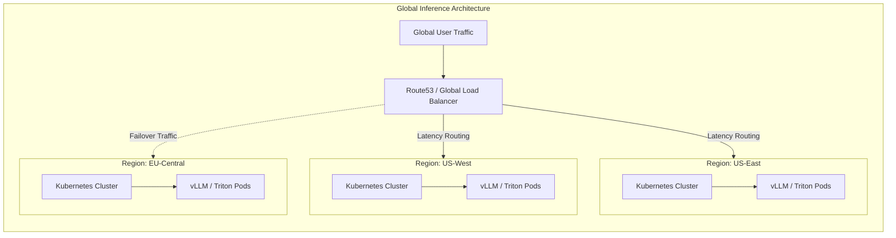

# Chapter 14 — Reference Architecture: Multi-Region Inference Deployment

## Beginner's Primer: The Global Cash Register

If a Training Cluster (Chapter 13) is a research laboratory, an Inference Cluster is a global cash register. 
If the laboratory goes offline for 5 minutes, it's annoying, but the scientists just resume the job from the last checkpoint. 

> **Note on figures:** Capacities, prices, and timings in this chapter are illustrative planning assumptions that continue the sizing from Chapters 08 and 09 (about 15 QPS per 2-GPU replica of Llama-3-70B). Benchmark your own model and serving stack, and use current provider pricing, before committing.

If the cash register goes offline for 5 minutes, you lose millions of dollars, and your customers switch to a competitor.

Because Inference is tied directly to customer experience, we cannot design it like a Training cluster. 
1. The user-facing path is standard Ethernet and HTTP/gRPC so it integrates with global load balancers; inside a replica, tensor-parallel GPUs still talk over NVLink, and no inter-node collectives cross replicas.
2. Replicas are small (a 2-GPU tensor-parallel group), so a failed GPU or node takes out a small slice of capacity rather than a whole training job.
3. We don't put everything in one building. We put 1/3 of the GPUs in New York, 1/3 in London, and 1/3 in Tokyo. 

If London loses power, the global DNS server instantly re-routes the European customers to New York. The latency increases slightly, but the AI API stays online. This chapter provides the exact architectural blueprints for a 99.9% uptime global serving platform capable of handling 2,000 Queries Per Second (QPS).

## COMPLETE DESIGN: GLOBAL LLAMA INFERENCE (2000 QPS, 99.9% SLA)

### Global Deployment Spec

```yaml
SERVICE: Llama-3-70B Inference API (chatbot.example.com)

SLA:
  Availability: 99.9% (21.6 min downtime/month)
  Latency p99 TTFT: <500 ms
  Latency p99 ITL: <150 ms (inter-token latency)
  Throughput: 2000 QPS sustained peak

REGIONAL CLUSTERS (3 active-active regions, sized as in Chapter 08):

Region 1: US-West (us-west-2, Oregon)
  Capacity: 17 nodes × 8 GPU = 136 H100s -> 68 two-GPU replicas ≈ 1,034 QPS
  Peak QPS: 600 (30% of global traffic)
  Model: Llama-3-70B, 2-GPU tensor parallelism
  Latency to users: ~20 ms (US West coast)
  Availability: multi-AZ

Region 2: US-East (us-east-1, Virginia)
  Capacity: 17 nodes × 8 GPU = 136 H100s -> 68 replicas ≈ 1,034 QPS
  Peak QPS: 600
  Latency to users: ~50 ms (US East coast)

Region 3: EU-West (eu-west-1, Dublin Ireland)
  Capacity: 19 nodes × 8 GPU = 152 H100s -> 76 replicas ≈ 1,155 QPS
  Peak QPS: 800 (40% of traffic, largest region)
  Latency to users: ~30 ms (Europe, Middle East, Africa)

TOTAL INFRASTRUCTURE:
  Hardware: 53 nodes, 424 GPUs
  Software: 212 inference replicas
  Failover sizing: each region can absorb its neighbors' load if one region fails
    (EU down: 400 QPS to each US region -> 1,000 QPS, within 1,034;
     US-West down: 300 QPS each to US-East and EU -> 900 and 1,100 QPS, within capacity)
  Failover time: tens of seconds (health check + DNS/LB update + client retry)

GLOBAL LOAD BALANCING:

Application LB (Layer 7):
  Route by geography (GeoDNS):
    client IP 12.34.56.78 (USA) → us-west-2 or us-east-1
    client IP 45.67.89.01 (Europe) → eu-west-1
  Fallback: If region unhealthy, reroute to next-closest region (1 sec latency increase)

Regional LB (Layer 4):
  Health check: Every 10 seconds (ping inference pod, verify <100ms latency)
  Active-active: No single "primary" region; all 3 serve simultaneously
  Failover: If 2/3 AZs down, reroute to other regions

Intra-region routing:
  Kubernetes Service (ClusterIP)
  Load balancer: Round-robin across vLLM pods
  Concurrency per pod: 64 concurrent sequences max (KV cache limit)
  CPU-to-GPU: CPU runs pre/post-processing, GPU runs inference

COST BREAKDOWN (Year 1, illustrative):

Hardware (424 GPUs):
  53 GPU nodes × $285K = $15.1M
  Networking: $2M
  Storage (NVMe, S3): $1.5M
  Subtotal: ≈ $18.6M (one-time CAPEX)

Operations (Annual):
  Electricity: 424 GPUs × 700W × 60% avg draw × 1.35 PUE ≈ 240 kW × 8760h × $0.12/kWh ≈ $252K
  Personnel: 20 engineers × $150K = $3M
  Network (inter-region WAN): $1M
  Cloud services (S3, monitoring): $0.5M
  Subtotal: ≈ $4.75M/year OPEX

Amortized (3-year TCO):
  CAPEX: $18.6M / 3 = $6.2M/year
  OPEX: $4.75M/year
  Total: ≈ $10.95M/year ≈ $3.65M per region/year

Cost per token:
  Annual tokens at constant peak: 2000 QPS × 86,400 s/day × 365 days × 150 tokens/seq ≈ 9.46 trillion tokens/year
  Cost per million tokens: $10.95M / 9.46M ≈ $1.16 per million tokens (higher at lower average load;
  Chapter 08 gets $0.83 with leaner personnel and network assumptions)
  Compare this with your price per million tokens and with current managed-API prices for similar
  models: self-hosting rarely wins on raw per-token cost at this scale unless utilization is high.
  The case for self-hosting usually rests on data residency, latency, customization, or
  sustained high utilization, not on cheaper tokens.
```

### Kubernetes Deployment

```yaml
# kustomize/overlays/global-inference/deployment.yaml

apiVersion: apps/v1
kind: Deployment
metadata:
  name: vllm-inference-llama
spec:
  replicas: 68  # Per region (US regions; 76 in EU)
  selector:
    matchLabels:
      app: vllm-inference
      model: llama-70b

  template:
    metadata:
      labels:
        app: vllm-inference
        model: llama-70b
        region: us-west-2  # Per-region value

    spec:
      containers:
      - name: vllm
        image: vllm/vllm-openai:<pinned-tag>   # pin and test a specific release
        args:                                   # vLLM is configured with CLI arguments
          - --model=meta-llama/Llama-3.1-70B-Instruct
          - --tensor-parallel-size=2
          - --max-num-seqs=64
          - --gpu-memory-utilization=0.90
        resources:
          limits:
            nvidia.com/gpu: 2  # 2-GPU tensor parallelism
            memory: "400Gi"
          requests:
            nvidia.com/gpu: 2
            memory: "400Gi"

        env:
        - name: VLLM_LOGGING_LEVEL
          value: "INFO"

        ports:
        - containerPort: 8000
          name: http

        # Loading 140 GB of weights takes minutes; use a startup probe so liveness
        # does not kill the pod while it loads
        startupProbe:
          httpGet:
            path: /health
            port: 8000
          periodSeconds: 10
          failureThreshold: 60

        livenessProbe:
          httpGet:
            path: /health
            port: 8000
          periodSeconds: 10
          timeoutSeconds: 5
          failureThreshold: 3

        readinessProbe:
          httpGet:
            path: /health
            port: 8000
          periodSeconds: 5
          failureThreshold: 2

      # Affinity: Spread across AZs
      affinity:
        podAntiAffinity:
          preferredDuringSchedulingIgnoredDuringExecution:
          - weight: 100
            podAffinityTerm:
              labelSelector:
                matchExpressions:
                - key: app
                  operator: In
                  values: ["vllm-inference"]
              topologyKey: topology.kubernetes.io/zone

      nodeSelector:
        gpu: "true"
        compute-type: inference
---
# Service for load balancing
apiVersion: v1
kind: Service
metadata:
  name: vllm-inference-svc
spec:
  type: LoadBalancer
  selector:
    app: vllm-inference
  ports:
  - protocol: TCP
    port: 443
    targetPort: 8000
  sessionAffinity: None  # No session stickiness (stateless)
---
# HPA for auto-scaling
apiVersion: autoscaling/v2
kind: HorizontalPodAutoscaler
metadata:
  name: vllm-hpa
spec:
  scaleTargetRef:
    apiVersion: apps/v1
    kind: Deployment
    name: vllm-inference-llama
  minReplicas: 50   # Floor per region (example)
  maxReplicas: 68   # Cannot exceed the GPUs physically present; extra replicas need extra nodes
  metrics:
  # CPU utilization is a poor scaling signal for GPU inference; scale on queue depth or
  # concurrent requests exposed by the serving engine (requires a custom-metrics adapter)
  - type: Pods
    pods:
      metric:
        name: inference_request_queue_depth   # placeholder: map to the engine's waiting-requests metric
      target:
        type: AverageValue
        averageValue: "10"  # Scale if avg queue depth >10
```

### Disaster Recovery Procedures

```yaml
FAILOVER SCENARIO: One entire region (us-west-2) fails

Timeline:

T+0: Region failure begins
  - Health checks against the us-west-2 load balancer start timing out
  - After the configured number of consecutive failed checks (for example 3 checks at 10 s),
    the region is marked DOWN: roughly 30 seconds elapsed

T+30–90 s: Failover
  - The global load balancer / DNS removes us-west-2; clients retry against other regions
  - Some requests fail during detection and DNS/LB propagation (the length depends on TTLs
    and client retry behavior)
  - New distribution: 600 QPS from us-west-2 split to us-east-1 (+300 -> 900 QPS, 87% of capacity)
    and eu-west-1 (+300 -> 1,100 QPS, 95% of its 1,155 QPS capacity)

T+90–120: Auto-scaling
  - Replica autoscaling can only help if spare GPU nodes exist; with fixed GPU capacity the
    surviving regions are already near their ceiling, so use admission control / load shedding
    for traffic beyond capacity

T+2 hours: Manual remediation
  - SRE team investigates us-west-2 (power loss? network partition?)
  - If infrastructure recovers: gradually shift traffic back (for example over 30 minutes)
  - If infrastructure destroyed: rebuilding a region takes weeks, not days, when hardware must be reordered

IMPACT ANALYSIS:
  Availability: 99.9% = 43.2 min downtime/month (21.6 min is the 99.95% budget used in Chapter 01)
  This failure: ~30-90 s of elevated errors, well within the monthly error budget
  SLA met: yes, provided surviving regions have capacity for the failover load

COST OF OUTAGE (illustrative):
  Lost revenue: 60 sec × a fraction of 2000 QPS × $0.0001 per request ≈ tens of dollars
  Personnel cost (incident response): 2 hours × $150/hr = $300
  Total: small compared with a full outage

COST OF 3-REGION REDUNDANCY:
  A 2-region design needs each region sized for 100% of peak (to survive losing the other),
  so it needs the same total GPUs as 3 regions at 50% each, but offers less geographic coverage
  and less failure isolation. 3 regions sized for N+1 (each region carries about half of peak
  after a failure) gives more flexibility for roughly the same hardware total.
```

---

## SUMMARY

Multi-region inference deployment provides:

1. **Low latency:** Network round trip to the nearest region is tens of milliseconds, leaving TTFT dominated by queueing and prefill.
2. **High availability:** the availability SLA holds through any single-region failure if surviving regions have the capacity.
3. **Elastic scaling:** pod autoscaling helps only where spare GPU capacity exists; plan admission control for the rest.
4. **Cost:** about $1.16 per million tokens under these assumptions; compare against current managed-API pricing and your own utilization, since self-hosting is rarely a pure per-token cost play.

**Deployment complexity:** High (Kubernetes multi-cluster, cross-region failover, monitoring).

**Key insight:** The economic case for self-hosting a multi-region deployment usually isn't "cheaper than the cloud API" on raw token cost; check current API pricing and your utilization. It is control over data residency, latency, and customization that a managed API may not offer. For non-critical services where those requirements don't apply, a managed API or a smaller single-region deployment is usually the more cost-effective choice.

## Architecture Summary

A global AI Inference architecture prioritizes High Availability (HA) and Latency over raw computational efficiency. By deploying Active-Active Inference clusters in three geographic regions behind a Global Load Balancer, the enterprise guarantees that if an entire datacenter suffers an outage, user traffic is instantly rerouted, preserving the 99.9% uptime SLA. 



---

## VOLUME 21 CONCLUSION

From strategy (Chapter 1: workload characterization) to execution (Chapter 14: global deployment), an AI factory is built by layering constraints:

1. **Constraints:** Business SLA (99.9% uptime), cost target (price per million tokens), workload profile (2000 QPS).
2. **Hardware:** GPU selection (H100 vs H200), topology (leaf-only pod vs two-tier fat-tree), interconnect (NVLink + InfiniBand).
3. **Software:** Distributed training (DeepSpeed ZeRO), inference serving (vLLM), orchestration (Kubernetes).
4. **Operations:** Monitoring (Prometheus), automation (HPA), incident response playbooks.

Each decision ripples forward: A workload that requires 99.9% uptime → forces multi-region → forces roughly 1.5x hardware for N+1 failover → pushes cost optimization (spot for interruption-tolerant work, higher utilization) → forces robust checkpoint management.

**Next steps:** Chapters 13–14 provided blueprints. Labs 01–04 teach design through hands-on exercises.
