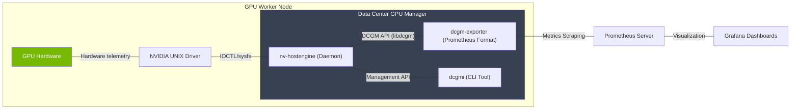

# Masterclass: GPU Sharing, Telemetry, and Lifecycle Operations

## Introduction
Welcome to the definitive masterclass on NVIDIA GPU sharing mechanisms, fleet telemetry, failure domain design, and lifecycle operations. In this masterclass, we will progress from beginner concepts to advanced NVIDIA AI Factory operations. This document serves as a comprehensive guide for DevOps, SRE, Platform, and MLOps engineers tasked with designing, deploying, and maintaining large-scale GPU clusters.

This masterclass is divided into six critical domains:
1. **GPU Sharing Fundamentals to Advanced (MIG, MPS, Time-Slicing, vGPU)**
2. **Fleet Telemetry & DCGM (Data Center GPU Manager)**
3. **Capacity and Failure Domain Design**
4. **Fleet Lifecycle, Upgrades, & Draining**
5. **Known-Good Validation**
6. **Senior Solutions Architect Troubleshooting & Interview Scenarios**

## Part 1: GPU Sharing Strategies
At the heart of any dense GPU deployment is the question of utilization. A modern H100 or A100 GPU is an incredibly powerful processor, often too powerful for a single lightweight inference workload or development notebook. To achieve optimal ROI and hardware utilization, engineers must employ GPU sharing.

### 1.1 Time-Slicing
Time-slicing is the most fundamental form of sharing. It leverages the OS and the NVIDIA driver to context-switch multiple processes on the GPU's compute engines.

#### The Architecture of Time-Slicing
When multiple processes address the same GPU without hardware partitioning, the GPU scheduler allocates time slots to each process. While one process executes, others are paused. Each process keeps its own GPU address space, but there is no memory capacity partitioning: all processes draw from the same physical GPU memory.

```bash
# Standard time-slicing does not require complex configuration,
# but you can configure Kubernetes device plugins to allow multiple
# pods to request the same physical GPU.
cat <<EOF > time-slicing-config.yaml
version: v1
sharing:
  timeSlicing:
    resources:
    - name: nvidia.com/gpu
      replicas: 4
EOF
```

**Pros:** High flexibility, zero hardware configuration, allows oversubscription.
**Cons:** High context-switching overhead, jitter in latency-sensitive workloads (inference), lack of memory capacity isolation (one process can exhaust GPU memory and cause allocation failures for the others; cgroups do not govern GPU memory), no fault isolation.

:::warning Time-Slicing Danger
Time-slicing gives no memory or fault isolation. With `replicas: 4`, the device plugin advertises four `nvidia.com/gpu` units per physical GPU, but nothing prevents one pod from consuming all of the GPU's memory.
:::

### 1.2 MPS (Multi-Process Service)
MPS was introduced to mitigate the context-switching overhead of Time-Slicing. It acts as a transparent proxy, intercepting CUDA API calls from multiple client processes and funneling them into a single context on the GPU.

#### MPS Architecture and Execution
MPS comprises a control daemon (`nvidia-cuda-mps-control`) and a server process (`nvidia-cuda-mps-server`).

```bash
#!/bin/bash
# Script to enable MPS on a specific GPU
export CUDA_VISIBLE_DEVICES=0
export CUDA_MPS_PIPE_DIRECTORY=/tmp/nvidia-mps
export CUDA_MPS_LOG_DIRECTORY=/tmp/nvidia-log

# Start the daemon
nvidia-cuda-mps-control -d

# Set compute mode to EXCLUSIVE_PROCESS to ensure only the MPS server can access the GPU directly
sudo nvidia-smi -i 0 -c EXCLUSIVE_PROCESS

# Provision resources (e.g., limit a client to 20% of threads)
echo set_default_active_thread_percentage 20 | nvidia-cuda-mps-control
```

**Deep Dive:** MPS allows concurrent execution of kernels from different processes on the same Streaming Multiprocessors (SMs). This massively increases utilization for small batch sizes. However, memory isolation is still not absolute at the hardware level, though MPS clients can be restricted in their memory allocation via `CUDA_MPS_PINNED_DEVICE_MEM_LIMIT`.

### 1.3 MIG (Multi-Instance GPU)
MIG, introduced in the Ampere architecture (A100) and refined in Hopper (H100), is the gold standard for secure, hardware-level GPU partitioning. It partitions the GPU into up to 7 fully isolated instances.

#### MIG Hardware Partitioning
MIG physically divides the GPU's memory controllers, L2 cache, and SMs. Each MIG device is exposed to workloads as a separate GPU device (addressed by MIG UUID) with its own dedicated memory and compute slices.

```mermaid
flowchart TD
    subgraph PhysicalGPU["Physical GPU (e.g. H100 80GB)"]
        direction TB
        subgraph MIG1["MIG Instance 1 (3g.40gb)"]
            MC1["Memory Controllers (40GB)"]
            L2_1["L2 Cache Slices"]
            SM1["Streaming Multiprocessors (3/7)"]
            MC1 --- L2_1 --- SM1
        end
        
        subgraph MIG2["MIG Instance 2 (2g.20gb)"]
            MC2["Memory Controllers (20GB)"]
            L2_2["L2 Cache Slices"]
            SM2["Streaming Multiprocessors (2/7)"]
            MC2 --- L2_2 --- SM2
        end
        
        subgraph MIG3["MIG Instance 3 (1g.10gb)"]
            MC3["Memory Controllers (10GB)"]
            L2_3["L2 Cache Slices"]
            SM3["Streaming Multiprocessors (1/7)"]
            MC3 --- L2_3 --- SM3
        end
    end
    
    style PhysicalGPU fill:#f4f4f4,stroke:#333,stroke-width:2px,color:#000
    style MIG1 fill:#76b900,color:#fff
    style MIG2 fill:#76b900,color:#fff
    style MIG3 fill:#76b900,color:#fff
```



#### Configuring MIG via nvidia-smi
MIG configuration requires placing the GPU into MIG mode; depending on GPU and driver, this may require a GPU reset or node reboot.

```bash
# 1. Enable MIG mode (requires root; may require a GPU reset or reboot)
sudo nvidia-smi -i 0 -mig 1

# 2. List available MIG profiles
nvidia-smi mig -lgip

# 3. Create GPU Instances (GI)
# Creating a 3g.40gb instance on GPU 0
sudo nvidia-smi mig -cgi 3g.40gb -i 0

# 4. Create Compute Instances (CI) within the GI
# Use the GI ID reported by the previous step (nvidia-smi mig -lgi); it is not always 1.
# (Passing -C to -cgi creates the default CI automatically.)
sudo nvidia-smi mig -cci -i 0 -gi <GI_ID>
```


### 1.4 vGPU (Virtual GPU)
While MIG partitions hardware for bare-metal or containerized workloads, vGPU operates at the hypervisor level. It uses NVIDIA's proprietary driver to mediate access between virtual machines and the physical GPU.

vGPU is typically used in VDI (Virtual Desktop Infrastructure) or enterprise cloud environments (like vSphere or AHV) where strict VM isolation is mandated. It requires an active NVIDIA license server (DLS/CLS).

**vGPU Operational Note:** When configuring SR-IOV for vGPU on modern architectures, ensure that the BIOS settings have SR-IOV enabled, VT-d/IOMMU enabled, and that the host OS kernel boots with `intel_iommu=on` or `amd_iommu=on`. Without these IOMMU groups properly initialized, the VFIO driver cannot bind the virtual functions to the guests.

## Part 2: Fleet Telemetry & DCGM
Operating a fleet of thousands of GPUs requires granular, real-time observability. The NVIDIA Data Center GPU Manager (DCGM) is the definitive tool for this task.

### 2.1 DCGM Architecture
DCGM runs as a daemon (`nv-hostengine`) on the host. It collects GPU telemetry through the driver and exposes APIs for health checking, profiling, and policy management.



### 2.2 DCGM Exporter Configuration
By default, `dcgm-exporter` exports a subset of metrics. In an AI Factory, you need custom metrics, especially for profiling (Tensor Core utilization, NVLink bandwidth).

#### Custom metrics.csv
```csv
# Format: DCGM field name, Prometheus type, help text
# The Prometheus metric name is the DCGM field name itself.
DCGM_FI_DEV_SM_CLOCK, gauge, SM clock frequency (in MHz).
DCGM_FI_DEV_MEM_CLOCK, gauge, Memory clock frequency (in MHz).
DCGM_FI_DEV_GPU_TEMP, gauge, GPU temperature (in C).
DCGM_FI_DEV_POWER_USAGE, gauge, Power draw (in W).
DCGM_FI_PROF_PIPE_TENSOR_ACTIVE, gauge, Ratio of cycles the tensor cores were active.
DCGM_FI_PROF_NVLINK_TX_BYTES, gauge, NVLink transmit bytes.
DCGM_FI_PROF_NVLINK_RX_BYTES, gauge, NVLink receive bytes.
```

To run DCGM exporter with these metrics in Docker:
```bash
docker run -d --gpus all \
  --cap-add SYS_ADMIN \
  -v /path/to/custom_metrics.csv:/etc/dcgm-exporter/default-counters.csv \
  -p 9400:9400 \
  nvcr.io/nvidia/k8s/dcgm-exporter:latest \
  -f /etc/dcgm-exporter/default-counters.csv
```

### 2.3 Hardware Health, ECC, and XID Semantics
GPUs will fail. Understanding the semantics of these failures is the difference between a 3 AM page and an automated self-healing cluster.

#### ECC Errors (SBE vs DBE)
- **SBE (Single-Bit Error):** Automatically corrected by ECC memory. High rates of SBEs indicate impending hardware failure (often handled via row remapping on Ampere/Hopper).
- **DBE (Double-Bit Error):** Uncorrectable. Typically reported as XID 48 and usually terminates the affected application. Requires node isolation and typically GPU replacement if row remapping fails.

**XID 13: Graphics Engine Exception. Often a software bug in the CUDA kernel, out-of-bounds memory access, or an illegal instruction. Rarely a hardware failure.**
:::tip Automated Remediation for XID 13
:::

**XID 31: GPU Memory Page Fault. A process tried to access unallocated memory. Similar to a segfault. Almost always a software issue. Ensure workloads are not leaking memory.**

**XID 43: GPU stopped processing. This is distinct from Xid 79 ("GPU has fallen off the bus"). The Xid Catalog's immediate action is `IGNORE` and the investigatory action is `CONTACT_SUPPORT`, so correlate it with other Xids and with PCIe AER messages before concluding anything.**

**XID 62: Internal micro-controller halt (PMU halt). The Xid Catalog lists `RESET_GPU` as the immediate action and `CONTACT_SUPPORT` as the investigatory action. If it recurs after a reset, escalate. (GSP errors are Xid 119 and 120.)**

**XID 74: NVLink Error. Reported when an NVLink error is detected on the high-speed fabric. Check `nvidia-smi nvlink` status, NVSwitch/Fabric Manager telemetry, and physical board seating, and consult the Xid Catalog for the decoded fields.**

**XID 94: Contained ECC Error. An uncorrectable error occurred, but the GPU contained it to a specific process without crashing the whole chip (supported in later architectures).**

## Part 3: Capacity and Failure Domain Design
An AI Factory is not just a collection of GPUs; it is a meticulously designed synchronous engine. The network is the computer.

### 3.1 Node, Rack, and Pod Topologies
A standard HGX H100 node contains 8 GPUs fully connected via NVLink and NVSwitch. Network connectivity usually dictates 4 to 8 ConnectX-7 NICs (400Gbps NDR InfiniBand or RoCEv2) per node, providing a 1:1 GPU-to-NIC ratio (Rail-Optimized topology).

### 3.2 Blast Radius Analysis
In a synchronous training job (e.g., training a 175B parameter LLM), the failure of *one* GPU halts the entire training job across thousands of GPUs. The cluster must restart from the last checkpoint.
Therefore, failure domains must map to job schedulers.
- **Spine Switch Failure:** Affects an entire Pod. Massive blast radius.
- **Leaf Switch Failure:** Affects a Rack. 
- **Node Failure:** Affects 8 GPUs.

## Part 4: Fleet Lifecycle, Upgrades, & Draining
Maintaining driver hygiene and upgrading components without downtime is an art form.

### 4.1 Node Draining Protocol
Before patching a driver, you must safely drain the node.

```bash
# Advanced GPU Node Drain Script
NODE=$1

# 1. Cordon the node
kubectl cordon $NODE

# 2. Wait for actively running GPU jobs to complete (or forcefully evict after timeout)
echo "Waiting for GPU utilization to hit 0%..."
while true; do
    # Poll DCGM for active workloads across all GPUs on the node
    UTIL=$(ssh root@$NODE 'dcgmi dmon -e 203 -c 1 | tail -n +3 | awk "{s+=\$2} END {print s}"')
    if [ "$UTIL" -eq "0" ]; then
        echo "Node is idle. Proceeding with drain."
        break
    fi
    sleep 30
done

# 3. Terminate DCGM and NV-Hostengine to release file descriptors
ssh root@$NODE 'systemctl stop nvidia-dcgm-exporter nvidia-dcgm'

# 4. Unload kernel modules (critical for driver upgrade without reboot)
ssh root@$NODE 'rmmod nvidia_uvm nvidia_drm nvidia_modeset nvidia'
```

## Part 5: Known-Good Validation
After an upgrade or RMA, the node must prove it is capable of rejoining the fleet. This is done via Known-Good Validation (KGV).

### 5.1 DCGM Diagnostics
```bash
# Run the thorough DCGM diagnostic suite (Level 3)
dcgmi diag -r 3
```

### 5.2 NCCL All-Reduce Bandwidth Test
Compute is irrelevant if the network is broken. We must validate intra-node NVLink and inter-node InfiniBand.
```bash
# Run NCCL tests to measure intra-node NVLink bandwidth; compare against your own known-good baseline
mpirun -np 8 --bind-to none \
  -x NCCL_DEBUG=INFO \
  /opt/nccl-tests/build/all_reduce_perf -b 1G -e 8G -f 2 -g 1
```

## Part 6: Senior Solutions Architect Troubleshooting & Interview Scenarios
In this final section, we explore real-world, high-pressure scenarios that Senior Solutions Architects face in the field.

### Scenario 1: The Ghost OOM on MPS
**Context:** Customer runs two inference containers on an A100 using MPS. Container A occasionally crashes with CUDA Out of Memory, but `nvidia-smi` shows only 10GB out of 40GB in use.
**Architect's Diagnosis:**
Under MPS, GPU memory is shared by all clients unless a limit is set, so `nvidia-smi` showing 10GB used does not rule out the failure. Check whether a per-client limit (`CUDA_MPS_PINNED_DEVICE_MEM_LIMIT`, or the MPS control daemon's `set_default_device_pinned_mem_limit`) is configured below what Container A needs, whether the figure was sampled after the OOM rather than at the peak, and whether Container B spiked. If the workloads need guaranteed, isolated memory, migrate them to MIG, which partitions memory in hardware.

### Scenario 2: XID 31 Storm on Node 42
**Context:** Node 42 is suddenly emitting thousands of XID 31 errors per minute. The monitoring system is screaming. What do you do?
**Architect's Action Plan:**
1. **Verify Blast Radius:** Check if Node 42 is part of a multi-node MPI job. If so, the entire job is likely deadlocked or corrupting data.
2. **Analyze the Error:** XID 31 is a memory page fault. It is a software error. A pointer in a CUDA kernel went out of bounds.
3. **Identify the Culprit:** Use `dmesg | grep NVRM` or DCGM to identify the PID attached to the fault. Trace the PID to the specific Kubernetes Pod or Slurm job.
4. **Triage:** Terminate the offending Pod. If the node recovers, it was purely a user software bug. If the node hangs or emits XID 13s subsequently, the driver state may be corrupted.
5. **Root Cause Analysis (RCA):** Work with the ML researcher to run `compute-sanitizer` (formerly `cuda-memcheck`) on their workload. It will pinpoint the exact line of CUDA C++ code causing the out-of-bounds access.

### Conclusion
Mastering GPU fleet operations requires deep understanding across the entire stack: from the quantum physics of silicon failure leading to ECC bit-flips, up through the PCIe bus protocols, driver abstractions, DCGM telemetry, and finally the distributed orchestrators scaling workloads across InfiniBand fabrics. This masterclass serves as the foundational text for operating the modern AI Factory.

---
*(End of Masterclass Volume 04)*
