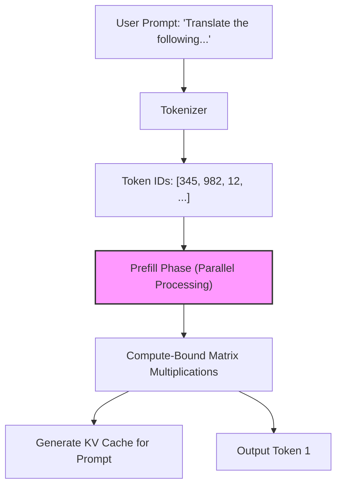
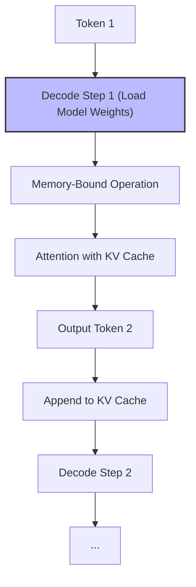
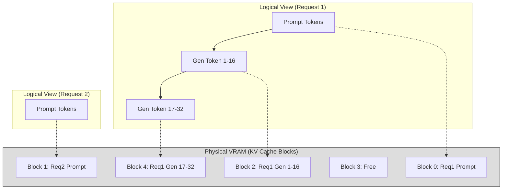
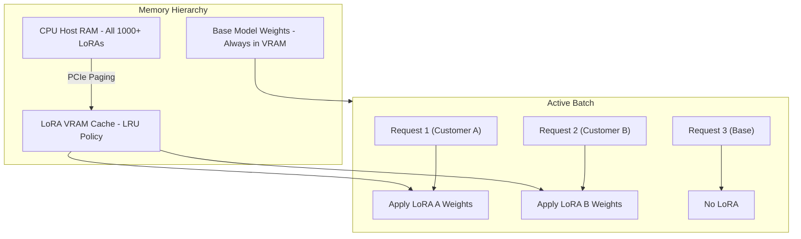

# LLM Inference and Serving Masterclass: From Fundamentals to NVIDIA AI Factory

Welcome to the definitive masterclass on Large Language Model (LLM) Inference and Serving. This document is designed for DevOps, SRE, Platform, Cloud, Infrastructure, and MLOps engineers tasked with deploying, scaling, and maintaining LLMs in production.

This guide progresses from the fundamental mathematical and computational phases of LLM inference to advanced, system-level optimizations using the NVIDIA AI Enterprise suite (NIM, TensorRT-LLM, Triton) and covers extreme edge cases required for AI Factory scale operations.

## 1. Introduction: The Inference Imperative

Training a foundation model requires thousands of GPUs running for months. However, the lifetime cost and computational expenditure of **serving** that model—running inference at scale—quickly eclipses the training cost. Efficiency in inference is not just a cost-saving measure; it is the fundamental enabler of viable AI products.

Serving an LLM in production is vastly different from running `model.generate()` in a Jupyter notebook. Production serving must handle concurrent requests, variable sequence lengths, strict latency SLAs (Service Level Agreements), and massive GPU memory constraints.

### 1.1 The Production Conundrum

In a production environment, you will face conflicting requirements:
*   **Low Latency:** End users expect immediate responses (measured in Time To First Token, TTFT) and fast reading speeds (measured in Time Per Output Token, TPOT or Token Generation Rate).
*   **High Throughput:** Platform engineers need to serve as many concurrent users as possible to amortize the cost of expensive GPU instances (measured in Requests Per Second, RPS, or Tokens Per Second, TPS).
*   **Memory Constraints:** LLMs are massive. The model weights themselves require tens to hundreds of gigabytes of VRAM. The intermediate memory state required for sequence generation (the KV Cache) grows dynamically and unpredictably, easily leading to Out-Of-Memory (OOM) errors if not managed rigorously.

Balancing these forces requires a deep understanding of the underlying mechanics.

---

## 2. The Mechanics of LLM Inference: Prefill and Decode

Autoregressive models (like GPT, LLaMA, and Mixtral) generate text one token at a time. This process is strictly divided into two distinct computational phases with entirely different performance profiles: **Prefill** and **Decode**.

### 2.1 The Prefill Phase (Prompt Processing)

When a user submits a prompt, the model cannot instantly generate the first new token. It must first process the entire input sequence to understand the context. This is the **Prefill** phase.

*   **Computation:** The model computes the embeddings and attention scores for all tokens in the input prompt simultaneously.
*   **Characteristics:** Highly parallelizable. It relies heavily on dense matrix multiplications (GEMM - General Matrix Multiply).
*   **Bottleneck:** Compute-bound. The GPU's Tensor Cores are fully saturated processing the large input matrices. VRAM bandwidth is less of an issue here because the model weights are loaded once to compute a massive batch of tokens.
*   **Output:** The first generated token, and the foundational Key-Value (KV) cache for the prompt.



### 2.2 The Decode Phase (Token Generation)

Once the prefill phase is complete and the first token is generated, the model enters the **Decode** phase. Here, it generates subsequent tokens one by one, using the newly generated token and the historical context.

*   **Computation:** To generate token *N*, the model must look at token *N-1* and the KV cache of tokens *1* to *N-2*.
*   **Characteristics:** Inherently sequential. Token *N* cannot be calculated until token *N-1* is finalized. 
*   **Bottleneck:** Memory-bandwidth bound. To generate a single token, the *entire* model weight matrices must be loaded from HBM (High Bandwidth Memory) into the GPU's SRAM/registers. Because we are only calculating a single token per request, the ratio of compute (FLOPs) to memory access (Bytes) is exceptionally low. The GPU Tensor Cores are severely underutilized; they are starved waiting for data from VRAM.
*   **Output:** Subsequent tokens until an End-Of-Sequence (EOS) token is reached or a length limit is hit.



### 2.3 The Architectural Trade-off

The dichotomy between Prefill (Compute-bound) and Decode (Memory-bound) dictates inference optimization strategies. If we just run batch size = 1, we waste massive amounts of GPU compute capacity during decode. We must batch requests.

---

## 3. The KV Cache Bottleneck and PagedAttention

To understand modern serving frameworks, you must deeply understand the KV Cache and its challenges.

### 3.1 What is the KV Cache?

In the Transformer architecture, Self-Attention requires computing Keys (K) and Values (V) for every token in the sequence to determine which previous tokens the current token should pay attention to.

During the autoregressive Decode phase, recomputing the K and V vectors for all *past* tokens every time we want to generate a *new* token would be computationally disastrous (an $O(N^2)$ operation per token). 

Instead, serving engines cache the K and V tensors from previous steps. When generating token *N*, the engine only computes the K and V for token *N-1*, concatenates them with the cached K and V tensors of tokens *1* to *N-2*, and performs the attention calculation. This reduces the complexity to $O(N)$ per token.

### 3.2 The Memory Math of the KV Cache

The KV cache is not small. Let's calculate its size.
For a single token across all layers, the size is:
`2 (for K and V) * Number_of_Layers * KV_Heads * Head_Dim * Bytes_Per_Element`

For a model like LLaMA-2 70B (FP16), which uses grouped-query attention (GQA):
*   Layers: 80
*   KV heads: 8 (versus 64 query heads)
*   Head dimension: 128
*   Bytes per element (FP16): 2

`2 * 80 * 8 * 128 * 2 = 327,680 bytes (~0.31 MB) per token.`

If you have a batch of 128 requests, and each reaches a sequence length of 2048 tokens:
`128 * 2048 * 0.31 MB = ~86 GB of KV Cache.`

Without GQA (full multi-head attention, KV dimension equal to the hidden size of 8192), the same arithmetic gives `2 * 80 * 8192 * 2 = ~2.6 MB` per token and ~687 GB for the same batch, which is why GQA matters so much for serving. Always compute the KV size from your model's actual config (`num_key_value_heads`).

### 3.3 The Problem with Traditional Memory Management

:::warning Traditional Memory Fragmentation
Early serving frameworks (like FasterTransformer or standard HuggingFace `generate`) pre-allocated contiguous memory blocks for the maximum possible sequence length for every request in a batch. 

This leads to catastrophic fragmentation:
1.  **Internal Fragmentation:** We don't know the final length of a generation. If we pre-allocate 2048 tokens, but the model stops at 100, we've wasted 1948 tokens worth of VRAM.
2.  **External Fragmentation:** As requests finish and free up contiguous blocks, new requests might not fit perfectly into the gaps, stranding memory.

Because of fragmentation, traditional systems often only utilize 20-40% of the available KV cache memory, severely limiting the maximum concurrent batch size.
:::

### 3.4 PagedAttention: The Solution

To solve this, researchers at UC Berkeley introduced **PagedAttention** (the core innovation behind vLLM). It applies the concept of virtual memory paging from operating systems to the KV cache.

Instead of contiguous memory, the KV cache is divided into fixed-size "blocks" (e.g., capable of holding 16 or 32 tokens each).
*   A centralized Block Manager tracks free and used blocks.
*   A Page Table maps logical tokens in a sequence to physical blocks in VRAM.
*   Blocks do not need to be contiguous in physical memory.



**Benefits of PagedAttention:**
1.  **Near-Zero Waste:** Memory is allocated block by block only when needed. Internal fragmentation is bounded by the size of a single block.
2.  **Zero External Fragmentation:** Any free block can be mapped to any request.
3.  **Memory Sharing:** For complex sampling methods (like beam search or parallel decoding), multiple sequences can share the exact same physical blocks for their common prefixes, massively reducing memory usage.

---

## 4. Continuous Batching (In-Flight Batching)

With PagedAttention solving the memory fragmentation crisis, we can now aggressively batch requests to solve the compute-underutilization problem of the Decode phase.

### 4.1 Static vs. Dynamic vs. Continuous Batching

*   **Static Batching:** Wait for N requests. Run them all. Wait for all N to finish. Highly inefficient because sequences have different lengths. The GPU sits idle waiting for the longest sequence to finish.
*   **Dynamic Batching (server-side):** Collect requests that arrive within a short window into one batch. Better than one-at-a-time, but the batch still runs to completion together, so short sequences wait on long ones.
*   **Continuous Batching (In-Flight Batching):** The state-of-the-art approach used in vLLM and TensorRT-LLM.

Continuous Batching operates at the *iteration* level, not the request level. The scheduler evaluates the queue and the currently running batch before every single forward pass.

1.  If Request A finishes its generation, it is immediately ejected from the batch.
2.  A new Request C from the queue is immediately injected into the batch.
3.  The next forward pass computes a Prefill for Request C alongside Decode steps for the existing Request B.

```mermaid
gantt
    title Continuous Batching vs Static Batching
    dateFormat  s
    axisFormat %s

    section Static Batching
    Req 1 (Short) :done, 0, 3
    Req 2 (Long)  :done, 0, 7
    Req 3 (Med)   :done, 0, 5
    Idle Time (Req 1) :crit, 3, 7
    Idle Time (Req 3) :crit, 5, 7
    Next Batch Starts : 7, 8

    section Continuous Batching
    Req 1 (Short) :done, 0, 3
    Req 4 (New)   :active, 3, 8
    Req 2 (Long)  :done, 0, 7
    Req 5 (New)   :active, 7, 9
    Req 3 (Med)   :done, 0, 5
    Req 6 (New)   :active, 5, 8
```



### 4.2 The Challenge: Chunked Prefill

Combining Prefill (compute-bound) and Decode (memory-bound) in the same batch introduces a severe tail-latency problem.

If a massive new prompt (e.g., 32,000 tokens) enters the queue, the continuous batcher injects it. The Prefill for this massive prompt will monopolize the GPU Tensor Cores for hundreds of milliseconds. Meanwhile, the concurrent Decode requests—which require strict, low-latency iteration to maintain a high Token Generation Rate for users—are starved. This causes terrible "stuttering" in the streaming output of existing requests.

**Solution: Chunked Prefill**
Modern engines break massive prefill sequences into smaller chunks (e.g., chunks of 512 or 1024 tokens).
Iteration 1: Decode (Req A, B) + Prefill Chunk 1 (Req C)
Iteration 2: Decode (Req A, B) + Prefill Chunk 2 (Req C)
...and so on.
This bounds the maximum time of any single forward pass, guaranteeing consistent TPOT for decode streams while slightly increasing the TTFT for the massive prompt.

---

## 5. The Serving Frameworks Landscape

The open-source and proprietary ecosystem for serving LLMs is fragmented but converging around a few heavyweights.

### 5.1 vLLM: The PagedAttention Pioneer
vLLM popularized PagedAttention and Continuous Batching. It is highly flexible, supports nearly every model architecture on HuggingFace immediately upon release, and is written in a mix of Python and C++/CUDA.
*   **Pros:** Incredible ease of use, fastest time-to-market for new architectures, massive community, excellent for prototyping and many production workloads.
*   **Cons:** Python overhead can be a bottleneck at extreme scale. Optimization is generalized, not specifically tuned to the bare metal of the latest NVIDIA silicon architecture in the way proprietary solutions might be.

### 5.2 NVIDIA TensorRT-LLM (TRT-LLM): Bare Metal Performance
TRT-LLM is NVIDIA's hyper-optimized C++ inference engine. It bypasses PyTorch overhead entirely, compiling the model into an optimized compute graph (a TensorRT Engine) specific to the target GPU architecture (e.g., Hopper, Ada, Ampere).
*   **Pros:** Absolute maximum performance on NVIDIA GPUs. Deep integration with hardware-specific features like FP8 FP-formats, Transformer Engine, In-Flight Batching, and advanced attention kernels (FlashAttention, XQA).
*   **Cons:** Steep learning curve. Requires a distinct "compilation/build" step before running. Not every esoteric HuggingFace model is supported immediately.

### 5.3 Triton Inference Server: The Orchestrator
Neither vLLM nor TRT-LLM are full *servers* in the enterprise sense (though vLLM provides a basic OpenAI-compatible FastAPI wrapper). Triton is a multi-framework serving platform.
It handles: gRPC/HTTP endpoints, dynamic batching across multiple instances, metric export (Prometheus), model versioning, and multi-node orchestration.
In production, you do not expose TRT-LLM directly; you host a TRT-LLM *backend* inside a Triton Inference Server.

### 5.4 NVIDIA NIM (NVIDIA Inference Microservices)
NIM is the evolution of the AI platform boundary. It packages the entire stack—the optimized TRT-LLM engine, the Triton Server, the API gateway, and the optimal configuration for a specific GPU—into a single, deployable OCI container.
It abstracts away the complexity of building TRT-LLM engines while providing the peak performance of the underlying stack.

---

## 6. Deep Dive: TensorRT-LLM Engine Building

To understand what NIM does under the hood, or to deploy custom models not covered by standard NIMs, you must understand the TensorRT-LLM engine building process.

Building a TRT-LLM engine is a two-step process:
1.  **Checkpoint Conversion:** Translate the weights from HuggingFace/PyTorch format into a TRT-LLM generic format.
2.  **Engine Building:** Compile the generic format into an optimized execution graph for a specific GPU architecture and topology (e.g., Tensor Parallelism = 4).

### 6.1 Step 1: Checkpoint Conversion

Here is how you convert a Llama-3-8B-Instruct model.

```bash
# Example script to convert HF weights to TRT-LLM format
# Run inside the TensorRT-LLM development container

python3 TensorRT-LLM/examples/llama/convert_checkpoint.py \
    --model_dir /models/Meta-Llama-3-8B-Instruct \
    --output_dir /models/trt-engines/llama-3-8b/trt_ckpt \
    --dtype bfloat16 \
    --tp_size 2 \
    --pp_size 1
```

*Code Explanation:*
*   `--model_dir`: Source HF checkpoint.
*   `--output_dir`: Intermediate output format.
*   `--dtype bfloat16`: We lock the weights to BF16. Crucial for stability on Ampere and newer GPUs compared to FP16.
*   `--tp_size 2`: **Tensor Parallelism**. This dictates that the resulting engine MUST be run on 2 GPUs. The matrix multiplications will be split across the 2 GPUs using NVLink for AllReduce operations.
*   `--pp_size 1`: **Pipeline Parallelism**. Layers are kept on the same TP group (not split across nodes).

### 6.2 Step 2: Engine Compilation (trtllm-build)

This step invokes the TRT compiler. It applies kernel fusions, selects the best FlashAttention implementations, and optimizes memory layouts.

```bash
# Compile the TRT Engine
trtllm-build \
    --checkpoint_dir /models/trt-engines/llama-3-8b/trt_ckpt \
    --output_dir /models/trt-engines/llama-3-8b/engine \
    --gemm_plugin bfloat16 \
    --use_paged_context_fmha enable \
    --max_batch_size 128 \
    --max_input_len 4096 \
    --max_seq_len 8192 \
    --max_num_tokens 8192
```

*Deep Dive on Build Flags:*
*   `--gemm_plugin`: Enables TensorRT's optimized General Matrix Multiply kernels, critical for prefill speed.
*   `--use_paged_context_fmha`: Enables fused attention over a paged KV cache during the context (prefill) phase. It is needed for features such as chunked context and KV cache reuse; check the TensorRT-LLM docs for your release.
*   **The Shape Constraints (`max_batch_size`, `max_input_len`, `max_seq_len`):** Unlike PyTorch which is dynamic, TRT needs maximum bounds at compile time to allocate optimal workspace memory and select kernels. If an inference request exceeds `max_seq_len` at runtime, it will fail. If you set these values too high (e.g., max_batch_size 1024), the compiler might select less efficient kernels or you will run out of VRAM just allocating the engine contexts. Sizing these properly requires profiling your specific production workload.

---

## 7. Triton Inference Server Configuration for LLMs

Once the TRT-LLM engine is built, it must be loaded into Triton using the `tensorrtllm` backend. Triton requires a specific directory structure known as the Model Repository.

```text
model_repository/
├── tensorrt_llm/
│   ├── config.pbtxt
│   └── 1/
│       └── (empty, Triton loads from the engine path)
└── vllm/ (if using vllm backend instead)
    ├── config.pbtxt
    └── 1/
```

### 7.1 Deep Dive: The Triton config.pbtxt

The `config.pbtxt` is where platform engineers tune the serving cluster. Let's look at a production-grade configuration for a TRT-LLM backend.

```protobuf
# model_repository/tensorrt_llm/config.pbtxt
name: "tensorrt_llm"
backend: "tensorrtllm"
max_batch_size: 128 # Must match or be less than trtllm-build max_batch_size

# Define input/output tensors strictly
input [
  {
    name: "input_ids"
    data_type: TYPE_INT32
    dims: [ -1 ]
  },
  {
    name: "request_output_len"
    data_type: TYPE_INT32
    dims: [ -1 ]
  }
]
output [
  {
    name: "output_ids"
    data_type: TYPE_INT32
    dims: [ -1, -1 ]
  }
]

instance_group [
  {
    count: 1
    kind: KIND_CPU
  }
]

parameters: {
  key: "triton_backend"
  value: { string_value: "tensorrtllm" }
}
# GPU placement is controlled through backend parameters (for example gpu_device_ids
# and the participant/orchestrator settings), not instance_group GPUs. Use the reference
# config.pbtxt from the tensorrtllm_backend repository for your release as the starting point;
# this listing is abbreviated.
parameters: {
  key: "gpt_model_path"
  value: { string_value: "/models/trt-engines/llama-3-8b/engine" }
}

# The Decoupled architecture is MANDATORY for streaming LLM responses
model_transaction_policy {
  decoupled: True
}

# Advanced In-Flight Batching Configuration
parameters: {
  key: "max_tokens_in_paged_kv_cache"
  value: { string_value: "256000" } # Total tokens the KV cache can hold globally
}
parameters: {
  key: "kv_cache_free_gpu_mem_fraction"
  value: { string_value: "0.9" } # Use 90% of REMAINING free VRAM for KV cache
}
parameters: {
  key: "enable_chunked_context"
  value: { string_value: "true" } # Enable chunked prefill
}
```

*Architectural Significance:*
1.  **Decoupled Policy:** Standard Triton expects 1 request = 1 response. For LLMs, we want Server-Sent Events (SSE) streaming (1 request = N token responses). `decoupled: True` enables the backend to return multiple responses asynchronously.
2.  **KV Cache Allocation:** The `kv_cache_free_gpu_mem_fraction` is critical. If set too high (e.g., 0.99), memory fragmentation or a sudden spike in context usage during decode might cause the OS/CUDA to OOM. Leave headroom and tune it against your own peak prompt lengths.

---

## 8. System-Level Optimization: CUDA Graphs and torch.compile

While framework-level batching is vital, system-level optimizations squeeze the final drops of performance out of the silicon.

### 8.1 The CPU Overhead Problem

In the Decode phase, the GPU calculates a single token incredibly fast (often in just a few microseconds). However, the PyTorch/Python CPU thread must issue the next CUDA kernel launch for the next token. 
When the GPU execution time becomes shorter than the CPU kernel launch time, the GPU sits idle waiting for instructions from the CPU. This is CPU-bound inference.

### 8.2 CUDA Graphs

CUDA Graphs solve this. Instead of launching 50 individual kernels sequentially from the CPU for an attention block, the CPU "records" the sequence of kernels once. This recorded "graph" is then launched with a *single* CPU instruction. The GPU schedules the dependent kernels entirely on-device, bypassing the CPU overhead.

TRT-LLM utilizes CUDA Graphs aggressively. However, graphs require static shapes. Because Continuous Batching constantly changes the batch size and sequence lengths, TRT-LLM must compile multiple CUDA graphs for different common "buckets" of batch sizes, falling back to standard execution if a batch doesn't match a graph.

### 8.3 torch.compile (TorchDynamo)

TorchDynamo is the graph-capture frontend behind PyTorch 2.x `torch.compile`. If you are running raw PyTorch or vLLM, `torch.compile` can capture the model and generate fused kernels (via TorchInductor, which emits Triton kernels) and can be combined with CUDA Graphs. (Do not confuse it with NVIDIA Dynamo, a separate NVIDIA distributed inference serving framework.)

While powerful for ML engineers iterating rapidly, JIT compilation adds warm-up time and shape-dependent recompilation, whereas ahead-of-time engines such as TRT-LLM give you a fixed, validated artifact. Measure both against your latency SLA.

---

## 9. Production Operations: Telemetry and Scaling

Operating LLMs requires different metrics than traditional microservices. Traditional metrics like CPU % or raw RPS are misleading.

### 9.1 The Golden Signals of LLM Serving

Platform engineers must monitor these four core metrics (exported via Triton's Prometheus endpoint or vLLM's metrics API):

1.  **Time To First Token (TTFT):** The duration from request receipt to the first token emitted. This measures the health of your *Prefill* compute. If TTFT spikes, your queue is backing up or chunked prefill is misconfigured.
2.  **Time Per Output Token (TPOT):** The duration between emitted tokens during decode. This measures *Decode* health. If TPOT spikes, you are likely memory-bandwidth bound (batch size too high, saturating VRAM bandwidth).
3.  **KV Cache Utilization (%):** The percentage of PagedAttention blocks currently in use. This is your primary scaling indicator.
4.  **Iteration Time (ms):** The wall-clock time for the continuous batcher to complete one forward pass.

### 9.2 The HPA (Horizontal Pod Autoscaler) Dilemma

In standard Kubernetes, you scale on CPU or Memory. For LLMs, this is disastrous. VRAM is always pre-allocated (KV cache takes all available memory at startup), so memory usage always reads 100%. CPU is largely irrelevant.

**Proper Scaling Strategy:**
You must implement a Custom Metrics Adapter in Kubernetes and scale based on **KV Cache Utilization** or **Queue Length / Wait Time**.

If KV Cache Utilization hits 85%, the node cannot accept more concurrent sequences. You must spin up a new replica (which takes minutes for massive models), so predictive scaling based on derivative queue growth is essential.

---

## 10. Senior Solutions Architect Troubleshooting Scenarios

As an architect in an AI Factory, you will face complex failures. Here is how to debug them.

### Scenario 1: The OOM during Decode Spike

**Symptom:** A TRT-LLM pod crashes with CUDA Out of Memory specifically during a period of high concurrent usage, even though `kv_cache_free_gpu_mem_fraction` is set to 0.90.

**Analysis & Root Cause:**
The architect must realize that the KV cache is not the only dynamic memory. During the *Prefill* phase of a new, extremely long prompt, temporary workspace memory is required for the massive intermediate attention matrices before they are reduced. 
If the KV cache is 90% full, and a massive 32k token prompt arrives, the continuous batcher admits it. The allocation for the prefill workspace exceeds the remaining 10% safety buffer, triggering an OOM and taking down the entire batch of 100+ active users.

**Resolution:**
1.  Enable Chunked Context / Chunked Prefill. By breaking the 32k prompt into 2k chunks, the peak prefill workspace memory requirement is drastically reduced, fitting safely in the buffer.
2.  Decrease `kv_cache_free_gpu_mem_fraction` to 0.85 to increase the safety buffer for prefill spikes.

### Scenario 2: The TPOT Degradation Trade-off

**Symptom:** The product team complains that the model feels "sluggish." They are reading tokens slower than normal. TPOT has increased from 20ms/token to 60ms/token. However, overall system throughput (Tokens Per Second) is at an all-time high.

**Analysis & Root Cause:**
This is the classic Throughput vs. Latency trade-off in Continuous Batching. The system is doing exactly what it is designed to do: maximizing GPU utilization by pushing the batch size higher. As batch size increases, the massive memory bandwidth requirement to load weights for every token causes the Decode phase to slow down per request, even as total throughput increases.

**Resolution:**
The architect must enforce SLAs.
1. Determine the product requirement. For human reading, ~30ms-50ms TPOT is acceptable.
2. Configure the serving engine to cap the maximum concurrent sequences (`max_batch_size` or vLLM's `max_num_seqs`). 
3. By capping the batch size artificially, you force the system to queue new requests (increasing their TTFT) but preserve the TPOT SLA for active requests.
4. Scale horizontally earlier.

### Scenario 3: Preemption and Swapping Thrash

**Symptom:** Extreme, multi-second latency spikes in generation, accompanied by PCIe bus saturation alerts.

**Analysis & Root Cause:**
If the continuous batcher over-admits requests and runs out of KV Cache blocks, it must *preempt* active sequences to make room. 
Depending on engine and version, preempted sequences are either swapped out of GPU HBM over the PCIe bus into CPU system RAM and later swapped back in, or dropped and recomputed (vLLM's recompute policy). Either way the work is paid for twice. If the system is hovering right at the memory limit, it enters a thrashing state—constantly swapping KV cache blocks over PCIe, saturating the bus and halting compute.

**Resolution:**
1. Monitor the vLLM preemption counter (`vllm:num_preemptions_total` in recent releases; confirm in your `/metrics` output) or the equivalent metric in your engine. Any non-zero preemption rate indicates a misconfigured capacity limits or insufficient horizontal scaling.
2. Tune the scheduler. In vLLM, ensure `gpu_memory_utilization` accurately reflects available VRAM, and consider lowering it slightly if memory fragmentation is occurring despite PagedAttention (rare, but possible with certain alignments).

---

## 11. Core Interview Questions for AI Infrastructure Roles

If you are interviewing for a Senior MLOps or Platform Engineer role managing LLMs, expect these questions:

**Q1: Explain the difference between compute-bound and memory-bandwidth-bound phases in LLM inference.**
*A strong answer must explicitly name Prefill and Decode. It must explain that Prefill uses Tensor Cores heavily (GEMM) because it computes a large batch of prompt tokens against the weights loaded once. It must explain that Decode is memory-bound because the entire model weight matrices must be transferred from HBM to SRAM for every single generated token, severely underutilizing the FLOPs.*

**Q2: Why does standard HuggingFace `generate()` fail in a high-concurrency production environment?**
*A strong answer discusses memory fragmentation. It explains that standard PyTorch allocates contiguous blocks for the maximum possible sequence length, wasting massive amounts of VRAM (internal fragmentation) and preventing optimal batching. It must contrast this with PagedAttention and non-contiguous KV cache blocks.*

**Q3: How do you decide when to horizontally scale an LLM serving cluster? CPU utilization?**
*A strong answer immediately dismisses CPU utilization. It points to KV Cache memory utilization (e.g., scaling at 80% capacity) and Queue Length / Time-To-First-Token degradation. It notes that memory is fully allocated at startup, so standard memory metrics are useless; application-specific telemetry is required.*

**Q4: What is the purpose of Tensor Parallelism in inference, and when is it strictly necessary?**
*A strong answer defines TP as splitting the model weights and matrix multiplications across multiple GPUs within the same node, connected via NVLink. It is strictly necessary when the model weights + KV cache + context exceed the memory capacity of a single GPU (e.g., fitting a 70B model on 80GB GPUs requires TP=2 or TP=4).*

**Q5: Describe a scenario where you would intentionally restrict the maximum batch size of your continuous batcher.**
*A strong answer discusses the Latency vs. Throughput trade-off. To maintain a strict SLA for Time-Per-Output-Token (TPOT) for a streaming chatbot application, you must limit the batch size. Unbounded batch sizes will maximize overall hardware throughput (Tokens/sec) but will slow down individual generation speeds to unacceptable levels for human readers.*

---
# End of Masterclass Document

## 12. Advanced API Integration and Client-Side Handling

### 12.1 The OpenAI Compatible Server

Most modern serving frameworks expose an OpenAI-compatible API. This is crucial for drop-in replacement in existing applications.

Here is an example of spinning up a vLLM server:
```bash
python -m vllm.entrypoints.openai.api_server \
    --model mistralai/Mistral-7B-Instruct-v0.2 \
    --dtype auto \
    --api-key my_secret_key \
    --max-model-len 8192 \
    --gpu-memory-utilization 0.9
```

### 12.2 Handling Streaming Responses in Python

To achieve low perceived latency, you MUST stream the response. Here is the correct way to handle Server-Sent Events (SSE) using the standard `openai` python package against your custom server.

```python
import os
from openai import OpenAI

# Point to the Triton/vLLM instance instead of OpenAI's cloud
client = OpenAI(
    api_key=os.environ.get("OPENAI_API_KEY", "my_secret_key"),
    base_url="http://localhost:8000/v1"
)

stream = client.chat.completions.create(
    model="mistralai/Mistral-7B-Instruct-v0.2",
    messages=[{"role": "user", "content": "Explain Kubernetes architecture."}],
    stream=True,
    max_tokens=1024,
    temperature=0.7,
)

print("Streaming response:")
for chunk in stream:
    if chunk.choices[0].delta.content is not None:
        # Print token by token as they arrive from the continuous batcher
        print(chunk.choices[0].delta.content, end="", flush=True)
print()
```

### 12.3 Offline Inference (Batch Processing)

For offline batch processing where throughput (Tokens/Sec) is the only metric that matters (and TTFT is irrelevant), you should bypass the API server entirely and use the framework's core engine directly.

```python
from vllm import LLM, SamplingParams

# Load model directly into GPU memory
llm = LLM(
    model="meta-llama/Llama-2-7b-hf",
    tensor_parallel_size=1, # Change to 2, 4, 8 for multi-GPU
    gpu_memory_utilization=0.95 # Can be pushed higher for offline
)

prompts = [
    "The future of AI infrastructure is",
    "NVIDIA GPUs are powerful because",
    "To optimize inference, you must",
]

# Set sampling parameters
sampling_params = SamplingParams(temperature=0.8, top_p=0.95, max_tokens=256)

# Execute the batch (vLLM's continuous batcher handles this optimally)
outputs = llm.generate(prompts, sampling_params)

# Print results
for output in outputs:
    prompt = output.prompt
    generated_text = output.outputs[0].text
    print(f"Prompt: {prompt!r}, Generated text: {generated_text!r}")
```

## 13. Deep Dive: Multi-LoRA Serving at Scale

A major trend in AI Factories is serving one massive foundation model (e.g., Llama-3-70B) alongside thousands of specialized LoRA (Low-Rank Adaptation) adapters for different customers or tasks.

Loading 1000 different 70B models is impossible. Loading one 70B base model and dynamically swapping the 200MB LoRA adapters per-request is highly efficient.

### 13.1 How Multi-LoRA Works

Instead of merging the LoRA weights into the base weights (which would create a new distinct model in VRAM), the serving engine keeps the base weights and the LoRA `A` and `B` matrices separate.

During the forward pass, for a specific request using LoRA ID `X`, the engine computes:
`Activation = (Base_Weights * Input) + (LoRA_B_X * (LoRA_A_X * Input))`

### 13.2 LoRA Paging (vLLM)

Just like PagedAttention pages the KV Cache, modern engines page the LoRA weights.
1. A massive pool of VRAM is reserved for LoRA weights.
2. When a request for LoRA `X` arrives, its weights are paged into the GPU from CPU RAM if not already present.
3. The Continuous Batcher can process a single batch containing requests using completely different LoRAs simultaneously.



## 14. Hardware Implications: Grace Hopper and the Future

The PCIe bottleneck for KV cache swapping and LoRA paging is a major limitation of x86/PCIe architectures.

The NVIDIA GH200 (Grace Hopper Superchip) fundamentally alters this. By connecting the Grace CPU and Hopper GPU via NVLink-C2C (900 GB/s bidirectional, 7x faster than PCIe Gen5), the GPU can address the CPU's massive LPDDR5X memory pool almost as if it were VRAM.

This enables:
* Much faster KV cache swapping than over PCIe.
* Storing tens of thousands of active LoRAs in fast CPU memory.
* Holding much longer contexts than HBM alone could fit, at the cost of lower bandwidth for the spilled portion.

## 15. Summary

Serving LLMs is one of the most complex infrastructure challenges in modern computing. It requires a fundamental shift from CPU/Memory-based scaling to custom GPU utilization metrics. 

By mastering PagedAttention, Continuous Batching, and the intricacies of frameworks like TRT-LLM and vLLM, Platform Engineers can dramatically reduce their organization's AI compute spend while delivering world-class latency to end-users.

---
