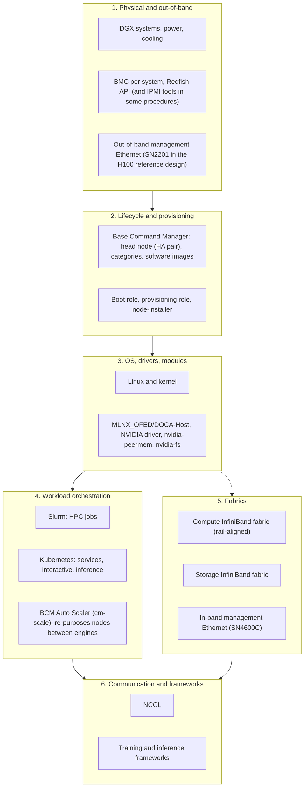

# Interview Lab — NVIDIA Senior Solutions Architect: AI Factory from Bare-Metal to Workloads

A senior architect interview is not a recall test. The interviewer is checking two things: whether you can reason through the whole stack, and whether you know the difference between what the product documents and what you are inferring. An answer that states an unsupported detail confidently is worse than one that says "the reference architecture says X, and my inference is Y."

This lab keeps the layered structure from earlier versions and replaces the details that were not supportable. Where a number or product behavior appears, it is traceable to a vendor document listed at the end. Where you must reason beyond the documents, the text says so, because that is the sentence an interviewer will probe.

---

## 1. The stack, from the rack to the job



The reference-design switch models come from the H100 SuperPOD reference architecture. Your customer's design may differ, and the next section shows how to say that.

---

## 2. Facts to know cold, with their sources

### 2.1 What the DGX SuperPOD H100 reference architecture says

- **Four fabrics**: compute InfiniBand, storage InfiniBand, in-band management Ethernet, and out-of-band management Ethernet. The reference design uses SN4600C switches for in-band management and SN2201 switches for out-of-band management (H100 reference architecture, "Network Fabrics").
- **Scalable units (SU).** The design is built from SUs of 32 nodes. The reference architecture focuses on four SUs with 128 nodes and 1,024 GPUs, and it describes scaling to more than 64 SUs and 2,000 or more DGX H100 nodes ("DGX SuperPOD Architecture").
- **The 127-node detail.** In the full compute-fabric layout, a four-SU design shows 127 nodes and 1,016 GPUs, and a one-SU design shows 31 nodes. The document notes that it is a 32-node-per-SU design in which a DGX system is removed to accommodate UFM connectivity ("Network Fabrics", compute table). Know both numbers, and know why they differ.
- **Rail alignment.** Each group of 32 nodes is rail-aligned: traffic on a given rail is one hop from the other 31 nodes in the SU, and traffic between nodes or between rails goes through the spine layer.
- **Storage fabric.** InfiniBand, on MQM9700-NS2F switches, chosen because per-node I/O must exceed 40 GB/s. Storage devices connect at a 1:1 port-to-uplink ratio. DGX H100 connections are slightly oversubscribed, near 4:3.
- **Power per rack.** The reference rack layout example has more than 40 kW per rack, and the document says the layout can change to fit local power and cooling limits ("DGX SuperPOD Architecture").

### 2.2 What the DGX H100 user guide says

- **Power.** The power specification table lists 10.2 kW maximum, and the component table lists six 3.3 kW power supplies (DGX H100/H200 User Guide). Do not quote a different "typical" number unless you can cite it.
- **Redfish.** NVIDIA documents the BMC's Redfish API with working examples. These are the URIs the guide actually shows:

```bash
# Power control of the host (ResetType values documented include On, GracefulShutdown, ForceOff, GracefulRestart, ForceRestart, PowerCycle)
$ curl -k -u <bmc-user>:<password> --request POST \
    'https://<bmc-ip-address>/redfish/v1/Systems/DGX/Actions/ComputerSystem.Reset' \
    --header 'Content-Type: application/json' --data '{"ResetType": "GracefulRestart"}'

# Sensors, firmware inventory, and the system event log
$ curl -k -u <bmc-user>:<password> 'https://<bmc-ip-address>/redfish/v1/Chassis/DGX/Sensors'
$ curl -k -u <bmc-user>:<password> 'https://<bmc-ip-address>/redfish/v1/UpdateService/FirmwareInventory'
$ curl -k -u <bmc-user>:<password> 'https://<bmc-ip-address>/redfish/v1/Managers/BMC/LogServices/SEL/Entries'
```

- `-k` skips certificate verification and is acceptable for a lab BMC with a self-signed certificate. For production, install proper certificates and drop it.
- The endpoint returns 75 SEL members at a time and gives a `Members@odata.nextLink` for paging.
- The earlier draft's path `/redfish/v1/Chassis/GPU_Tray_0/Thermal` does not appear in the guide. Use the documented URIs, or discover resources by walking `/redfish/v1/` from the service root.
- The guide also documents password rules (13 to 20 characters with upper, lower, digit, and special character) and BMC reset and factory-default actions. Read them before a customer asks.

**Redfish versus IPMI.** Say what the documents show, not a slogan. The DGX firmware guide describes updating through `nvfwupd` or the Redfish API, and the same guide still uses `ipmitool` for BMC reset (`ipmitool mc reset cold`). The accurate statement is that Redfish is the documented API for firmware, BIOS, and power-management tasks on these systems, while IPMI tooling still appears in procedures. The DMTF Redfish specification itself is the reference for the REST model.

### 2.3 What the BCM manual says (and does not say)

These corrections matter because the earlier draft got them wrong. Details are in [Senior Deep Dive 1](./13-senior-deep-dive-1-bcm-at-fleet-scale.md).

| Claim in earlier draft | What BCM 11 documents |
|---|---|
| Head node HA uses Corosync, Pacemaker, and DRBD | HA is built with `cmha-setup`. It uses fencing, STONITH through power control, a quorum check across nodes, and NAS shared storage (BCM 11 Admin Manual, §15) |
| Intermediate CMDaemon proxies offload telemetry | No such tier. Scale boot with the **boot role** and image transfer with the **provisioning role** (§5.1.7, §5.2) |
| BitTorrent and multicast image distribution | Not documented. Image distribution is through provisioning nodes (§5.2) |
| Move nodes between Slurm and Kubernetes by changing the category in `cmsh` | The documented mechanism is **BCM Auto Scaler (`cm-scale`)**, which switches nodes between configuration overlays (§8) |
| Firmware and node images are "immutable" | BCM can update running nodes in place (`imageupdate`) as well as reprovision them at boot (§5.6) |

Auto Scaler deserves a precise answer, because it is the documented answer to "can the same hardware serve Slurm and Kubernetes?" Per the manual, the `cm-scale` service collects workload information from workload engines and can re-purpose nodes: "if Slurm jobs are pending and there is a free Kubernetes node, then the node is turned into a Slurm node pretty much immediately" (§8.1.1, use case 2). It matches requested CPUs, GPUs, and memory, and for Kubernetes it also considers pods, ephemeral storage, and extended resources, with support for NVIDIA GPUs (§8.1.2). The same service can also power nodes on and off, or extend into the cloud, but those paths take longer than re-purposing.

---

## 3. Whiteboard scenarios

### Scenario 1: Architect an AI factory for a customer

**Interviewer:** "A customer wants a foundation-model training cluster of roughly 128 DGX H100 nodes plus an inference environment. Walk me through the architecture."

**A defensible answer, in order:**

1. **Anchor on the reference architecture.** "NVIDIA publishes a reference design for this size. It's four scalable units of 32 nodes, 1,024 GPUs, and I'd start from it and then say where the customer's constraints force a deviation." That sentence shows you know the document and aren't improvising.
2. **Four networks, each sized for its job.** Compute InfiniBand (rail-aligned in groups of 32), storage InfiniBand (the reference sizes this for more than 40 GB/s per node, 1:1 at the storage side and about 4:3 on the DGX side), in-band management Ethernet, and out-of-band management Ethernet. Explain why management is separate: it carries different trust and different failure modes.
3. **Power and cooling are a design input, not an afterthought.** "A single DGX H100 is listed at 10.2 kW maximum with six 3.3 kW supplies. The reference rack example exceeds 40 kW. The customer's rack power limit decides how many systems per rack, so I'd get the facility limit first." Do not invent a rack density. Compute it from their limit.
4. **Lifecycle.** BCM with an HA head-node pair. "HA needs power control on both heads for automatic failover, a dedicated heartbeat link, and shared storage, because only one head can be active against shared filesystems." For scale, add provisioning-role nodes per rack group and boot-role nodes per subnet if boot storms appear.
5. **Orchestration.** Slurm for scheduled training and BCM Auto Scaler if the customer also wants Kubernetes capacity that can change over time. Name the trade-off: re-purposing happens between jobs and depends on the workload engines' queue state, so it is not instant isolation.
6. **Close with what you'd validate.** Fabric health (`ibdiagnet`), NCCL baselines, GDS checks, and a change-management ring plan ([Chapter 10](./10-coordinated-cluster-wide-software-change-management.md)).

### Scenario 2: A 64-node training run is frozen at a step

**Interviewer:** "A 64-node run froze. The scheduler shows it running, GPU utilization is zero. Walk me through it."

**A defensible answer:**

> "I'd go in order and let evidence pick the layer. First the scheduler: is the allocation intact, and did any node get drained or go down? Then launch and limits: are all ranks alive on every node, and does `ulimit -l` inside a step show unlimited, since a pinned-memory limit gives specific `ibv_create_qp` and `ibv_reg_mr` failures. Then I'd use NCCL's own tools on the hung job. If it's NCCL 2.24 or newer, the RAS client `ncclras` shows per-communicator status. A MISMATCH row lists the ranks whose collective operation counts are behind and where they run, and an INCOMPLETE row names a process that isn't responding. I'd run it twice, a few seconds apart, because a small mismatch that moves is normal. In parallel I'd grep every node's kernel log for `NVRM: Xid`. A GPU that's inaccessible stops one rank and the rest wait. If those are clean, the fabric: port state and rate with `ibstat`, whether a subnet manager is up, and error counters read twice a few minutes apart, looking for increase and not just non-zero values. I would not restart the job before I had the RAS output and the logs, because a restart destroys the evidence."

This compresses [Senior Deep Dive 3](./15-senior-deep-dive-3-mpi-and-nccl-joint-debugging.md). Notice it never states a watchdog timeout number or a GID index. Those are the details that were wrong before.

### Scenario 3: Slurm or Kubernetes?

**Interviewer:** "Our IT team knows Kubernetes. Why not run the whole AI factory on it?"

**A defensible answer:**

> "I'd decide on workload shape and on what each scheduler guarantees today, not on a preference. The question for large training is all-or-nothing placement across many nodes with topology awareness. Slurm is built around that. Upstream Kubernetes is moving there: the current documentation describes gang scheduling through a PodGroup API, but it sits behind feature gates and parts of it, like hierarchical groups, are alpha. So I'd check the customer's Kubernetes version and which gates are enabled, and I'd probably still use a gang-aware scheduler or Slurm for large training in production today. For inference, interactive work, and services, Kubernetes is the natural fit. They also don't have to choose permanently. BCM's Auto Scaler documents re-purposing nodes between Slurm and Kubernetes based on pending work. If they raise scheduling jitter from node agents, I'd say that's testable. We can run the same NCCL benchmark with and without the agents and compare, rather than argue it."

Two things in that answer are verified from documentation: Kubernetes gang scheduling status (Kubernetes scheduling documentation, "Gang Scheduling") and the Auto Scaler behavior (BCM §8). The jitter point is deliberately framed as an experiment, because no source in this lab supports it as a fact.

---

## 4. Answers that lose points, and what to say instead

| Weak statement | Why it fails | Say instead |
|---|---|---|
| "BCM HA is Pacemaker plus DRBD." | The BCM manual describes `cmha-setup`, fencing, quorum, and NAS | "BCM HA uses its own failover with BMC-based fencing and a quorum check. Let me confirm the shared-storage option for the release." |
| "Set `NCCL_IB_GID_INDEX=3` for RoCE." | Recent NCCL defaults to AUTO | "Recent NCCL selects the GID automatically. I'd check `show_gids` only on old releases." |
| "Firmware can never be rolled back." | The DGX H100/H200 guide has a downgrade procedure | "It's possible on these systems through a documented force-update procedure, but it's a separate, rehearsed change." |
| "SHARP cuts hops in half." | Not a documented figure | "I'd benchmark with and without CollNet at our message sizes." |
| "The watchdog timeout is 30 minutes." | The watchdog is the framework's, and the default depends on version and backend | "I'd read the timeout from the framework configuration for that release." |
| "Move nodes between Slurm and Kubernetes by changing the category." | The documented mechanism is Auto Scaler and overlays | "Auto Scaler (`cm-scale`) re-purposes nodes between engines using configuration overlays." |

---

## 5. Practice

1. Without notes, recite the four SuperPOD fabrics and the switch family named for each in the H100 reference design. Then explain why one SU shows 32 nodes in one table and 31 in another.
2. A customer says their racks are limited to 30 kW. Using the 10.2 kW maximum per DGX H100, state how many systems fit and what you would verify before committing. (Show the arithmetic, and name what the figure does not include.)
3. Write the `curl` command to read the system event log from a DGX H100 BMC and describe how you would page through the results.
4. Explain, in two sentences each, the difference between the boot role and the provisioning role in BCM, and what you tune for each at scale.
5. Describe the exact condition under which BCM will not fail over automatically, and how you would test failover without triggering that condition.

---

## Key takeaways

1. **Anchor on documents.** For sizing and topology, say "the reference architecture says" and then state where the customer differs.
2. **Know the differences that look like typos.** 127 versus 128 nodes, power maximum versus typical, boot role versus provisioning role.
3. **BCM scales image delivery with roles and handles Slurm/Kubernetes sharing with Auto Scaler.** It is not a proxy tier, BitTorrent, or Pacemaker design.
4. **Hang triage is evidence-driven.** Use `ncclras`, kernel Xid logs, and counter deltas. Do not restart before capturing them.
5. **State the status of features.** Kubernetes gang scheduling is documented but gated, and parts are alpha. Say that, and say what you would verify.

---

## Sources

- NVIDIA DGX SuperPOD with DGX H100 reference architecture: [docs.nvidia.com/dgx-superpod/reference-architecture-scalable-infrastructure-h100](https://docs.nvidia.com/dgx-superpod/reference-architecture-scalable-infrastructure-h100/latest/index.html)
- NVIDIA DGX H100/H200 User Guide (specifications, Redfish API support): [docs.nvidia.com/dgx/dgxh100-user-guide](https://docs.nvidia.com/dgx/dgxh100-user-guide/redfish-api-supp.html)
- NVIDIA DGX H100/H200 Firmware Update Guide: [docs.nvidia.com/dgx/dgxh100-fw-update-guide](https://docs.nvidia.com/dgx/dgxh100-fw-update-guide/index.html)
- NVIDIA Base Command Manager 11 Administrator Manual (§5 provisioning, §8 Auto Scaler, §15 high availability): [admin-manual.pdf](https://docs.nvidia.com/base-command-manager/manuals/11/admin-manual.pdf)
- NVIDIA NCCL User Guide (RAS, diagnostics, environment variables): [docs.nvidia.com/deeplearning/nccl/user-guide](https://docs.nvidia.com/deeplearning/nccl/user-guide/docs/index.html)
- Kubernetes documentation, Gang Scheduling: [kubernetes.io/docs/concepts/scheduling-eviction/gang-scheduling](https://kubernetes.io/docs/concepts/scheduling-eviction/gang-scheduling/)
- DMTF Redfish specification (DSP0266): [dmtf.org/standards/redfish](https://www.dmtf.org/standards/redfish)

**Not verified in this rewrite.** Run:ai behavior and licensing were not checked against current documentation, so they are intentionally absent here. Spectrum-X reference-design specifics were also not verified, and BlueField-3 storage-path details for DGX H100 were not checked.
