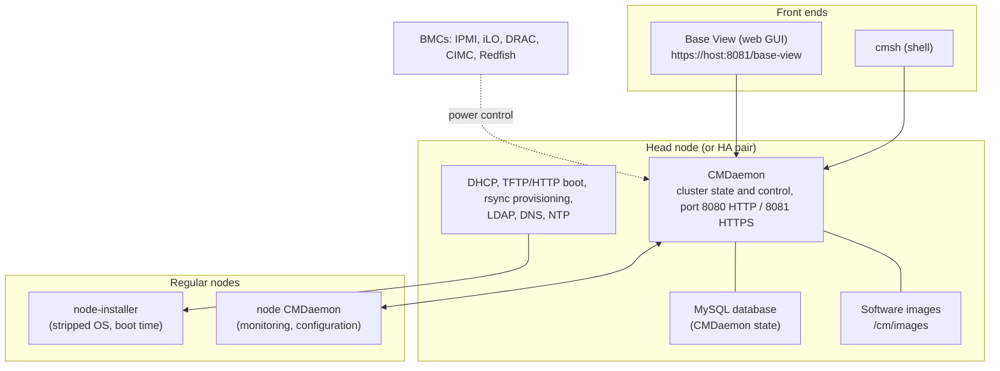
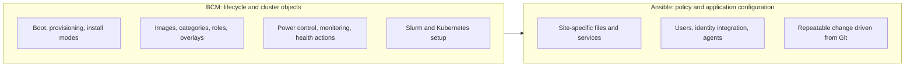

# Chapter 2 — NVIDIA Base Command Manager (BCM)

**Learning outcome:** Explain what BCM manages and how, operate it through `cmsh` with confidence, trace a node from power-on to a running OS, change a software image safely, and place BCM correctly next to Ansible, Slurm, and Kubernetes.

**Prerequisites:** Linux administration, PXE/DHCP/DNS basics, and the networking and Slurm material in the surrounding chapters.

**Difficulty:** Intermediate to advanced. **Estimated reading time:** 90 minutes plus lab practice.

**A note on sources.** An earlier version of this chapter described BCM high availability as Corosync/Pacemaker/DRBD, image distribution as BitTorrent, and boot modes called `SYNCLOCAL` and `BITTORRENT`. None of those appear in the BCM 11 Administrator Manual. This rewrite follows the manual. Where a statement is an architect's judgment instead of documented behavior, the text says so.

---

## 1. Why a cluster manager exists

Configuration management tools such as Ansible are strong on Day 2: packages, users, services. They are weak on the questions that come first on a new cluster:

1. How does an unformatted bare-metal node get its first operating system?
2. How do you power-cycle several hundred nodes through their BMCs in a controlled way?
3. How do you stop several hundred nodes from pulling an OS image from one server at the same moment?
4. How do you keep the scheduler's idea of each node consistent with the hardware actually present?

BCM (the successor to Bright Cluster Manager) covers that lifecycle: install and boot, provision images, power control, monitoring and health checks, high availability for the head node, and integration with workload managers. It is not a replacement for Ansible. Section 10 draws the boundary.

---

## 2. Architecture



- **CMDaemon** is the central service. Its default ports are 8080 (HTTP) and 8081 (HTTPS), changeable with the `cm-cmd-ports` utility (BCM Admin Manual, p. 906). Base View connects to the HTTPS service on 8081 at `/base-view` (p. 39).
- **Two front ends** speak to the same daemon: `cmsh` (the shell) and Base View (the web application). Pick `cmsh` for scripting and repeatable change, Base View for exploration.
- **A head node is also a provisioning and boot node.** It always carries the `boot` and `provisioning` roles (pp. 244–245).
- **Certificates and profiles.** Front-end access uses PEM certificates with profiles. The root account's `cmsh` certificate is `/root/.cm/admin.pem` with key `admin.key` (p. 36). A profile decides what a certificate holder may do, and `admin` is the built-in all-operations profile (p. 37).
- **Password changes.** `cm-change-passwd` changes the head-node root, software-image root, node-installer root, and MySQL root passwords in one dialog. Run it on **both** head nodes in an HA pair, except that the image password is copied automatically (pp. 34–35).

Head node high availability is covered in [Senior Deep Dive 1](./13-senior-deep-dive-1-bcm-at-fleet-scale.md). It is `cmha-setup`-based, uses fencing and quorum, and is not a Pacemaker design.

---

## 3. The object model: how BCM organizes a cluster

Most BCM mistakes come from not knowing which object a setting belongs to. These are the objects you will touch.

| Object | What it is | Key facts from the manual |
|---|---|---|
| **Device / node** | A physical node, head node, switch, PDU, etc. | Has interfaces, a MAC address, a BMC, and per-node overrides |
| **Category** | A group of regular nodes that share configuration | A regular node is in **exactly one** category at all times, `default` unless changed (§2.1.3, p. 29) |
| **Node group** | An arbitrary set of nodes for convenience | A node can be in zero or more groups. Groups carry no configuration, only operations (§2.1.4, p. 30) |
| **Role** | A task a node can perform (boot, provisioning, storage, Slurm client...) | Assigned to nodes or categories. You cannot create custom roles, only `assign` existing ones (§2.1.5, p. 30) |
| **Configuration overlay** | A group of roles assigned to chosen nodes, with a priority | Custom overlays can be created (§2.1.6, p. 31) |
| **Software image** | A directory tree under `/cm/images` used as a node's root file system | Categories point at images, not one-to-one (p. 29) |
| **Network** | A defined network (management, InfiniBand, BMC...) | Interfaces on nodes attach to networks |
| **Partition** | The base cluster object (default category, default image, etc.) | `defaultcategory` is set here (p. 29) |

### 3.1 Inheritance rules

- **Non-Boolean values:** a node inherits the category value, and a value set on the node overrides it.
- **Boolean values:** a node does *not* inherit. The category value and the node value are combined with a Boolean OR (for example `datanode` and `installbootrecord`) (p. 29). Remember this when a node "refuses" to behave like its category.
- **Categories and images:** no one-to-one requirement. Several categories can use one image, and a category can be switched between images (p. 29).

### 3.2 Roles, priorities, and overlays

Roles have fixed priorities by assignment level: **250** for category, **750** for node, and **500** by default for a configuration overlay (p. 30). So a node-level role overrides a category-level role, and also overrides the default overlay. Overlay priorities may be 0 to 1000, except 250 and 750, which are forbidden. A priority of -1 means "ignore this overlay" (p. 31).

Use this to design the cluster:

- Put hardware-class settings (disk layout, image, kernel parameters) in **categories**.
- Put capability bundles (for example the Slurm client and submit roles) in **overlays**, so you can attach them to nodes from several categories without cloning categories.
- Use **node-level** roles only for genuine exceptions, because they win over everything else.

The manual's custom-role limitation is by design. If you need what looks like a custom role, create a configuration overlay (p. 31).

---

## 4. `cmsh` essentials

`cmsh` is a modal shell. Each mode (`device`, `category`, `softwareimage`, `network`, `monitoring`, `wlm`...) exposes objects you `use`, edit with `set`, and persist with `commit`.

```bash
$ cmsh
[basecm11]% category use default
[basecm11->category[default]]% show
[basecm11->category[default]]% set newnodeinstallmode FULL
[basecm11->category*[default*]]% commit
```

- The asterisk in the prompt marks uncommitted changes. Nothing takes effect until `commit`.
- One-liners use `cmsh -c "mode; command; commit"`, for example `cmsh -c "category use default; set newnodeinstallmode FULL; commit"` (pp. 278, 298).

**Acting on many nodes.** Two documented tools:

```bash
# Range of nodes, in device mode
[basecm11->device]% range -n node0[01-24]
[basecm11->device{-n node001..024}]%          # commands now apply to the range

# foreach over a category, or a node range
[basecm11->device]% foreach -c default (set pxelabel MEMTEST)
[basecm11]% device foreach -n node001..node999 (set nextinstallmode nosync)
[basecm11]% device commit
```

- `range -n` selects nodes by name pattern. The prompt shows the active range (p. 77).
- `foreach -c default (...)` repeats a command for every node in a category (p. 241). `-n` takes a node range.
- Review a range with `list` before you `commit` a destructive setting.

---

## 5. Software images

A software image is a directory tree on the head node, normally under `/cm/images/<name>`. Nodes get their root file system from an image at boot (full copy or incremental sync, depending on install mode). `default-image` is the image created at install.

### 5.1 Change an image safely

1. **Clone** the working image before changing it. Cloning copies settings and the data:

```bash
[basecm11]% softwareimage
[basecm11->softwareimage]% clone default-image imagetwo
[basecm11->softwareimage*[imagetwo*]]% commit
```

(The manual's example of the cloning workflow, §3.20.2, pp. 219–220.)

2. **Chroot into the image with BCM's wrapper.** `cm-chroot-sw-img` works on all distributions and mounts `/proc`, `/sys`, `/dev` and the other special directories for you. This matters on Ubuntu, where package scripts need them (§9.4.1, pp. 535–536):

```bash
root@basecm11:~# cm-chroot-sw-img /cm/images/imagetwo
root@basecm11:/# apt update; apt upgrade        # or dnf/yum/zypper on other distributions
root@basecm11:/# exit
```

Alternatives are `chroot`, or the package manager's root option (`yum --installroot=/cm/images/imagetwo`, `rpm --root`, `zypper --root`). The earlier draft used a command named `cm-chroot-image`. The documented wrapper is `cm-chroot-sw-img`.

3. **Lock the image while you update it,** because a package update fails to start if a provisioner is serving that image at that moment (p. 537):

```bash
cmsh -c "softwareimage lock imagetwo"
yum --installroot /cm/images/imagetwo update
cmsh -c "softwareimage unlock imagetwo"
```

4. **Tell BCM about a new kernel.** A kernel installed in an image is not used until you set it in CMDaemon. Then regenerate the ramdisk:

```bash
[basecm11->softwareimage]% use imagetwo
[basecm11->softwareimage[imagetwo]]% set kernelversion          # TAB lists installed kernels
[basecm11->softwareimage*[imagetwo*]]% commit -w
```

- `kernelversion` is the property that selects the kernel the nodes boot (§9.3.3, p. 532).
- The extended BCM ramdisk is **not** rebuilt by the distribution's update. After a kernel or module change made outside CMDaemon, regenerate it (the `createramdisk` command, §5.8.6 and §9.4.3). A stale ramdisk is a classic cause of nodes failing during ramdisk load (p. 258).
- Kernel parameters for an image are the `kernelparameters` property of `softwareimage` mode, for example `append kernelparameters " VLANID=89"` (pp. 261, 532).

5. **Point a category at the image and roll it out.** Put the image on a category, then reboot nodes (an `AUTO` install pulls the latest image) or use `imageupdate` for small in-place changes. The comparison and the exclude-list pitfalls are in [Senior Deep Dive 1](./13-senior-deep-dive-1-bcm-at-fleet-scale.md), section 2.

### 5.2 HA caveat

Installing a new kernel on the active head node can, in edge cases, stop its network interface and trigger a failover. The manual advises making the change on the passive head first, or disabling automatic failover, before a change that could initiate one (§9.3.1, p. 529).

---

## 6. From power-on to a running node

### 6.1 Before the kernel loads

On x86 nodes the first stage is PXE. The `bootloaderprotocol` parameter selects what carries the later stages: `HTTP` (the default), `HTTPS`, or `TFTP`. With `HTTP`, the initial PXE still uses TFTP and then switches to HTTP for the kernel and RAM disk. The manual says HTTPS "should almost never be used because it is rarely implemented in hardware" (§5.1.6, p. 244). ARMv8 nodes use GRUB fetched from the head node instead of iPXE (§5.1.5, p. 243).

```bash
[basecm11->device[node001]]% get bootloaderprotocol
[basecm11->device[node001]]% set bootloaderprotocol tftp
[basecm11->device*[node001*]]% commit
```

- Set at category or node level. A node value overrides the category.

The PXE menu defaults to the `AUTO` entry, which loads a kernel, runs `AUTO` install mode, and provisions `default-image` (p. 242). A node's PXE label can be overridden per node (`set pxelabel MEMTEST`) or set to `localdrive` to boot from its first local drive without the node-installer. The manual discourages `localdrive` because it usually makes node management harder (p. 242).

InfiniBand booting and provisioning are optional. They are enabled per network (`network; set ibnet nodebooting yes`) and need InfiniBand drivers added to the ramdisk and a defined provisioning interface. By default provisioning uses Ethernet because InfiniBand modules are not available during the pre-init stage (§5.1.3, §5.3.3, pp. 242–260). The interface a node boots from (`BOOTIF`) must not already be configured as a device interface for that node (p. 243).

### 6.2 The node-installer: 13 steps

After the kernel and ramdisk load, the node runs the **node-installer**, a software image provided by the head node that talks to CMDaemon and finishes the boot (§5.4, p. 261). Its steps, in order:

1. Request a node certificate.
2. Decide or select the node configuration (identify the node by MAC address and, if configured, Ethernet switch port).
3. Start all network interfaces.
4. Determine install-mode type and execution mode.
5. Run initialize scripts.
6. Check partitions and RAID, mount file systems.
7. Synchronize the local drive with the software image.
8. Write network configuration files.
9. Create the local `/etc/fstab`.
10. Install GRUB if configured, and initialize SELinux if configured.
11. Run finalize scripts.
12. Unload drivers no longer needed.
13. Switch the root device to the local drive and call `/sbin/init`.

```mermaid
sequenceDiagram
    participant N as Node
    participant H as Head node (DHCP, TFTP/HTTP, CMDaemon)
    N->>H: PXE request (DHCP)
    H-->>N: boot program, then kernel + ramdisk (bootloaderprotocol)
    N->>H: node-installer: request certificate, identify node
    H-->>N: node configuration, install mode
    N->>N: check partitions, mount file systems
    N->>H: rsync image (FULL or incremental sync)
    H-->>N: image data
    N->>N: write network config, fstab, GRUB; finalize scripts
    N->>N: switch root to local drive, /sbin/init
    N->>H: node CMDaemon connects, state UP
```

A new node that is unknown to CMDaemon is matched to a configuration through its MAC address or switch port. The installer can prompt an administrator to select a configuration, which is why placeholders (node objects with no MAC yet) are useful when adding many nodes (§5.4.2, §5.7, pp. 262–304).

### 6.3 Install modes: what actually runs at boot

The manual defines five install-mode values (§5.4.4, pp. 276–278):

| Mode | Behavior |
|---|---|
| `AUTO` | Check the partition layout against the node's stored configuration. If they do not match (new node, corruption), do a `FULL` install. If healthy, do an **incremental sync** of the image |
| `FULL` | Re-partition, create new file systems, and sync a full image. **Wipes all pre-boot drive content** |
| `MAIN` | No disk check. Drop into maintenance mode for manual investigation. The drive is untouched |
| `NOSYNC` | If the partition layout matches, skip image synchronization so drive contents persist. A layout mismatch still triggers a `FULL` sync. Not a data-protection mechanism |
| `SKIP` | No partition check and no image sync. For data recovery attempts |

Three settings control when a mode applies:

- **New nodes:** the category property `newnodeinstallmode`, **default `FULL`**.
- **The next boot only:** the node property `nextinstallmode`. This is how you reboot many nodes onto their existing disk without an image sync, for example `device foreach -n node001..node999 (set nextinstallmode nosync)` (p. 277).
- **A PXE menu choice at the console,** for the current boot only; the menu default is `AUTO`.

`imageupdate` (a running node) ignores install modes. The install mode applies only during the installer stage (p. 276). The decision is logged on the head node in `/var/log/node-installer`, with the disk check delegated to `/cm/node-installer/scripts/disks`, whose exit codes explain a surprise `FULL` install (p. 277).

**Disk layouts.** Nodes can be disked, semi-diskless, or diskless (§3.13, p. 167). Which you choose changes what survives a reboot and how much RAM the image consumes. Choose per workload and read the matching section before standardizing.

### 6.4 Scaling the boot path

Two roles scale the pipeline, and they relieve different loads: `boot` relieves DHCP and TFTP, and `provisioning` serves images. Both are covered, with the parameters and failure behavior, in [Senior Deep Dive 1](./13-senior-deep-dive-1-bcm-at-fleet-scale.md) (section 1).

### 6.5 About kernel parameters for AI nodes

An earlier draft presented `numa_balancing=0` and `iommu=pt` as universal BCM tuning for GPUDirect RDMA. The sources do not support that framing. NVIDIA's DOCA documentation lists `iommu=pt` in specific procedures, for example as a fix when DMA fails with an `IO_PAGE_FAULT` message in `dmesg` and for some DOCA services. Treat kernel parameters as platform-specific settings you add for a documented reason and a measured effect, set through the image's `kernelparameters`, and validate on a canary before rollout.

---

## 7. Networks, interfaces, and power control

- **Interfaces and ranges.** Attach interfaces to networks per node or via a range. Check the exact `cmsh` syntax in the Administrator Manual chapter 3 for your release before scripting it. The earlier draft's `range dgx-01..dgx-32` and an `X` auto-increment placeholder for IP addresses are not shown in the manual's range documentation (p. 77).
- **BMC interfaces.** BCM configures IPMI, iLO, DRAC, CIMC, and Redfish interfaces (§3.7, pp. 137–147). Power control uses a `powercontrol` property such as `ipmi0` or `ilo0`.
- **Power operations.** The main operations are power on, off, reset, and status. `power reset` powers off and then on after a short delay (§4.2, pp. 231–236).

```bash
[mycluster]% device power -n node001,node018..node033 on
[mycluster]% device foreach -c default (set powercontrol ilo0)
[mycluster]% device commit
```

- `device power -n <list> on` powers on a node list. Output shows the power device and state per node.
- Setting `powercontrol` per category selects the mechanism. Verify with `device power status -n <nodes>` before you rely on it. Automatic head-node failover needs working power control (see Deep Dive 1).
- Scheduled power operations are available from `cmsh` only, with `--at`, `--after`, `-d`, and `--parallel-delay`, and `power wait`, `power cancel`, and `power list` manage them (p. 232).

---

## 8. Workload managers: Slurm and Kubernetes

### 8.1 Slurm

`cm-wlm-setup` installs and configures a workload manager from a text dialog, and the result is represented in BCM as objects: roles such as `slurmclient` and `slurmsubmit`, assigned through configuration overlays (`slurm-client`, `slurm-submit`) or to nodes, plus a `wlm` mode object (`wlm use slurm`) holding cluster-wide settings (§7.5, pp. 401–427).

```bash
[basecm11]% configurationoverlay use slurm-client
[basecm11->configurationoverlay[slurm-client]]% roles
[basecm11->configurationoverlay[slurm-client]->roles]% use slurmclient
[...[slurmclient]]% genericresources
[...[slurmclient]->genericresources]% add autodetected-gpus
[...[slurmclient*]->genericresources*[autodetected-gpus*]]% set name gpu
[...[slurmclient*]->genericresources*[autodetected-gpus*]]% set count 8
[...[slurmclient*]->genericresources*[autodetected-gpus*]]% set addtogresconfig no
[...[slurmclient*]->genericresources*[autodetected-gpus*]]% commit
[basecm11->wlm[slurm]]% set gpuautodetect nvml
[basecm11->wlm*[slurm*]]% commit
```

(Adapted from the manual's GPU autodetection example, p. 426.)

- `genericresources` declares *how many* GPUs Slurm should expect (here, 8 of name `gpu`). Slurm's GPU autodetection finds the details but not the count; the manual notes the count must still be specified (p. 425).
- `addtogresconfig no` keeps this generic resource out of `gres.conf` while still adding the GRES information to `slurm.conf`, which is needed when autodetection owns `gres.conf`.
- `gpuautodetect` accepts `bcm`, `none`, `nrt`, `nvml`, `off`, `oneapi`, and `rsmi` (p. 405). With `bcm`, BCM detects GPU counts and types and configures `slurm.conf` itself, and this does not work for nodes with mixed GPU vendors (p. 426). The vendor options (for NVIDIA, `nvml`) mean you must supply the `Gres=` count.
- The setting can be applied globally in `wlm` mode, or per role (device, category, or overlay).

The earlier draft showed a hand-written, "autogenerated" `gres.conf` with `COREs=` lists. Do not copy it. Let Slurm's own autodetection (or BCM's) produce topology-aware GRES, and review the result against `nvidia-smi topo -m` on a representative node.

For the Slurm REST API (`slurmrestd` with JWT), the manual gives a full procedure, including creating a `jwt.key` readable by user `slurm`, configuring `AuthAltTypes=auth/jwt`, and registering `slurmrestd` as a monitored, autostarted BCM service (p. 424).

### 8.2 Kubernetes

BCM deploys Kubernetes with `kubeadm` (from BCM 10.0 onward). BCM runs CoreDNS, the kubelet, and the control plane inside Kubernetes, and runs `etcd` **outside** Kubernetes (BCM 11 Containerization Manual, chapter 4). Setup is done with `cm-kubernetes-setup`. Details of cluster design belong in the Kubernetes volume. The point here is that both schedulers are first-class objects in the same control plane.

### 8.3 Sharing nodes between Slurm and Kubernetes

The documented mechanism is **Auto Scaler (`cm-scale`)**. It collects workload information from the engines and re-purposes nodes by switching configuration overlays. The earlier draft claimed you move a node by changing its category in `cmsh`. Changing a category does change configuration, but it also changes the image and reboots the node, whereas Auto Scaler's documented use case is to turn a free Kubernetes node into a Slurm node "pretty much immediately" when Slurm jobs are pending (§8.1.1, pp. 467–468). See [the interview lab](./00c-slurm-bcm-interview-lab.md) for the interview framing.

---

## 9. Health, monitoring, and rolling change

- **Health checks, triggers, and actions** form BCM's monitoring pipeline, including `Drain`, `Undrain`, `ImageUpdate`, `Reboot`, power actions, and `NVSMHealthDump` (§10, pp. 576–606). The pipeline, the severity defaults, and a safe remediation-tier design are in [Senior Deep Dive 1](./13-senior-deep-dive-1-bcm-at-fleet-scale.md), section 3.
- **Health-check scripts** live in `/cm/local/apps/cmd/scripts/healthchecks`, and actions in `/cm/local/apps/cmd/scripts/actions` (pp. 576, 1046). The earlier draft's `healthcheck.d/check_nvlink.sh` path and exit-code semantics (0, 1, 2 mapping to healthy, warning, drain) are not in the manual. A standalone health check reports `PASS`, `FAIL`, or `UNKNOWN`, and may set its own severity such as `FAIL 40` (p. 577). Read an existing script under the documented directory before you write one.
- **Rolling image change.** Clone the image, change it in a chroot, create a canary category that points at it, move a few nodes into the category, validate, and promote. The mechanics of image changes are section 5 here. The coordination around them (compatibility matrix, canary rings, Slurm `scontrol reboot ASAP nextstate=RESUME`) is in [Chapter 10](./10-coordinated-cluster-wide-software-change-management.md).

---

## 10. BCM and Ansible: where the boundary really is



| Responsibility | Natural owner | Why |
|---|---|---|
| OS install, disk layout, image sync | BCM | The node-installer and install modes own this |
| Kernel selection and ramdisk | BCM | `kernelversion`, `createramdisk`, `kernelparameters` |
| Roles and workload manager objects | BCM | `wlm`, `slurmclient`, overlays |
| Power control and head-node failover | BCM | Needs `powercontrol` and the HA stack |
| Image contents (packages, driver, OFED) | Either, but pick one | Build into the image with `cm-chroot-sw-img`, or install at run time with Ansible. Mixing the two produces drift |
| Site policy files, identity integration, extra agents | Ansible | Template-driven and reviewable in Git |

BCM ships an Ansible collection, which the manual documents: modules such as `brightcomputing.bcm110.category` (with `cloneFrom`) let a playbook create and modify BCM objects (§14.10, p. 781). That makes BCM objects themselves manageable as code. The rule that holds up in production: **let BCM own what a node boots into, and let Ansible own what you want to review in a pull request.** Whichever you choose for a given file, choose one.

---

## 11. Troubleshooting scenarios

### Scenario 1: Mass boot failures during bring-up

**Symptom.** Powering on hundreds of nodes produces boot failures that move around between attempts.

**Reasoning.** The manual describes exactly this: "random different regular nodes are unable to boot, typically due to network effects" when DHCP and TFTP are overwhelmed (§5.1.7, p. 244). Distinguish boot load from provisioning load.

**Steps.**
1. Confirm boot failures happen at the PXE stage (DHCP/TFTP), not during image sync.
2. Assign the `boot` role to one regular node per rack subnet to take DHCP and TFTP load.
3. Separately, check provisioning capacity: `softwareimage; provisioningstatus` (slots, pending requests), and the cluster-wide `MaxNumberOfProvisioningThreads` in `/etc/cmd.conf` ([Deep Dive 1](./13-senior-deep-dive-1-bcm-at-fleet-scale.md)).
4. Use `nextinstallmode nosync` for planned mass reboots where the disk contents should be kept, to avoid every node pulling image data.

### Scenario 2: A node installs the wrong thing, or repeatedly re-images

**Symptom.** A node goes through a `FULL` install on every reboot.

**Reasoning.** `AUTO` falls back to `FULL` when the on-disk partition layout does not match the stored configuration. `/var/log/node-installer` records the decision, and `/cm/node-installer/scripts/disks` explains the exit code (p. 277).

**Steps.** Read the node-installer log for the installer decision and the failing check. Compare the layout the node reports with the layout stored for its category. If a burn session destroyed the layout, a `FULL` sync on the next reboot is expected behavior (p. 277).

### Scenario 3: A GPU that keeps failing health checks and returning

**Symptom.** A node is drained for a GPU memory error, passes after a reboot, and drains again later.

**Reasoning.** This is a remediation-design question, not a BCM bug. A reboot that returns suspect hardware to service hides a hardware fault. Use the tiered approach in [Deep Dive 1](./13-senior-deep-dive-1-bcm-at-fleet-scale.md): drain, collect evidence (`nvidia-bug-report.sh`, the Xid catalog, DCGM diagnostics), and escalate. Do not automate "reboot and resume" for hardware-class errors. Use `Drain` with notification, and keep the node out of rotation until hardware service.

---

## Key takeaways

1. **Know your objects.** Category (hardware class), role (capability), overlay (grouped roles with priority), image (root file system). Roles at node level win over category-level roles (priorities 750 over 250).
2. **Booleans OR, values inherit.** That one rule explains many "why won't this node follow its category" cases.
3. **The node-installer has 13 steps and five install modes.** `AUTO` is safe, `FULL` wipes, `NOSYNC` is not data protection, and `newnodeinstallmode` defaults to `FULL`.
4. **Use `cm-chroot-sw-img`, lock the image, set `kernelversion`, and regenerate the ramdisk.** Skipping any of the last three is how nodes fail to boot after a "successful" update.
5. **Slurm GPU configuration is documented.** `genericresources` for the count, `gpuautodetect` for the details, `wlm` mode for scope.
6. **Nodes move between Slurm and Kubernetes through Auto Scaler.** Not through a category rename and a hope.
7. **Choose one owner per file.** BCM or Ansible, never both.

---

## Sources

- NVIDIA Base Command Manager 11 Administrator Manual: [admin-manual.pdf](https://docs.nvidia.com/base-command-manager/manuals/11/admin-manual.pdf). Sections cited: §2.1 (concepts), §2.3 to §2.4 (authentication, Base View), §2.5 (cmsh), §3.7 and §4 (BMC and power), §3.13 (disk layouts), §3.20 (configuration without CMDaemon), §5 (node provisioning), §7.5 (workload managers), §8 (Auto Scaler), §9 (software image management), §10 (monitoring), §14.10 (Ansible), Appendix C (cmd.conf).
- NVIDIA Base Command Manager 11 Containerization Manual, chapter 4 Kubernetes: [containerization-manual.pdf](https://docs.nvidia.com/base-command-manager/manuals/11/containerization-manual.pdf)
- NVIDIA DOCA documentation, host configuration (`iommu=pt`): [networking-docs.nvidia.com/doca](https://networking-docs.nvidia.com/doca/archive/3-5-0)

**Not verified in this rewrite.** Disk-layout specifics (diskless versus semi-diskless trade-offs), the exact `cmsh` syntax for interface and network configuration on your release, and Run:ai integration with BCM. Check the matching manual sections before using those in a design.
