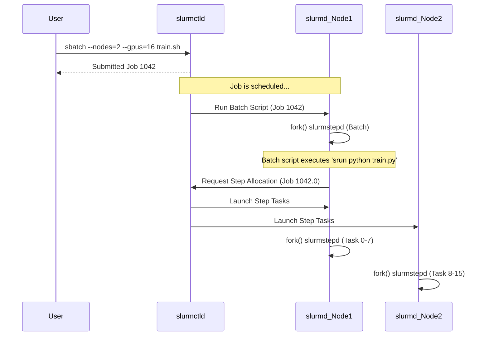
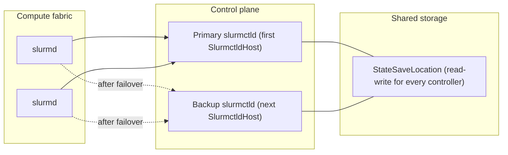
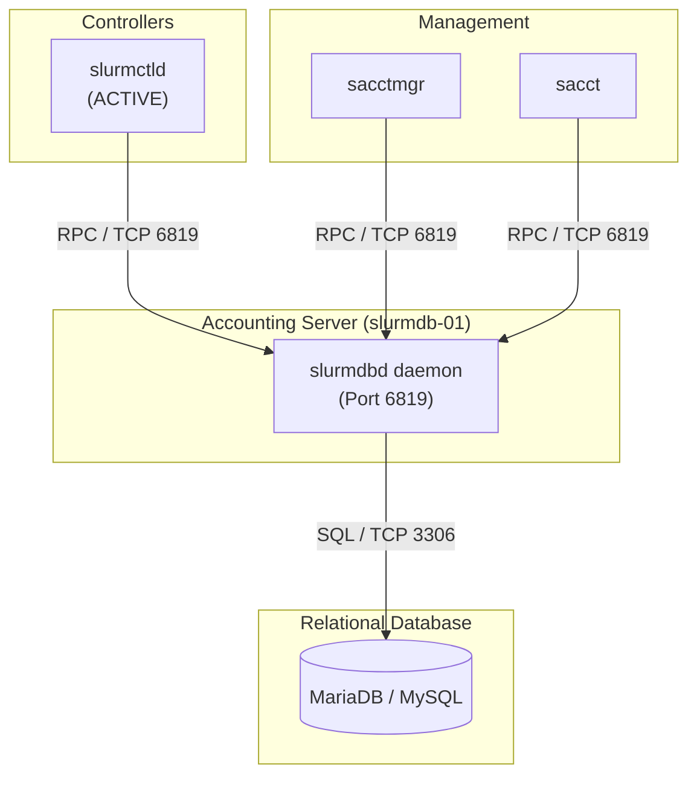
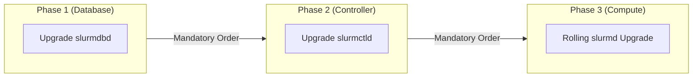

# Chapter 6 — Slurm Administration: HA, Topology-Aware Scheduling, Accounting, and Upgrades

In high-performance accelerated computing, **Slurm Workload Manager** is the premier orchestration engine for large-scale distributed training. Unlike general-purpose cloud orchestrators like Kubernetes that historically focused on bin-packing single containers based on loose CPU and memory estimates, Slurm operates as a **deterministic, gang-scheduled batch fabric**. It allocates thousands of tightly coupled GPUs, guarantees hardware NUMA and PCIe locality, and coordinates synchronized multi-node launches over InfiniBand and RoCE fabrics.

In an NVIDIA AI Factory setting—such as an NVIDIA DGX SuperPOD—Slurm is the ultimate arbiter of multi-million-dollar resources. As an **NVIDIA Senior Solutions Architect** or Platform Engineer, you are not simply restarting daemons; you are expected to architect resilient Slurm control planes, configure Generic Resources (GRES) with hardware topology awareness, design multi-tenant fairshare and Quality of Service (QoS) hierarchies that balance organizational budgets, and perform zero-downtime cluster software upgrades.

This chapter transitions from the absolute foundational principles of Slurm to the complex, hyper-scale administrative operations required in a production GPU environment. It serves as a masterclass, preparing you for the most rigorous architectural designs and troubleshooting scenarios encountered in the world's largest AI supercomputers.

---

## 1. Foundational Architecture: The Anatomy of Slurm

To administrate Slurm effectively, you must intimately understand its distributed daemons, state management, and the lifecycle of a payload. Slurm is heavily modularized, but its core daemon architecture is elegantly simple, optimized for POSIX-compliant clusters.

### 1.1 Core Daemons and Responsibilities

Slurm distributes responsibilities across a handful of specialized daemons:

*   **`slurmctld` (Slurm Controller Daemon):** The brain. It monitors cluster state, manages the job queue, enforces scheduling policies (like fairshare and backfill), and allocates resources. It does not run user code. It is highly stateful and must be made highly available. 
*   **`slurmd` (Slurm Node Daemon):** The worker agent running on every compute node. It waits for instructions from `slurmctld`, provisions the node environment (cgroups, GPU isolation, network namespaces), and launches jobs.
*   **`slurmstepd` (Slurm Step Daemon):** The true parent of user tasks. `slurmd` forks a `slurmstepd` for every job step. `slurmstepd` drops root privileges to assume the user's identity, manages I/O forwarding, and directly monitors the user processes (the actual MPI ranks or Python scripts).
*   **`slurmdbd` (Slurm Database Daemon):** The ledger. It provides a secure, centralized interface between `slurmctld` and a relational database (typically MariaDB or MySQL). It records historical cluster usage, enforces account limits, manages users, and tracks billing via Trackable Resources (TRES).
*   **`slurmrestd` (Slurm REST API Daemon):** An optional but increasingly critical daemon that provides an OpenAPI-compliant RESTful interface to Slurm, widely used by modern MLOps platforms (like Run:ai, Weights & Biases, or custom CI/CD pipelines) to submit and monitor jobs without relying on SSH or local CLI clients.

### 1.2 Jobs, Steps, and Tasks

In Slurm parlance, a user's computational request is broken down hierarchically:

1.  **Job (Allocation):** A request for resources (nodes, GPUs, memory, time) from the scheduler. For example, "I need 8 DGX nodes, 64 GPUs total, for 2 hours." This creates an allocation block, identified by a `JobID`.
2.  **Job Step (`srun`):** A set of tasks launched *within* an existing allocation. A single job can have multiple sequential or concurrent steps. A step is identified by `JobID.StepID`.
3.  **Task:** An individual operating system process launched by a step (e.g., a single PyTorch Distributed Data Parallel rank).

#### 1.2.1 Real-World Launch Example

Consider a user submitting a batch script (`sbatch train.sh`). The script requests two nodes with 8 GPUs each. 
Inside the script, the user calls `srun python train.py`. 

1.  `sbatch` contacts `slurmctld` to queue the job.
2.  `slurmctld` grants the allocation and contacts the `slurmd` on the first allocated node (the batch host).
3.  The batch host `slurmd` forks `slurmstepd` to run the shell script `train.sh`.
4.  The shell script hits `srun`. `srun` contacts `slurmctld` to get a step allocation.
5.  `slurmctld` instructs `slurmd` on *both* allocated nodes to fork new `slurmstepd` processes.
6.  These new `slurmstepd` instances pin CPU cores, isolate the GPUs using cgroups, and launch `python train.py`.



---

## 2. Advanced Slurm Configuration (`slurm.conf`) Deep Dive

The `slurm.conf` file is the master configuration for the cluster. In production environments, it is typically distributed by configuration management tools (Ansible, Puppet) and must remain consistent across all nodes (controllers and compute). 

If a compute node has a `slurm.conf` that differs from the controller (for example, missing a partition definition or having a mismatched `AuthType`), it will be violently rejected from the cluster upon registration, usually resulting in a `DOWN` or `DRAIN` state.

### 2.1 The Architecture of `slurm.conf`

A production `slurm.conf` is divided into distinct operational blocks. Let's examine a highly extensive, realistic excerpt for an NVIDIA DGX H100 SuperPOD.

```ini
# /etc/slurm/slurm.conf
# =========================================================================
# 1. CLUSTER DEFINITION & DAEMON SETTINGS
ClusterName=AIFactory
SlurmUser=slurm
SlurmdUser=root
SlurmctldPort=6817
SlurmdPort=6818
AuthType=auth/munge
CryptoType=crypto/munge

# The state save location must be on a highly available shared file system
StateSaveLocation=/var/spool/slurmctld_state
SlurmdSpoolDir=/var/spool/slurmd

# Logging and Debugging
SlurmctldDebug=info
SlurmctldLogFile=/var/log/slurm/slurmctld.log
SlurmdDebug=info
SlurmdLogFile=/var/log/slurm/slurmd.log
SlurmSchedLogFile=/var/log/slurm/slurmsched.log
SlurmSchedLogLevel=1

# 2. HIGH AVAILABILITY (ACTIVE/PASSIVE)
SlurmctldHost=slurmctl-01(10.10.10.11)
SlurmctldHost=slurmctl-02(10.10.10.12)
SlurmctldTimeout=30
SlurmdTimeout=60

# 3. ACCOUNTING & DATABASE
JobAcctGatherType=jobacct_gather/cgroup
JobAcctGatherFrequency=30
AccountingStorageType=accounting_storage/slurmdbd
AccountingStorageHost=slurmdb-01
AccountingStorageTRES=gres/gpu,cpu,mem,energy
AccountingStoreFlags=job_comment
AcctGatherEnergyType=acct_gather_energy/ipmi

# 4. SCHEDULING & POLICIES
SchedulerType=sched/backfill
SchedulerParameters=bf_max_job_user=100,bf_window=10080,bf_resolution=600

SelectType=select/cons_tres
SelectTypeParameters=CR_Core_Memory,CR_CORE_DEFAULT_DIST_BLOCK

PriorityType=priority/multifactor
PriorityDecayHalfLife=14-0
PriorityWeightFairshare=100000
PriorityWeightAge=1000
PriorityWeightPartition=10000
PriorityWeightJobSize=1000
PriorityWeightQOS=1000000
PriorityFlags=SMALL_RELATIVE_TO_TIME

# 5. RESOURCE ISOLATION & CGROUPS (V2)
ProctrackType=proctrack/cgroup
TaskPlugin=task/cgroup,task/affinity
GresTypes=gpu,nic

# 6. NODE DEFINITIONS (NVIDIA DGX H100)
# DGX H100 has 2x Intel Xeon Platinum 8480C (56 cores each)
# Hyperthreading is ON (224 logical CPUs)
# 2TB RAM
# 8x H100 GPUs
NodeName=dgx-h100-[01-32] CPUs=224 Boards=1 SocketsPerBoard=2 CoresPerSocket=56 ThreadsPerCore=2 RealMemory=1920000 Gres=gpu:h100:8 State=UNKNOWN

# 7. PARTITION (QUEUE) DEFINITIONS
PartitionName=train Nodes=dgx-h100-[01-24] Default=YES MaxTime=7-00:00:00 State=UP OverSubscribe=NO TRESBillingWeights="gres/gpu=100,cpu=1,mem=0.01"
PartitionName=debug Nodes=dgx-h100-[25-32] Default=NO MaxTime=01:00:00 State=UP OverSubscribe=NO TRESBillingWeights="gres/gpu=100,cpu=1,mem=0.01"
```

#### Detailed Breakdown of Critical Directives:

:::danger
*   **`AuthType=auth/munge`**: Slurm absolutely depends on MUNGE (MUNGE Uid 'N' Gid Emporium) for cryptographic authentication. All nodes in the cluster must share the exact same `/etc/munge/munge.key` and have synchronized clocks (NTP/PTP is critical). A clock drift of even a few minutes will cause MUNGE credentials to be rejected, instantly partitioning the cluster. If you see "Invalid credential" errors in the logs, check NTP first.
:::

*   **`SelectType=select/cons_tres`**: The "Consumable Trackable Resources" selection plugin. This is mandatory for GPU scheduling. It allows Slurm to track CPUs, Memory, and GPUs individually as consumable items, rather than dedicating an entire node to a job that only needs a fraction of it. If this is set to `select/linear`, Slurm will only allocate whole nodes, severely wasting resources for small debugging jobs.
*   **`TaskPlugin=task/cgroup,task/affinity`**: This pair forces `slurmstepd` to use Linux Control Groups (cgroups) to constrain jobs to their allocated resources, preventing "noisy neighbor" scenarios where Job A bleeds memory or CPU usage into Job B's allocation. `task/affinity` handles the low-level NUMA pinning logic.
*   **`PriorityType=priority/multifactor`**: This tells the scheduler to calculate queue priority mathematically based on a combination of queue time (Age), job size, Quality of Service (QOS), and Historical Usage (Fairshare). We will dive deep into this later.
*   **`SchedulerParameters=bf_max_job_user=100,bf_window=10080`**: This tunes the backfill scheduler. Backfill scheduling is what allows small jobs to "sneak" into the schedule ahead of larger jobs, provided they finish before the large job's requested resources become fully available. This dramatically increases cluster utilization. `bf_window=10080` tells the scheduler to look up to 7 days into the future (10080 minutes) to plan allocations.

### 2.2 Generic Resources (GRES) and Topology-Aware GPU Binding

CPUs and Memory are standard resources to Slurm. Everything else (GPUs, FPGAs, special networking cards, NVMe drives) is considered a Generic Resource (GRES).

Defining a node as having 8 GPUs is not enough in modern AI infrastructure. A DGX system is highly topological: specific GPUs sit on specific PCIe switches, attached to specific CPU sockets and NUMA nodes. If PyTorch tries to communicate between GPU 0 and GPU 1, it expects NVLink. If it communicates between GPU 0 and a CPU core, it expects they share the same PCIe root complex.

If Slurm blindly assigns *any* free CPU core to *any* free GPU, performance will degrade by up to 40% due to QPI/UPI cross-socket traffic or suboptimal PCIe traversal.

This is managed by `gres.conf` and `topology.conf`.

#### Example `gres.conf` for a Topology-Aware System

```ini
# /etc/slurm/gres.conf
# Define AutoDetect so Slurm interrogates NVML on startup
AutoDetect=nvml

# Explicit mapping definition (example of what AutoDetect figures out behind the scenes)
# CPU cores 0-15 and 64-79 (hyperthreads) map to NUMA node 0 and GPUs 0,1
Name=gpu Type=h100 File=/dev/nvidia0 Cores=0-15,64-79 Links=0,1
Name=gpu Type=h100 File=/dev/nvidia1 Cores=0-15,64-79 Links=0,1

# ... definitions for other GPUs mapping to their local cores ...
```

By using `AutoDetect=nvml`, the `slurmd` daemon on the compute node will query the NVIDIA Management Library (NVML) on service startup to dynamically map the true hardware topology. The controller uses this data when placing jobs.

When a user submits: `sbatch --gpus=2 --ntasks=8 --cpus-per-task=2`, Slurm will guarantee that the 16 requested CPU cores share the exact same NUMA domain as the 2 allocated GPUs.

#### Network Topology (`topology.conf`)

In a multi-rack InfiniBand setup, Slurm needs to know which nodes are attached to which leaf switches to minimize network hops for MPI communications.

```ini
# /etc/slurm/topology.conf
SwitchName=ib-leaf-01 Nodes=dgx-h100-[01-16]
SwitchName=ib-leaf-02 Nodes=dgx-h100-[17-32]
SwitchName=ib-spine-01 Switches=ib-leaf-[01-02]
```

When scheduling a 16-node job, Slurm will attempt to pack all 16 nodes under `ib-leaf-01` before spanning across the spine, drastically improving collective operation latency in NCCL.

---

## 3. Cgroups Configuration and Resource Containment

To guarantee that jobs do not interfere with each other, Slurm heavily utilizes Linux Control Groups. Modern OS releases (RHEL 9, Ubuntu 22.04+) default to **Cgroups V2**. Slurm administrators must be acutely aware of how `cgroup.conf` is constructed.

```ini
# /etc/slurm/cgroup.conf
CgroupPlugin=cgroup/v2
CgroupMountpoint=/sys/fs/cgroup

# Crucial isolation parameters
ConstrainCores=yes
ConstrainDevices=yes
ConstrainRAMSpace=yes
ConstrainSwapSpace=yes

# Allowed RAM to be used by OS/System tasks (in MB)
AllowedRAMSpace=98
MaxRAMPercent=100

# Device whitelisting
AllowedDevicesFile=/etc/slurm/cgroup_allowed_devices_file.conf
```

### 3.1 The Mechanics of Device Containment

When `ConstrainDevices=yes` is set, `slurmstepd` creates an eBPF program (in Cgroups V2) or writes to the `devices.deny` and `devices.allow` files (in Cgroups V1) for the specific job step. 

By default, the job is denied access to *all* character and block devices. `slurmstepd` then explicitly whitelists only the devices the job requested.

If a user asks for `--gpus=2`, `slurmstepd` identifies that these are `/dev/nvidia0` and `/dev/nvidia1` (along with `/dev/nvidiactl` and `/dev/nvidia-uvm` which are globally whitelisted in `cgroup_allowed_devices_file.conf`). 

If the user's Python script attempts to open `/dev/nvidia2`, the kernel intercepts the syscall at the VFS layer and returns `EPERM` (Operation not permitted). The user sees a PyTorch or CUDA error stating the device is unavailable. This is the bedrock of multi-tenant security in an AI cluster.

---

## 4. Designing Slurm High Availability (Active/Passive)

The Slurm controller (`slurmctld`) is a single binary holding the state of a multi-million-dollar supercomputer. If `slurmctld` dies and is unrecoverable, the cluster stops accepting jobs, and running jobs may lose their telemetry or fail gracefully depending on configurations.

Slurm's controller HA is built in: you list more than one controller in `slurm.conf`, give them shared access to the state directory, and a backup takes over when the primary stops responding. Details, failure behavior, and recovery options are in [Senior Deep Dive 2](./14-senior-deep-dive-2-slurm-ha-and-accounting-internals.md). This section gives the working summary.

### 4.1 Architecture of HA controllers



In `slurm.conf`, HA is declared by listing the controllers:

```ini
SlurmctldHost=slurmctl-01(10.10.10.11)
SlurmctldHost=slurmctl-02(10.10.10.12)
StateSaveLocation=/var/shared_spool/slurmctld_state
SlurmctldTimeout=120
```

- If `SlurmctldHost` appears more than once, **the first entry is primary and the rest are standby backups**. If the primary fails, the first backup becomes primary until the first host returns (slurm.conf).
- The address in parentheses is optional and tells Slurm how to reach the host.
- `SlurmctldTimeout` is the time a backup waits for the primary to respond before assuming control. The default is 120 seconds.

### 4.2 The failover mechanism

1. **State.** Every controller must have read-write access to `StateSaveLocation` at all times. The directory holds all running and pending job information, so Slurm recommends a reliable file system.
2. **Detection.** The backup waits `SlurmctldTimeout` seconds for the primary to respond before assuming control. An administrator can speed this up with `scontrol takeover`, which asks the first backup to take over and waits for the primary to terminate (or switches directly if the primary cannot be contacted).
3. **Redirection.** `slurmd` daemons and client commands need the full `SlurmctldHost` list (distribute the same `slurm.conf` everywhere) so they find the new primary.
4. **Virtual IP (optional).** `SlurmctldPrimaryOnProg` and `SlurmctldPrimaryOffProg` run programs when a controller becomes or stops being primary, so a virtual address can follow the primary.

### 4.3 Split-brain: what the documentation says and what to design

The slurm.conf manual states that if two nodes are simultaneously configured as primary and both are running `slurmctld`, "system behavior will be destructive." So the design requirement is that exactly one controller can ever act as primary.

1. **Verify the shared storage.** Confirm the standby sees a consistent view of `StateSaveLocation` after the primary's last write, and test it by killing the primary under load. SchedMD documents the requirement (shared, read-write, reliable) but does not publish file-system-specific tuning, so treat any recipe you find, including older versions of this chapter, as something to test on your storage.
2. **Decide whether you need external fencing.** Some sites add power fencing through the BMC so a dead primary is definitely off before the backup acts. That adds a second decision-maker, and it must not fight Slurm's own failover. BCM, for example, relies on Slurm's `scontrol takeover` plus its own head-node fencing ([Senior Deep Dive 1](./13-senior-deep-dive-1-bcm-at-fleet-scale.md)).
3. **Practice recovery before you need it** (section 7, Scenario 2).

---

## 5. Multi-Tenant Accounting, `slurmdbd`, and Fairshare

A large AI factory is rarely a single monolithic team. It is shared by LLM Pretraining teams, Reinforcement Learning teams, Computer Vision researchers, and generic data science. These teams represent departments with distinct financial budgets.

Slurm uses the `slurmdbd` (Database Daemon) and the Multifactor Priority Plugin to implement a pseudo-currency system.

### 5.1 The Accounting Architecture



:::tip
`slurmdbd` stands between the controllers and the database: `slurmctld` talks to `slurmdbd` (port 6819 by default) and `slurmdbd` talks to MySQL or MariaDB. If `slurmdbd` stops responding, `slurmctld` runs from an internal cache and queues accounting records, but `slurmdbd` must be up when `slurmctld` first starts. For database availability, use the high-availability mechanism your database vendor supports and test `slurmdbd` against it. SchedMD documents a backup `slurmdbd` (`AccountingStorageBackupHost` and `DbdBackupHost`) but does not prescribe a database clustering topology. See [Senior Deep Dive 2](./14-senior-deep-dive-2-slurm-ha-and-accounting-internals.md).
:::

### 5.2 Configuring `slurmdbd.conf`

```ini
# /etc/slurm/slurmdbd.conf
AuthType=auth/munge
DbdHost=slurmdb-01
DbdPort=6819
SlurmUser=slurm
StorageType=accounting_storage/mysql
StorageHost=db-host
StoragePort=3306
StorageUser=slurm
StoragePass=<set a real secret and restrict file permissions>
StorageLoc=slurm_acct_db

# Purge old records. If these are unset, records are NEVER purged.
PurgeJobAfter=12months
PurgeStepAfter=1month
ArchiveJobs=yes            # archive job records when purging (default is no)

LogFile=/var/log/slurm/slurmdbd.log
DebugLevel=info
```

- `DbdHost` and `DbdPort` must match `AccountingStorageHost` and `AccountingStoragePort` in `slurm.conf` (the port defaults to 6819).
- `Purge*After` uses months by default (or days/hours if you say so) and the purge runs at the start of each month, day, or hour depending on the unit. Aggregated usage is kept until `PurgeUsageAfter`.
- `ArchiveJobs=yes` writes purged job records to the archive. Without it, purged records are gone.
- The `slurmdbd.conf` file holds a database password. Keep it readable only by `SlurmUser`.
- The database server itself needs the settings SchedMD lists (buffer pool size, lock wait timeout, and so on), covered in [Senior Deep Dive 2](./14-senior-deep-dive-2-slurm-ha-and-accounting-internals.md), section 3.3.

### 5.3 The Hierarchy: Clusters, Accounts, and Users

Using `sacctmgr`, the Slurm Database Administrator creates a billing hierarchy. This is fundamentally how you logically partition access to the cluster's compute.

```bash
# 1. Create the cluster representation in the DB
sacctmgr add cluster AIFactory

# 2. Create high-level organizational accounts
sacctmgr add account genai description="Generative AI Division"
sacctmgr add account robotics description="Robotics Research"

# 3. Create sub-accounts for specific teams
sacctmgr add account llm-pretrain parent=genai
sacctmgr add account cv-vision parent=robotics

# 4. Associate users with accounts
sacctmgr add user jsmith account=llm-pretrain
sacctmgr add user adoe account=cv-vision
```

You can view the resulting tree structure:
```bash
$ sacctmgr show tree
 Cluster  Account      User
--------  -------      ----
AIFactory root             
          genai            
           llm-pretrain    
                        jsmith
          robotics         
           cv-vision       
                        adoe
```

### 5.4 The Multifactor Priority Algorithm & Fairshare

When 50 jobs are sitting in the queue waiting for a node, who gets scheduled first? Slurm calculates a priority score for every pending job.

Priority = (Weight_Age * Age_Score) + (Weight_Fairshare * Fairshare_Score) + (Weight_QoS * QoS_Score) + ...

**The Fairshare Factor (The most complex variable):**

Fairshare is the mechanism that ensures teams get the computing time they "paid" for. If the GenAI team purchased 80% of the cluster, and Robotics purchased 20%, you assign them "shares" proportional to their investment.

```bash
sacctmgr modify account genai set shares=80
sacctmgr modify account robotics set shares=20
```

The Fairshare_Score (a value between 0.0 and 1.0) is dynamically calculated by comparing a team's **Assigned Shares** against their **Historical Usage**.

*   If the GenAI team has historically used exactly 80% of the cluster, their Fairshare Score sits around 0.5 (neutral).
*   If the GenAI team has been dominating the cluster and using 95% of the cycles, their Fairshare Score approaches 0.0. Their future jobs are heavily penalized in the queue.
*   If the Robotics team has been on vacation and used 0% of the cluster, their Fairshare Score approaches 1.0. The moment they submit a job, its massive priority boost forces it to the top of the queue.

**Decay:** Historical usage decays over time (defined by `PriorityDecayHalfLife=14-0` in `slurm.conf`, meaning usage weight halves every 14 days). Without decay, a user who ran a huge job six months ago would be penalized forever.

### 5.5 Billing via TRES (Trackable Resources)

Historically, Slurm billed by "CPU Minutes." In an AI Factory, CPUs are cheap; GPUs are expensive. Slurm uses TRES to weight billing.

In `slurm.conf`:
```ini
AccountingStorageTRES=gres/gpu,cpu,mem
```

Using `sacctmgr`, an administrator can define TRES billing weights for a partition:
```bash
# A GPU costs 100 credits/hour, a CPU costs 1 credit/hour.
sacctmgr modify partition train set TRESBillingWeights="gres/gpu=100,cpu=1,mem=0.01"
```
When calculating a user's historical usage for Fairshare, Slurm applies these weights. Burning 1,000 CPU core hours barely registers, but burning 1,000 H100 GPU hours will heavily impact their Fairshare score.

---

## 6. Live Cluster Upgrades and Maintenance Operations

A 2000-node AI Factory running a 3-month foundation model training job cannot be rebooted for a minor Slurm patch. Slurm supports in-place upgrades within a documented compatibility window, and running jobs continue on the compute nodes while the controller is down. Plan the controller outage and the backups.

### 6.1 The upgrade rules (from the SchedMD Upgrade Guide)

:::warning
**Reverting an upgrade is not supported once any Slurm daemon has been started.** On startup the daemons convert their state files and database to the new version's structure, and an older version will not recognize them. Your only way back is restoring backups of `StateSaveLocation` and the accounting database, which discards everything that happened after the backups.
:::

The documented order of operations is: prepare the cluster, create backups, upgrade `slurmdbd`, upgrade `slurmctld`, upgrade `slurmd` (preferably together with `slurmctld`), upgrade login nodes and client commands, rebuild any customized plugins, test key functionality, and archive the backup data (Slurm Upgrade Guide).

Other rules from the same guide that this chapter's earlier draft left out:

- **Compatibility window.** In-place upgrades work only between releases inside the supported window, and upgrades from incompatible versions "fail immediately upon startup". Go in steps, verifying each. The guide's table lists the compatible prior versions for each release (for example, 24.11 accepts 24.05, 23.11, and 23.02). Check it for your target.
- **Finish old jobs before the next upgrade.** Jobs that started before `slurmd` was upgraded run with the old `slurmstepd`. Wait for them to finish before starting another upgrade or using new features.
- **Upgrade packages together.** With RPM/DEB, upgrade all Slurm packages on a host at once and use `dnf` or `apt`, not low-level `rpm` or `dpkg`, which may not enforce the dependencies.
- **Mind `reconfig_on_restart`.** If `SlurmctldParameters=reconfig_on_restart` is enabled, `slurmd` and `sackd` could be upgraded earlier than you intend. Consider disabling it temporarily.
- **Minor releases are friendlier.** Upgrades between maintenance releases follow the same procedure but take less time and tolerate mixed versions better. Keep current backups anyway.



### 6.2 Step-by-Step Live Upgrade Procedure

*Scenario: Upgrading Slurm from 23.02.x to 23.11.x on a production cluster.*

#### Phase 1: Database Upgrade

1.  **Halt Accounting:** Stop the database daemon. The controllers will cache accounting data in memory and on disk until `slurmdbd` returns.
    ```bash
    systemctl stop slurmdbd
    ```
2.  **Backup Database:** Perform a mysqldump of the `slurm_acct_db`. This is non-negotiable. Major Slurm upgrades frequently include automated DB schema migrations. If the migration fails, you must rollback.
    ```bash
    mysqldump -u root -p slurm_acct_db > /backup/slurm_acct_db_23_02.sql
    ```
3.  **Upgrade Binaries:** Install the new `slurm` and `slurm-slurmdbd` RPMs/DEBs on the `slurmdbd` host.
4.  **Start and Migrate:** Start the daemon. It will detect the old schema and automatically lock the database, applying ALTER TABLE statements. This can take hours on massive databases.
    ```bash
    systemctl start slurmdbd
    # Tail the logs to watch schema migrations
    tail -f /var/log/slurm/slurmdbd.log
    ```

#### Phase 2: Controller Upgrade

1.  **Halt Controllers:** Stop both the primary and backup controllers. Running jobs will continue processing on the compute nodes completely undisturbed. However, users cannot run `squeue`, submit new jobs via `sbatch`, or interact with the queue.
    ```bash
    systemctl stop slurmctld # On both CTL1 and CTL2
    ```
2.  **Upgrade Binaries:** Install the new Slurm packages on both controller hosts.
3.  **Start Controllers:** Start the primary, then the backup. The new `slurmctld` will read the `StateSaveLocation`, parse the binary state files from the old version, translate them to the new internal struct formats, and resume operations.
    ```bash
    systemctl start slurmctld
    ```
4.  **Verify State:** The queue should immediately reappear.
    ```bash
    sinfo
    squeue
    ```

#### Phase 3: Rolling Compute Upgrades

Compute nodes can be upgraded incrementally without disrupting running jobs. `slurmctld` 23.11 can communicate perfectly with `slurmd` 23.02.

For a given compute node (`dgx-01`):
1.  **Drain the Node (Optional but recommended):** If you wish to be perfectly safe, drain the node to prevent new jobs from landing on it, wait for current jobs to finish, upgrade, and resume.
    ```bash
    scontrol update nodename=dgx-01 state=DRAIN reason="Slurm Upgrade"
    ```
2.  **Or, Live Upgrade:** Alternatively, simply restart the daemon. `slurmd` handles the node state. The running jobs are managed by `slurmstepd`, which is an independent process tree. Restarting `slurmd` does *not* kill the running `slurmstepd` tasks.
    ```bash
    systemctl stop slurmd
    yum update slurm-slurmd
    systemctl start slurmd
    ```

---

## 7. Senior Solutions Architect Troubleshooting Scenarios

Operations in high-performance computing regularly involve diagnosing obscure distributed systems failures. 

### Scenario 1: Commands hang and the accounting database is under strain

**Symptom:** `squeue` and `sinfo` are slow or time out while running jobs keep progressing.

**Diagnosis:**
1. By design `slurmctld` uses a cache when `slurmdbd` is unresponsive, so a database problem alone should not freeze scheduling immediately. Find where the time goes first. Run `sdiag` and look at the server thread count against its maximum, the agent queue, and RPC counts.
2. Check the `slurmdbd` log for lock waits and connection errors, and the database for long-running queries. A very wide `sacct` or `sreport` query is a common culprit, and `MaxQueryTimeRange` in `slurmdbd.conf` exists to stop that.
3. Check `slurmctld.log` for accounting queue messages. If `slurmdbd` stays down long enough for the queue to exceed its maximum size, messages are dropped.

**Remediation:**
1. In the database, list running queries (`SHOW FULL PROCESSLIST;`), identify the one holding locks, and end it (`KILL <process_id>;`) with the owner's agreement.
2. Confirm `slurmdbd` drains its queue and `slurmctld` returns to normal.
3. Prevent a repeat: set `MaxQueryTimeRange`, purge old records, and review the database settings in Deep Dive 2.

### Scenario 2: Recovering after a controller split or state-directory damage

**Symptom:** After a network event, nodes show `DOWN`, `slurmctld` logs show conflicting node updates, or a controller refuses to start because it cannot read its state files.

**Diagnosis:** Establish how many controllers believe they are primary. Two active primaries is the destructive case the slurm.conf manual warns about.

**Remediation:**
1. **Stop the extra primary first.** Stop `slurmctld` on all but one controller. Do not leave two running.
2. **Do not use `slurmctld -c` to "rebuild from the nodes."** The man page says `-c` clears all previous state, that **all jobs, running and queued, are deleted**, and that it is rare you would want it in production because all jobs will be killed. The earlier version of this scenario described `-c` as preserving running jobs. That is incorrect.
3. **Restore state from backup.** Restore `StateSaveLocation` from your latest backup. Start `slurmctld` with its default behavior, which recovers partial state (jobs and node DOWN/DRAIN state with reasons, but no partition state). Use `-R` to recover full state including partitions and power-save settings.
4. **Use `-i` only as a deliberate loss decision.** It ignores errors reading state files, and anything unrecovered is lost.
5. **Validate** with `squeue` and `sinfo` before reopening the queue, and have users resubmit anything the restore did not bring back.
6. **Afterward,** find out why two controllers believed they were primary (shared storage, network, configuration) and fix that cause.

The recovery plan is only as good as your backups of `StateSaveLocation`. See [Senior Deep Dive 2](./14-senior-deep-dive-2-slurm-ha-and-accounting-internals.md), section 2.4.

---

### Scenario 3: GPU Binding Failures (Cgroup Issues)

**Symptom:** A user submits an 8-GPU job on a single node. The job fails immediately. The user's `slurm-%j.out` file reads: `RuntimeError: CUDA error: no CUDA-capable device is detected`. However, `nvidia-smi` on the node shows 8 healthy GPUs.

**Diagnosis:**
1.  Inspect the node's `slurmd` log (`/var/log/slurm/slurmd.log`).
    ```
    slurmd: error: cgroup/v2: unable to add task to device cgroup: Permission denied
    slurmd: error: stepd_api: could not setup cgroups
    ```
2.  The node was recently updated to a new OS kernel, which transitioned the system from cgroups v1 to cgroups v2, or the `systemd` delegate policies for the Slurm slice were overwritten. Slurm's `task/cgroup` plugin creates a device allowlist (via eBPF in cgroups v2) that explicitly prevents the user's process from communicating with the `/dev/nvidia*` character devices unless allocated. If the cgroup setup fails, the default action is total denial of access.

**Remediation:**
1.  Verify the `slurm.conf` explicitly supports the cgroup version: `CgroupPlugin=cgroup/v2`.
2.  Ensure `/etc/slurm/cgroup.conf` is correctly configured to constrain devices:
    ```ini
    ConstrainDevices=yes
    ConstrainCores=yes
    ConstrainRAMSpace=yes
    ```
3.  Check `systemd` delegation. Slurm requires the ability to manipulate eBPF programs for device control in v2.
    ```bash
    # In /etc/systemd/system/slurmd.service
    [Service]
    Delegate=yes
    ```
4.  Run `systemctl daemon-reload` and restart `slurmd`.

### Scenario 4: PMIX and MPI Launch Failures

**Symptom:** A multi-node PyTorch Distributed training job fails to initialize on the network. The user is using `srun` with PMIx to bootstrap the process tree, but it hangs indefinitely.

**Diagnosis:**
1.  Examine the user's batch script.
    ```bash
    srun --mpi=pmix_v3 python train.py
    ```
2.  Check the `slurmd` logs on the compute node. If `slurmd` was not compiled against the system's `pmix` libraries, or the version mismatches, PMIx bootstrapping fails.
3.  Verify the available MPI plugins in Slurm:
    ```bash
    srun --mpi=list
    srun: MPI types are...
    srun: pmix
    srun: pmi2
    srun: none
    ```
4.  If `pmix` is missing, the Slurm RPMs must be recompiled with `--with-pmix=/path/to/pmix`. Alternatively, the user can fall back to the older (but robust) `pmi2` interface, or use PyTorch's native `env://` initialization instead of relying on MPI for the process bootstrap.

**Remediation:**
1. Instruct the user to bypass MPI for PyTorch DDP by using `srun` merely as a task launcher and passing the NCCL environment variables explicitly:
    ```bash
    export MASTER_ADDR=$(scontrol show hostnames $SLURM_JOB_NODELIST | head -n 1)
    export MASTER_PORT=29500
    srun python train.py
    ```
2. Schedule a cluster maintenance window to recompile Slurm RPMs with native PMIx v3/v4 support.

---

## 8. Operational Best Practices and Summary

Managing Slurm at the scale of an AI Factory requires treating the scheduler as a tier-zero infrastructure component, on par with the core networking fabric.

1.  **Monitor the Queues, Not Just the Hardware:** A cluster with 100% hardware uptime is useless if the scheduler queue is permanently blocked by a misconfigured Fairshare policy or a database lock. Monitor Slurm RPC latencies, pending job queue depth, and DB query times via Prometheus (using the `slurm-exporter`). Set alerts for when `sinfo` execution time exceeds 5 seconds.
2.  **Version Control Everything:** `slurm.conf`, `slurmdbd.conf`, `gres.conf`, and `cgroup.conf` must be rigorously managed via Git and deployed via Ansible/Terraform. A single typo in a node definition will permanently partition that node from the scheduler. Configuration drifts are the #1 cause of silent performance degradation in HPC.
3.  **Regularly Purge the Database:** The `slurm_job_table` in MariaDB will grow to billions of rows in a busy cluster, causing severe performance degradation. Ensure `PurgeJobAfter` is set in `slurmdbd.conf` to automatically truncate records older than 12-18 months. Aggregate data via Slurm rollups will be preserved for high-level historical reporting.
4.  **Test Failover Quarterly:** Game-day test your HA controllers. Randomly kill the primary `slurmctld` process during peak workload hours. If your storage locks or network timeouts are misconfigured, it is better to find out during a controlled test than a 3:00 AM core switch crash.

The transition from a default Slurm installation to a multi-tenant, highly available AI orchestrator requires meticulous attention to state management, accounting physics, and deep operating system integration. When properly tuned, Slurm is an unbreakable engine capable of maximizing the ROI of any NVIDIA SuperPOD.


## 9. Comprehensive NVIDIA Solutions Architect Interview Guide

This section contains an exhaustive list of highly technical interview questions, typical for an L5/L6 Solutions Architect focusing on HPC and AI Infrastructure.

### Q1: Describe the precise interaction between `slurmctld`, `slurmdbd`, and MariaDB when a user submits a job that exceeds their QOS limit. Include network ports, RPC calls, and DB locks.

**Answer:** `sbatch` sends the job to `slurmctld` (default port 6817). With `AccountingStorageEnforce` set to include associations and limits, `slurmctld` validates the job against the association and QOS limits it holds in memory. That data comes from `slurmdbd` (default port 6819), which reads and writes the SQL database (default port 3306). A job that exceeds a limit is rejected or held with a reason at that point, depending on the limit type, and the message goes back to the `sbatch` client. If `slurmdbd` is down, `slurmctld` works from its cache of accounts and limits and queues accounting records until `slurmdbd` returns. I would not quote a latency budget or specific SQL lock behavior, because neither is documented. If asked, I would say that I would measure it with `sdiag` and the `slurmdbd` log.


## 10. Infrastructure as Code: Deploying Slurm via Ansible

In a production NVIDIA AI Factory, deploying Slurm manually is a critical anti-pattern. Configuration drift between compute nodes will lead to instantaneous job failures, network partitions, and impossible-to-diagnose NUMA pinning errors.

The following is a comprehensive Ansible architecture for deploying the HA Slurm control plane, the database, and the compute nodes.

### 10.1 Inventory Structure

Your Ansible inventory must segment the database, controllers, and compute nodes, as they require distinct daemon installations and firewall rules.

```ini
# inventory/production/hosts.ini

[slurm_db]
slurmdb-01.aifactory.internal ansible_host=10.10.10.10

[slurm_controllers]
slurmctl-01.aifactory.internal ansible_host=10.10.10.11
slurmctl-02.aifactory.internal ansible_host=10.10.10.12

[slurm_compute]
dgx-h100-01.aifactory.internal ansible_host=10.10.20.101
dgx-h100-02.aifactory.internal ansible_host=10.10.20.102
dgx-h100-03.aifactory.internal ansible_host=10.10.20.103
dgx-h100-04.aifactory.internal ansible_host=10.10.20.104
# ... remaining 28 nodes ...

[slurm_cluster:children]
slurm_db
slurm_controllers
slurm_compute
```

### 10.2 The Core Playbook: Munge Authentication First

Before any Slurm daemons can communicate, the MUNGE cryptographic key must be absolutely identical across all hosts, and the UID/GID for `munge` and `slurm` users must match perfectly across the fleet.

```yaml
# playbooks/01-prerequisites.yaml
---
- name: Configure Base OS and Authentication
  hosts: slurm_cluster
  become: yes
  tasks:
    - name: Ensure chronological sync is absolutely precise
      ansible.builtin.package:
        name: chrony
        state: present
    
    - name: Ensure chronyd is running and enabled
      ansible.builtin.systemd:
        name: chronyd
        state: started
        enabled: yes

    - name: Create group for munge with specific GID
      ansible.builtin.group:
        name: munge
        gid: 990
        system: yes

    - name: Create user for munge with specific UID
      ansible.builtin.user:
        name: munge
        uid: 990
        group: munge
        system: yes
        create_home: no
        shell: /sbin/nologin

    - name: Create group for slurm with specific GID
      ansible.builtin.group:
        name: slurm
        gid: 991
        system: yes

    - name: Create user for slurm with specific UID
      ansible.builtin.user:
        name: slurm
        uid: 991
        group: slurm
        system: yes
        create_home: no
        shell: /sbin/nologin

    - name: Install Munge Package
      ansible.builtin.package:
        name: munge
        state: present

    - name: Distribute the singular Munge key
      ansible.builtin.copy:
        src: files/munge.key
        dest: /etc/munge/munge.key
        owner: munge
        group: munge
        mode: '0400'
      notify: Restart Munge

  handlers:
    - name: Restart Munge
      ansible.builtin.systemd:
        name: munge
        state: restarted
```

### 10.3 Deploying the Database Daemon (slurmdbd)

The database daemon requires connection strings to MariaDB and its own configuration file.

```yaml
# playbooks/02-database.yaml
---
- name: Configure Slurm Database Daemon
  hosts: slurm_db
  become: yes
  tasks:
    - name: Install slurm-slurmdbd package
      ansible.builtin.package:
        name: slurm-slurmdbd
        state: present

    - name: Deploy slurmdbd.conf
      ansible.builtin.template:
        src: templates/slurmdbd.conf.j2
        dest: /etc/slurm/slurmdbd.conf
        owner: slurm
        group: slurm
        mode: '0600'
      notify: Restart Slurmdbd

    - name: Ensure log directory exists
      ansible.builtin.file:
        path: /var/log/slurm
        state: directory
        owner: slurm
        group: slurm
        mode: '0755'

  handlers:
    - name: Restart Slurmdbd
      ansible.builtin.systemd:
        name: slurmdbd
        state: restarted
        enabled: yes
```

### 10.4 Deploying the HA Controllers

Every controller must have read-write access to the shared state directory (`StateSaveLocation`). The NFS mount options below are an example only. SchedMD does not publish file-system-specific options, so validate whatever you use with failure injection before relying on it.

```yaml
# playbooks/03-controllers.yaml
---
- name: Configure Slurm Controllers
  hosts: slurm_controllers
  become: yes
  tasks:
    - name: Install slurm-slurmctld package
      ansible.builtin.package:
        name: slurm-slurmctld
        state: present

    - name: Mount highly available NFS spool directory
      ansible.posix.mount:
        path: /var/spool/slurmctld_state
        src: "nfsserver.aifactory.internal:/export/slurm_state"
        fstype: nfs
        opts: rw,sync,hard,intr
        state: mounted

    - name: Ensure correct permissions on spool directory
      ansible.builtin.file:
        path: /var/spool/slurmctld_state
        state: directory
        owner: slurm
        group: slurm
        mode: '0755'

    - name: Deploy main slurm.conf
      ansible.builtin.template:
        src: templates/slurm.conf.j2
        dest: /etc/slurm/slurm.conf
        owner: slurm
        group: slurm
        mode: '0644'
      notify: Restart Slurmctld

  handlers:
    - name: Restart Slurmctld
      ansible.builtin.systemd:
        name: slurmctld
        state: restarted
        enabled: yes
```

### 10.5 Deploying the Compute Nodes (slurmd)

Compute nodes require cgroup configurations and GRES (Generic Resource) topology maps to isolate GPUs correctly.

```yaml
# playbooks/04-compute.yaml
---
- name: Configure Slurm Compute Nodes
  hosts: slurm_compute
  become: yes
  tasks:
    - name: Install slurm-slurmd package
      ansible.builtin.package:
        name: slurm-slurmd
        state: present

    - name: Create local spool directory
      ansible.builtin.file:
        path: /var/spool/slurmd
        state: directory
        owner: root
        group: root
        mode: '0755'

    - name: Deploy main slurm.conf (MUST BE IDENTICAL TO CONTROLLERS)
      ansible.builtin.template:
        src: templates/slurm.conf.j2
        dest: /etc/slurm/slurm.conf
        owner: slurm
        group: slurm
        mode: '0644'
      notify: Restart Slurmd

    - name: Deploy cgroup.conf
      ansible.builtin.template:
        src: templates/cgroup.conf.j2
        dest: /etc/slurm/cgroup.conf
        owner: root
        group: root
        mode: '0644'
      notify: Restart Slurmd

    - name: Deploy gres.conf for GPU topology
      ansible.builtin.template:
        src: templates/gres.conf.j2
        dest: /etc/slurm/gres.conf
        owner: root
        group: root
        mode: '0644'
      notify: Restart Slurmd

  handlers:
    - name: Restart Slurmd
      ansible.builtin.systemd:
        name: slurmd
        state: restarted
        enabled: yes
```

## 11. Appendix: Slurm Log Analysis Mastery

When Slurm fails, it fails loudly in the logs. A Senior Solutions Architect must be able to read these logs like the Matrix. Here are actual production log snippets and their translations.

### 11.1 The "Node Flapping" Log
**Log Snippet (`/var/log/slurm/slurmctld.log`):**
```
slurmctld: error: Nodes dgx-h100-14 not responding
slurmctld: Node dgx-h100-14 now responding
slurmctld: error: Nodes dgx-h100-14 not responding
slurmctld: Node dgx-h100-14 now responding
```
**Architect Translation:** The controller is receiving heartbeats sporadically. This is almost never a Slurm issue. It is a network issue (dropped UDP packets on the management network), or the CPU on `dgx-h100-14` is 100% pegged, preventing `slurmd` from processing the RPC ping thread in time. Investigate OS load or switch buffers.

### 11.2 The "OOM Kill" Log
**Log Snippet (`/var/log/slurm/slurmd.log`):**
```
slurmd: error: Job 104543 stepd died with signal 9
slurmd: error: cgroup/v2: job_104543 memory limit exceeded.
```
**Architect Translation:** The user requested `--mem=100G` but their PyTorch dataloader attempted to allocate 150GB in RAM. The Linux kernel's Out-Of-Memory killer intervened and shot the `slurmstepd` process in the head. Slurm reports this as a signal 9. Instruct the user to request more memory or optimize their dataloader workers.

### 11.3 The "Bad RPC" Log
**Log Snippet (`/var/log/slurm/slurmd.log`):**
```
slurmd: error: Invalid RPC received 1024 from 10.10.10.11
slurmd: error: slurm_receive_msg: Zero Bytes were transmitted or received
```
**Architect Translation:** The controller (`10.10.10.11`) sent a command to the compute node, but the compute node didn't understand it. This happens strictly when you upgrade the compute node `slurmd` to a newer version than the controller `slurmctld`. Remember the golden rule: Compute nodes can be older than controllers, but NEVER newer. Roll back the compute node package.
