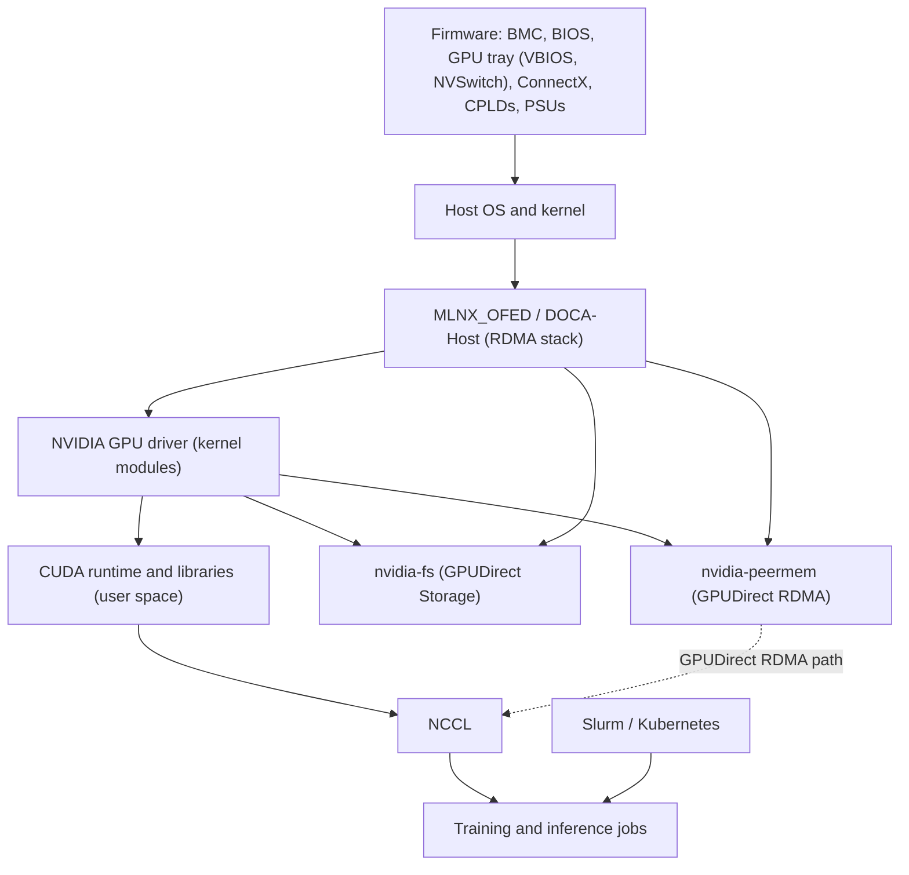
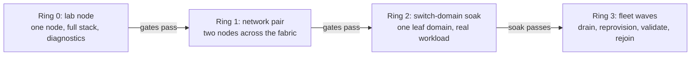

# Chapter 10 — Coordinated Cluster-Wide Software Change Management

On an ordinary application platform, a kernel patch does not change how your application talks to the network. On a GPU cluster it can. The NVIDIA driver is an out-of-tree kernel module. The RDMA stack, the GPU peer-memory module, and the storage module are built against that kernel. NCCL and the CUDA libraries sit on top and negotiate with all of them at start-up.

The result is that "routine" changes fail in unusual ways: not with an outage, but with slower training, a transport silently swapped for a worse one, or a module that did not rebuild.

This chapter gives you a method that holds up under that coupling. It uses compatibility rules that NVIDIA and SchedMD actually document, and it says plainly where a recommendation is judgment. An earlier draft of this chapter relied on specific version numbers, a claim that firmware is always irreversible, and a reservation example with behaviors Slurm does not provide. Those are corrected below.

---

## 1. The coupled stack, and what each coupling really is



Each arrow is a different kind of contract. Treat them differently.

### 1.1 Driver and toolkit: a range, not a pin

The CUDA release notes define two relationships, and the earlier draft collapsed them into one number.

| Relationship | What the documentation says |
|---|---|
| **Driver branch per toolkit** | Each CUDA Toolkit release corresponds to a driver branch. The current table pairs, for example, CUDA 13.4 with R615 and CUDA 13.0 with R580. Update releases within a minor version use the same branch (CUDA Toolkit Release Notes, §2.2) |
| **Backward compatibility** | An application built against a toolkit keeps working on later drivers |
| **Minor-version compatibility** | An application can run on a driver *older* than its toolkit's branch, within a range: 13.x needs >= 580; 12.x needs >= 525 and < 580; 11.x needs >= 450 and < 525 (same section) |
| **Forward compatibility package** | The `cuda-compat-<major>-<minor>` package lets a *newer* CUDA user-space run on an older kernel driver, across major releases. It is named for the highest toolkit it supports (CUDA Compatibility guide) |

Two operating rules follow:

- **Do not state a single "minimum driver for CUDA X" in a runbook without the qualifier.** New features and newly enabled platforms need the matching branch. Existing applications can run under minor-version compatibility, with documented restrictions (for example, PTX JIT compilation limits).
- **Remove forward-compatibility packages during a full system upgrade.** The CUDA Compatibility guide says to remove any forward-compatible packages when you install both the toolkit and the driver.

One version-dependent detail to track: the release notes state that the NVIDIA driver is no longer bundled with the CUDA Toolkit on Linux starting with CUDA 13.4. A pipeline that assumed the toolkit installer delivers the driver will install a toolkit with whatever driver was already there.

### 1.2 Module build order: the one that bites

Two documented orderings decide whether GPUDirect works after a rebuild.

**GPUDirect RDMA (`nvidia-peermem`).** The GPUDirect RDMA documentation notes: if the NVIDIA GPU driver was installed before MLNX_OFED, the GPU driver must be uninstalled and reinstalled so `nvidia-peermem` is compiled against the RDMA APIs that MLNX_OFED provides (GPUDirect RDMA documentation). Image builds that install the GPU driver first and OFED second produce a module that exists but cannot do GPUDirect RDMA.

**GPUDirect Storage (`nvidia-fs`).** Install MLNX_OFED/DOCA before GDS, install the NVIDIA driver before `nvidia-fs`, and rely on DKMS to rebuild `nvidia-fs` when the driver is upgraded (GDS Release Notes §4; `nvidia-fs` guide §7.3.1). A node where it did not rebuild keeps working through cuFile compatibility mode, only slower. [Senior Deep Dive 4](./16-senior-deep-dive-4-coordinated-firmware-driver-os-rollout-across-compute-network-storage.md) covers the diagnosis.

Put these orderings in the image build as explicit, tested steps. Do not rely on package manager defaults.

### 1.3 NCCL: confirm the transport, do not assume it

NCCL selects a network transport at start-up. `NCCL_IB_DISABLE` prevents the IB/RoCE transport, and NCCL then "will instead fall back to another available transport such as IP sockets" (NCCL Environment Variables). The documented logging page shows what to look for with `NCCL_DEBUG=INFO`:

```text
NCCL INFO Initialized NET plugin IB
NCCL INFO Using network IB
```

- `Using network IB` is the line you want after every change that touches the host network stack.
- A different transport name, or `NCCL WARN Failed to initialize any NET plugin`, means the job is not using the fabric you think it is.
- `NCCL_NET_GDR_LEVEL` controls the maximum NIC-to-GPU distance for GPUDirect RDMA. If unset, NCCL selects a value from the detected topology.

Make this check part of the canary acceptance test, not a post-mortem step. A change that leaves jobs running on sockets still passes "the job started".

### 1.4 Slurm: a documented compatibility window and a one-way door

SchedMD's Upgrade Guide is explicit, and it contradicts parts of the earlier draft:

- **Compatibility window.** In-place upgrades are supported from a limited set of prior major releases. As of the current guide, 25.11 lists 25.05, 24.11, and 24.05 as compatible prior versions. Upgrades from incompatible versions "fail immediately upon startup" and must be done in steps. Check the table for your target release; it changes with each release.
- **Daemon order.** Prepare, back up, upgrade `slurmdbd`, then `slurmctld`, then `slurmd` (preferably with `slurmctld`), then login nodes and client commands, then plugins, then test.
- **No downgrade.** "Reverting an upgrade (or downgrading) is not supported once any of the Slurm daemons have been started." Recovery means restoring backups of `StateSaveLocation` and the accounting database, which discards everything after the backup.
- **Wait for old jobs.** Jobs started before `slurmd` was upgraded run with the old `slurmstepd`. Finish them before starting another upgrade or using new features.
- **Package discipline.** For RPM/DEB, upgrade all Slurm packages on a host together. Do not use low-level `rpm` or `dpkg` that skip dependency enforcement.

So the genuinely one-way layer in this stack is the Slurm state and accounting schema, not "firmware".

### 1.5 Firmware: sequenced, activated, and sometimes reversible

The DGX H100/H200 Firmware Update Guide documents the mechanics, and several are change-planning facts:

- **Two ways to update.** The `nvfwupd` tool, or the Redfish API directly. Known issues and steps are the same for both (Firmware Update Guide, "About Firmware Updates").
- **Quiesce first.** The guide says to stop all GPU activity, including running `nvidia-smi`, because it can prevent the VBIOS update, and not to add load such as jobs, diagnostics, or monitoring during the update (Firmware Update Steps).
- **Duration.** About 90 minutes for motherboard-tray and GPU-tray components, and about 30 minutes for ConnectX-7 devices (same page). Use these as planning inputs, then measure your own.
- **Version path constraints.** Upgrading from certain older bundles straight to 24.09.1 skips required intermediate steps. The guide says to go through 1.1.3 first, otherwise a factory reset is required (same page). Read the guide's version-specific notes for your exact source and target versions.
- **Activation is component-specific.** A BMC update needs a BMC reset. BIOS and HGX (GPU tray) components need a cold reset of the system. PCIe switch, retimer, EROT, and CPLD components need an AC power cycle (About Firmware Updates, "Firmware Update Activation").
- **Downgrade exists but is deliberate.** The guide has a procedure, "Forcing a Firmware Downgrade", that sets a `ForceUpdate` flag on the BMC, performs the update, then clears the flag:

```bash
$ nvfwupd --target ip=<bmc-ip-address> user=<user> password=<password> force_update enable
$ nvfwupd --target ip=<bmc-ip-address> user=<user> password=<password> force_update status
# ... perform the firmware update with the older package ...
$ nvfwupd --target ip=<bmc-ip-address> user=<user> password=<password> force_update disable
$ nvfwupd --target ip=<bmc-ip-address> user=<user> password=<password> force_update status
```

- `force_update enable` permits an update to a version the BMC would otherwise refuse. `status` confirms the flag before and after.
- Always disable and re-check the flag afterwards, so a later update cannot silently downgrade.
- The guide also lists upgrade and downgrade failures in known issues (the listed workaround is to retry). Plan for a failed flash on some nodes.

That changes how to phrase the rollback question. "Firmware cannot be rolled back" is not what the DGX H100/H200 guide says. The accurate position is: *downgrade is a documented, deliberate procedure, but it is a separate change with its own risk and must be rehearsed. Other platforms and components may differ, so check the guide for your hardware.*

---

## 2. The compatibility matrix: a template, not a list of numbers

A change request should carry a matrix that names the exact current and target value for each layer, how each is validated, and how each is reverted. Use this template and fill it from the documents above and from your own inventory. The values below are placeholders.

| Layer | Current | Target | How it is validated | Revert path (source) |
|---|---|---|---|---|
| BMC / BIOS / GPU tray / CX-7 firmware | `<fwpkg versions>` | `<fwpkg versions>` | `nvfwupd show_version -p <pkg>` shows `Up-To-Date`; activation step done | `ForceUpdate` downgrade procedure; rehearsed (DGX Firmware Guide) |
| Kernel | `<version>` | `<version>` | Modules build for the target kernel in CI | Boot previous kernel / previous image |
| MLNX_OFED / DOCA-Host | `<version>` | `<version>` | RDMA bandwidth test; `nvidia-peermem` loads | Previous image |
| NVIDIA driver | `<branch.version>` | `<branch.version>` | Module loads; `dcgmi diag -r 3` passes | Previous image |
| `nvidia-peermem` / `nvidia-fs` | `<version>` | `<version>` | Built after OFED and driver; `gdscheck.py -p` | Previous image |
| CUDA toolkit / libraries | `<version>` | `<version>` | Within the driver compatibility range (section 1.1) | Module/path switch |
| NCCL | `<version>` | `<version>` | `nccl-tests` plus `Using network IB` in the log | Swap library |
| Slurm | `<version>` | `<version>` | Target is inside the compatibility window | **Restore from backup only** (Slurm Upgrade Guide) |

Two rules for filling it in:

1. **Mark each cell "verified" or "assumed".** The review should be able to see which combinations someone tested and which were inferred from release notes.
2. **Revert path is a tested fact, not a belief.** If nobody has done the revert on a canary, write "untested".

---

## 3. Progressive rings (design pattern)

Never apply a change to the whole fleet at once. The ring structure below is a design recommendation. The sizes are examples to adapt, not requirements.



| Ring | What it proves that the previous ring cannot |
|---|---|
| 0 | The image builds, modules load, and a single GPU node is healthy. Run `dcgmi diag -r 3` (DCGM's level 3 diagnostic; see the DCGM diagnostics documentation for what each level runs) |
| 1 | Two nodes talk across the fabric: RDMA transport selected (`Using network IB`), GPUDirect RDMA working, `nccl-tests` bandwidth within your baseline |
| 2 | A real workload on a leaf domain behaves for a soak period you choose, with checkpoint I/O exercised (see Deep Dive 4) |
| 3 | The fleet rolls in waves. Each wave drains, reprovisions, validates, and rejoins before the next starts |

A ring-1 gate should compare against **your own recorded baseline for the same hardware**. Do not use a number from a slide.

Define the stop conditions before you start: which failed gate halts the rollout, who can call it, and what state the already-changed nodes are left in.

---

## 4. Executing a wave: Slurm and BCM

### 4.1 Take the capacity out cleanly

Create a maintenance reservation so no job starts into the window. Slurm's documentation gives the pattern: a full-system maintenance reservation with the `maint` and `ignore_jobs` flags (Slurm Reservations documentation):

```bash
$ scontrol create reservation reservationname=maint_wave1 \
    starttime=2026-11-07T22:00:00 duration=480 user=root \
    flags=maint,ignore_jobs nodes=dgx-[01-64]
```

- `flags=maint` marks the time as maintenance for accounting.
- `ignore_jobs` lets you create the reservation while jobs are running. By default only resources not expected to have a running job at the start time can be reserved.
- As the reservation approaches, Slurm launches only jobs that can finish before it starts.
- `duration` is in minutes here (480 = 8 hours).

**What the reservation does not do.** It does not notify running jobs or signal them to checkpoint. The earlier draft claimed jobs get `SIGUSR1` 30 minutes prior. That is not reservation behavior. A job gets a pre-timeout signal only if it asks for one at submission:

```bash
$ sbatch --signal=B:USR1@1800 train.sh
```

- `--signal=B:USR1@1800` sends `SIGUSR1` to the batch shell when the job is within 1,800 seconds of its end time.
- `B:` signals only the batch shell; without it, job steps are signaled instead.
- Slurm says the signal may arrive up to 60 seconds earlier than requested.
- Your training script must trap the signal and checkpoint. The scheduler only delivers it.

Jobs with long limits that overlap the window need either a coordinated stop with their owners, or you accept that `ignore_jobs` plus cancelation will end them.

### 4.2 Reboot nodes through Slurm

Instead of draining by hand and resuming by hand, Slurm has a reboot request that handles the state transitions (`scontrol` documentation):

```bash
$ scontrol reboot ASAP nextstate=RESUME reason="wave1: driver and OFED" dgx-[01-08]
```

- `ASAP` adds the `DRAIN` flag so no new jobs start, then reboots each node when it is idle.
- `nextstate=RESUME` returns the node to service after it reboots and registers. Slurm clears the reason and drain state.
- After the reboot, the node's `HealthCheckProgram` runs once before the node registers, so a health check configured in `slurm.conf` becomes your automatic gate.
- Without `nextstate`, `ASAP` defaults to `UNDRAIN`. Use `nextstate=DOWN` if you want nodes held down for a manual check.
- `FORCE` ignores running jobs and requeues them. Avoid it in a planned wave.

### 4.3 Reprovision through BCM

In BCM the image is the unit of change. Move nodes to a category that points at the new software image, then reboot so the node installs it. The BCM manual documents the pieces:

- `range -n node0[01-24]` in `device` mode applies subsequent commands to a node range (BCM Admin Manual, §2.5).
- A reboot places the latest image with an `AUTO` install. The *Reinstall node* option forces a `FULL` install (§5.6.4).
- `updateprovisioners` must have propagated the new image to the provisioning nodes first, and the default timeout between provisioner updates is 300 seconds (§5.2.4). See [Senior Deep Dive 1](./13-senior-deep-dive-1-bcm-at-fleet-scale.md).

```bash
$ cmsh
[basecm11]% device
[basecm11->device]% range -n dgx[01-08]
[basecm11->device{-n dgx01..08}]% set category dgx-canary
[basecm11->device{-n dgx01..08}]% commit
```

- `set category` repoints the nodes at the canary category and its software image. Create and populate that category and image first.
- The `range` syntax above is adapted from the manual's `node0[01-24]` example. Match it to your node naming and check the result with `list` before `commit`.

Run an `imageupdate` dry run only for small, in-place changes. For a kernel, driver, or OFED change, reboot into the new image. The manual's own advice is that extensive changes are safer by reboot (§5.6.4).

### 4.4 Gate before rejoining

Before a wave's nodes accept production work, require:

1. Firmware versions match the plan: `nvfwupd show_version -p <pkg>`, with `Up-To-Date` as expected.
2. The kernel modules loaded: driver, `nvidia-peermem`, and `nvidia-fs`.
3. `dcgmi diag -r 3` passes.
4. A short `nccl-tests` run shows `Using network IB` and bandwidth within baseline.
5. `gdscheck.py -p` shows the direct mode expected for your file system.

If your health check runs through `slurm.conf`'s `HealthCheckProgram`, encode 1 to 3 there, so a node that fails the check does not register as healthy after `scontrol reboot`.

---

## 5. What can go wrong

| Symptom | Likely cause | First check |
|---|---|---|
| GPUDirect RDMA unavailable after an image rebuild | GPU driver was installed before MLNX_OFED, so `nvidia-peermem` was built without the RDMA APIs | Reinstall the driver after OFED (GPUDirect RDMA documentation) |
| Training slower, no errors | `nvidia-fs` did not rebuild, or NCCL fell back to sockets | check that `nvidia_fs` appears in `lsmod`; look for `Using network IB` in the NCCL log |
| Application fails on a new driver or toolkit combination | Outside the minor-version compatibility range | Compare against the CUDA Toolkit release notes table |
| `slurmctld` refuses to start after upgrade | Source version outside the compatibility window | Check the Upgrade Guide table; upgrade in steps. Restore from backup if needed |
| Firmware update stalls or fails on some nodes | GPU activity (including `nvidia-smi`) during the update, or a known issue | Quiesce the node, retry per the known-issues page |
| Updated firmware not active | Missing the activation step for that component class | Check the activation table (BMC reset, cold reset, AC power cycle) |
| A later firmware update downgrades something | `ForceUpdate` flag left enabled | `nvfwupd ... force_update status`, then `disable` |

---

## 6. Interview scenarios

### Scenario 1: "Can we roll back the firmware?"

**Interviewer:** "Halfway through a firmware wave on a DGX H100 fleet, an application team reports numerical differences. Do we run a rollback script?"

**Strong answer:**
> "I'd stop the wave first and keep the nodes that are already changed isolated from production. Then I'd separate two questions. Is rollback possible? On DGX H100 and H200, NVIDIA documents a deliberate downgrade procedure, using a `ForceUpdate` flag on the BMC, so it isn't impossible. But it's a separate change with its own risk. I'd rehearse it on a canary, apply the right activation step for each component class, and make sure the flag is disabled afterward. The second question is whether firmware is actually the cause. I'd reproduce the numerical difference on a ring-0 node with firmware as the only variable before I commit to a downgrade. If I can't prove the cause, I'd rather hold the wave and preserve evidence than downgrade blindly. And I'd say plainly that I'm describing the DGX H100/H200 guide. For other hardware I'd check its own documentation."

### Scenario 2: "Why is the cluster slower after a routine image update?"

**Interviewer:** "Nothing failed, jobs run, but throughput dropped after an image update. What do you check?"

**Strong answer:**
> "I'd check the layers that degrade silently. First the transport: NCCL with `NCCL_DEBUG=INFO` should say `Using network IB`, and a different transport means we fell back. Then the module chain: `nvidia-peermem` is only usable for GPUDirect RDMA if the driver was built after OFED, and `nvidia-fs` needs a DKMS rebuild after a driver change or cuFile drops to compatibility mode. Then I'd compare `gdsio` transfer types and `nccl-tests` against our own baseline. I'd fix the build order in the image pipeline and add the transport and module checks to the canary gate, so the next change fails closed instead of running slow."

---

## Key takeaways

1. **Know which coupling you are touching.** Driver and toolkit are a range (backward and minor-version compatibility), module build order is a hard dependency, and Slurm upgrades follow a documented window.
2. **Build order is part of the design.** The GPU driver must be installed after MLNX_OFED for `nvidia-peermem`; `nvidia-fs` relies on DKMS after driver upgrades.
3. **Silent degradation needs explicit checks.** Look for `Using network IB` in NCCL logs and check GDS mode on every canary.
4. **The real one-way door is Slurm state.** Reverting a Slurm upgrade is unsupported once daemons start. Restore from backups.
5. **Firmware has a procedure, not a slogan.** On DGX H100/H200, updates need component-specific activation, and downgrades use the `ForceUpdate` procedure. Rehearse both.
6. **Let Slurm do the node handling.** `scontrol reboot ASAP nextstate=RESUME` plus a `HealthCheckProgram` gives you drain, reboot, health check, and return to service in one flow, and `sbatch --signal` is how jobs learn to checkpoint.

---

## Sources

- NVIDIA CUDA Toolkit Release Notes, §2.2 CUDA Driver: [docs.nvidia.com/cuda/cuda-toolkit-release-notes](https://docs.nvidia.com/cuda/cuda-toolkit-release-notes/index.html)
- NVIDIA CUDA Compatibility guide: [docs.nvidia.com/deploy/cuda-compatibility](https://docs.nvidia.com/deploy/cuda-compatibility/index.html)
- NVIDIA GPUDirect RDMA documentation (`nvidia-peermem`): [docs.nvidia.com/cuda/gpudirect-rdma](https://docs.nvidia.com/cuda/gpudirect-rdma/index.html)
- NVIDIA GPUDirect Storage documentation: [docs.nvidia.com/gpudirect-storage](https://docs.nvidia.com/gpudirect-storage/)
- NVIDIA DGX H100/H200 Firmware Update Guide: [docs.nvidia.com/dgx/dgxh100-fw-update-guide](https://docs.nvidia.com/dgx/dgxh100-fw-update-guide/index.html)
- NVIDIA NCCL User Guide (environment variables, logging): [docs.nvidia.com/deeplearning/nccl/user-guide](https://docs.nvidia.com/deeplearning/nccl/user-guide/docs/index.html)
- NVIDIA DCGM documentation (`dcgmi diag`): [docs.nvidia.com/datacenter/dcgm](https://docs.nvidia.com/datacenter/dcgm/latest/index.html)
- NVIDIA Base Command Manager 11 Administrator Manual, §2.5, §5.2, §5.6: [admin-manual.pdf](https://docs.nvidia.com/base-command-manager/manuals/11/admin-manual.pdf)
- SchedMD Slurm: [Upgrade Guide](https://slurm.schedmd.com/upgrades.html), [Reservations](https://slurm.schedmd.com/reservations.html), [scontrol](https://slurm.schedmd.com/scontrol.html), [sbatch](https://slurm.schedmd.com/sbatch.html)

**Not verified in this rewrite.** The ring sizes, soak durations, and bandwidth gates are design choices for you to set from your own baselines. The `cmsh` `range`/`set category` sequence is adapted from the manual's examples and should be tried on a lab cluster. Versions in the matrix are placeholders on purpose.
