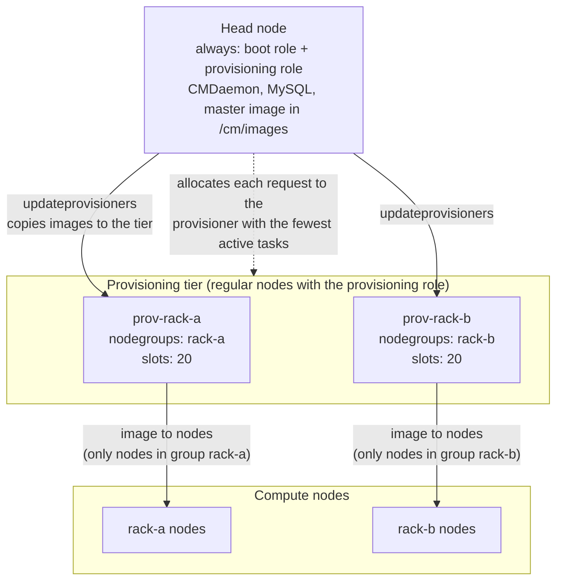
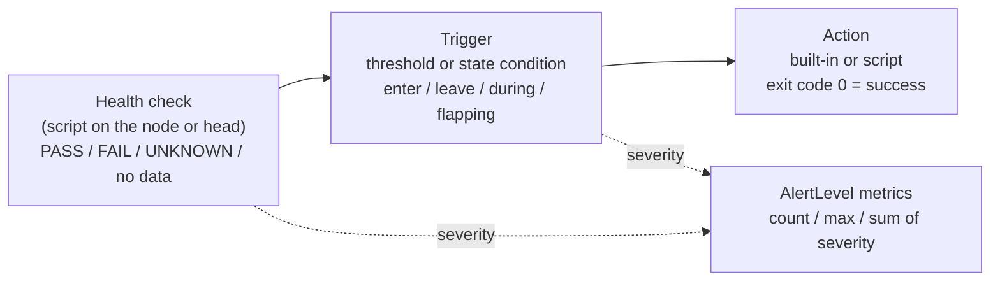
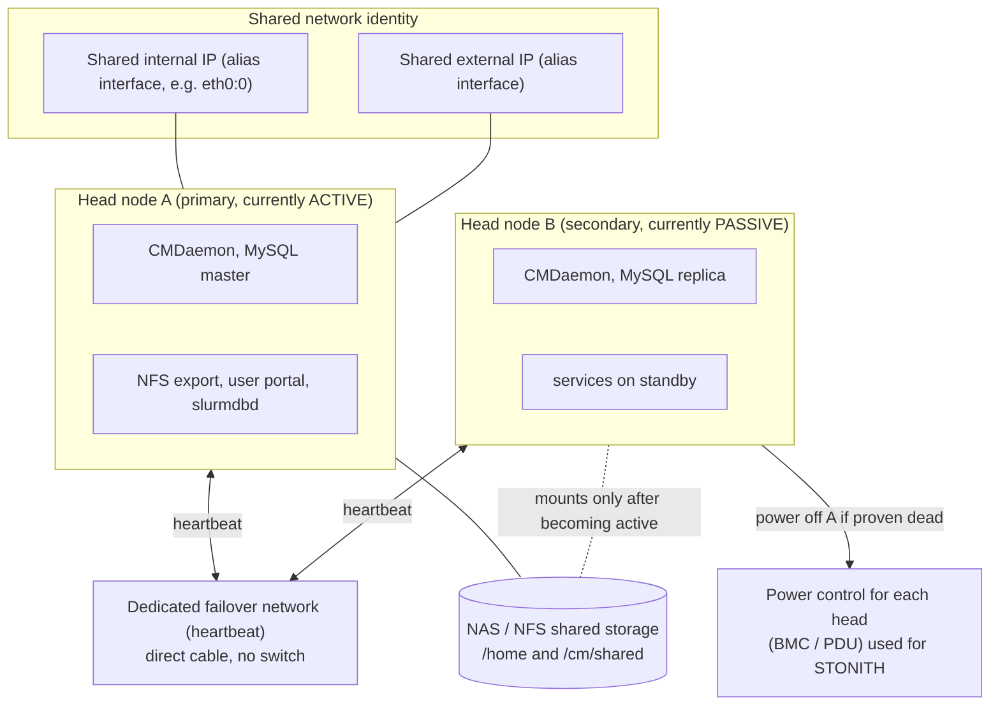

# Senior Deep Dive 1 — BCM at Fleet Scale: Provisioning Tiers, Image Drift, Health Actions, and Head Node HA

An earlier version of this chapter described BCM scaling through "CMDaemon proxies", BitTorrent image seeding, and a Pacemaker/Corosync/DRBD head node pair. None of those appear in the BCM 11 Administrator Manual. This rewrite replaces them with what the manual documents, and it marks every place where the chapter offers a *design recommendation* rather than documented BCM behavior.

That distinction matters in a customer meeting. If you describe an architecture that the product does not implement, the customer's BCM engineer will notice within one question.

**Scope and version.** Everything below is checked against BCM 11. Earlier releases differ in places (for example, shared storage options for HA changed in 11.0). Confirm against the manual for the release you deploy.

---

## 1. What breaks first when the node count grows

A BCM head node is not one service. It is a DHCP server, a TFTP server, an rsync image source, a CMDaemon, a MySQL database, an LDAP server, and a workload-manager controller sharing one machine. Different services saturate at different sizes, and BCM gives you a different knob for each.

**An illustrative failure (constructed for teaching, not a customer incident).** A site powers on a few hundred nodes after a maintenance window. Most come up. A random scattering do not, and the set changes on every retry. Nothing is wrong with the nodes. The manual describes exactly this pattern: when large numbers of nodes boot at once, "random different regular nodes are unable to boot, typically due to network effects", because TFTP and DHCP are overwhelmed (BCM 11 Admin Manual, §5.1.7, p. 244).

The fix is not a bigger head node. It is to move the load.

### 1.1 Two separate roles for two separate loads

BCM splits "getting a node started" from "getting a node its operating system image":

| Concern | Role | What it does | Head node |
|---|---|---|---|
| Booting | **boot** role | Serves the boot image over DHCP and TFTP | Always has it; cannot be removed |
| Image transfer | **provisioning** role | Serves the software image to nodes | Always has it |

The manual's example of the boot role: groups of racks, each rack in its own subnet, with one regular node per subnet holding the boot role. Those nodes take the DHCP and TFTP load for their subnet off the head node (§5.1.7, p. 244).

Provisioning nodes are the image-distribution tier. You create one by assigning the `provisioning` role to a node or a whole category (§5.2, p. 244).



### 1.2 The provisioning-role parameters that decide scale

These are the documented parameters of the provisioning role (§5.2.1, pp. 244–245):

| Parameter | Meaning | Default / note |
|---|---|---|
| `provisioningslots` | Max nodes this provisioner serves in parallel | Default 10. Lower it if network or disk saturates |
| `allimages` | Which images it serves: `onlocaldisk`, `onlocaldiskexceptsharedimages`, `onsharedstorage`, or `no` | Default `onlocaldisk` |
| `localimages` / `sharedimages` | Explicit image lists, used only when `allimages` is `no` | |
| `nodegroups` | Restricts the provisioner to nodes in listed groups, and those groups to provisioners that list them | Unset by default. This is how you build a rack-aligned hierarchy |

Configuration in cmsh, as shown in the manual (§5.2.2, p. 246):

```bash
$ cmsh
[basecm11]% category add misc
[basecm11->category*[misc*]]% roles
[basecm11->category*[misc*]->roles]% assign provisioning
[basecm11...*]->roles*[provisioning*]]% set allimages no
[basecm11...*]->roles*[provisioning*]]% set localimages default-image
[basecm11...*]->roles*[provisioning*]]% set provisioningslots 20
[basecm11->category*[misc*]->roles*[provisioning*]]% commit
```

- `assign provisioning` creates the association between the role and the category.
- `set allimages no` plus `set localimages default-image` makes the provisioner serve only that one image, which limits the disk it needs.
- `provisioningslots 20` raises parallelism from the default of 10. Only do this if the provisioner's NIC and disk can sustain it.

One practical constraint from the manual: a provisioner keeps a copy of every image it serves on local disk, in the same directory path the head node uses. Its disk layout must have room for that (§5.2.1, p. 245).

### 1.3 How the head node allocates and limits work

The head node does the housekeeping for the whole provisioning system (§5.2.4, pp. 249–250):

- Requests are served first-come, first-served.
- If several provisioners can serve the image, the request goes to the one with the **lowest number of already-started provisioning tasks**.
- A cluster-wide ceiling exists independently of per-node slots: `MaxNumberOfProvisioningThreads` in the head node's `/etc/cmd.conf`.
- If no provisioner is free, the request is **deferred**, then retried as tasks finish.
- A failed transfer is retried up to **5** times.
- A provisioner that loses connectivity keeps its allocated requests for **180 seconds**, then they fail.
- Cold-boot order matters: head node first, then provisioning nodes (they must themselves be provisioned), then everyone else.

### 1.4 Keeping the tier current: `updateprovisioners`

A role change configures a provisioner but does not push images to it. BCM runs `updateprovisioners` automatically after a role change, and CMDaemon tracks which provisioners hold up-to-date images (§5.2.2, pp. 246–247, §5.2.4, p. 250).

Three behaviors that surprise people in production:

1. **Out-of-band image edits are not noticed.** If someone changes a file inside the image directly from a shell, rather than through cmsh or Base View, you must run `updateprovisioners` manually. Otherwise it runs on a schedule: by default every midnight UTC (`autoupdateperiod`, 86400 s).
2. **A provisioner being updated does not serve nodes** until its update finishes.
3. **There is a deliberate rate limit.** `dirtyautoupdatetimeout` defaults to 300 s. When a provisioning request arrives, the head node triggers a provisioner update only if the last update is older than that. Set it to 0 and the automatic update is disabled (§5.2.4, p. 252).

You can also drain the tier. `drain` and `undrain` in `softwareimage` mode stop a provisioner from taking new requests while letting active ones finish. `drain --role provisioning` drains all provisioners at once and leaves pending requests queued until you undrain (p. 251).

```bash
[basecm11->softwareimage]% drain --role provisioning
[basecm11->softwareimage]% provisioningstatus      # shows slots, state (draining/drained), up-to-date images
[basecm11->softwareimage]% undrain --role provisioning
```

**Where this stops helping.** All of this scales image delivery and boot. It does not shard CMDaemon, MySQL, or the monitoring database. Those still live on the head node (and its HA partner). For very large fleets, the sizing conversation is about those services; do not promise a "proxy tier" for them, because the manual does not describe one.

---

## 2. Image drift: seeing it, fixing it, and the two directions of sync

BCM's model is that a node category points at a software image, and nodes are supposed to match it. In practice, someone logs in during an incident and changes a running node.

The manual gives you two directions of synchronization, and mixing them up is the most common mistake.

| Direction | Command | Purpose | Exclude list used |
|---|---|---|---|
| Image → running node | `imageupdate` | Bring a live node back to the image without rebooting | `excludelistupdate` |
| Running node → image | `grabimage` | Capture a node's changes into the stored image | `excludelistgrab` (sync into existing image), `excludelistgrabnew` (full copy into a new image) |
| Image → node at boot | provisioning (`FULL` or `SYNC`) | Install on boot | `excludelistfullinstall`, `excludelistsyncinstall` |

(Table assembled from §5.6, pp. 294–296.)

### 2.1 Detecting drift with a dry run

`imageupdate` is **a dry run by default**. It writes nothing to the node. You review the rsync result with `synclog`, and only then pass `-w` to apply (§5.6.2, p. 302):

```bash
[basecm11->device]% imageupdate -n node001
Performing dry run (use synclog command to review result, then pass -w to perform real update)...
...
[basecm11->device]% imageupdate -n node001 -w      # real update, after reviewing synclog
```

- `imageupdate -n node001` queues a dry-run sync from the stored image to the running node.
- `synclog` shows the rsync output, which lists what *would* change. That list is your drift report for that node.
- `-w` applies it.

This is the documented mechanism for seeing divergence. The earlier version of this chapter showed `grabimage -w -s /etc,/usr/local` producing a `[CHANGED]` / `[ADDED]` diff report. That output format and those flags are not in the manual, and `grabimage` points the other way (node into image).

**A fleet audit pattern (design recommendation, not a BCM feature).** Run the dry run per node on a schedule and alert on a non-empty change list. The pieces are all documented: `cmsh -c` with `;`-separated commands appears in the manual (for example `cmsh -c "category use default; set excludelistupdate; commit"`, p. 298), and `imageupdate` and `synclog` are documented. Assemble and test the exact invocation on your cluster before relying on it. Keep the audit away from the head node's peak provisioning windows, because an update request is queued and delegated to a provisioning node just like a normal provisioning request (§5.6, pp. 294–295).

### 2.2 What `imageupdate` will and will not touch

- **Exclude list logic.** Paths on `excludelistupdate` that exist on the node are left alone. Paths **not** on any list lose their contents and are overwritten from the image. The manual states plainly that content not covered by the lists "is normally not protected from deletion" (p. 297).
- **Automatic protection for imported filesystems.** BCM skips statically imported filesystems of these types: NFS, Lustre, FUSE, CephFS, CIFS, PanFS, FhGFS, BeeGFS, GlusterFS, and GPFS (p. 297).
- **Where that protection ends.** Filesystems mounted dynamically (autofs) cannot be detected reliably. You must add them to the exclude list yourself or an update "may wipe out the filesystem" if it happens to be mounted mid-sync (p. 298). Likewise, an imported filesystem that was mounted manually into the image via `/etc/fstab` can be wiped (p. 298). On a GPU cluster with Lustre or BeeGFS scratch, read this paragraph twice.
- **The five-minute trap.** If an image changed in the last 5 minutes (`dirtyautoupdatetimeout`), provisioners may not yet have it, so nodes updating from a provisioner do not receive it. Run `updateprovisioners` immediately before `imageupdate` (p. 302).
- **Limits of live updates.** BCM refuses provisioning if automount is running by default, and services on a live node may not restart because init does not notice the replacement. For extensive changes the manual's advice is to reboot instead. A reboot places the latest image with an `AUTO` install and restarts all services. The *Reinstall node* option in Base View forces a `FULL` install and takes longer (p. 303).

### 2.3 Folding a legitimate fix back into the image

If an emergency change on a node is something you want everywhere, capture it deliberately:

```bash
[basecm11->device]% grabimage -n node001         # sync node -> existing image (uses excludelistgrab)
[basecm11->device]% grabimage -i <newimage> -n node001   # full copy into a new image (uses excludelistgrabnew)
```

(`grabimage` and `grabimage -i` are described in §5.6 p. 295 and §9.5.2. Check the dry-run behavior and exact options in §9.5.2 for your release before using them in anger.)

The review step is the point. A change that reaches the image should go through the same change control as any other image change, then be rolled out through `updateprovisioners` and a reboot or `imageupdate`.

### 2.4 Taking a suspect node out of rotation

Three different "off" switches exist, with different consequences (§5.5.4, pp. 292–294):

| Command | Effect | Common mistake |
|---|---|---|
| `drain` | Workload manager stops starting new jobs; running jobs finish | Assuming it also stops monitoring |
| `mute` | Node stays monitored and UP/DOWN, but alerts and triggers are suppressed | Forgetting to `unmute` after maintenance |
| `close` | Most CMDaemon monitoring actions for the node stop; state shows e.g. `UP/CLOSED` | Believing it stops jobs. **It does not.** The workload manager runs independently of CMDaemon, so jobs continue on a closed node |

The manual's own advice: drain before closing, although it is not obligatory (p. 294). A closed node stays closed until an administrator runs `open`. Even a reboot does not clear it.

---

## 3. Health checks, triggers, and actions

BCM monitoring is a three-stage pipeline. Treat remediation as a design problem inside it, not as a single "auto-heal" switch.



### 3.1 Documented building blocks

**Health check results** are `PASS`, `FAIL`, `UNKNOWN`, or `no data` (§10.2.4, p. 576). `UNKNOWN` means the check neither passed nor failed, for example a timeout, and "typically the administrator should investigate this further". Treat `UNKNOWN` as its own signal. Do not fold it into `FAIL`.

**Default severities:** `FAIL` = 15, `UNKNOWN` = 10, `PASS` = 0. A standalone health-check script can override these with its own value, such as `FAIL 40` (p. 577).

**Trigger launch points** (p. 598):

| Launch option | Fires when |
|---|---|
| Enter actions | Sample enters the zone |
| Leave actions | Sample leaves the zone |
| During actions | Sample stays in the zone |
| State flapping actions | Threshold crossed repeatedly: **5 times within 5 minutes by default** |

Only three triggers exist by default (failing, passing, unknown health checks), each using *Enter* actions with an event as the action (p. 598).

**Built-in actions** on a new system (§10.5.1, pp. 605–606; Appendix G.4.1, p. 1046):

| Action | What it does |
|---|---|
| `Drain` / `Undrain` | Workload manager stops/starts placing new jobs on the node |
| `ImageUpdate` | Updates the image on the node |
| `Reboot` | Clean reboot through the system |
| `Shutdown` | Clean power-off through the system |
| `PowerOff` / `PowerOn` / `PowerReset` | **Hard** power operations through the BMC or PDU |
| `NVSMHealthDump` | NVSM health dump (appears in the 11 action list) |
| `Event` | Sends an event to connected clients |
| `Send e-mail to administrators` | Mail through the configured mail server |
| Script actions | `killprocess`, `remount`, `testaction`, and your own |

An action is a script or built-in that exits 0 on success (p. 577). `drain` also supports a hidden `post-drain-actions` setting that runs further actions *after* the node is fully drained, for example e-mailing and then powering off (pp. 599–600):

```bash
[basecm11->monitoring->trigger]% add mydrain
[basecm11->...->trigger*[mydrain*]]% set enteractions drain
[basecm11->...->trigger*[mydrain*]]% set -e -v post-drain-actions send\ e-mail\ to\ administrators poweroff
[basecm11->...->trigger*[mydrain*]]% commit
```

- `set enteractions drain` runs the drain action when the trigger condition is entered.
- `post-drain-actions` waits until running jobs have finished and the node is fully drained, then runs the listed actions in order.
- Use `validate` before `commit` on custom triggers. The manual shows it catching a misspelled measurable name (`devicestate` instead of `devicestatus`, pp. 600–601).

### 3.2 A remediation tier model (design recommendation)

BCM does not ship a policy that says "hardware faults do X, software faults do Y". You build it from triggers and actions. The tiering below is an architecture pattern for doing that safely. The *mechanisms* are documented above; the *mapping* is judgment.

| Tier | Failure class | Example signals | Suggested action chain | Why |
|---|---|---|---|---|
| 1 | Suspected hardware fault | GPU Xid 79 "GPU has fallen off the bus", uncorrectable ECC, PSU or transceiver failure | `Drain` → e-mail/`Event` → `NVSMHealthDump` for evidence. **No automatic `Reboot` or `ImageUpdate`.** | A reboot does not repair hardware. It returns suspect silicon to the scheduler |
| 2 | Reproducible software state | Missing mount, wrong package or kernel module, corrupted container cache | `Drain` → `ImageUpdate` (or reboot for an `AUTO` reinstall) → re-run the health check → `Undrain` on PASS | State is defined by the image, so restoring the image restores the node |
| 3 | Transient or workload-readiness | Brief fabric congestion, a one-off timeout | Use *State flapping* and `UNKNOWN` handling: alert, and drain only if it persists | Reimaging a healthy node wastes the time you were trying to save |

For Tier 1, the NVIDIA Xid catalog is the authority on what a code means. Xid 79 is logged when the driver tries to reach the GPU over PCIe and finds it inaccessible (NVIDIA Xid Errors, §4.9). Treat the catalog entry, not this table, as the source for any specific code.

**The part people get wrong.** The danger in Tier 2 is a loop: reimage, fail the check, reimage again. Cap it. Count attempts per node and move the node to Tier 1 handling after the second failure. BCM gives you the primitives; the counter is yours to build in the action script.

**Undrain needs a plan.** The manual's own usage tip on the `Drain` action is to "plan for undrain from another node becoming active" (p. 1046). If a drain action ran on a node that then goes down, something else has to undrain it.

---

## 4. Head node high availability

The head node is where CMDaemon, MySQL, DHCP/TFTP, the master images, and (typically) the Slurm accounting daemon live. BCM's answer is a two-head failover pair built with `cmha-setup`. The earlier draft of this chapter described a different design (Pacemaker, Corosync, DRBD). The manual does not describe that design for BCM 11.

### 4.1 Vocabulary: naming versus mode

- **Primary / secondary** is *naming*, and it never changes.
- **Active / passive** is *mode*, and it changes on failover.
- The primary can be passive. The manual also warns that BCM's "primary" is not the same word as Slurm's primary when Slurm runs its own failover (§15.1.1, p. 800).



### 4.2 What runs where

Services on **both** heads at all times (§15.1.3, p. 801): CMDaemon (including provisioning), DHCP (load balanced), TFTP, LDAP (replication), MySQL (master-replica), NTP, DNS. One workload-manager instance is fully active while the other holds standby components.

Services that **migrate** on failover in a typical setup (§15.1.3, p. 802): NFS, the User Portal, and workload-manager components such as `slurmdbd` or LSF batch daemons.

The consequence for provisioning: both head nodes take the provisioning role, so nodes can be provisioned from either one, and the passive head is itself provisioned from the active (p. 802).

### 4.3 Shared storage

In the common setup, `/home` and `/cm/shared` are shared (§15.1.5, p. 804). Two details matter:

- **BCM 11 and later use NAS.** Direct-attached shared storage was allowed before 11.0 but is no longer suggested, because it is "significantly more fragile" (p. 804). The most common NAS is NFS; the manual also names Lustre and GPFS.
- **Shared filesystems are available only on the active head.** Users who log in to the passive head directly get confusing behavior from unmounted filesystems. Point users at the shared external IP, not at either head's own address (p. 804).

CMDaemon moves storage with a configurable mount script and unmount script. A head going active invokes the mount script after the other head has relinquished the filesystems (p. 804). Replace those scripts to support storage the setup menu does not cover.

### 4.4 Guaranteeing a single active head

Two heads writing to shared storage is the failure to prevent. The manual's rule: a head about to go active must either get confirmation that the other is passive or make sure the other is **powered off** (§15.1.6, p. 805).

The sequence, as documented (pp. 805–806):

1. The passive head notices its counterpart is not responding and enters **fencing mode**. In fencing mode it tags subsequent actions as a backlog to apply later. If the heads reconnect before failover, the backlog is compared and synced.
2. It obtains proof the active is dead, in one of two ways: an administrator manually confirms the power is off, or the passive performs a power-off (**STONITH**) and verifies the power is off.
3. Before powering off, it runs a **quorum check**. It asks all nodes whether they also cannot reach the active head. Only if **more than half** of the nodes confirm does it proceed. This prevents a passive head with its own network problem from killing a healthy active head.
4. Once the active is proven off, the fencing head moves to active mode.

The manual also draws two distinctions worth knowing before a failover test:

- **Power-off is not the same as pulling the power cable.** A power-off leaves the BMC up, so power state can be verified. Pulling the cable typically takes the BMC down too, and CMDaemon will *not* fail over automatically because it cannot tell a dead head from a network failure (§15.2.4, pp. 814–815). That case needs manual confirmation.
- **A graceful shutdown does not trigger failover**, because it is assumed to be intentional (p. 806).

### 4.5 Automatic versus manual failover

Automatic failover requires **power control defined for both head nodes**. If power control is defined, automatic failover is attempted by default. You can disable it (§15.1.7, p. 806):

```bash
$ cmsh
[basecm11]% partition failover base
[basecm11->partition[base]->failover]% set disableautomaticfailover yes
[basecm11->partition*[base*]->failover*]% commit
```

Failover is also manual when no power control exists, when it is disabled, when power control is broken, or when the active is "mostly dead", meaning slightly responsive (p. 806).

Verify power control before you rely on it (§15.2.4, p. 815):

```bash
[master1]% device power status -n mycluster1,mycluster2
```

### 4.6 Building and checking the pair

`cmha-setup` builds the pair in stages (§15.2, p. 808): preparation, cloning the secondary from the primary, shared storage setup, then optional automated failover. Manual construction without `cmha-setup` is explicitly unsupported (p. 808). The manual describes an express, non-ncurses mode driven by an XML file and `cmha-setup -x -c failoverconf.xml` (§15.3, p. 816).

Health of the pair is visible with `cmha status` (p. 814):

```bash
[root@basecm11 ~]# cmha status
Node Status: running in active master mode
Failover status:
basecm11* -> head2
failoverping [ OK ]
mysql        [ OK ]
ping         [ OK ]
status       [ OK ]
head2 -> basecm11*
...
```

- The asterisk marks the active node, and each arrow shows which node is checking which.
- `failoverping` uses the dedicated failover network and starts working once the passive head has rebooted.

### 4.7 Trap: what actually replicates

By default only the `cmdaemon` and `slurm_acct_db` MySQL databases are cloned to the secondary. A third-party application database on the head, such as the manual's AJR example, is **not** cloned and will be missing after a failover (§15.1.3, p. 801). From BCM 11.34.0, `cmha-setup` can optionally replicate all non-system databases plus users and grants. The express option is `--replicate-all-databases`. Inventory every database on the head before you promise "full HA".

Other deliberate design points: the failover network should be a direct cable with no switch, so a switch reset cannot break the heartbeat (p. 804). External head node addresses must be **static**. DHCP on external addresses will not work for HA (p. 809). HA needs an HA-enabled license; an HA license shows two MAC addresses in `verify-license info`, a single-head license shows one (pp. 807–808). Installing a new license invalidates existing user certificates, so install the HA-enabled license *before* creating certificates and profiles if you expect to move to HA later (p. 808).

---

## 5. Failure scenarios

| Symptom | Likely cause | What to check |
|---|---|---|
| Random subset of nodes fail PXE on mass power-on | TFTP/DHCP overload on the head | Add `boot` role nodes per subnet (§5.1.7) |
| Nodes sit in `INSTALLING` and provisioning is slow | Provisioners out of slots, or cluster-wide thread cap hit | `provisioningstatus`, `provisioningslots`, `MaxNumberOfProvisioningThreads` |
| New image never reaches nodes that update from a provisioner | Provisioner not updated, or inside the 5-minute window | Run `updateprovisioners` before `imageupdate` |
| `imageupdate` wiped a scratch mount | Dynamic (autofs) mount not on the exclude list | Add it to `excludelistupdate`; check `excludelist get update /` |
| Node shows `UP/CLOSED` but jobs keep landing | `close` does not stop the workload manager | `drain` first; `open` to restore monitoring |
| Passive head will not take over | No power control, automatic failover disabled, or BMC unreachable | `device power status`, `disableautomaticfailover`, `cmha status` |
| After failover an application's data is missing | Its database was not in the replicated set | Check replicated databases; consider `--replicate-all-databases` (11.34.0+) |
| Users hit "file not found" on the passive head | Shared filesystems mount only on the active head | Point users to the shared external IP |

---

## 6. Senior Solutions Architect interview scenarios

### Scenario 1: Making a large BCM cluster boot and provision reliably

**Interviewer:** "A customer is bringing up several hundred DGX nodes under BCM. Nodes fail to PXE boot unpredictably. How do you approach it?"

**Strong answer:**
> "That pattern matches TFTP and DHCP saturation on the head node, which BCM documents. I'd confirm that first, then separate two loads. For *booting*, I'd assign the boot role to one regular node per rack subnet so DHCP and TFTP are served locally. For *image transfer*, I'd assign the provisioning role to a node per rack group, use `nodegroups` to keep traffic rack-local, and size `provisioningslots` against each provisioner's NIC and disk. I'd also check the cluster-wide `MaxNumberOfProvisioningThreads`. Then I'd make sure someone owns `updateprovisioners`, because provisioners serve stale images until it runs. I would not promise a CMDaemon proxy tier. BCM doesn't have one, and the database and monitoring still live on the head pair."

### Scenario 2: Designing safe auto-remediation

**Interviewer:** "How would you auto-remediate unhealthy GPU nodes in BCM?"

**Strong answer:**
> "BCM gives me health checks, triggers, and actions. It doesn't give me a policy, so I design one. Hardware-class signals, like Xid 79 or uncorrectable ECC, get drain, notification, and an NVSM health dump, and never an automatic reboot. Software-state failures get drain, `ImageUpdate` or a reboot into an `AUTO` reinstall, a re-check, and undrain only on PASS, with an attempt counter so a node can't loop. Transients use flapping thresholds and the `UNKNOWN` state instead of drain-on-first-failure. I'd also confirm `close` isn't used as a drain substitute, since jobs keep running on a closed node."

### Scenario 3: Explaining failover to a security-minded customer

**Interviewer:** "What stops both head nodes from writing to shared storage during a split?"

**Strong answer:**
> "The passive head can't go active on suspicion. It enters fencing mode and has to prove the active is off, either by an administrator's confirmation or by powering it off through its BMC and verifying. Before it powers anything off it runs a quorum check across the cluster's nodes and needs more than half to agree they can't reach the active head, so a passive head with its own network fault can't take down a healthy one. Shared filesystems mount only on the active head, via the mount script. And I'd warn them that yanking the power cable is a worse test than a power-off, because it takes the BMC down and BCM then refuses to fail over automatically."

---

## Key takeaways

1. **Split the loads.** Boot role relieves DHCP/TFTP; provisioning role distributes images. Both are documented, both are tunable, and neither shards CMDaemon or MySQL.
2. **Know the direction of sync.** `imageupdate` goes image → node and is a dry run by default. `grabimage` goes node → image. Review `synclog` before `-w`.
3. **Protect your scratch mounts.** Dynamic mounts are not auto-detected. Exclude them explicitly.
4. **`close` is not `drain`.** A closed node keeps running jobs.
5. **Remediation is something you build.** Triggers and actions are the primitives. Keep hardware faults off the auto-reboot path, and cap software-reimage loops.
6. **HA means fencing plus quorum plus power control.** Test with a power-off, not a pulled cable, and inventory which databases replicate.

---

## Sources

- NVIDIA Base Command Manager 11 Administrator Manual, [https://docs.nvidia.com/base-command-manager/manuals/11/admin-manual.pdf](https://docs.nvidia.com/base-command-manager/manuals/11/admin-manual.pdf). Sections cited: §5.1.7 (boot role, p. 244); §5.2 (provisioning nodes, pp. 244–252); §5.5.4 and §5.6 (node states, updating running nodes, pp. 292–303); §10.2 and §10.4–10.5 (health checks, triggers, actions, pp. 576–606); §15.1–15.3 (high availability, pp. 800–816); Appendix G.4.1 (actions, p. 1046).
- NVIDIA GPU Xid Errors catalog, [https://docs.nvidia.com/deploy/xid-errors/analyzing-xid-catalog.html](https://docs.nvidia.com/deploy/xid-errors/analyzing-xid-catalog.html).

**Not verified in this rewrite.** The exact `cmsh -c` form for a scheduled fleet-wide dry run, the attempt-counter loop guard, and the tier-to-action mapping are design recommendations. Test them on a lab cluster before putting them in a customer runbook.
