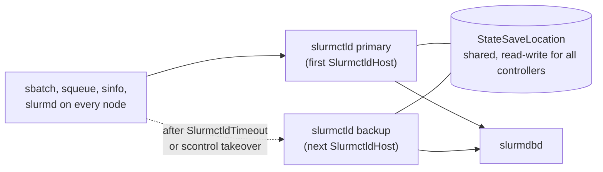

# Senior Deep Dive 2 — Slurm HA, Accounting Database, and Fairshare

An earlier draft of this chapter taught that Slurm's native failover is unsafe and should be replaced by Pacemaker and Corosync, that the accounting database should be a MariaDB Galera cluster behind ProxySQL, and that `SIGUSR2` dumps controller thread state. None of that is in the SchedMD documentation, and the `SIGUSR2` claim is wrong. It also contained invented `slurm.conf` and `slurmdbd.conf` parameters (for example `RollupStats`) and a padded appendix of placeholder comments. This rewrite is built from the SchedMD documents and marks design judgment as such.

The three questions that matter in production:

1. If the controller dies, how does the cluster continue, and what can go wrong?
2. What happens to scheduling when the accounting database is slow or down?
3. How does fairshare turn history into queue order, and how do you tune it for AI workloads?

---

## 1. The three planes and what each one stores

| Plane | Daemon | State it owns | Where it lives |
|---|---|---|---|
| Scheduling | `slurmctld` | Jobs, nodes, partitions, reservations | In memory, saved to `StateSaveLocation` |
| Execution | `slurmd` on each node | Running steps, local enforcement | Node-local spool |
| Accounting | `slurmdbd` + SQL database | Associations, QOS, usage history, job records | SQL database |

Fairshare is the coupling between planes: `slurmctld` needs the associations and the usage history from the accounting plane to compute priority (Multifactor Priority documentation: computing the fair-share factor "requires the installation and operation of the Slurm Accounting Database").

---

## 2. Controller high availability: what Slurm documents

### 2.1 The native mechanism

Slurm's own HA is configured in `slurm.conf`:

```ini
SlurmctldHost=slurmctl-01
SlurmctldHost=slurmctl-02
StateSaveLocation=/shared/slurm/state
SlurmctldTimeout=120
```

- `SlurmctldHost` must appear at least once. **If specified more than once, the first entry runs as primary and all others as standby backups.** If the primary fails, the first backup becomes primary until the first host comes back (slurm.conf).
- **Every controller needs access to `StateSaveLocation`.** It must be readable and writable from the primary and all backups at all times. Slurm recommends a reliable file system such as RAID because all running and pending job information is stored there.
- `SlurmctldTimeout` (default 120 s) is how long a backup waits for the primary to respond before assuming control.
- `scontrol takeover [index]` tells a backup to take over now. By default the first backup requests control from the primary and waits for its termination; if the primary cannot be contacted, it switches directly. The documentation notes this speeds up failover when the primary is down and minimizes disruption when it is scheduled down (scontrol).
- For a floating address, Slurm provides `SlurmctldPrimaryOnProg` and `SlurmctldPrimaryOffProg`, programs run when a controller becomes or stops being primary, so you can attach or detach a virtual IP (slurm.conf).



### 2.2 The risk Slurm itself calls out

The slurm.conf manual states it plainly: **if two nodes are simultaneously configured and running as primary controller, "system behavior will be destructive."** (RELOCATING CONTROLLERS). That is the split-brain case, and it is the reason the design questions below matter.

Two design choices follow, and neither is dictated by the documentation. Choose deliberately.

| Option | What it adds | Trade-off |
|---|---|---|
| **Native HA only** (`SlurmctldHost` list, shared state, optional `SlurmctldPrimaryOnProg`) | Fewest moving parts; the failover logic is Slurm's own | The failover decision relies on `slurmctld`'s own timeout logic and on your shared storage behaving correctly |
| **Native HA plus external fencing** (a cluster manager or BMC-based power fencing that ensures a dead primary is really off) | Removes the destructive both-primary case | Two systems now participate in the primary decision. They must agree, or they will fight. This is a deliberate engineering effort, not a default |

BCM takes the first approach with a hook: on a BCM HA cluster, Slurm's `slurmctldstartpolicy` is `TAKEOVER` by default, which makes the `prefailoverscript` in the failover submode call `/cm/local/apps/cmd/scripts/slurm.takeover.sh`, so Slurm's `scontrol takeover` runs when the active head node changes. On a non-HA cluster the default is `ALWAYS`. The takeover is temporary: if the head node with the Slurm primary restarts, the primary takes its role back "as per Slurm documentation" (BCM 11 Admin Manual, §7.2.4, pp. 356–357). Combined with BCM's own fencing for the head-node pair ([Senior Deep Dive 1](./13-senior-deep-dive-1-bcm-at-fleet-scale.md)), that is the documented BCM design.

### 2.3 `StateSaveLocation`: what to ask of the storage

The documentation requires shared read-write access and recommends reliability. It does not publish a mount-option recipe. Treat the following as questions to answer and test, not as documented settings:

- Does the file system give the standby controller a consistent view after the primary's last write? Test by killing the primary during load and checking what the backup recovers.
- What happens to the controller when the file system stalls? A hung `StateSaveLocation` can stall scheduling.
- Who owns backups of it? Restoring it is the documented way to revert an upgrade ([Chapter 10](./10-coordinated-cluster-wide-software-change-management.md)).

The earlier draft's `noac,lookupcache=none` NFS options and its "DRBD dual-primary" recommendation were invented. If you use NFS, validate the specific appliance and mount options with failure injection instead of copying a recipe.

### 2.4 Recovery options that exist (and the one that kills jobs)

`slurmctld` startup flags control how much state is recovered (slurmctld man page):

| Flag | Behavior |
|---|---|
| (none) / `-r` | **Default.** Recover partial state: jobs, and node DOWN/DRAIN state with reasons. No partition state is recovered |
| `-R` | Recover full state: jobs, nodes, partitions, and power-save settings |
| `-i` | Ignore errors reading state files on startup. **Anything not recovered is lost** |
| `-c` | **Clear all previous state. All jobs, running and queued, are deleted** |

The man page notes that it is rare you would want `-c` in production because all jobs will be killed.

The earlier draft's "recover by deleting `job_state` and letting `slurmd` re-register" is not a documented recovery procedure. If the state directory is damaged:

1. Stop `slurmctld` everywhere. Do not start a second primary.
2. Restore `StateSaveLocation` from your most recent backup to the shared location.
3. Start with the default flags and read the log. Use `-i` only after you accept losing what cannot be read.
4. Use `-c` only as a decision to end all jobs.
5. Validate with `squeue` and `sinfo` before reopening the queue.

The point for design: **the quality of your `StateSaveLocation` backups is your recovery plan.** Backups are not optional.

### 2.5 Which signals do what

The earlier draft's `kill -SIGUSR2` thread dump does not exist. The documented `slurmctld` signals (slurmctld man page):

| Signal | Effect |
|---|---|
| `SIGTERM`, `SIGINT`, `SIGQUIT` | Clean shutdown, saving state to the state save directory |
| `SIGABRT` | Clean shutdown, save state, and core dump |
| `SIGHUP` | Reload configuration, like `scontrol reconfigure` |
| `SIGUSR2` | Re-read the log level from the config, then reopen the log file (use with `logrotate`) |
| `SIGPROF` | Log connection-manager state (at debug level info or higher) |
| `SIGCHLD`, `SIGUSR1`, `SIGXCPU`, `SIGPIPE`, `SIGALRM` | Explicitly ignored |

To diagnose a controller that is running but unresponsive, use `sdiag`, which reports server thread count, agent queue, scheduler statistics, and RPC counts. A server thread count "often close to MAX_SERVER_THREADS" points to a bottleneck (sdiag man page).

---

## 3. Accounting: `slurmdbd` and the database

### 3.1 What happens when `slurmdbd` is slow or down

The Accounting documentation answers the question that the earlier draft got wrong:

- If `slurmdbd` is configured but not responding, `slurmctld` uses **an internal cache until it returns**. The cache is written to local storage on shutdown and recovered at startup.
- Job and step accounting records generated meanwhile are cached and sent when `slurmdbd` returns.
- **Limits:** `slurmdbd` must be responding when `slurmctld` is **first started**, because no cache of accounts and user limits exists yet. If `slurmdbd` stays down long enough that the queue exceeds its maximum size, messages are dropped.

So an accounting outage does not freeze scheduling by design, but it has a deadline. Alert on `slurmdbd` health well before the queue limit, and never restart `slurmctld` from a cold state while `slurmdbd` is down.

### 3.2 Backup `slurmdbd`

Configure `AccountingStorageBackupHost` in `slurm.conf` and `DbdBackupHost` in `slurmdbd.conf`. The backup should be on a different machine from the primary. Both instances must reach the same database, share the same munge key(s), and have the same users with the same UID/GIDs (Accounting documentation).

That protects the daemon. It does not make the database highly available. For the database itself, use the high-availability option your database vendor supports for MySQL or MariaDB, and test the failover with `slurmdbd` pointed at it. SchedMD's documentation does not describe or endorse a specific clustering topology such as Galera or a proxy layer, so if you add one it is your design and your support boundary.

### 3.3 Database settings SchedMD recommends

The Accounting documentation lists server settings to review before running `slurmdbd` for the first time:

| Setting | SchedMD guidance |
|---|---|
| `innodb_buffer_pool_size` | 5 to 50 percent of the SQL server's memory, and at least 4 GiB. Too small causes problems when upgrading large databases or purging old records |
| `innodb_log_file_size` | 25 percent of `innodb_buffer_pool_size` divided by `innodb_log_files_in_group`. Larger values lengthen recovery after an unexpected shutdown |
| `innodb_redo_log_capacity` | Use instead of the above on MySQL 8.0.30 and later; 25 percent of `innodb_buffer_pool_size` |
| `innodb_lock_wait_timeout` | 900 seconds |
| `max_allowed_packet` | At least 16M; must exceed `max_script_size` if you store job scripts |
| `innodb_snapshot_isolation` | Set to OFF (on the MariaDB releases the document names) |

The earlier draft recommended 60 to 80 percent of RAM for the buffer pool. SchedMD recommends 5 to 50 percent. Follow the vendor.

### 3.4 `slurmdbd.conf` knobs that are real

- `CommitDelay`: seconds between commits on a connection from `slurmctld`. For high job throughput, SchedMD says setting it (1 second in their testing) improves performance dramatically, at the cost of a small window for data loss if `slurmdbd` exits abnormally.
- `MaxQueryTimeRange`: return an error for queries over too large a time span. Default is unlimited; operators and above are exempt. Use it to stop a careless reporting query from loading the daemon.
- `Purge*After` (for example `PurgeJobAfter`, `PurgeStepAfter`, `PurgeUsageAfter`): units are months (default), days, or hours, and the purge occurs at the start of each month, day, or hour depending on the unit. **If unset, records are never purged.** `PurgeJobAfter` also covers job scripts and environments unless their own purge options are set. Aggregated information is preserved until `PurgeUsageAfter`.
- `ArchiveJobs` and `ArchiveScript`: archive records when purging; default is no.
- `MessageTimeout`: round-trip time allowed; default 10 seconds.

`RollupStats`, which the earlier draft showed, is not a `slurmdbd.conf` parameter.

### 3.5 Querying the database directly

Reading SQL tables is possible but it is a fallback, not a primary interface. The schema is internal. Prefer `sacct`, `sreport`, and `sacctmgr`, and treat direct queries as read-only forensics on a replica. If you do query, remember that tables are prefixed by the cluster name (for example `clustername_job_table`) and that TRES IDs are site-specific: look them up in the TRES table before parsing `tres_req_str`.

---

## 4. Priority and fairshare

### 4.1 The priority formula

With `PriorityType=priority/multifactor`, a job's priority is a weighted sum (Multifactor Priority documentation):

```text
Job_priority = site_factor
             + PriorityWeightAge       * age_factor
             + PriorityWeightAssoc     * assoc_factor
             + PriorityWeightFairshare * fair-share_factor
             + PriorityWeightJobSize   * job_size_factor
             + PriorityWeightPartition * priority_job_factor
             + PriorityWeightQOS       * QOS_factor
             + SUM(TRES_weight_<type> * TRES_factor_<type>)
             - nice_factor
```

All factors range from 0.0 to 1.0, weights are unsigned 32-bit integers, and the resulting priority is an integer from 0 to 4294967295. Use `sprio` (with `-w` to show the weights) to see the breakdown for a job, and `sshare -l` to see fairshare inputs.

The documentation is explicit about what fairshare is *not*: "The fair-share factor does not involve a fixed allotment, whereby a user's access to a machine is cut off once that allotment is reached." It orders the queue, so under-serviced accounts go first and over-serviced accounts run when the machine would otherwise be idle. If you need hard limits, use QOS or association limits (for example `GrpTRESMins`) instead of tuning fairshare.

### 4.2 Fair Tree is the default

Since Slurm 19.05, the fairshare algorithm is **Fair Tree**. The earlier "classic" algorithm is used only if `PriorityFlags=NO_FAIR_TREE` is set (Multifactor Priority documentation). Fair Tree ranks accounts by level so that if account A outranks sibling account B, **every child of A outranks every child of B**. `sshare -l` shows `Level FS`, which is infinity for an association with no usage.

The simple formula the earlier draft showed, `F = 2^(-U/S)`, belongs to the **classic** algorithm. The classic documentation gives it as `F = 2**(-U/S/d)`, where `d` is `FairShareDampeningFactor` (default 1), and notes that 0.5 means the user has used exactly their share (Classic Fair Share). Know which algorithm you run before you explain a number to a customer.

### 4.3 Decay settings

| Parameter | Documented default | Meaning |
|---|---|---|
| `PriorityDecayHalfLife` | 7 days (`7-0`) | Time over which historical usage halves. `0` means no decay |
| `PriorityCalcPeriod` | 5 minutes | How often the decay is recalculated |
| `PriorityUsageResetPeriod` | `NONE` | Resets association usage to zero at an interval (`NONE`, `NOW`, `DAILY`, `WEEKLY`...). Needed if `PriorityDecayHalfLife=0` |
| `PriorityMaxAge` | 7 days | Queue wait at which the age factor maxes out |

Choosing a half-life is a policy decision about burst behavior. A shorter half-life forgives a big burst sooner, a longer one makes teams "pay back" a burst over weeks. The default of 7 days is a reasonable starting point. Move it only when you can state the behavior you want, then verify with `sshare` over a few weeks. The earlier draft's claim that 7 to 14 days is "the industry standard for LLM training" has no source behind it.

### 4.4 Charging for GPUs

Fairshare usage defaults to `allocated_cpus * seconds`. To account for other resources, set `TRESBillingWeights` on the partition so GPUs contribute (Multifactor Priority). To track GPUs as TRES, list them in `AccountingStorageTRES`:

```ini
AccountingStorageTRES=gres/gpu
PriorityWeightTRES=CPU=1000,Mem=2000,GRES/gpu=3000
```

- `AccountingStorageTRES=gres/gpu` tracks GPU usage in addition to the default TRES (billing, CPU, energy, memory, node, FS/disk, pages, VMem). The defaults cannot be disabled, only appended to.
- TRES are set up in the database automatically when `slurmctld` starts, so you do not need a separate step to add the type. The earlier draft's `sacctmgr add tres` step is unnecessary for this case.
- If you track a GRES with a subtype (for example `gres/gpu:h100`), also list the generic `gres/gpu`, or requests that give only the generic type will not be accounted for. Setting `gres/gpu` also sets `gres/gpumem` and `gres/gpuutil`.
- `PriorityWeightTRES` takes the form shown, applied only with `priority/multifactor` and a configured `AccountingStorageTRES`. The numbers above are the documentation's example, not a recommendation.

---

## 5. Failure scenarios

### Scenario 1: Commands hang and the accounting log shows database contention

**Reasoning.** Do not assume the database froze the scheduler. By design, `slurmctld` uses a cache when `slurmdbd` is unresponsive. First find where the time is going.

1. `sdiag`: look at server thread count against its maximum, the agent queue, and RPC counts.
2. `slurmdbd` log: lock waits, slow queries, connection errors.
3. Database: look for long-running queries (a reporting query across a huge range is a common cause; `MaxQueryTimeRange` exists for this).
4. Mitigate: stop the offending queries, review `innodb_lock_wait_timeout`, `innodb_buffer_pool_size`, and consider `CommitDelay` for sustained high job rates.
5. Prevent: purge old records (`Purge*After`) so the database does not grow without bound.

### Scenario 2: Primary controller died, backup did not take over

**Check in order:** `SlurmctldHost` entries are present and identical on all hosts; the backup can read and write `StateSaveLocation`; `SlurmctldTimeout` has elapsed (default 120 s) or `scontrol takeover` was issued; the backup's log shows what it tried; on BCM, check `slurmctldstartpolicy` and the `prefailoverscript`. Never start a second primary by hand.

### Scenario 3: A user's usage looks absurdly high and blocks their fairshare

**Reasoning.** First verify the record, then correct the cause, then the symptom.

1. Find the job with `sacct` and check the start and end times. A wildly wrong duration points to a clock problem (check time sync on controllers and nodes).
2. Reset the account's accrued raw usage if warranted: `sacctmgr` supports `RawUsage=0` as the only value (reset to zero) when modifying an account. It cannot be used as a filter.
3. Do not edit SQL rows directly. If the database truly has a wrong record, work with SchedMD support before changing accounting tables.

---

## Key takeaways

1. **Slurm HA is native.** Multiple `SlurmctldHost` lines, a shared read-write `StateSaveLocation`, a 120 s default timeout, `scontrol takeover`, and VIP hooks. Two simultaneous primaries is destructive, so design fencing deliberately and make sure only one system decides who is primary.
2. **Backups are the recovery plan.** `-c` kills all jobs, `-i` loses what it cannot read, and the default recovers partial state.
3. **An accounting outage has a deadline, not an immediate effect.** `slurmctld` caches until the queue overflows, and `slurmdbd` must be up at first start.
4. **Follow SchedMD's database settings,** not folklore: buffer pool 5 to 50 percent of memory, lock wait 900 s, and purges set explicitly (unset means never purge).
5. **Know your fairshare algorithm.** Fair Tree is the default since 19.05. `2^(-U/S)` is the classic formula.
6. **Fairshare orders the queue; it does not cap usage.** Use QOS or association limits for hard caps.

---

## Sources

- SchedMD Slurm documentation: [slurm.conf](https://slurm.schedmd.com/slurm.conf.html), [slurmctld](https://slurm.schedmd.com/slurmctld.html), [scontrol](https://slurm.schedmd.com/scontrol.html), [sdiag](https://slurm.schedmd.com/sdiag.html), [Accounting and Resource Limits](https://slurm.schedmd.com/accounting.html), [slurmdbd.conf](https://slurm.schedmd.com/slurmdbd.conf.html), [Multifactor Priority](https://slurm.schedmd.com/priority_multifactor.html), [Fair Tree](https://slurm.schedmd.com/fair_tree.html), [Classic Fair Share](https://slurm.schedmd.com/classic_fair_share.html), [TRES](https://slurm.schedmd.com/tres.html), [sacctmgr](https://slurm.schedmd.com/sacctmgr.html), [Upgrade Guide](https://slurm.schedmd.com/upgrades.html).
- NVIDIA Base Command Manager 11 Administrator Manual, §7.2.4 Slurm HA and `slurmctldstartpolicy`: [admin-manual.pdf](https://docs.nvidia.com/base-command-manager/manuals/11/admin-manual.pdf)

**Not verified in this rewrite.** The behavior of any specific shared file system as `StateSaveLocation` under failure, any database clustering topology under `slurmdbd`, and the exact queue limit at which `slurmctld` drops cached accounting messages (check `slurmdbd`/`slurm.conf` documentation for your version).
