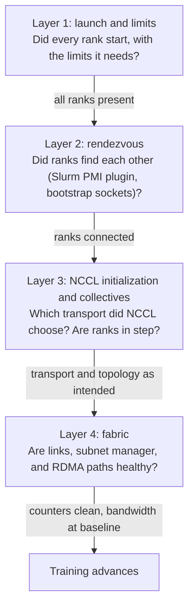

# Senior Deep Dive 3 — MPI, NCCL, and Fabric Joint Debugging

When a large training job hangs, the cost is idle GPUs. The harder cost is time: four different systems can produce the same symptom, and each team that owns one of them will tell you it is not theirs. Slurm launches the processes. A process-management layer (PMIx or MPI) lets ranks find each other. NCCL builds communicators and runs collectives. The fabric carries the bytes.

This chapter gives you an order of operations that isolates the layer quickly, and the exact tools NVIDIA documents for each layer. An earlier draft of this chapter contained several unverified details: an `NCCL_WATCHDOG_DUMP` variable that does not exist in NCCL's documentation, a hard-coded `NCCL_IB_GID_INDEX=3`, an `NCCL_ALGO=CollNet` setting that applies only to old NCCL releases, and SHARP log lines that NVIDIA does not publish. Those are corrected below. The mechanisms behind scale-dependent failures remain here as *hypotheses to test*, not as facts.

---

## 1. The ladder



Go in order. A hang at layer 3 that you chase on the fabric wastes an afternoon if the real cause was an interface binding at layer 2.

---

## 2. Layer 1: launch and limits

**Question.** Did the scheduler start the intended number of processes on every node, and do they have the limits GPU and RDMA code needs?

```bash
# Rank count per node for a running job (replace the job ID)
$ srun --jobid=<jobid> --ntasks-per-node=1 bash -c 'echo "$(hostname): $(pgrep -fc python3)"'
```

- `--jobid` attaches a step to the existing allocation.
- `--ntasks-per-node=1` runs the check once per node.
- `pgrep -fc python3` counts matching processes. Adjust the pattern to your launcher. A node with fewer processes than expected is your lead.

Causes worth checking when a rank is missing:

1. **Process-count limits.** A cgroup or systemd `pids.max` ceiling rejects further `fork()` calls. Check the limit your job's cgroup actually has, not a generic value.
2. **Locked memory.** RDMA registers pinned memory. NCCL's troubleshooting guide documents the symptom precisely: `NCCL WARN Call to ibv_create_qp failed` or `ibv_reg_mr failed` means the process cannot register enough pinned memory. NVIDIA's fix is `memlock unlimited` (soft and hard) in `/etc/security/limits.conf`, applied so that jobs launch with the new limits. For Slurm, that means the limit must be present inside the job, which you verify with `ulimit -l` from within a step (NCCL User Guide, Networking Troubleshooting).

```bash
$ srun --jobid=<jobid> --ntasks-per-node=1 bash -c 'echo "$(hostname): memlock=$(ulimit -l)"'
```

---

## 3. Layer 2: rendezvous

**Question.** All processes exist. Can they exchange the addresses they need?

Two separate mechanisms live here, and they fail differently.

**The Slurm process-management plugin.** Slurm's MPI guide explains that `MpiDefault` in `slurm.conf` sets the default PMI implementation and `srun --mpi=<type>` (or `SLURM_MPI_TYPE`) overrides it per job. Using an MPI implementation without the matching Slurm plugin "may result in application failure" (Slurm MPI Users Guide).

```bash
$ srun --mpi=list          # plugins this Slurm build supports
$ srun --mpi=pmix ...      # select PMIx explicitly for this job
```

The guide also warns that, with RPM installs, the `slurm-libpmi` package conflicts with `pmix-libpmi`. After an upgrade, check that the intended one is installed.

**NCCL's bootstrap network.** NCCL opens TCP connections between processes to exchange connection information, using an interface it selects automatically. NCCL's guide states the risk directly: "If some interfaces are in the UP state but are not able to communicate between nodes, NCCL may try to use them anyway and therefore fail during the init functions or even hang."

The fix is `NCCL_SOCKET_IFNAME`. It takes **prefixes**, with exact-match and exclude syntax (NCCL User Guide, Environment Variables):

| Setting | Meaning |
|---|---|
| `eth` | All interfaces starting with `eth` |
| `=eth0` | Only the interface named exactly `eth0` |
| `=eth0,eth1` | Exactly those two |
| `^docker` | Exclude interfaces starting with `docker` |

A typical bad case: one node has a container bridge such as `docker0` that NCCL picks, while its peers cannot reach that address. `NCCL_SOCKET_IFNAME=^docker,lo` is a reasonable exclusion, or pin the management interface with `=` if every node uses the same name. Interface names often differ between node types, so a prefix list like `eth,ens,bond` can be safer than one exact name. Choose by looking at `ip -br addr` on each node type.

NCCL also uses TCP ports for rendezvous. To keep them inside a firewall rule, restrict the kernel's ephemeral range (documented example: `echo 50000 51000 > /proc/sys/net/ipv4/ip_local_port_range`) and open that range between nodes (NCCL User Guide, Networking Troubleshooting).

---

## 4. Layer 3: NCCL initialization and the tools that tell you who is stuck

### 4.1 Read the log for the transport and topology

```bash
$ export NCCL_DEBUG=INFO
$ export NCCL_DEBUG_SUBSYS=INIT,GRAPH,ENV     # default is INIT,BOOTSTRAP,ENV
```

- `NCCL_DEBUG=INFO` prints detailed operation logs. `NCCL_DEBUG_SUBSYS` filters by subsystem. Valid names include `INIT`, `COLL`, `P2P`, `NET`, `GRAPH`, `TUNING`, and `ENV`.
- On a healthy IB cluster the log shows `Using network IB` (NCCL User Guide, Logging). A different transport on an IB cluster means NCCL fell back, because `NCCL_IB_DISABLE` is set or the IB plugin failed (`NCCL WARN Failed to initialize any NET plugin`).
- `GRAPH` shows topology detection and the rings and trees NCCL built. Compare the rail and device choices against what you intended. To test one rail in isolation, restrict NCCL with `NCCL_IB_HCA` (for example `=mlx5_5:1`) and see whether the problem follows that adapter.

### 4.2 Built-in active diagnostics (NCCL 2.31 and later)

```bash
$ NCCL_RUN_DIAGNOSTICS=1 <application>
```

- The diagnostics are off by default. When enabled, they run at each communicator initialization, before application traffic, and print lines prefixed `NCCL DIAG` from rank 0.
- `[OK]` means a check passed. `[INFO]` marks something to review, such as `p2p: only 52/56 GPU-to-GPU peer accesses passed verification`.
- They are informational: a reported issue does not abort initialization.
- Because they run before any workload, a failure points to the system (GPU, interconnect, driver, or configuration) and not the application (NCCL User Guide, Diagnostics).

### 4.3 RAS: finding the rank that is not in step (NCCL 2.24 and later)

For a job that is already hung, the RAS subsystem is the most direct documented tool. It runs inside NCCL and builds a network between processes that exchange keep-alives, so a crashed or hung rank is detected by its peers.

```bash
$ ncclras            # query the local RAS thread (default localhost:28028)
$ ncclras -v         # verbose output
$ echo verbose status | nc localhost 28028      # same query without the client binary
```

- RAS listens on `localhost`, port `28028` by default (change with `NCCL_RAS_ADDR`). Run the client on a node of the job.
- The response is a job summary, then a per-communicator table with `Status` and `Errors` columns.
- A `MISMATCH` row with the message *"Communicator ranks have different collective operation counts"* lists how many ranks launched up to each operation number, and names the lagging ranks with their GPU, process ID, and node. That is your straggler.
- An `INCOMPLETE` row means data is missing from a process that is not responding. RAS reports the process and rank, and later queries are faster because RAS routes around the dead process.
- NVIDIA's guidance on false alarms is practical: a small mismatch is not a cause for concern if the counts increase across repeated queries, because collectives can outpace the RAS query. Query twice, a few seconds apart, and compare.

The exact output format changes between NCCL releases. Read what your installed version prints rather than matching the examples character for character.

### 4.4 The watchdog is not NCCL's

Frameworks add their own timeouts around NCCL calls. In PyTorch, the process group takes a `timeout` argument (`init_process_group(..., timeout=None, ...)` in the 2.14 documentation), and PyTorch's `ProcessGroupNCCL` has the watchdog that raises "watchdog thread terminated" errors. Two consequences:

- The relevant environment variables for that behavior carry PyTorch's `TORCH_NCCL_` prefix. NCCL's own documented variables use `NCCL_`. NCCL's environment-variable reference has no `NCCL_WATCHDOG_DUMP`. The earlier draft's setting does nothing.
- A watchdog error tells you a collective did not complete in time on some rank. It does not tell you why. Use sections 4.1 to 4.3 and layer 4 to find out.

The PyTorch documentation also describes `TORCH_DISTRIBUTED_DEBUG` for extra logging and a flight-recorder trace buffer that respects `TORCH_FR_BUFFER_SIZE` and `TORCH_NCCL_TRACE_BUFFER_SIZE`. Look up the current defaults in the PyTorch docs for your release before putting numbers in a runbook. This chapter does not quote a default timeout because the 2.14 signature shows `timeout=None` and the effective value depends on the backend.

### 4.5 GPU faults appear here as hangs

If one rank's GPU becomes inaccessible, that rank stops, and every other rank eventually waits for it. Check the kernel log on all nodes for Xid messages:

```bash
$ srun --jobid=<jobid> --ntasks-per-node=1 bash -c 'journalctl -k --since "-6 hours" | grep "NVRM: Xid"'
```

The Xid catalog describes Xid 79 as the driver finding the GPU inaccessible over PCI Express, often from link failures but possibly failing hardware or driver issues. The `--since` value is an example window. For handling, use Runbook B in [Chapter 12](./12-customer-runbooks-onboarding-and-best-practice-documentation.md).

---

## 5. Layer 4: fabric health

NCCL's networking guide lays out the sequence. Use it in this order because each step rules out the layer under it.

### 5.1 InfiniBand

```bash
$ ibstatus                       # quick per-port view
$ ibstat                         # detailed per-HCA and per-port view
```

Healthy means: port state `Active` (not `Down`, `Init`, or `Armed`), physical state `LinkUp`, the expected link layer, and a `Rate` that matches the fabric with no unexpected downshift.

```bash
$ sudo sminfo                    # is a Subnet Manager running?
$ sudo perfquery -x <lid>        # error counters for a port
$ sudo ibping -S                 # on the remote node, start the ping server
$ sudo ibping <lid>              # on the local node, ping by LID
$ sudo ibdiagnet                 # fabric-wide: topology, routing, errors (needs SM access)
```

- Watch `SymbolErrorCounter`, `LinkErrorRecoveryCounter`, and `LinkDownedCounter`. Non-zero or **increasing** values suggest cabling or hardware problems. Read twice, minutes apart, and compare. A value that is non-zero but static is history.
- `perfquery` and `ibqueryerrors` can reset counters when used with reset options. Capture values first.
- If NCCL works on some rails and fails or slows on one, run `ibdiagnet` and read its report for missing links, bad ports, or routing inconsistencies on the switch ports serving that rail (NCCL User Guide).
- On a fabric with the SMP firewall active, `sminfo` fails by design (MLNX_OFED secure-host documentation). Confirm with the fabric owner before treating that failure as an SM outage.

### 5.2 Bandwidth and latency between two nodes

```bash
# server
$ ib_write_bw -d <device> -a
# client
$ ib_write_bw -d <device> <server> -a
# same, using GPU memory (options depend on how perftest was built; check --help)
$ ib_write_bw -d mlx5_0 --use_cuda=<gpu_id> <server> -a
# tail latency
$ ib_write_lat -d <device>              # server
$ ib_write_lat -d <device> <server>     # client
```

- Compare host-memory results with GPU-memory results. If host memory is fine and GPU memory is poor, suspect GPUDirect RDMA (see [Chapter 10](./10-coordinated-cluster-wide-software-change-management.md), section 1.2 on `nvidia-peermem`).
- The NCCL guide notes bandwidth can look healthy while tail latency is poor. If the symptom is stalls or intermittent slowness, run the latency test too.

```bash
$ rdma statistic                        # watch for growing rnr_nak_retry_err, packet_seq_err,
                                        # implied_nak_seq_err, local_ack_timeout_err during a test
$ mlxlink -d <mst_device>               # width, speed, error state of the physical link
```

- Counters named above that are increasing during a test indicate loss, retries, or transport-level problems.
- `mlxlink` is the check when bandwidth degraded without an obvious software change.

### 5.3 RoCE

RoCE needs different tools, and its failures are usually configuration, not cables.

```bash
$ ethtool -S <nic>                      # errors, drops, pause frames, PFC counters
$ rping -s -a <server_ip> -V -C 10      # on the remote node
$ rping -c -a <server_ip> -S <client_ip> -V -C 10
$ show_gids                             # GID table
```

Two documented RoCE facts replace the earlier draft's hard-coded advice:

- **GID index.** NCCL's `NCCL_IB_GID_INDEX` defaults to `AUTO` (since 2.32u1), letting NCCL determine the GID. Earlier guidance says NCCL 2.21 and later select it dynamically and that the variable should not be set. Setting a fixed number such as `3` in a launch script is a way to break a cluster that would otherwise work, if the GID table differs between nodes. Set it only for old NCCL releases, and only after `show_gids` confirms the value on each node.
- **Traffic class.** Users "may also need to set `NCCL_IB_TC`", with values taken from the vendor's documentation (NCCL User Guide). It must match the switch's classification.

On the switch side, Cumulus Linux documents the lossless RoCE defaults, which gives you a concrete target to compare against (Cumulus Linux 5.12, RoCE):

| Item | Documented default |
|---|---|
| PFC | Enabled on switch priority 3 (RoCE) in lossless mode |
| RoCE traffic | DSCP 26 → switch priority 3 → traffic class 3 |
| CNP traffic | DSCP 48 → switch priority 6 → traffic class 6, strict priority |
| ECN | Enabled on traffic classes 0 and 3 in the example output |
| LLDP application TLV | UDP, protocol 4791, priority 3 |

The earlier draft said PFC "priority 3 (DSCP 26 or 48)". Those are two different things: DSCP 26 marks RoCE data, DSCP 48 marks congestion notification packets (CNPs).

```bash
cumulus@switch:~$ nv set qos roce
cumulus@switch:~$ nv config apply
cumulus@switch:~$ nv show qos roce
```

- `nv set qos roce` applies lossless mode with PFC and ECN. NVUE defaults to lossless.
- `nv show qos roce` prints applied versus operational state: mode, PFC priority, ECN thresholds, and the DSCP-to-priority mappings. Compare it with the host's NIC trust and priority settings.
- The Cumulus RoCE page is for Spectrum switches running Cumulus Linux. If your customer's fabric uses Spectrum-X with a different OS or reference design, use that design's documentation.

NCCL's own advice on RoCE performance problems: if PFC, ECN, CNP, or queue-drop counters rise while latency tails grow, "investigate congestion control and lossless-fabric configuration before changing NCCL."

---

## 6. "Two nodes work, eight nodes hang": hypotheses, each with a test

A job that is fine at small scale and fails at larger scale is common. The mechanisms below are plausible and widely seen, but they are hypotheses, not documented outcomes. Test each before you assert it.

| Hypothesis | Why it would appear only at scale | How to test it |
|---|---|---|
| Traffic starts crossing switch tiers | Two nodes on one leaf never use uplinks. Larger jobs do | Place the small job across two leaves (use the topology your scheduler exposes) and see if it fails at two nodes |
| One bad rail or cable | Small tests may not exercise every rail. Collectives across all rails wait for the slowest | Run `ib_write_bw` per HCA between the same node pair. Use `NCCL_IB_HCA=` to isolate rails in `nccl-tests` |
| Error counters on one port | A marginal link drops under sustained load | Read `perfquery -x` before and after a run and compare |
| Oversubscribed uplinks | Pairwise tests do not stress them | Run a larger `nccl-tests` all-reduce and compare to the baseline for that size |
| Resource exhaustion that scales with ranks | Memory registration, queue pairs | Look for the `ibv_create_qp` / `ibv_reg_mr` warnings and raise memlock |

If you suspect one rail, `ibdiagnet` plus per-rail `ib_write_bw` is the evidence that persuades the fabric team. Bring both.

---

## 7. SHARP and in-network reduction: what is documented

The earlier draft said SHARP "cuts network hops in half" and showed specific log lines. Neither is in NVIDIA's NCCL documentation. What is documented:

- **IB SHARP through the CollNet plugin.** `NCCL_COLLNET_ENABLE` (since 2.6) enables the CollNet plugin. It is off by default and must be set to `1` (NCCL User Guide).
- **Algorithm names changed.** In `NCCL_ALGO`, `Collnet` is valid for NCCL 2.5 to 2.13. From 2.14 the algorithms are `CollnetChain` and `CollnetDirect`. Setting `NCCL_ALGO=CollNet` on a modern NCCL, as the earlier draft did, does not select what you intend. Also, from NCCL 2.24, `NCCL_ALGO` parsing is stricter: unexpected tokens warn and fail, and if `ring` is not listed there is no implicit fallback to it. Forcing an algorithm can therefore turn a working job into a failing one.
- **NVLink SHARP is a different feature.** `NCCL_NVLS_ENABLE` (since 2.17, default `2`) controls NVLink SHARP offload, available on third-generation NVSwitch systems (NVLink4) with Hopper and later GPUs. The `NVLS` and `NVLSTree` algorithm names enable it. NVLink SHARP is intra-domain and does not need the IB Aggregation Manager.
- **The Aggregation Manager is a separate service.** UFM Enterprise can run the NVIDIA SHARP Aggregation Manager: starting UFM starts it, and `/etc/init.d/ufmd sharp_stop` and `sharp_start` control only the SHARP AM while UFM keeps running (UFM Enterprise 6.19.1, NVIDIA SHARP integration appendix). If the AM is down or an allocation fails, a SHARP-enabled job needs another path or must run without CollNet.

How to verify SHARP is in use: do not search for a specific log line. Run `nccl-tests` with and without `NCCL_COLLNET_ENABLE=1` at the message sizes you care about, check `NCCL_DEBUG=INFO` and the `TUNING` subsystem for the algorithms NCCL selected, and compare against the baseline. Treat "faster at the sizes that matter" as the acceptance criterion.

---

## 8. Interview scenarios

### Scenario 1: A large job dies every eight to twelve hours with a watchdog timeout

**Interviewer:** "A customer's LLM job on a large cluster crashes every 8 to 12 hours with a PyTorch watchdog error. They blame the framework. How do you lead?"

**Strong answer:**
> "First I'd correct the attribution. The watchdog belongs to PyTorch's NCCL process group, and it's telling us a collective didn't finish on some rank. It isn't the cause. So I'd find which rank. For the next run I'd keep NCCL RAS available, because when the job hangs I can run `ncclras` on a node and look for a MISMATCH row naming the ranks behind on operation counts, or an INCOMPLETE row naming an unresponsive process. In parallel I'd sweep every node's kernel log for `NVRM: Xid`, because a GPU that goes inaccessible stops one rank and the rest wait. If the GPUs are clean, I'd look at the fabric: counters read before and after a run, looking for increase, not just non-zero. And I'd check that `NCCL_SOCKET_IFNAME` excludes container bridges. I wouldn't change the timeout to hide it, and I'd be careful quoting a default, because it depends on the framework and backend."

### Scenario 2: RoCE benchmark is slow and hangs intermittently

**Interviewer:** "A customer runs NCCL over RoCE v2 and sees throughput drops and intermittent hangs. What do you verify?"

**Strong answer:**
> "I'd start with whether the fabric is actually lossless end to end, because RoCE depends on PFC and ECN. On the switch I'd read the applied QoS state, for Cumulus that's `nv show qos roce`, and compare it to what the NICs are marking. The documented defaults are PFC on priority 3, RoCE traffic on DSCP 26, and congestion notification on DSCP 48 in a strict-priority class. Then host-side, I'd look at `ethtool -S` for drops, pause, and PFC counters while a test runs, and `rdma statistic` for retry and ACK-timeout counters growing. For NCCL, I'd check that nobody hard-coded `NCCL_IB_GID_INDEX`. Recent NCCL selects it automatically. And I'd check `NCCL_IB_TC` against the switch classification. I would not start by tuning NCCL algorithms."

---

## Key takeaways

1. **Order matters.** Launch and limits, then rendezvous, then NCCL, then fabric. Each layer has a documented tool.
2. **Use RAS for hung jobs.** `ncclras` (NCCL 2.24+) names the ranks that are behind or unresponsive. Use `NCCL_RUN_DIAGNOSTICS=1` (2.31+) for init-time checks.
3. **The watchdog is the framework's.** It reports that a collective was late, not why. `TORCH_NCCL_*` variables belong to PyTorch.
4. **Prefix syntax is the trap in `NCCL_SOCKET_IFNAME`.** Use `^docker,lo` to exclude, `=name` to pin exactly.
5. **Let NCCL pick the RoCE GID.** Recent releases default `NCCL_IB_GID_INDEX` to `AUTO`. Do not hard-code it.
6. **Cumulus RoCE defaults are concrete.** PFC priority 3, RoCE on DSCP 26, CNP on DSCP 48. Compare switch and host against them.
7. **SHARP claims need a benchmark, not a log line.** CollNet algorithm names changed in 2.14, NVLink SHARP is separate, and IB SHARP needs the Aggregation Manager.

---

## Sources

- NVIDIA NCCL User Guide: [Environment Variables](https://docs.nvidia.com/deeplearning/nccl/user-guide/docs/env.html), [Logging](https://docs.nvidia.com/deeplearning/nccl/user-guide/docs/troubleshooting/logging.html), [Diagnostics](https://docs.nvidia.com/deeplearning/nccl/user-guide/docs/troubleshooting/diagnostics.html), [RAS](https://docs.nvidia.com/deeplearning/nccl/user-guide/docs/troubleshooting/ras.html), [Networking Troubleshooting](https://docs.nvidia.com/deeplearning/nccl/user-guide/docs/troubleshooting/networking_troubleshooting.html)
- NVIDIA Cumulus Linux 5.12, RoCE: [documentation](https://docs.nvidia.com/networking-ethernet-software/cumulus-linux-512/Layer-1-and-Switch-Ports/Quality-of-Service/RDMA-over-Converged-Ethernet-RoCE/)
- NVIDIA UFM Enterprise 6.19.1, SHARP integration and diagnostic utilities appendices: [networking-docs.nvidia.com/ufmenterprisearum/6191](https://networking-docs.nvidia.com/ufmenterprisearum/6191)
- NVIDIA MLNX_OFED 24.10 secure-host documentation: [networking-docs.nvidia.com/mlnxofedswum/24100700](https://networking-docs.nvidia.com/mlnxofedswum/24100700)
- NVIDIA Xid Errors catalog: [docs.nvidia.com/deploy/xid-errors](https://docs.nvidia.com/deploy/xid-errors/index.html)
- SchedMD Slurm MPI Users Guide: [slurm.schedmd.com/mpi_guide.html](https://slurm.schedmd.com/mpi_guide.html)
- PyTorch `torch.distributed` documentation (2.14): [docs.pytorch.org/docs/2.14/distributed.html](https://docs.pytorch.org/docs/2.14/distributed.html)

**Not verified in this rewrite.** The default PyTorch watchdog timeout (the 2.14 signature shows `timeout=None`; the effective value was not confirmed), exact PMIx debug variables, and Spectrum-X settings for non-Cumulus operating systems. Section 6 lists hypotheses, not documented causes.
