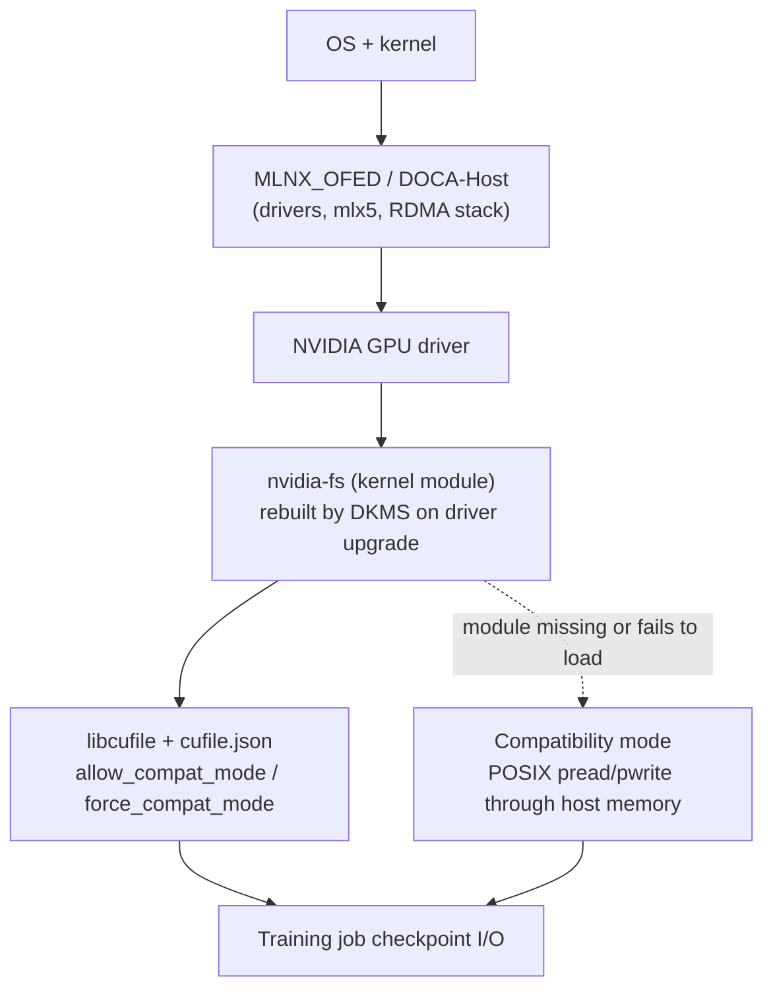

# Senior Deep Dive 4 — Coordinated Rollout Across Compute, Network, and Storage

A platform refresh touches three domains that depend on each other: GPU nodes (OS, kernel, NVIDIA driver, network drivers), the InfiniBand fabric (switch software, Subnet Manager), and parallel storage (controllers, clients). The failure that hurts most is not a crash. It is a *silent downgrade*, where everything stays up and the checkpoint path quietly gets several times slower.

An earlier version of this chapter asserted a strict "storage, then network, then compute" law and showed a `gdsio` run with exact throughput and CPU numbers. Neither is supported by NVIDIA documentation. This version teaches the dependencies that *are* documented, derives an upgrade order from them, and labels the order as judgment.

---

## 1. The documented dependency chain on a GPU node

Three components have to line up on every compute node for GPUDirect Storage (GDS) to take the direct path. The GDS documentation states the rules:

| Rule | Source |
|---|---|
| MLNX_OFED/DOCA must be installed **before** GDS | GDS Release Notes, §4 "MLNX_OFED/DOCA and File System Requirements" |
| Install the NVIDIA driver **before** `nvidia-fs`; when the driver is upgraded later, **DKMS rebuilds `nvidia-fs` automatically** | GDS `nvidia-fs` guide, §7.3.1 |
| A `.run`-file install of the GDS components **fails if MLNX_OFED is not installed** | GDS Release Notes, §10 Known Issues |
| `nvidia-fs.ko` requires Linux kernel 4.15.x or newer, and each MLNX_OFED/DOCA release lists the distributions it supports | GDS Release Notes, §4 |
| Some `nvidia-fs` releases have bugs (for example 2.25.6 may make cuFile APIs fail in P2P mode; 2.25.7 or newer is recommended) | GDS Release Notes, §10 |



The dotted path is the trap, and it is documented.

### 1.1 Compatibility mode: why a bad upgrade does not fail loudly

The cuFile library can fall back to ordinary POSIX I/O when direct I/O is not possible. The API Reference Guide lists the situations, and the first one that matters here is "deployments where `nvidia-fs.ko` is not loaded or cannot be loaded" (cuFile API Reference, §3.3). The relevant `cufile.json` options and their defaults:

| Option | Default | Effect |
|---|---|---|
| `allow_compat_mode` | `true` | Fall back to compatibility mode if the file descriptor cannot use GDS |
| `force_compat_mode` | `false` | Force all I/O through compatibility mode. An admin can get the same effect by unloading `nvidia_fs.ko` |
| `gds_rdma_write_support` | `true` | If `false`, forces compatibility mode for writes even when the file system could do GDS writes |

Compatibility mode uses `pread`, `pwrite`, and `aio_submit` to host memory, then copies to GPU memory when needed. With `allow_compat_mode` defaulting to `true`, **a kernel upgrade that leaves `nvidia-fs` unbuilt does not break jobs. It makes their checkpoints slower.** That is exactly the failure customers report as "the cluster is fine but training is slow".

If you want a hard failure instead, set `allow_compat_mode` to `false` on the canary and fleet so a missing module surfaces as an error during validation. Decide this deliberately: it also removes the safety net for workloads that legitimately run on unsupported file systems.

---

## 2. Choosing an upgrade order (judgment, with the reasoning shown)

NVIDIA documentation does not publish a mandatory cross-domain order for a customer's mix of storage, fabric, and GPU nodes. What it does publish is each domain's compatibility matrices. The order below is derived from them and from blast radius. Treat it as a default to challenge, not a law.

**A defensible default:** storage first, fabric second, compute last, using a canary at each step.

| Step | Rationale | The exception that breaks the rule |
|---|---|---|
| Storage backend first | Servers are usually backward-compatible with older clients, and storage failures are the most data-critical to find early | If the new storage release requires a newer client (kernel module, NFS/RDMA client, parallel-FS client), upgrade a canary client set *first* and prove mount and I/O before touching the whole backend |
| Fabric second | The fabric is shared by every job and by storage traffic. Change it while compute is drained and the workload is absent | If new host drivers (MLNX_OFED/DOCA) are required for new switch firmware features, the canary must include host-side changes |
| Compute last | Largest blast radius (thousands of nodes), and the only domain you can re-image automatically through BCM | A driver-only fix for a GPU bug may be the *reason* for the window; then compute may go first on a canary ring |

State this to a customer as: "The order follows each domain's compatibility matrix and blast radius. Here are the matrices we checked." That is more defensible than "the sequence is fixed."

### 2.1 The maintenance envelope in Slurm

Before touching anything, take the capacity out of the scheduler cleanly. Slurm's documentation gives the exact pattern for a full-system maintenance reservation:

```bash
$ scontrol create reservation starttime=2026-11-07T22:00:00 \
    duration=480 user=root flags=maint,ignore_jobs nodes=ALL
```

- `flags=maint` marks the reservation as maintenance for accounting.
- `ignore_jobs` lets the reservation be created even though jobs are running; the manual notes you can cancel running jobs as needed.
- As the reservation time approaches, only jobs that can complete before it starts are launched (Slurm Reservations documentation, "Reservation Creation").

The start time above is an example. Use your own change window, and use a node list in place of `ALL` when only a partition is in scope.

```mermaid
sequenceDiagram
    autonumber
    participant S as Slurm
    participant ST as Storage
    participant NET as Fabric (switches, SM)
    participant C as Compute (BCM categories)

    Note over S: Maintenance reservation created, partition drained
    ST->>ST: Upgrade; validate with canary client I/O
    NET->>NET: Move SM mastership to standby, then upgrade switches in rings
    NET->>NET: Verify SM state, link errors, full topology
    C->>C: Canary ring: OS, MLNX_OFED/DOCA, driver, nvidia-fs
    C->>ST: GDS checks and gdsio on the canary
    C->>NET: NCCL all_reduce_perf on the canary
    Note over S: Widen ring only if every gate passes, then release reservation
```

---

## 3. Compute: build the canary around the dependency chain

On the canary node, prove each link in the chain from section 1 before running any benchmark.

### 3.1 Is the direct path actually in use?

NVIDIA provides `gdscheck.py` for this, installed under the CUDA tree (GDS Troubleshooting Guide, §16.5):

```bash
$ /usr/local/cuda-<x>.<y>/gds/tools/gdscheck.py -p
```

- `-p` prints platform support. The output has an `ENVIRONMENT` section and a `DRIVER CONFIGURATION` section that lists, per storage type, which modes are available.
- Documented examples show lines such as `NVMe : p2pdma, compat` and `BeeGFS : nvfs, compat`. Read these as "which direct mode exists" plus the always-present `compat` fallback.
- It reports the GDS release, the `nvidia_fs` version, and the `libcufile` version. Record these in your change log. They are the versions that must match the compatibility notes in section 1.
- Confirm the module is loaded with `lsmod | grep nvidia_fs`, and compare `nvidia_fs` versions across the canary and the fleet.

**What a failure looks like.** Documented example outputs show a mode and `compat`; the thing you are checking is whether the *direct* mode you paid for appears for your file system. A file system that shows only compatibility behavior will not give you GDS throughput, whatever the rest of the stack looks like.

### 3.2 Measure, and compare transfer paths on the same node

`gdsio` ships with the GDS tools and can run the same load through different transfer paths. The transfer type is selected with `-x` (GDS Configuration Guide, §4.3.1):

| `-x` | Path |
|---|---|
| 0 | Storage → GPU (GDS direct) |
| 1 | Storage → CPU |
| 2 | Storage → CPU → GPU |
| 5 | Storage → GPU async stream |
| 6 | Storage → GPU batch |

`-I` selects the I/O type (`0` read, `1` write, `2` random read, `3` random write), `-d` the GPU index, `-w` the thread count, `-s` the file size, `-i` the I/O size, `-f` a file or `-D` a directory, and `-T` a duration in seconds. Run `gdsio -h` on your installed version for the authoritative list.

```bash
# Same workload, two paths, on one canary node. Replace the path with a file on the file system under test.
$ gdsio -f /mnt/scratch/gds_probe -d 0 -w 8 -s 20G -i 1M -I 1 -x 0     # write via GDS
$ gdsio -f /mnt/scratch/gds_probe -d 0 -w 8 -s 20G -i 1M -I 1 -x 2     # write via CPU bounce
```

- Both commands write the same data from GPU 0 with 8 threads in 1 MiB I/Os. Only the path differs.
- The documented output format is one line per run, for example `IoType: WRITE XferType: GPUD Threads: 1 ... Throughput: ... GiB/sec, Avg_Latency: ... usecs` (GDS Getting Started, §4.1). `GPUD` is the direct path and `CPU_GPU` the bounce path.
- **What to compare:** the ratio between the two runs, and each run against *your own pre-upgrade baseline on the same hardware*. Do not compare against a number from a slide.

If the direct run is no faster than the bounce run, treat that as the compatibility-mode signature from section 1.1 and go back to `gdscheck.py -p` and the `cufile.json` options before you suspect the storage.

A topology note from the same guide: cuFile selects a GPU close to the storage on the PCIe tree, and the guide reports a case where a non-optimal GPU choice cut throughput by about 40% and doubled latency (GDS Configuration Guide, benchmarking section). Pin the benchmark GPU to one that shares a PCIe switch with the NIC or NVMe devices. `nvidia-smi topo -mp` shows the GPU-to-NIC pairing.

### 3.3 Network drivers and firmware on the host

Check three things after the host image changes:

- **MLNX_OFED/DOCA replaces inbox drivers.** The 24.10 known-issues list states that installing the kernel part of DOCA-Host replaces InfiniBand drivers such as `ib_core` that were previously installed, so you inherit a changed stack. Know which one a node is meant to run (MLNX_OFED 24.10 Known Issues).
- **`mstflint` is no longer bundled.** As of MLNX_OFED 24.07, package installation does not install, upgrade, or remove `mstflint`. If your firmware runbook calls it, install it separately (MLNX_OFED "Customer Affecting Changes").
- **Firmware queries.** UFM's firmware-upgrade documentation extracts the adapter PSID from `mstflint -d <device> q` and the device from `lspci`. Use the same query to record adapter firmware before and after (UFM Enterprise User Manual, Devices window).

---

## 4. Fabric: do not lose the Subnet Manager

The Subnet Manager (SM) discovers the topology, assigns LIDs, and computes routes. If it disappears, existing paths mostly keep working until something changes, then the fabric cannot recover or reconfigure. A switch reboot that takes the master SM with it, with no ready standby, is the classic cause of a long outage.

### 4.1 What is documented about SM priority and handover

UFM's SM Handover documentation gives the rules in concrete numbers (UFM Enterprise User Manual 6.19.1, "SM Handover Configuration"):

| Parameter | Documented value |
|---|---|
| SM priority | Range **0 (lowest) to 15 (highest)**; the priority decides which SM is master. Default **15** |
| Polling timeout | Time between polls of the active master SM |
| Polling retries | Default **4** failed polls to declare the remote SM "not operational" |
| Honor GUID-to-LID file | If enabled, honors the `guid2lid` file when coming out of standby |

Two consequences for a rollout:

1. **Assign priorities deliberately.** The earlier draft suggested "master 15, standby 14". That is a reasonable convention, but the *documented* facts are the 0 to 15 range and that the higher value wins. Choose and record the pair for your site, and confirm it on every SM instance before you start.
2. **Detection takes time.** The standby declares the master failed only after the configured number of failed polls. That window is part of your outage budget during a planned failover.

### 4.2 Checking which SM is master

`sminfo` queries the SMInfo attribute. By default it targets the SM listed in the local port info, and you can pass an SM LID to target a specific one (UFM Enterprise User Manual, diagnostic utilities appendix):

```bash
$ sminfo            # SM listed in local port info (normally the master)
$ sminfo 2          # query the SM at port LID 2
```

**Warning from the same page:** using `sminfo` for anything beyond a simple query "might result in a malfunction of the target SM." The `-s` (state), `-p` (priority), and `-a` (activity) flags *set values in the MAD*. Never use them on a production fabric. Query only.

Interpret the result as: which LID and GUID is the master, its priority, and its state. If the master is the SM you are about to take down, fail it over first.

NCCL's own troubleshooting page gives the baseline check: run `sudo sminfo`; if it fails or shows no SM, make sure the SM is running on at least one node (NCCL User Guide, "Subnet Manager"). Also remember that on a fabric using the SMP firewall, `sminfo` fails by design (MLNX_OFED secure-host documentation), so a failed `sminfo` is not always an SM outage.

The earlier draft used `ibdiagnet --sm`. That flag is not documented in the IBUtils2/ibdiagnet manual. `ibdiagnet` does include a check that all HCAs have the same SM configuration for certain features, and its summary reports how many fields differ across the fabric. Use that documented check after any change that touches SM settings.

### 4.3 If UFM manages the fabric, UFM's own HA matters too

UFM Enterprise supports an HA pair, and the documentation covers upgrading it (UFM Enterprise 6.19.1, "Upgrading UFM on Bare Metal – High Availability Upgrade"):

- Since UFM 6.14.0, HA upgrade supports **in-service upgrade**, so UFM can keep running during the steps.
- The order is: upgrade the **standby** first, then run a **failover** (or takeover) so the upgraded node becomes master, then upgrade the previous master.
- UFM data upgrades automatically at the next UFM start after the code upgrade. A backup is saved to `/opt/ufm/BACKUP` before the data upgrade.
- UFM HA uses DRBD for replication and needs two identical dedicated partitions and out-of-band connectivity between the servers (UFM "Additional Prerequisites for UFM High Availability Installation"). If you have seen a diagram with DRBD for a head node, check which product it belongs to. BCM head node HA is a different mechanism (see [Senior Deep Dive 1](./13-senior-deep-dive-1-bcm-at-fleet-scale.md)).

### 4.4 Gates before moving on from the fabric

Run these before declaring the fabric ring done. Keep the criteria as measurements, not impressions:

- SM master identity, priority, and state match the plan.
- The discovered topology (switch, host, and link counts) matches the pre-change record.
- Link error counters are not climbing. `ibqueryerrors` and `perfquery` are the documented tools. Note both can **clear counters** when used with reset options, so capture values before you reset anything.
- `ibdiagnet` completes and its SM-configuration comparison reports no unexpected differences.

---

## 5. Storage: client compatibility and checkpoint behavior

You cannot validate a storage upgrade from the storage side alone. The effect shows up on the client.

- **Check file-system support for GDS.** Support depends on the file system, its client, and the kernel. The GDS release notes and configuration guide carry per-file-system notes. Some are version-sensitive, for example NVMe P2PDMA being unsupported on certain RHEL releases, and requiring `nokaslr` in some x86_64 cases (GDS Release Notes, §10).
- **Know the vendor boundary.** Parallel-file-system vendors publish their own client and GDS matrices. NVIDIA's guide points to the vendor's page for the current support matrix (for example for VAST NFSoRDMA with Multipath). Treat the vendor's matrix as authoritative for the client side.
- **Test the real access pattern.** A 4 KiB random read pattern and a large sequential checkpoint write stress different limits. The configuration guide shows throughput scaling with thread count for small random reads; do not benchmark only one shape.
- **Look for a changed cache or queue policy.** A storage firmware update can change write-cache or queue behavior. That is a hypothesis to test with a before/after write sweep from a canary client, not a documented consequence.

---

## 6. Interview scenario

### Checkpoints got slower after a maintenance window

**Interviewer:** "After a weekend window where both the compute driver and storage firmware were upgraded, training is noticeably slower, but GPU kernel times look the same. Where do you look?"

**Strong answer:**
> "If compute kernels are unchanged, the regression is in the data path around them. I'd start on the client, because there's a documented silent failure there: if `nvidia-fs` wasn't rebuilt for the new kernel or driver, cuFile falls back to compatibility mode and does POSIX I/O through host memory. `allow_compat_mode` defaults to true, so nothing errors. I'd run `lsmod | grep nvidia_fs`, `gdscheck.py -p` to see which direct modes exist for that file system, and compare `gdsio` with `-x 0` against `-x 2` on one node. If the two paths perform the same, that's compatibility mode. If GDS is healthy, I'd check the PCIe affinity of the benchmark GPU, then move to the storage side and compare write sweeps to our pre-change baseline for cache or queue changes. I wouldn't quote a throughput number from memory, only our own baseline from the same hardware."

---

## Key takeaways

1. **Chain, not pile.** On a GPU node the documented order is MLNX_OFED/DOCA, then the NVIDIA driver, then `nvidia-fs` (rebuilt by DKMS on driver upgrades).
2. **The dangerous failure is silent.** `allow_compat_mode` defaults to `true`, so a missing `nvidia-fs` slows I/O instead of failing it. Check `gdscheck.py -p` and compare `gdsio -x 0` with `-x 2`.
3. **Upgrade order is judgment.** Storage, fabric, compute is a sound default driven by blast radius and compatibility matrices. Show the matrices, and name the exceptions.
4. **Protect the Subnet Manager.** Priorities run 0 to 15, higher wins, and failover detection is not instant. Confirm the standby before any switch work, and never use `sminfo`'s setting flags on a live fabric.
5. **Use the maintenance reservation.** `flags=maint,ignore_jobs` in Slurm gives you a clean window and stops long jobs from starting into it.
6. **Benchmark against yourself.** Baseline your own hardware before the change and compare after. A number from a slide is not a baseline.

---

## Sources

- NVIDIA GPUDirect Storage documentation: Release Notes (§4, §10), Troubleshooting Guide (§16.5, §17.2), Configuration Guide (§4.3.1), API Reference Guide (§3.3 cuFile Compatibility Mode), Getting Started (§4), `nvidia-fs` guide (§7.3.1). [https://docs.nvidia.com/gpudirect-storage/](https://docs.nvidia.com/gpudirect-storage/)
- NVIDIA UFM Enterprise User Manual 6.19.1: SM Handover Configuration; HA upgrade procedures; diagnostic utilities appendix. [https://networking-docs.nvidia.com/ufmenterprisearum/6191](https://networking-docs.nvidia.com/ufmenterprisearum/6191)
- NVIDIA IBUtils2 / ibdiagnet documentation 2.27.0. [https://networking-docs.nvidia.com/ibdiagnetutilityum/2.27.0](https://networking-docs.nvidia.com/ibdiagnetutilityum/2.27.0)
- NVIDIA MLNX_OFED 24.10 documentation: known issues, customer-affecting changes, secure host. [https://networking-docs.nvidia.com/mlnxofedswum/24100700](https://networking-docs.nvidia.com/mlnxofedswum/24100700)
- NCCL User Guide, networking troubleshooting. [https://docs.nvidia.com/deeplearning/nccl/user-guide/docs/](https://docs.nvidia.com/deeplearning/nccl/user-guide/docs/)
- Slurm documentation, Advanced Resource Reservation. [https://slurm.schedmd.com/reservations.html](https://slurm.schedmd.com/reservations.html)

**Not verified in this rewrite.** Exact `sminfo` output formatting varies by `infiniband-diags` version and is not reproduced here. The suggested example times and thread counts are placeholders. Quantum-2 switch firmware upgrade procedures are not covered because they are model- and release-specific; use the switch release notes for the version you deploy.
